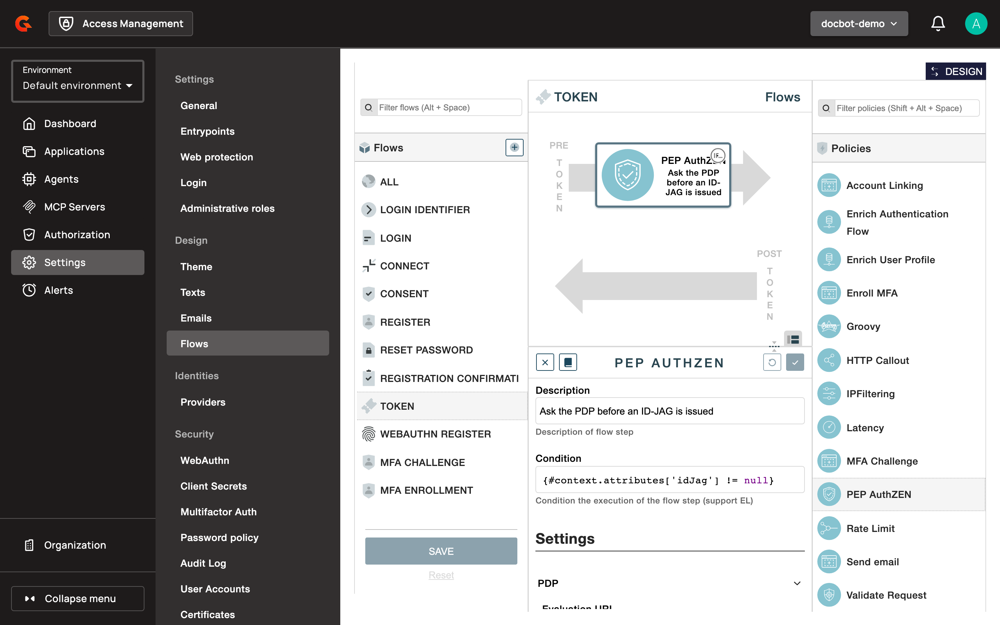

# PEP AuthZEN Policy

## Overview

The PEP AuthZEN policy asks an external policy decision point (PDP) whether AM may issue a token. During the token flow, the policy sends an access evaluation request to the PDP's [AuthZEN](https://openid.net/specs/authorization-api-1_0.html) API, and AM issues the token only when the PDP permits it.


The PEP AuthZEN policy is an [Enterprise Edition](../../../overview/open-source-vs-enterprise-am/README.md) policy plugin, available from AM 4.13.0. It's bundled with the AM Enterprise Edition distribution. It requires a license that contains the `enterprise-features` or the `enterprise` pack.


## Add the policy to the token flow

1. Log in to AM Console.
2. Select your security domain.
3. Click **Settings**.
4. In the **Design** section, click **Flows**.
5. Select the **TOKEN** flow.
6. Drag **PEP AuthZEN** from the **Policies** list to the **PRE** step of the flow, so the decision is made before AM issues the token.
7. Optionally, set a **Condition** that limits the policy to some requests. For example, `{#context.attributes['idJag'] != null}` applies it to [Cross App Access](../../auth-protocols/oauth-2.0/cross-app-access.md) requests only.
8. Fill in the policy settings, and then click the check mark to apply them.
9. Click **SAVE**.

<figure><figcaption><p>PEP AuthZEN policy in the TOKEN flow</p></figcaption></figure>

## Policy settings

| Setting | Description | Default |
| --- | --- | --- |
| **Evaluation URL** | Required. The full URL of the PDP's AuthZEN access evaluation API, starting with `http://` or `https://`. | None |
| **Authentication** | **AM OAuth client**: the policy gets an access token for a client of the security domain and sends it to the PDP as a bearer token. **None**: the policy sends no credentials. | **AM OAuth client** |
| **Client ID** | Shown for **AM OAuth client**. A client of the security domain with the **Client Credentials** grant flow. The policy requests the client's default scopes, and reuses the access token until 30 seconds before it expires. | None |
| **Subject type** | Required. The `type` of the subject. Supports Gravitee Expression Language. | `user` |
| **Subject ID** | Required. The `id` of the subject. Supports Gravitee Expression Language. When it's empty, the token is refused without calling the PDP. | `{#context.attributes['user'].id}` |
| **Resource type** | Required. The `type` of the resource. Supports Gravitee Expression Language. | `client` |
| **Resource ID** | Required. The `id` of the resource. Supports Gravitee Expression Language. | `{#context.attributes['client'].clientId}` |
| **Action name** | Required. The `name` of the action. Supports Gravitee Expression Language. | None |
| **Context** | Entries sent in the `context` of the request, each with a **Key** and a value that supports Gravitee Expression Language. | None |
| **Error message** | The error description returned when the PDP denies access. | `Access denied` |

For a Cross App Access request, `{#context.attributes['idJag']['audience']}` and `{#context.attributes['idJag']['resource']}` return the authorization server and the resource of the requested ID-JAG.

## How the policy decides

The policy sends a `POST` request with a JSON body to the **Evaluation URL**:

```json
{
  "subject": { "type": "user", "id": "c5413c3f-a7d2-4f8e-813c-3fa7d2df8e95" },
  "resource": { "type": "resource-server", "id": "https://calendar.partner.example/mcp" },
  "action": { "name": "id-jag-exchange" },
  "context": { "audience": "https://auth.partner.example" }
}
```

The PDP answers with a JSON object whose `decision` is `true` or `false`, and optionally a `context` object.

| PDP answer | Result |
| --- | --- |
| `decision` is `true`. | AM continues the token flow. The `context` of the answer is available to the next policies as `{#context.attributes['authzen.context']}`. |
| `decision` is `false`. | AM refuses the token request with HTTP 403, `invalid_grant`, and the **Error message** as `error_description`. |
| The PDP can't be reached, answers with a status outside the 2xx range, doesn't answer in time, which is 5 seconds by default, or returns no boolean `decision`. | AM refuses the token request with HTTP 503, `invalid_grant`, and `Authorization service unavailable`. |
| The policy can't get an access token for the **Client ID**, because the client doesn't exist or doesn't have the **Client Credentials** grant flow. | AM refuses the token request with HTTP 503, `invalid_grant`, and `Authorization service unavailable`. |

By default, the policy waits up to 10 seconds to connect to the PDP.

## Audit events

AM records the decision, and the `context` the PDP returned, in the audit event of the token request, whether the PDP permits or denies the request. The entry appears under `AUTHZEN`. See [Audit Trail](../../audit-trail.md).

## Verification

To verify the PEP AuthZEN policy is working as expected, follow these steps:

1. Configure the PDP to deny the subject of a test user.
2. Request a token for that user with a request that matches the policy's **Condition**.
3. Confirm that AM answers with HTTP 403, `invalid_grant`, and the **Error message**.
4. Configure the PDP to permit the subject, and request the token again. AM issues the token.
