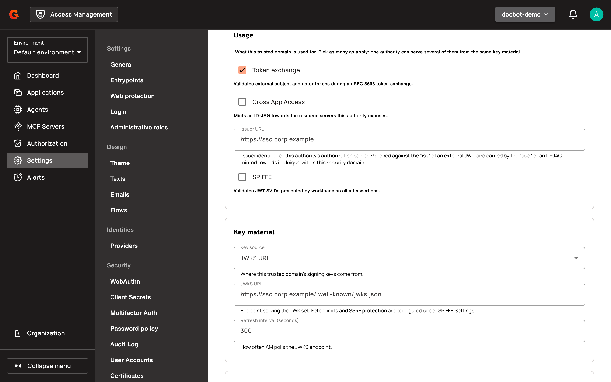
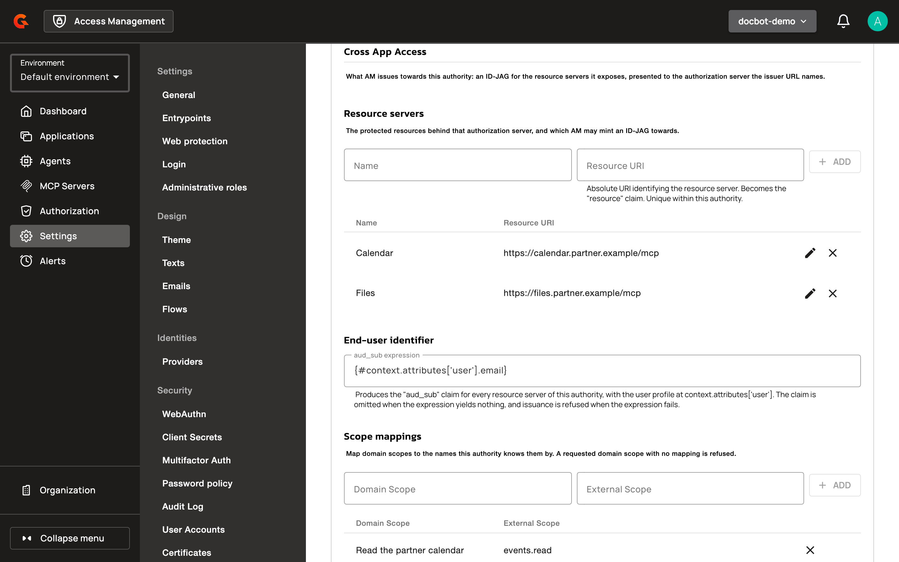
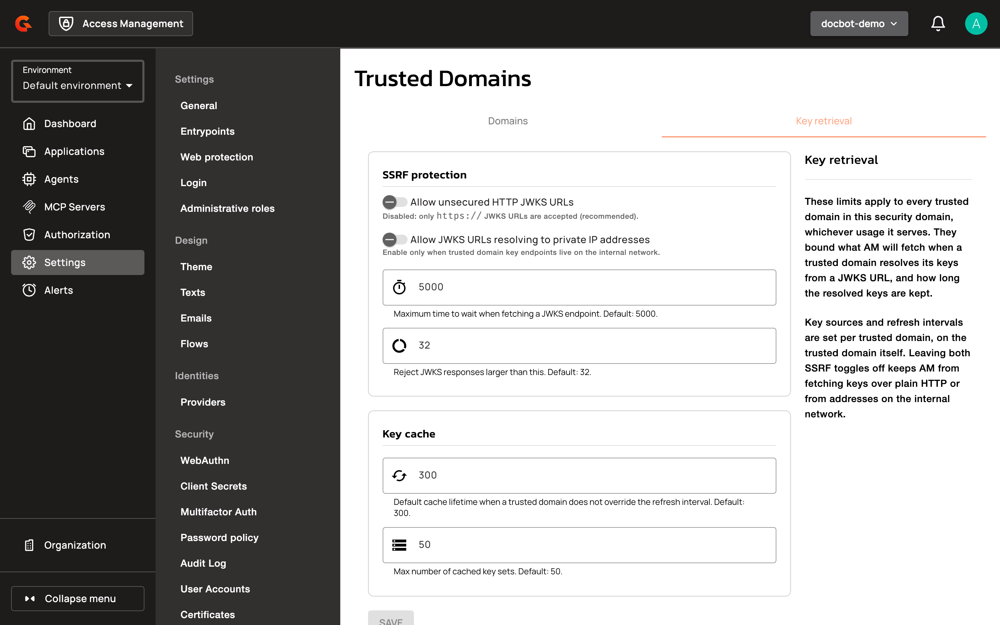
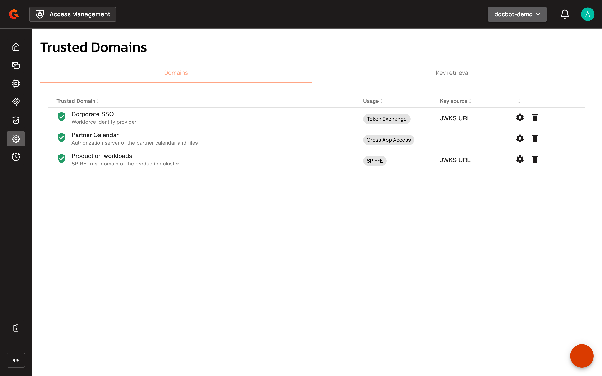

# Manage Trusted Domains

A trusted domain declares an outside authority that a security domain trusts, and what it trusts that authority for. Each trusted domain serves one or more usages:

* **Token exchange**: AM accepts JWTs signed by the authority as subject or actor tokens in an [OAuth 2.0 token exchange](oauth-2.0-token-exchange-concepts/README.md).
* **Cross App Access**: AM issues ID-JAGs toward the authority's authorization server. See [Cross App Access](auth-protocols/oauth-2.0/cross-app-access.md).
* **SPIFFE**: AM accepts JWT-SVIDs from the authority's workloads as client assertions. See [Configure SPIFFE and CIMD Settings](security-domains/configure-spiffe-and-cimd-settings.md).

One trusted domain can serve several usages from the same key material.


From AM 4.13, trusted domains replace the trusted issuers of the **Token Exchange** settings and the trust domains of the **Workload Identity** settings. When you upgrade, AM turns each trusted issuer into a trusted domain with the **Token exchange** usage, and keeps each trust domain as a trusted domain with the **SPIFFE** usage.


## Create a trusted domain

1. Log in to AM Console.
2. Select your security domain.
3. Click **Settings**.
4. In the **Security** section, click **Trusted Domains**.
5. On the **Domains** tab, click the plus icon.
6. Enter a **Name**, and optionally a **Description**.
7. Under **Usage**, select **Token exchange**, **Cross App Access**, **SPIFFE**, or several of them, and fill in the fields each usage shows.
8. Under **Key material**, select a **Key source** and fill in its field. The **Key material** section isn't shown when **Cross App Access** is the only usage.
9. Click **CREATE**.

<figure><figcaption><p>Usage and key material of a trusted domain</p></figcaption></figure>

| Field | Description |
| --- | --- |
| **Name** | The label of the trusted domain. Unique within the security domain, up to 255 characters. |
| **Issuer URL** | Shown for **Token exchange** and **Cross App Access**. The issuer identifier of the authority's authorization server. For token exchange, AM matches it against the `iss` claim of external JWTs. For Cross App Access, AM puts it in the `aud` claim of the ID-JAGs it issues, and it must be an absolute URI. Unique within the security domain, up to 512 characters. |
| **SPIFFE trust domain** | Shown for **SPIFFE**. Matched against the `sub` of a JWT-SVID, without the `spiffe://` scheme. Lowercase letters, digits, `.`, and `-` only. Unique within the security domain. |
| **Key source** | Where the authority's signing keys come from: **JWKS URL**, **JWK Set**, or **PEM Certificate**. Required for **Token exchange** and **SPIFFE**. |
| **JWKS URL** | The endpoint that serves the authority's JWK set. It must pass the [key retrieval settings](#limit-how-keys-are-fetched) when you save the trusted domain. |
| **Refresh interval (seconds)** | Shown for **JWKS URL**. How often AM fetches the keys again. 300 seconds by default. |
| **JWK set** | Shown for **JWK Set**. The authority's JWK set, pasted inline. |
| **PEM certificate** | Shown for **PEM Certificate**. A PEM-encoded X.509 certificate that holds the signing key. |

When you update a trusted domain, AM discards the keys it cached for it.

## Configure token exchange

The **Token exchange** section sets what AM accepts from the issuer during a token exchange. AM accepts the issuer's JWTs signed with `RS256`, `RS384`, `RS512`, `PS256`, `PS384`, `PS512`, `ES256`, `ES384`, or `ES512`, and rejects a JWT whose `iss` isn't the **Issuer URL** of a trusted domain with the **Token exchange** usage, with `invalid_request` and `Untrusted issuer: <iss>`.

* **Scope mappings** map an **External Scope** of the issuer to a **Domain Scope**. When the trusted domain has scope mappings, AM translates the scopes of the external token and drops each scope without a mapping. When it has none, AM keeps the external scopes as they are.
* **Enable User Binding** makes the exchanged token carry an existing user of the security domain, with their roles, groups, and profile. Each of the **User binding mappings** pairs a **User Attribute**, such as `emails.value`, with a **Claim / Expression** evaluated over the claims of the external token, such as `{#token['email']}`. Every mapping must match, and exactly one user must match them all. Otherwise, the exchange is rejected with `invalid_request`.

## Configure Cross App Access

The **Cross App Access** section sets what AM issues toward the authority: ID-JAGs for the resource servers behind its authorization server. See [Cross App Access](auth-protocols/oauth-2.0/cross-app-access.md) for the whole flow.

<figure><figcaption><p>Cross App Access settings of a trusted domain</p></figcaption></figure>

* **Resource servers**: each one has a **Name** and a **Resource URI**. The **Resource URI** is an absolute URI, unique within the trusted domain, and becomes the `resource` claim of the ID-JAG. At least one resource server is required. The edit icon changes a resource server in place, so the applications mapped to it keep their mapping. An application mapped to a resource server you remove shows it as **No longer available**.
* **End-user identifier**: the **`aud_sub` expression** produces the `aud_sub` claim of every ID-JAG issued toward this authority, with the user profile at `context.attributes['user']`, for example `{#context.attributes['user'].email}`. The claim is left out when the expression produces nothing, and the ID-JAG isn't issued when the expression fails or produces several values. Up to 512 characters.
* **Scope mappings**: each mapping pairs a **Domain Scope** with the **External Scope** name the authority knows it by. The ID-JAG carries the external names, and a requested domain scope without a mapping is refused.

When you clear **Cross App Access** and save, AM keeps the resource servers, the expression, and the scope mappings, and restores them when you select **Cross App Access** again.

## Configure SPIFFE

The **SPIFFE** usage adds the **SPIFFE trust domain** field and the **Signing algorithms** section. **Signing algorithms** overrides the **Default allowed signing algorithms** of the **SPIFFE Settings** for this trusted domain only. Leave it empty to use the default. `none` and the HMAC algorithms are always rejected.

## Limit how keys are fetched

The **Key retrieval** tab sets how AM fetches the keys of every trusted domain of the security domain that uses a **JWKS URL**, whichever usage it serves.

| Setting | Behavior |
| --- | --- |
| **Allow unsecured HTTP JWKS URLs** | Off by default: only `https://` JWKS URLs are accepted. |
| **Allow JWKS URLs resolving to private IP addresses** | Off by default: a JWKS URL whose host resolves to a private, loopback, or link-local address is refused, and so is a host that doesn't resolve when you save the trusted domain. |
| Fetch timeout | The longest AM waits for a JWKS endpoint. 5000 milliseconds by default. |
| Maximum response size | JWKS responses larger than this are rejected. 32 KB by default. |
| Cache lifetime | How long AM keeps the keys of a trusted domain that doesn't set a refresh interval. 300 seconds by default. |
| Maximum cached key sets | 50 by default. |

<figure><figcaption><p>Key retrieval settings</p></figcaption></figure>

AM checks a JWKS URL against these settings when you save the trusted domain, and again each time it fetches the keys.

## Manage trusted domains with the Management API

Trusted domains are also managed through the AM Management API:

* `GET` and `POST` on `/organizations/{organizationId}/environments/{environmentId}/domains/{domain}/trusted-domains` list and create trusted domains.
* `GET`, `PUT`, and `DELETE` on `/organizations/{organizationId}/environments/{environmentId}/domains/{domain}/trusted-domains/{trustedDomainId}` read, update, and delete one.

The `/trust-domains` endpoints of AM 4.12 are deprecated.

### Portal API

**Validate CIMD Document:**
```
POST /organizations/{organizationId}/environments/{environmentId}/domains/{domain}/cimd/validate
Content-Type: application/json

{
  "url": "https://agents.example.com/metadata/hotel-agent"
}
```

Response:
```json
{
  "url": "https://agents.example.com/metadata/hotel-agent",
  "hasInlineJwks": false,
  "missing": {
    "clientId": false,
    "clientName": false
  },
  "metadata": {
    "client_id": "https://agents.example.com/metadata/hotel-agent",
    "client_name": "Hotel Booking Agent",
    "redirect_uris": ["https://app.example.com/callback"],
    "grant_types": ["authorization_code", "client_credentials"],
    "response_types": ["code"],
    "token_endpoint_auth_method": "spiffe_jwt",
    "jwks_uri": "https://agents.example.com/jwks/hotel-agent",
    "scope": "openid profile email"
  }
}
```

**Create Application from CIMD:**
```
POST /organizations/{organizationId}/environments/{environmentId}/domains/{domain}/cimd/applications
Content-Type: application/json

{
  "cimdUrl": "https://agents.example.com/metadata/hotel-agent",
  "name": "Hotel Booking Agent",
  "clientName": "Hotel Booking Agent",
  "description": "AI agent for hotel reservations",
  "type": "SERVICE"
}
```

**Filter Applications by Type:**
```
GET /organizations/{organizationId}/environments/{environmentId}/domains/{domain}/applications?type=AGENT
GET /organizations/{organizationId}/environments/{environmentId}/domains/{domain}/applications?type=WEB&type=SERVICE
```

The `type` query parameter accepts multiple values. The `/applications` listing endpoint accepts a multi-valued `type` filter so the UI can request "AGENT only" or "everything except AGENT" in one call.

## Verification

To verify the trusted domain is set up as expected, follow these steps:

1. Click **Settings**.
2. In the **Security** section, click **Trusted Domains**.
3. On the **Domains** tab, find your trusted domain. The **Usage** column shows its usage, or the number of usages when it serves several, and the **Key source** column shows where its keys come from.

<figure><figcaption><p>Trusted domains list</p></figcaption></figure>

## Restrictions

- A JWKS URL that resolves to a private, loopback, or link-local IP address is refused unless **Allow JWKS URLs resolving to private IP addresses** is on in the **Key retrieval** tab.
- An unsecured HTTP JWKS URL is refused unless **Allow unsecured HTTP JWKS URLs** is on in the **Key retrieval** tab.
- The SPIRE local-stack overlay (`docker-compose.spire.yml`) is for development only. Production deployments must use a production-grade SPIRE deployment with TLS-secured OIDC discovery.

## Related Changes

- The **Agents** section appears as a new top-level navigation entry in the management console, separate from the **Applications** list.
- The Applications list now excludes agent applications by default.
