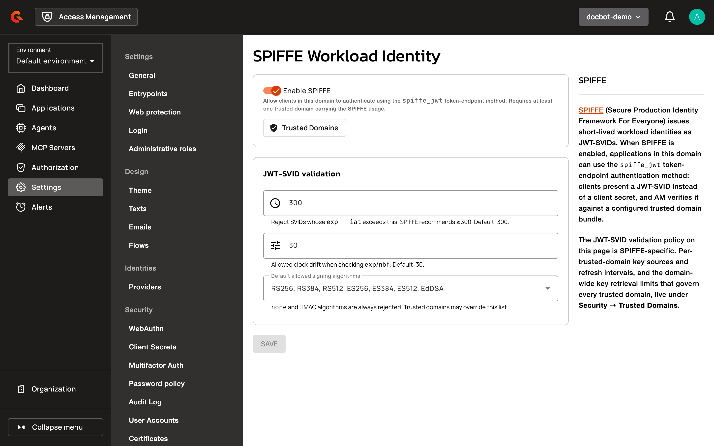
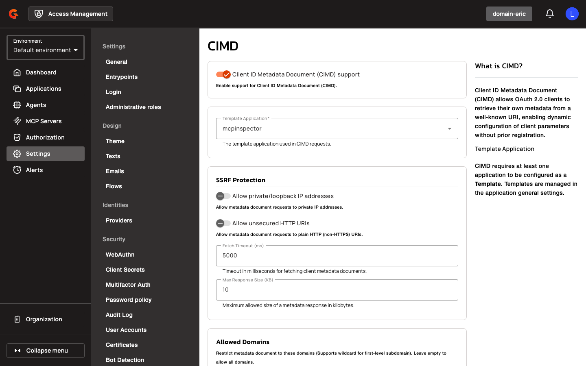

# Configure SPIFFE and CIMD Settings

SPIFFE and CIMD are configured **per security domain**, not via `gravitee.yml` or environment variables. Both are stored on the domain's OIDC settings (`oidc.workloadIdentitySettings` for SPIFFE, `oidc.cimdSettings` for CIMD) and can be set from the AM Console or through the domain management API.

## SPIFFE Settings

Configure SPIFFE JWT-SVID authentication at the domain level:

1. Click **Settings**.
2. In the **Workload Identity** section, click **SPIFFE Settings**.
3. Turn on **Enable SPIFFE** to allow clients in this domain to authenticate using the `spiffe_jwt` token-endpoint method. The security domain also needs at least one trusted domain with the **SPIFFE** usage. See [Manage Trusted Domains](../manage-spiffe-trust-domains.md).
4. Under **JWT-SVID validation**, set the maximum SVID lifetime, the clock skew tolerance, and the **Default allowed signing algorithms**.
5. Click **SAVE**.

    <figure><figcaption></figcaption></figure>

These settings live under `oidc.workloadIdentitySettings` on the domain. To set them via the management API, send a domain update:

```
PUT /organizations/{organizationId}/environments/{environmentId}/domains/{domain}
Content-Type: application/json

{
  "oidc": {
    "workloadIdentitySettings": {
      "enabled": true,
      "defaultAllowedAlgorithms": ["RS256", "ES256"],
      "clockSkewSeconds": 30,
      "maxJwtLifetimeSeconds": 300
    }
  }
}
```

| Field | Description | Example |
|:------|:------------|:--------|
| `enabled` | Enables SPIFFE JWT-SVID authentication for the domain | `true` |
| `defaultAllowedAlgorithms` | Default signing algorithms accepted for SPIFFE JWTs | `["RS256", "ES256"]` |
| `clockSkewSeconds` | Allowed clock skew for JWT validation | `30` |
| `maxJwtLifetimeSeconds` | Maximum allowed JWT lifetime | `300` |

From AM 4.13, the JWKS fetch limits and the SSRF toggles apply to every trusted domain of the security domain, whichever usage it serves. You set them on the **Key retrieval** tab of the **Trusted Domains** page. See [Limit how keys are fetched](../manage-spiffe-trust-domains.md#limit-how-keys-are-fetched). AM still accepts `allowPrivateIpAddress`, `allowUnsecuredHttpUri`, `fetchTimeoutMs`, `maxResponseSizeKb`, `cacheTtlSeconds`, and `cacheMaxEntries` in `oidc.workloadIdentitySettings`. It moves them to the key retrieval settings of the domain.

## CIMD Settings

Configure CIMD application creation at the domain level:

1. Navigate to **Settings > Security** in the domain sidebar.
2. Scroll to the **CIMD** section.
3. Toggle **Client ID Metadata Document (CIMD) support** to enable CIMD for the domain.
4. Set which template should be used as the base client settings for each client which accesses via CIMD

    <figure><figcaption></figcaption></figure>

These settings live under `oidc.cimdSettings` on the domain:

```
PUT /organizations/{organizationId}/environments/{environmentId}/domains/{domain}
Content-Type: application/json

{
  "oidc": {
    "cimdSettings": {
      "enabled": true,
      "allowedDomains": ["agents.example.com"],
      "allowPrivateIpAddress": false,
      "allowUnsecuredHttpUri": false,
      "fetchTimeoutMs": 10000,
      "maxResponseSizeKb": 512,
      "cacheTtlSeconds": 3600,
      "cacheMaxEntries": 100,
      "templateId": null,
      "revokeOnDocumentChange": false
    }
  }
}
```

| Field | Description | Example |
|:------|:------------|:--------|
| `enabled` | Enables CIMD support for the domain | `true` |
| `allowedDomains` | Whitelist of allowed domains for CIMD URLs | `["agents.example.com"]` |
| `allowPrivateIpAddress` | Whether CIMD URLs may resolve to private IP addresses | `false` |
| `allowUnsecuredHttpUri` | Whether unsecured HTTP CIMD URLs are permitted | `false` |
| `fetchTimeoutMs` | HTTP timeout for fetching the metadata document | `10000` |
| `maxResponseSizeKb` | Maximum metadata document response size | `512` |
| `cacheTtlSeconds` | TTL for cached metadata documents | `3600` |
| `cacheMaxEntries` | Maximum number of cached metadata documents | `100` |
| `templateId` | Application ID used as the registration template for CIMD clients | `null` |
| `revokeOnDocumentChange` | Whether to revoke the client when the source document changes | `false` |
