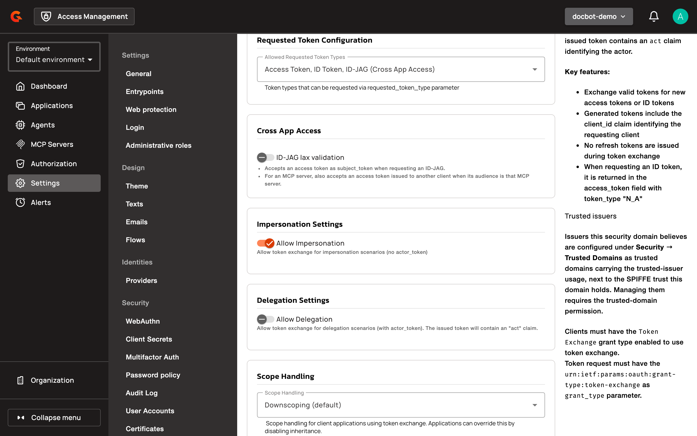
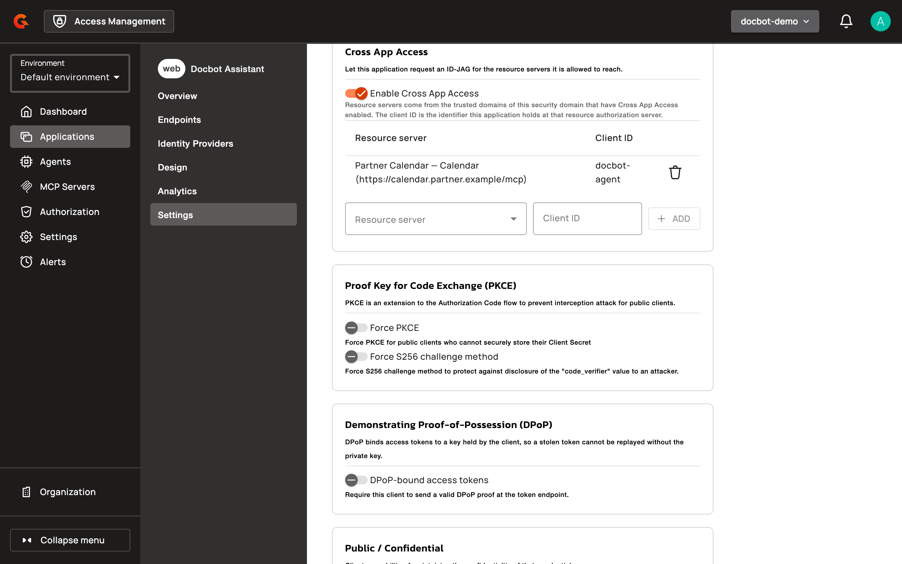
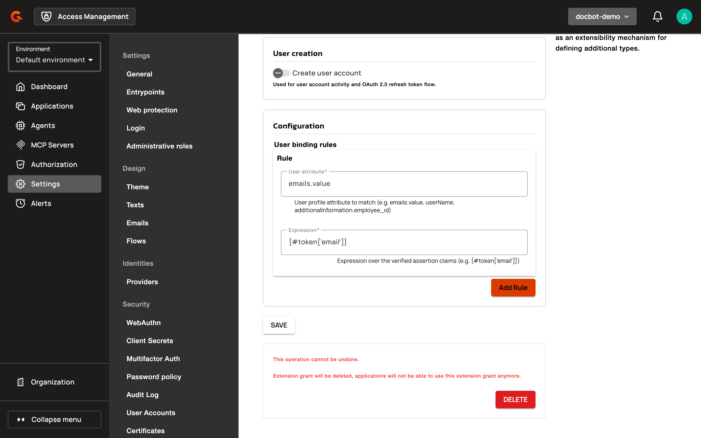

# Cross App Access

Cross App Access lets an application get an access token for another application's API on behalf of a user who signed in through your identity provider. The user doesn't sign in again. AM implements it with the identity assertion JWT authorization grant (ID-JAG) defined in [draft-ietf-oauth-identity-assertion-authz-grant](https://datatracker.ietf.org/doc/draft-ietf-oauth-identity-assertion-authz-grant/).


Cross App Access is available from AM 4.13.0.


## How it works

1. The user signs in to an application with the identity provider, and the application receives an ID token.
2. The application exchanges the ID token at the identity provider for an ID-JAG. The ID-JAG names the authorization server of the other application, the resource authorization server, and the resource the application wants to reach.
3. The application presents the ID-JAG to the resource authorization server with the JWT bearer grant type, and receives an access token for that resource.

A security domain can play either role, or both:

* As the identity provider, it issues ID-JAGs to its applications through OAuth 2.0 token exchange. See [Issue ID-JAGs](#issue-id-jags).
* As the resource authorization server, it redeems ID-JAGs from an identity provider it trusts and issues access tokens for its MCP servers. See [Redeem ID-JAGs](#redeem-id-jags).

## Issue ID-JAGs

To issue ID-JAGs, the security domain needs token exchange, a trusted domain that describes the resource authorization server, and an application allowed to reach that server.

### Prerequisites

* Token exchange is turned on for the security domain. See [OAuth 2.0 Token Exchange Configuration](../../oauth-2.0-token-exchange-concepts/oauth-2.0-token-exchange-configuration-reference.md).
* You know the issuer identifier of the resource authorization server, the URI of each resource behind it, and the client ID that your application holds at that authorization server.

### Allow the ID-JAG requested token type

1. Log in to AM Console.
2. Select your security domain.
3. Click **Settings**.
4. In the **OAuth 2.0** section, click **Token Exchange**.
5. In **Allowed Requested Token Types**, select **ID-JAG (Cross App Access)**.
6. Click **SAVE**.

<figure><figcaption><p>ID-JAG allowed as a requested token type</p></figcaption></figure>

Once the ID-JAG requested token type is allowed, the OpenID discovery document of the security domain lists `urn:ietf:params:oauth:token-type:id-jag` in `identity_chaining_requested_token_types_supported`.

By default, the subject token of an ID-JAG request must be an ID token. Turn on **ID-JAG lax validation** in the **Cross App Access** section to also accept an access token that was issued to the requesting application. When an MCP server requests the ID-JAG, lax validation also accepts an access token issued to another client whose audience is that MCP server.

### Register the resource authorization server

Create a trusted domain with the **Cross App Access** usage. Its **Issuer URL** is the issuer identifier of the resource authorization server. AM puts it in the `aud` claim of every ID-JAG it issues toward that server, and the requesting application sends it as the `audience` parameter. The trusted domain also lists the resource servers behind that authorization server. It maps your domain scopes to the scope names that the authorization server knows. See [Configure Cross App Access](../../manage-trusted-domains.md#configure-cross-app-access).

### Configure the application

1. Click **Applications**.
2. Select your application.
3. Click **Settings**.
4. Click **OAuth 2.0 / OIDC**.
5. On the **Grant Flows** tab, select **Token Exchange**.
6. In the **Cross App Access** section, turn on **Enable Cross App Access**.
7. Select a **Resource server**, enter the **Client ID** that the application holds at the resource authorization server, and then click **ADD**. Repeat for each resource server the application can reach.
8. Click **SAVE**.

<figure><figcaption><p>Cross App Access on the application</p></figcaption></figure>

The **Cross App Access** section stays unavailable until these conditions are true:

* The application has the **Token Exchange** grant flow.
* Token exchange is turned on for the security domain.
* The security domain allows the **ID-JAG (Cross App Access)** requested token type.

Until then, the section shows **Token Exchange grant flow required** or **ID-JAG requested token type required in domain Token Exchange settings**.

On the **Tokens & User Profile** tab:

* Under **Tokens TTL (seconds)**, the **ID-JAG** field sets the lifetime of an ID-JAG. By default, an ID-JAG is valid for 300 seconds, and it never outlives the subject token it was exchanged for.
* A custom claim with the **ID_JAG** token type is added to every ID-JAG the application receives. AM ignores custom claims named `iss`, `aud`, `client_id`, `jti`, `exp`, `iat`, or `cnf`.

### Request an ID-JAG

The application calls the token endpoint of the security domain with a token exchange request:

```bash
curl -X POST https://auth.example.com/your-domain/oauth/token \
  -u "client_id:client_secret" \
  -H "Content-Type: application/x-www-form-urlencoded" \
  -d "grant_type=urn:ietf:params:oauth:grant-type:token-exchange" \
  -d "subject_token=eyJhbGciOi..." \
  -d "subject_token_type=urn:ietf:params:oauth:token-type:id_token" \
  -d "requested_token_type=urn:ietf:params:oauth:token-type:id-jag" \
  -d "audience=https://auth.partner.example" \
  -d "resource=https://calendar.partner.example/mcp"
```

| Parameter | Description |
| --- | --- |
| `subject_token` | An ID token issued to the requesting application. Its `aud` claim must contain the application's client ID. |
| `subject_token_type` | `urn:ietf:params:oauth:token-type:id_token`. With **ID-JAG lax validation**, `urn:ietf:params:oauth:token-type:access_token` is also accepted. |
| `requested_token_type` | `urn:ietf:params:oauth:token-type:id-jag` |
| `audience` | Required, once. The **Issuer URL** of a trusted domain with the **Cross App Access** usage. |
| `resource` | Optional, at most once. The **Resource URI** of a resource server of that trusted domain that the application is mapped to. Required when the application is mapped to several resource servers of the trusted domain. |
| `scope` | Optional. Domain scopes, each with a scope mapping on the trusted domain. When the parameter is omitted, the ID-JAG carries every scope the trusted domain maps. |

The response carries the ID-JAG in the `access_token` field and never includes a refresh token:

```json
{
  "access_token": "eyJraWQiOi...",
  "token_type": "N_A",
  "expires_in": 300,
  "issued_token_type": "urn:ietf:params:oauth:token-type:id-jag",
  "scope": "events.read"
}
```

The ID-JAG is a signed JWT whose `typ` header is `oauth-id-jag+jwt`. Its claims are:

| Claim | Value |
| --- | --- |
| `iss` | The issuer of the security domain. |
| `sub` | The user the subject token was issued for. |
| `aud` | The **Issuer URL** of the trusted domain. |
| `client_id` | The client ID that the application holds at the resource authorization server, as mapped in its **Cross App Access** section. |
| `resource` | The **Resource URI** of the resource server. |
| `scope` | The granted scopes, under the names the trusted domain maps them to. |
| `aud_sub` | The result of the trusted domain's `aud_sub` expression, when the expression is set and doesn't produce an empty value. |
| `iat`, `exp`, `jti` | The issue time, the expiration time, and a unique identifier. |
| `act` | The actor, when the request is a delegation that carries an `actor_token`. |
| `cnf` | The `jkt` thumbprint of the proof key, when the request carries a DPoP proof. |

The ID-JAG also carries the custom claims of the **ID_JAG** token type. A custom claim named `aud_sub` takes the place of the trusted domain's `aud_sub` expression.

### Use the ID-JAG target in policies and claims

For an ID-JAG request, the execution context of the TOKEN flow and of the custom claims holds an `idJag` attribute with the `audience`, the `resource`, and the `clientId` of the ID-JAG, whether the application sent `resource` or AM inferred it. For example, `{#context.attributes['idJag']['resource']}` returns the resource, and the condition `{#context.attributes['idJag'] != null}` limits a policy to ID-JAG requests. See [Flows](../../flows/README.md).

### Bind an ID-JAG to a DPoP key

When the token exchange request carries a valid `DPoP` proof header, AM binds the ID-JAG to the proof key with the `cnf.jkt` claim. When AM redeems a bound ID-JAG, it requires a DPoP proof signed with the same key. See [Demonstrating Proof of Possession (DPoP)](demonstrating-proof-of-possession-dpop.md) for the proof requirements.

## Redeem ID-JAGs

To redeem ID-JAGs, the security domain trusts the identity provider that issues them, runs the Cross App Access extension grant, and protects the target resource.

### Prerequisites

* The Cross App Access extension grant is an Enterprise Edition plugin. It's bundled with the AM Enterprise Edition distribution and requires a license that contains the `enterprise-features` or the `enterprise` pack.
* The identity provider publishes an OpenID discovery document that declares its `issuer` and its `jwks_uri`, and AM can reach both.
* The resource that the ID-JAGs name is the **MCP Resource Identifier** of an MCP server of the security domain, and the scopes of the ID-JAGs are scopes of that MCP server's tools. See [Create an MCP Server](../../mcp-servers/create-an-mcp-server.md).

### Trust the identity provider

1. Click **Settings**.
2. In the **Identities** section, click **Providers**.
3. Click the plus icon.
4. Select **OpenID**, and then click **Next**.
5. Enter a **Name**, the **Client ID** and the **Client Secret** that AM holds at the identity provider, and set **Well-Known Endpoint** to the URL of the identity provider's OpenID discovery document.
6. Click **Create**.

AM trusts the ID-JAGs whose `iss` claim equals the `issuer` of that discovery document, and verifies their signature with the keys published at its `jwks_uri`. An issuer is trusted through one identity provider only: when several identity providers of the security domain declare the same issuer, redemption fails.

### Create the Cross App Access extension grant

1. Click **Settings**.
2. In the **OAuth 2.0** section, click **Extension Grants**.
3. Click the plus icon.
4. Select **Cross App Access**, and then click **Next**.
5. Enter a **Name**, and then click **Create**.
6. Open the new extension grant to set how AM finds the user of an ID-JAG.

<figure><figcaption><p>Cross App Access extension grant</p></figcaption></figure>

AM issues the access token to a user of the security domain:

* When **Create user account** is off, the user must already exist. When the extension grant has **User binding rules**, AM looks for the user whose **User attribute** equals the value of each rule's **Expression**, evaluated over the claims of the ID-JAG as `token`, for example `{#token['email']}`. Every rule must match, and exactly one user must match them all. Without rules, AM looks for the user whose external ID is the `sub` of the ID-JAG and who comes from the identity provider that trusts the issuer.
* When **Create user account** is on, AM creates or updates the user from the `sub`, `preferred_username`, and `email` claims of the ID-JAG, as a user of the identity provider that trusts the issuer.

### Configure the application

The `client_id` claim of an ID-JAG names the application that may redeem it.

1. Click **Applications**.
2. Select the application whose client ID the identity provider puts in the ID-JAGs.
3. Click **Settings**.
4. Click **OAuth 2.0 / OIDC**.
5. On the **Grant Flows** tab, select your Cross App Access extension grant by its name.
6. On the **Scopes** tab, add the scopes that the ID-JAGs carry.
7. Click **SAVE**.

### Redeem an ID-JAG

The application calls the token endpoint of the security domain with the JWT bearer grant type:

```bash
curl -X POST https://auth.example.com/your-domain/oauth/token \
  -u "client_id:client_secret" \
  -H "Content-Type: application/x-www-form-urlencoded" \
  -d "grant_type=urn:ietf:params:oauth:grant-type:jwt-bearer" \
  -d "assertion=eyJ0eXAiOiJvYXV0aC1pZC1qYWcrand0Ii..."
```

The request can also carry `scope`, a subset of the ID-JAG scopes, and `resource`, which must equal the `resource` of the ID-JAG. Without `scope`, the access token gets every scope of the ID-JAG.

```json
{
  "access_token": "eyJraWQiOi...",
  "token_type": "bearer",
  "expires_in": 7199,
  "scope": "events.read",
  "resource": "https://calendar.partner.example/mcp"
}
```

The `aud` claim of the access token is the resource. The response never includes a refresh token. When the ID-JAG is bound to a DPoP key, the request must carry a DPoP proof of that key, and the access token is bound to the same key.


AM doesn't keep track of the ID-JAGs it has redeemed: an ID-JAG can be redeemed again until it expires. Keep the ID-JAG lifetime short on the identity provider, or bind ID-JAGs to a DPoP key. AM doesn't process an `authorization_details` claim in an ID-JAG.


## Errors

All the errors below are returned with HTTP 400, as a JSON body with `error` and `error_description`.

### When an ID-JAG is issued

| Condition | `error` | `error_description` |
| --- | --- | --- |
| The application doesn't have Cross App Access enabled. | `unauthorized_client` | `Cross App Access is not enabled for this application` |
| The security domain doesn't allow the ID-JAG requested token type. | `invalid_request` | `requested_token_type not allowed: urn:ietf:params:oauth:token-type:id-jag` |
| `subject_token_type` isn't the ID token type, and lax validation is off. | `invalid_request` | `subject_token_type must be id_token when requesting an ID-JAG` |
| `subject_token_type` is neither the ID token nor the access token type, and lax validation is on. | `invalid_request` | `subject_token_type must be id_token or access_token when requesting an ID-JAG` |
| The subject token isn't of the declared type. | `invalid_request` | `The presented token is not of type urn:ietf:params:oauth:token-type:id_token` |
| The subject token wasn't issued to the requesting application. | `invalid_request` | `subject_token was not issued to this client` |
| `audience` is missing. | `invalid_request` | `Missing required parameter: audience` |
| `audience` is sent more than once. | `invalid_request` | `audience must not be provided more than once` |
| No trusted domain with Cross App Access has `audience` as its **Issuer URL**. | `invalid_target` | `No resource authorization server is configured for audience: <audience>` |
| The application isn't mapped to any resource server of that trusted domain. | `invalid_target` | `This application is not configured for audience: <audience>` |
| `resource` is missing, and the application is mapped to several resource servers of the trusted domain. | `invalid_request` | `Missing required parameter: resource (several resource servers are configured for audience: <audience>)` |
| `resource` isn't a resource server the application is mapped to. | `invalid_target` | `Resource <resource> is not reachable behind audience: <audience>` |
| `resource` is sent more than once. | `invalid_request` | `resource must not be provided more than once` |
| A requested scope has no scope mapping on the trusted domain. | `invalid_scope` | `Scope has no mapping at audience <audience>: <scope>` |
| The `aud_sub` expression fails. | `invalid_grant` | `The aud_sub mapping could not be evaluated for audience: <audience>` |
| The `aud_sub` expression produces several values. | `invalid_grant` | `The aud_sub mapping did not produce a single value for audience: <audience>` |

### When an ID-JAG is redeemed

| Condition | `error` | `error_description` |
| --- | --- | --- |
| The assertion isn't an ID-JAG, because its `typ` header isn't `oauth-id-jag+jwt`, and no other extension grant of the application accepts it. | `unsupported_grant_type` | `Unsupported grant type: urn:ietf:params:oauth:grant-type:jwt-bearer` |
| No identity provider of the security domain declares the issuer of the ID-JAG. | `invalid_grant` | `Assertion issuer is not trusted` |
| Several identity providers declare the issuer. | `invalid_grant` | `Assertion issuer is claimed by several identity providers` |
| The signature, the signing algorithm, the expiration, or a required claim of the ID-JAG is invalid. AM accepts `RS256`, `RS384`, `RS512`, `PS256`, `PS384`, `PS512`, `ES256`, `ES384`, and `ES512`, and requires `sub`, `aud`, `client_id`, `exp`, `iat`, and `jti`. | `invalid_grant` | `Assertion verification failed` |
| The ID-JAG was issued by this security domain. | `invalid_grant` | `Assertion was issued by this domain` |
| The `aud` of the ID-JAG names something other than this security domain alone. | `invalid_grant` | `Assertion audience must name only this domain` |
| The `client_id` of the ID-JAG isn't the client ID of the requesting application. | `invalid_grant` | `Assertion client_id does not match the authenticated client` |
| Neither the ID-JAG nor the request names a resource. | `invalid_target` | `Neither the assertion nor the request names a resource` |
| The request's `resource` isn't a protected resource of the security domain. | `invalid_target` | `The requested resource is not recognized by this authorization server.` |
| The request's `resource` differs from the resource of the ID-JAG. | `invalid_target` | `Requested resource does not match the assertion resource` |
| The resource of the ID-JAG isn't the **MCP Resource Identifier** of an MCP server of the security domain. | `invalid_target` | `Resource is not a protected resource of this domain` |
| A scope of the ID-JAG isn't a scope of the MCP server's tools. | `invalid_scope` | `Assertion scope is not defined by the resource's MCP tools` |
| A scope of the ID-JAG isn't a scope of the application. | `invalid_scope` | `Assertion scope is not permitted for the application` |
| The request's `scope` asks for a scope the ID-JAG doesn't carry. | `invalid_scope` | `Requested scope exceeds the assertion scopes` |
| The ID-JAG is bound to a DPoP key, and the request has no DPoP proof. | `invalid_grant` | `Proof of possession required for this authorization grant` |
| The ID-JAG is bound to a DPoP key, and the proof is signed with another key. | `invalid_grant` | `Proof of possession key does not match the authorization grant` |
| No user matches the user binding rules. | `invalid_grant` | `No user matches the binding rules` |
| Several users match the user binding rules. | `invalid_grant` | `Several users match the binding rules` |
| The user binding rules can't be evaluated against the claims of the ID-JAG. | `invalid_grant` | `Binding rules cannot be evaluated against the assertion` |
| The extension grant has no user binding rules, and no user matches the `sub` of the ID-JAG. | `invalid_grant` | `No user matches the assertion subject` |

## Audit events

AM records a `TOKEN_CREATED` audit event for each ID-JAG it issues. The event holds the `jti` of the ID-JAG under `ID_JAG`, and its parameters include the `AUDIENCE` and the `RESOURCE` of the ID-JAG. A redemption is recorded as a `TOKEN_CREATED` event of the access token. See [Audit Trail](../../audit-trail.md).

## Verification

To verify Cross App Access is working as expected, follow these steps:

1. Request an ID-JAG from the identity provider as shown in [Request an ID-JAG](#request-an-id-jag). The response has `issued_token_type` set to `urn:ietf:params:oauth:token-type:id-jag`.
2. Decode the ID-JAG. Its `typ` header is `oauth-id-jag+jwt`, its `aud` claim is the **Issuer URL** of the trusted domain, and its `client_id` claim is the client ID mapped on the application.
3. Redeem the ID-JAG at the resource authorization server as shown in [Redeem an ID-JAG](#redeem-an-id-jag). The response carries an access token and the `resource` it was issued for.
