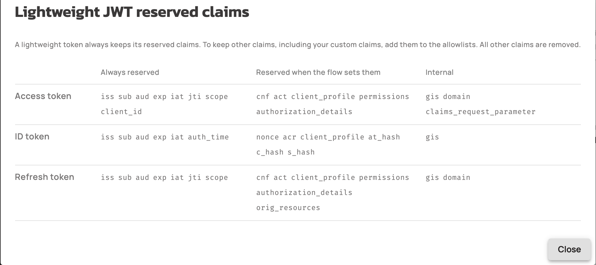
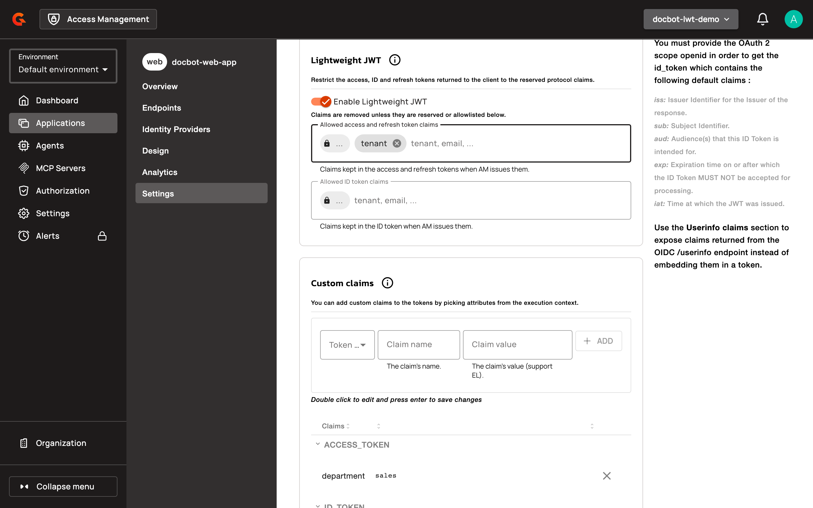
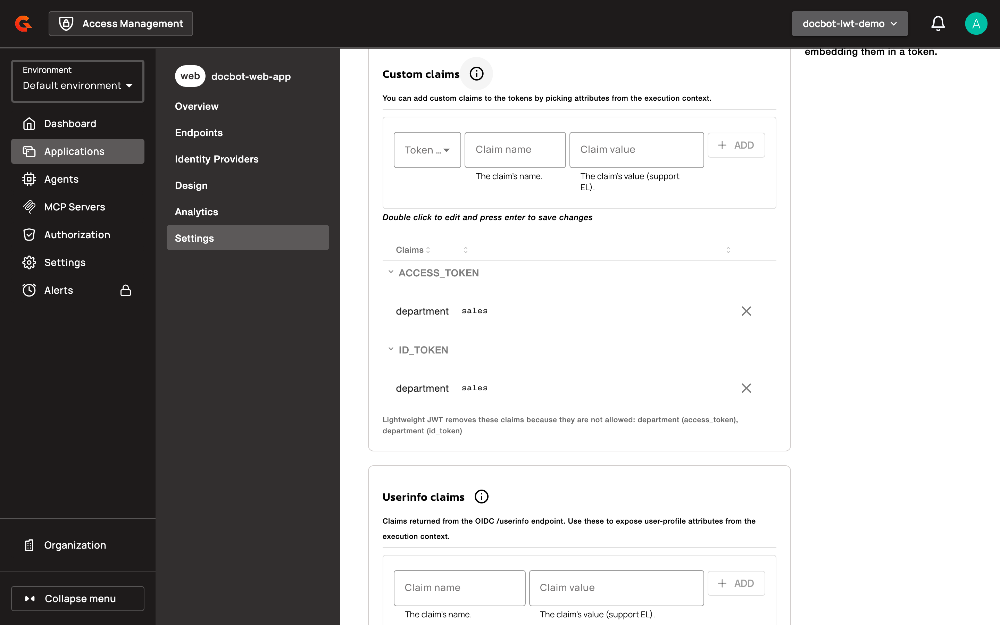

# Configure Lightweight JWT

Lightweight JWT restricts the access, refresh, and ID tokens that an application receives to the reserved protocol claims, plus the claims you choose to keep. A resource server or an API gateway that needs the full claim set gets it from the introspection endpoint. The UserInfo endpoint keeps returning the user claims for the granted scopes.


Lightweight JWT is available from AM 4.14.0. It's off by default, and you turn it on per application.


## How it works

When **Enable Lightweight JWT** is on for an application:

* Every access token, refresh token, and ID token that AM issues to the application keeps only the [reserved claims](#reserved-claims) of its token type and the claims on the matching allowlist. AM removes every other claim, such as the user profile claims of the ID token and the custom claims of the application.
* The introspection endpoint returns the full claim set of a lightweight access token or refresh token: the claims the token carries, plus the claims that AM removed from it.
* The UserInfo endpoint returns the user claims for the granted scopes, as it does for a full access token.
* Every grant issues lightweight tokens, including the refresh token grant and token exchange.

## Reserved claims

Reserved claims are the protocol claims that a lightweight token always keeps, and an allowlist can't remove them. Some are present only when the flow sets them, and some are internal to AM. In AM Console, the lock chip at the start of each allowlist expands to the reserved claims of that list. The **Lightweight JWT reserved claims** dialog, which opens from the info icon next to the **Lightweight JWT** heading, lists them per token type.

| Token | Always reserved | Reserved when the flow sets them | Internal |
| --- | --- | --- | --- |
| Access token | `iss`, `sub`, `aud`, `exp`, `iat`, `jti`, `scope`, `client_id` | `cnf`, `act`, `client_profile`, `permissions`, `authorization_details` | `gis`, `domain`, `claims_request_parameter` |
| ID token | `iss`, `sub`, `aud`, `exp`, `iat`, `auth_time` | `nonce`, `acr`, `client_profile`, `at_hash`, `c_hash`, `s_hash` | `gis` |
| Refresh token | `iss`, `sub`, `aud`, `exp`, `iat`, `jti`, `scope` | `cnf`, `act`, `client_profile`, `permissions`, `authorization_details`, `orig_resources` | `gis`, `domain` |

<figure><figcaption><p>The Lightweight JWT reserved claims dialog</p></figcaption></figure>

## Turn on Lightweight JWT for an application

To turn the setting on in AM Console:

1. Log in to AM Console.
2. Select your security domain.
3. Click **Applications**.
4. Select your application.
5. Click **Settings**.
6. Click **OAuth 2.0 / OIDC**.
7. Click the **Tokens & User Profile** tab.
8. In the **Lightweight JWT** section, turn on **Enable Lightweight JWT**.
9. Optional: In **Allowed access and refresh token claims**, type the name of a claim to keep in the access and refresh tokens, and press Enter. Repeat for each claim.
10. Optional: In **Allowed ID token claims**, type the name of a claim to keep in the ID token, and press Enter. Repeat for each claim.
11. Click **SAVE**.

<figure><figcaption><p>Lightweight JWT turned on for an application</p></figcaption></figure>

The allowlists follow these rules:

* An allowlist keeps a claim, it never adds one. A listed claim is in the token only when AM issues that claim for that token.
* The two allowlists are independent. **Allowed access and refresh token claims** applies to the access token and the refresh token, and **Allowed ID token claims** applies to the ID token.
* Adding a reserved claim has no effect. AM Console refuses the name and tells you that the claim is always kept.
* A name isn't empty, is at most 128 characters long, and has no spaces around it, no control characters, and no duplicate on the same allowlist. AM Console trims the spaces and refuses a duplicate or a name that's too long. The AM Management API rejects a request that breaks one of these rules with HTTP 400 and the `invalid_client_metadata` error code.
* A custom claim that you configured for the access token or the ID token is removed too, unless its name is on the matching allowlist. The **Custom claims** section lists the custom claims that the tokens no longer carry.
* Turning **Enable Lightweight JWT** off in AM Console keeps the allowlists for the next time you turn it on.

To turn the setting on with the AM Management API, patch the application:

```json
PATCH /organizations/{organizationId}/environments/{environmentId}/domains/{domain}/applications/{application}
Content-Type: application/json

{
  "settings": {
    "oauth": {
      "lightweightJwtSettings": {
        "enabled": true,
        "allowedAccessTokenClaims": ["tenant"],
        "allowedIdTokenClaims": []
      }
    }
  }
}
```

A client that registers through [dynamic client registration](../openid-connect.md#dynamic-client-registration) can't set Lightweight JWT, because the setting isn't part of the registration metadata. A registration update keeps the value that was set in AM Console or through the AM Management API.

The **Lightweight JWT** section is available on applications only. The **Tokens** tab of an MCP server doesn't have it.

## Token exchange

When the application exchanges tokens, AM reads the subject token and the actor token as the client presents them. A custom claim expression such as `{#context.attributes['token_exchange']['subject']['subject_token_claims']['department']}` reads the claims that the presented token carries. A claim that Lightweight JWT removed from a lightweight subject token or actor token isn't available to it. The tokens that the exchange issues follow the application's Lightweight JWT settings.

## Verification

To verify Lightweight JWT is working as expected, follow these steps:

1. Request an access token for the application, for example as described in [Set Up Your First Application](../../../getting-started/tutorial-getting-started-with-am/set-up-your-first-application.md).
2. Decode the access token. It carries the reserved claims and the claims on the **Allowed access and refresh token claims** list only.
3. Send the access token to the [introspection endpoint](README.md#introspection-endpoint). The response carries the claims that the token doesn't.
4. In AM Console, open the **Tokens & User Profile** tab of the application and scroll to the **Custom claims** section. When a custom claim is missing from an allowlist, the section shows **Lightweight JWT removes these claims because they are not allowed**, followed by the name and the token type of each claim.

<figure><figcaption><p>Custom claims that the lightweight tokens no longer carry</p></figcaption></figure>
