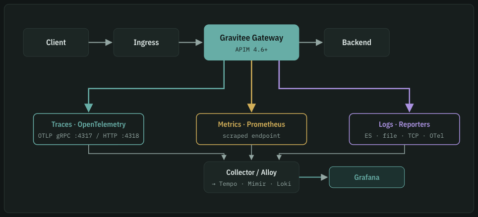
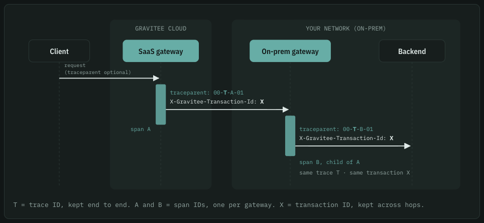
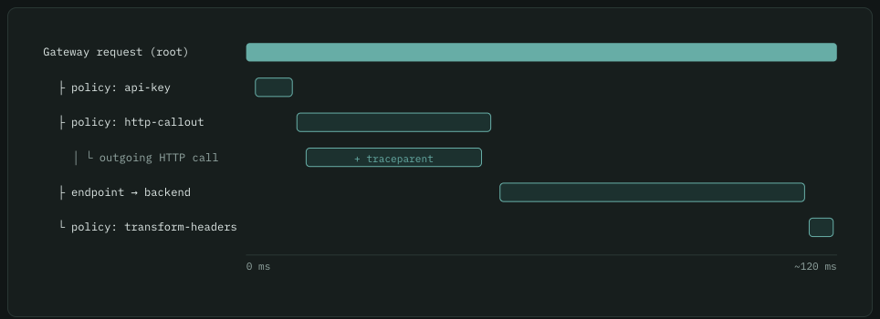
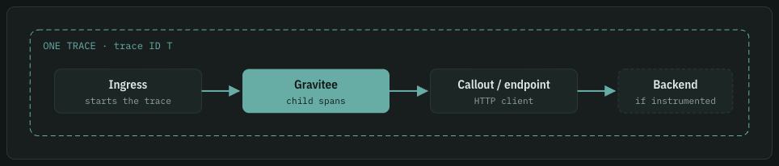
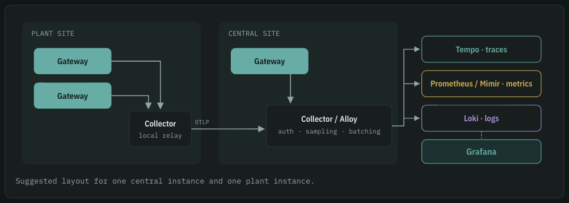

# OpenTelemetry in Gravitee, from ingress to Grafana

Technical briefing · APIM 4.13 and later

Answers to six questions about traces, metrics, and logs across a SaaS gateway and on-prem gateways, and how to get all of it into Grafana.

| Traces | Metrics | Logs |
| :--- | :--- | :--- |
| OTLP | Prometheus | Reporters |

| What OTel produces | SaaS to on-prem | Native log stream |
| :--- | :--- | :--- |
| Traces over OTLP, plus payload logs from 4.12 | One trace end to end, via W3C `traceparent` | Runs alongside OpenTelemetry. Nothing is replaced. |

## The big picture

A Gravitee gateway emits three kinds of telemetry, each through its own channel. OpenTelemetry covers traces. Metrics are scraped from a Prometheus endpoint. Request logs and analytics go through reporters, and the Elasticsearch reporter also feeds the APIM Console. Since 4.12, an OpenTelemetry reporter also sends request and response logs over OTLP when you turn it on.

<figure><figcaption></figcaption></figure>

This briefing answers six questions:

1. [Which plugins, and what each one does](#which-plugins-and-what-each-one-does)
2. [Correlation across SaaS and on-prem gateways](#correlation-across-saas-and-on-prem-gateways)
3. [Tracing callouts](#tracing-callouts)
4. [Starting the trace at the ingress](#starting-the-trace-at-the-ingress)
5. [Connecting to Grafana](#connecting-to-grafana)
6. [Replace or duplicate the native log stream?](#replace-or-duplicate-the-native-log-stream)

## Which plugins, and what each one does

*“It seems several plugins are available. What are the specifics of each?”*


**Short answer.** Since APIM 4.6, OpenTelemetry is built into the gateway and configured in one place on the gateway. The older tracer plugins (Jaeger, OpenTelemetry) belong to earlier versions. The other plugins you see are reporters, which serve a different purpose.


| Component | What it does | When to use it |
| :--- | :--- | :--- |
| Native OpenTelemetry (4.6+) | Creates spans for each request and exports them over OTLP (gRPC or HTTP). | Distributed tracing on any current version. |
| Tracer plugins (Jaeger, OpenTelemetry) | The previous tracing mechanism. | Only on versions before 4.6. Not needed for a new setup. |
| Reporters (Elasticsearch, file, TCP, Datadog…) | Ship per-request analytics and request/response logs. | Console analytics, log search, shipping logs to Loki. |
| OpenTelemetry reporter (4.12+) | Sends request/response logs as OTLP log records, carrying the trace and span IDs. Redaction rules for spans don't apply to them. | Payload logs in Loki, linked to their trace. Switched on at the gateway, then per v4 API with tracing on (not message, TCP proxy, or native Kafka APIs). |
| Prometheus metrics | Exposes gateway and JVM metrics on an endpoint to scrape. | Dashboards and alerting on throughput, latency, errors. |

Enable tracing in the gateway's `gravitee.yml` (or the matching environment variables):

```yaml
services:
  opentelemetry:
    enabled: true
    verbose: false        # true = detailed events on policy spans of HTTP APIs (v4 APIs also need verbose on the API)
    exporter:
      endpoint: http://otel-collector:4317
      protocol: grpc     # grpc (default) | http/protobuf | http (JSON)
      headers:            # optional, for example auth for a hosted OTLP endpoint
        - Authorization: "Basic <BASE64_CREDENTIALS>"
      compression: gzip  # none | gzip; TLS/mTLS, timeout and proxy are also available
      logsEndpoint: http://otel-collector:4318/v1/logs   # OpenTelemetry reporter logs: always HTTP/protobuf, full URL including /v1/logs
    tracing:
      v2:
        enabled: true   # 4.12.4+: v2 APIs are all traced (default false with a Cloud Token); set false to exclude them
reporters:
  otel:
    enabled: true   # OpenTelemetry reporter, default false
```

* **v4 APIs**: tracing and verbose mode are switched on per API, in the API's **Reporter Settings**.
* **v2 APIs**: no per-API switch. They're all traced when OpenTelemetry is on. From 4.12.4, `tracing.v2.enabled: false` excludes them. On a gateway with a Cloud Token, it defaults to `false`, so v2 APIs aren't traced until you set it to `true`.
* **Native Kafka APIs** (4.12+): `services.opentelemetry.kafka.tracedApiKeys` limits per-request spans to useful operations such as `PRODUCE` and `FETCH`. When it's omitted, or in verbose mode, every operation type is traced.

## Correlation across SaaS and on-prem gateways

*“For a standard correlation ID propagation case, how does this work if the traffic goes through two types of gateways (SaaS, then on-prem)?”*


**Short answer.** Two mechanisms work together. The W3C `traceparent` header links both gateways into one trace. The `X-Gravitee-Transaction-Id` header carries a stable business correlation ID across both hops.


<figure><figcaption></figcaption></figure>

T = trace ID, kept end to end. A and B = span IDs, one per gateway. X = transaction ID, kept across hops.

**W3C trace context: `traceparent`**

Each gateway reads the incoming [trace context](https://opentelemetry.io/docs/concepts/context-propagation/), creates its own span as a child of it, and forwards the updated header downstream. Both gateways then appear in one trace, provided both export to the same tracing backend.

**Gravitee headers: `X-Gravitee-Transaction-Id`**

If the request already carries a transaction ID, the next gateway keeps it. `X-Gravitee-Request-Id` is new on every gateway hop. Both header names are configurable.

```yaml
handlers:
  request:
    trace-context:
      enabled: true        # optional: add traceparent if missing, replace it if invalid
    transaction:
      header: X-Gravitee-Transaction-Id
      overrideMode: override # override | merge | keep, if the backend returns the header too
```


**SaaS gateways.** The SaaS hop shows in your trace only if the SaaS gateway exports its spans to your backend. Gravitee-hosted gateways export to your collector through an [OpenTelemetry reporter](https://documentation.gravitee.io/gravitee-cloud/guides/configure-custom-reporters/create-an-opentelemetry-reporter) configured in Gravitee Cloud. Confirm availability for your plan. Without it, the SaaS hop is missing from your trace. The trace still links up when the SaaS hop forwards a `traceparent`.


## Tracing callouts

*“How does tracing behave in the case of callouts?”*


**Short answer.** Once tracing is on, every policy on the request and the response gets its own span, including HTTP Callout. The callout's outgoing request gets a client span and carries `traceparent`, so an instrumented target joins the same trace.


<figure><figcaption></figcaption></figure>

Illustrative timings and labels. Verbose mode adds detailed events to each policy span.

* **Backend call**: traced when tracing is on for the API. The gateway injects its own `traceparent` into the backend request.
* **Callout policy**: one span for the policy, and a client span for its outgoing HTTP request, which carries `traceparent`.
* **Verbose mode**: on HTTP APIs, adds detailed execution events, with the headers and the context attributes, to each policy span. v2 APIs also get processor spans. On a v4 API, enable it both globally and on the API. A v2 API follows the global setting alone.
* **v2 APIs with Emulate v4 engine turned off**: the callout's outgoing request gets no client span and no `traceparent`, and verbose mode has no effect.

## Starting the trace at the ingress

*“Is it possible to go a bit further upstream before the entry into Gravitee (for example, traversing the ingress)?”*


**Short answer.** Yes. Instrument the ingress with OpenTelemetry ([Nginx](https://nginx.org/en/docs/ngx_otel_module.html), [Envoy](https://www.envoyproxy.io/docs/envoy/latest/api-v3/config/trace/v3/opentelemetry.proto), and [Traefik](https://doc.traefik.io/traefik/reference/install-configuration/observability/tracing/) all support it). It starts the trace and sends `traceparent`, and the gateway attaches its spans under it.


<figure><figcaption></figcaption></figure>

The same rule extends further: any instrumented component that forwards `traceparent` (a load balancer, the SaaS gateway, the backend service) adds its spans to the same trace.

## Connecting to Grafana

*“How does connectivity with Grafana work? What are the different exporter configurations?”*


**Short answer.** Send OTLP from the gateway to an [OpenTelemetry Collector](https://opentelemetry.io/docs/collector/) or [Grafana Alloy](https://grafana.com/docs/alloy/latest/), which forwards traces to [Tempo](https://grafana.com/docs/tempo/latest/). Scrape the Prometheus endpoint for metrics, and collect reporter output for logs.


<figure><figcaption></figcaption></figure>

Suggested layout for one central instance and one plant instance.

| Signal | From the gateway | To Grafana |
| :--- | :--- | :--- |
| Traces | OTLP push: gRPC on 4317 or HTTP on 4318, the collector's [default ports](https://github.com/open-telemetry/opentelemetry-collector/blob/main/receiver/otlpreceiver/README.md) | Collector or Alloy, then Tempo (or Grafana Cloud) |
| Metrics | `/_node/metrics/prometheus` on the technical API (port 18082), with `services.metrics.enabled: true` | Prometheus or Alloy scrape, then Prometheus or Mimir |
| Logs | OpenTelemetry reporter (4.12+) over OTLP, or the file/TCP reporter, plus the gateway's own logs on `stdout` | [Loki's OTLP endpoint](https://grafana.com/docs/loki/latest/send-data/otel/) directly, or Alloy then Loki |

* **Why a collector.** It handles sampling, batching, retries, and sending to several destinations, and keeps credentials out of the gateways. A plant collector buffers the data and relays it to the central site.
* **Exporting traces directly** from the gateway to an OTLP endpoint ([Grafana Cloud](https://grafana.com/docs/grafana-cloud/send-data/otlp/) included) also works: TLS and mTLS, custom headers for authentication, `gzip` compression, proxy.
* **Metrics** aren't exported over OTLP. Scrape the Prometheus endpoint instead. For a full setup, see [Monitor APIM with Prometheus and Grafana using Docker Compose](../how-to-guides/use-case-tutorials/monitor-apim-with-prometheus-and-grafana.md).
* **For a local start**, the APIM repository ships a ready-made Docker Compose setup, `docker/quick-setup/opentelemetry-jaeger`. Swap Jaeger for Alloy and Tempo to get the Grafana stack.
* **The Gamma console** also shows these traces on its **Tracing** page. On a self-hosted installation, it reads them from Elasticsearch, not Tempo. For the setup, see [Configure OpenTelemetry tracing and logs](https://documentation.gravitee.io/platform-management/environment/system-and-security/configure-opentelemetry-tracing-and-logs).

## Replace or duplicate the native log stream?

*“Does generating traces, logs, and metrics with the plugin replace or duplicate Gravitee's standard native log stream?”*


**Short answer.** Neither for traces and metrics. OpenTelemetry runs alongside the native reporters and replaces nothing. The data overlaps a little (latency, status code), but each stream answers a different question. Since 4.12, the OpenTelemetry reporter is one more reporter that runs next to the others. When an API has both **OTel Logs** and logging turned on, both streams receive the same log, with all four request and response bodies, even when the API's logging settings select fewer.


|  | Reporters (native stream) | OpenTelemetry |
| :--- | :--- | :--- |
| Content | Analytics records for each request (and each message on message APIs), optional request/response logs, and other records such as health checks | Spans: timing and the chain of calls |
| Answers | What happened, how often, for which consumer? | Where did the time go, across every hop? |
| Used by | APIM Console (dashboards, log search), your log stack | Tempo, Jaeger, Grafana |
| Turn it off? | Yes, but without the Elasticsearch reporter the Console loses its analytics | Yes, globally or per v4 API |


**Recommended.** Keep both. On v4 APIs reached over HTTP, the root span and the policy spans carry the Gravitee transaction ID and request ID as attributes, and from 4.12.4, the request logs of a traced proxy API record the trace ID. Use either to jump between a request log and its trace.


Based on the Gravitee APIM gateway source code, its default configuration, and the Gravitee documentation. Native OpenTelemetry is available from APIM 4.6. This page describes APIM 4.13 and later. Validate the setup in your environment before production.
