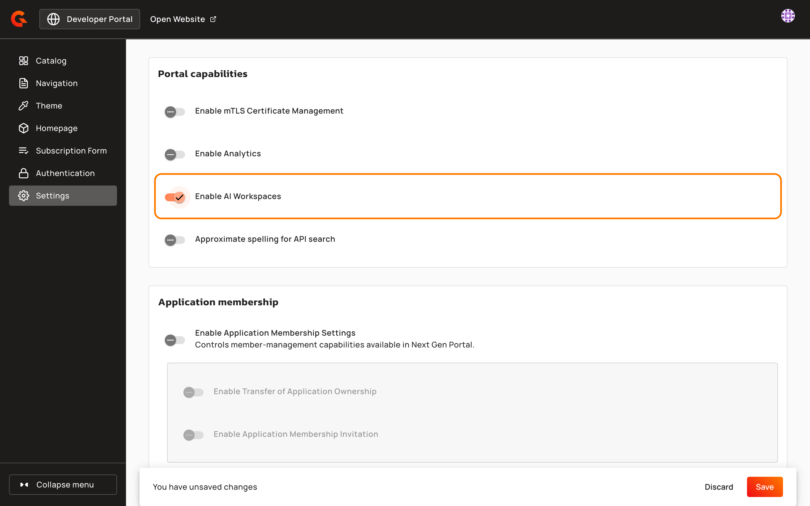
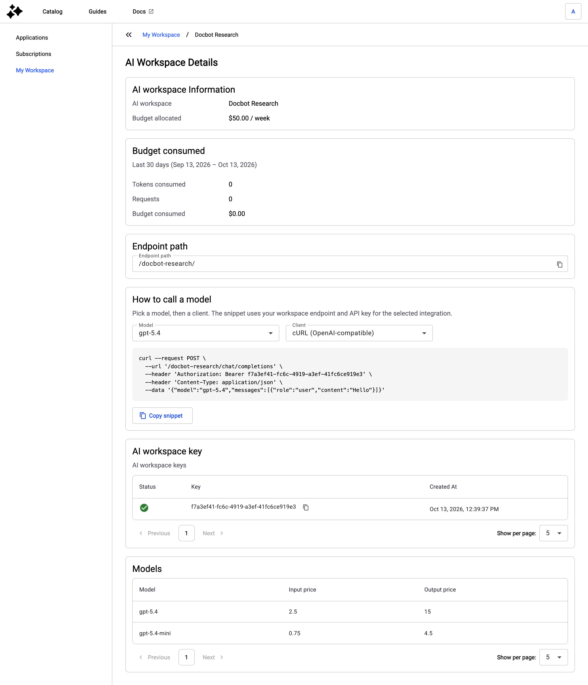
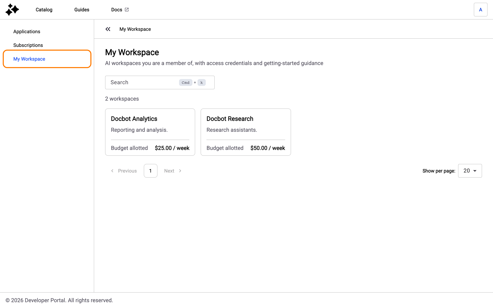

# Show AI Workspaces in the Developer Portal

## Overview

With AI Workspaces turned on, the New Developer Portal shows **My Workspace**, which lists the AI Workspaces that the logged-in user is a member of. For each AI Workspace, the user finds their budget and what they consumed over the last 30 days. They also find the endpoint path, a request snippet, their API key, and the models with their prices.

A user becomes a member when an administrator adds them to an AI Workspace in [Agent Management](https://documentation.gravitee.io/agent-management). The list shows the AI Workspaces that the user joined through an application they own.

## Prerequisites

* The New Developer Portal is enabled. For more information, see [Enable the New Developer Portal](configure-the-new-portal.md).
* An Enterprise license. Without one, the Portal Settings don't show the **Portal capabilities** section.

## Turn on AI Workspaces

AI Workspaces are off by default. While they're off, the Developer Portal shows no **My Workspace** entry.

1. In the Console sidebar, click **Portal Settings**. The Portal Settings open in a new browser tab.
2. Click **Settings**.
3.  In the **Portal capabilities** section, turn on **Enable AI Workspaces**.

    <figure><figcaption>
Enable AI Workspaces
</figcaption></figure>
4. Click **Save**.

## Open an AI Workspace

1. Log in to the Developer Portal.
2. Click your initials in the upper-right corner, and then click **My Workspace**.
3. Click an AI Workspace to open its details.

## AI Workspace details

The details page of an AI Workspace groups its information into the following sections:

<table>
    <thead>
        <tr>
            <th width="230">Section</th>
            <th>Details</th>
        </tr>
    </thead>
    <tbody>
        <tr>
            <td><strong>AI workspace Information</strong></td>
            <td>The AI Workspace name, and <strong>Budget allocated</strong>, the spend limit of your budget for each hour, day, week, or month.</td>
        </tr>
        <tr>
            <td><strong>Budget consumed</strong></td>
            <td>Your tokens, requests, and spend in this AI Workspace over the last 30 days.</td>
        </tr>
        <tr>
            <td><strong>Endpoint path</strong></td>
            <td>The path that receives your model requests. It doesn't include the address of your Gateway, so put that address in front of the path. The field stays empty until the AI Workspace has models.</td>
        </tr>
        <tr>
            <td><strong>How to call a model</strong></td>
            <td>A request snippet for the <strong>Model</strong> and the <strong>Client</strong> that you select, filled in with the endpoint path and your API key. Click <strong>Copy snippet</strong> to copy it. Like the endpoint path, the snippet doesn't include the address of your Gateway. The section appears only when the AI Workspace has an endpoint path.</td>
        </tr>
        <tr>
            <td><strong>AI workspace key</strong></td>
            <td>Your API key for the AI Workspace, its status, and when it was created. A paused key shows a pause icon instead of a check mark.</td>
        </tr>
        <tr>
            <td><strong>Models</strong></td>
            <td>The models of the AI Workspace, with their <strong>Input price</strong> and <strong>Output price</strong>. A dash means that no price is set.</td>
        </tr>
    </tbody>
</table>

<figure><figcaption>
The details of an AI Workspace
</figcaption></figure>

## Verification

To verify AI Workspaces are working as expected, follow these steps:

1. Log in to the Developer Portal as a member of an AI Workspace.
2.  Click your initials in the upper-right corner, and then click **My Workspace**. The AI Workspace appears in the list, with its **Budget allotted**.

    <figure><figcaption>
My Workspace
</figcaption></figure>
