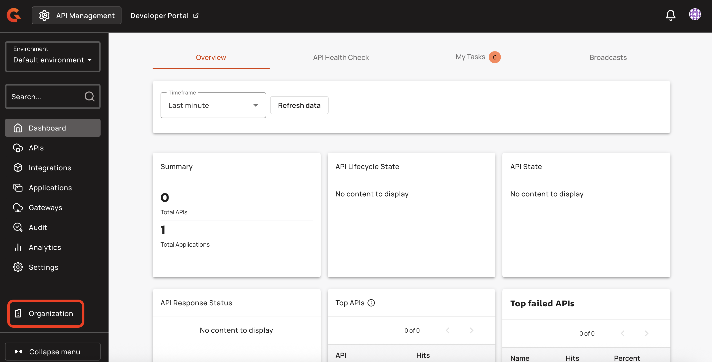

# Define an APIM service account for Terraform

## Overview

For Terraform to use APIM, it needs to authenticate as a user of the APIM instance.

To set Terraform up as an APIM user, you need to create a service account with specific roles on the organization and environment. The ADMIN role on the organization lets Terraform manage every resource. To give Terraform fewer permissions, see [Limit the permissions of the service account](#limit-the-permissions-of-the-service-account).

This guide explains how to define an APIM service account for Terraform so it can call the Management API (mAPI).

## Create a Terraform service account

To create a Terraform service account, complete the following steps:

1. Log in to your APIM Console.
2.  Select **Organization** from the navigation menu.

    <figure><figcaption></figcaption></figure>
3.  From the Organization navigation menu, select **Users**, and then click **Add user**.

    <figure><figcaption></figcaption></figure>
4. Select **Service Account** as the service type, and then enter a value for **Service Name**. Providing a service account email is optional.
5.  Click **Create**.

    <figure><figcaption></figcaption></figure>
6.  From the **Users** screen, click on your service account.

    <figure><figcaption></figcaption></figure>
7.  Ensure that your service account has the ADMIN role on the organization, and the API\_PUBLISHER role on the desired environment.

    <figure><figcaption></figcaption></figure>

    \
    The following screenshot shows the environment-level permissions that are included in the API\_PUBLISHER role:

    <figure><figcaption></figcaption></figure>
8.  From your newly created service account, scroll to the **Tokens** section, and then click **Generate a personal token**.

    <figure><figcaption></figcaption></figure>
9.  Give your token a name, and then click **Generate**.

    <figure><figcaption></figcaption></figure>
10. Copy your token and store it securely. You won’t be able to see it again.


You can now use this token as credentials in your Terraform provider configuration file.


## Limit the permissions of the service account

Instead of the ADMIN role on the organization, give the service account roles that grant only the permissions in the following table. Each cell gives the scope of a role, then the permission and the action as a role on the **Roles** page of the organization settings shows them. The scope tells you which of the service account's roles grants the permission:

* An **Environment** permission comes from the service account's role on the environment.
* An **API** or **Application** permission comes from the service account's role on that API or application. When Terraform creates an API from an `apim_apiv4` resource, or an application from an `apim_application` resource, the service account becomes its primary owner and holds these permissions on it. To let Terraform update an API or application that was created another way, add the service account to it as a member, with a role that grants these permissions.

| Resource | Create | Update | Delete | Read |
| --- | --- | --- | --- | --- |
| `apim_apiv4` | Environment `API`: Create | API `DEFINITION`: Update, and Environment `API`: Create or Update | API `DEFINITION`: Delete | API `DEFINITION`: Read |
| `apim_application` | Environment `APPLICATION`: Create | Application `DEFINITION`: Update, and Environment `APPLICATION`: Create or Update | Application `DEFINITION`: Delete | Application `DEFINITION`: Read |
| `apim_subscription` | API `SUBSCRIPTION`: Create, and Application `SUBSCRIPTION`: Create on the application | API `SUBSCRIPTION`: Update | API `SUBSCRIPTION`: Delete | API `SUBSCRIPTION`: Read |
| `apim_group` | Environment `GROUP`: Create | Environment `GROUP`: Update | Environment `GROUP`: Delete | Environment `GROUP`: Read |
| `apim_shared_policy_group` | Environment `SHARED_POLICY_GROUP`: Create | Environment `SHARED_POLICY_GROUP`: Update | Environment `SHARED_POLICY_GROUP`: Delete | Environment `SHARED_POLICY_GROUP`: Read |
| `apim_dictionary` | Environment `DICTIONARY`: Create | Environment `DICTIONARY`: Update | Environment `DICTIONARY`: Delete | Environment `DICTIONARY`: Read |
| `apim_mcp_proxy` | Environment `API`: Create | Environment `API`: Update | Environment `API`: Delete | Environment `API`: Read |
| `apim_catalog_mcp_server` | Environment `AI_CATALOG`: Create | Environment `AI_CATALOG`: Update | Environment `AI_CATALOG`: Delete | Environment `AI_CATALOG`: Read |

Terraform also reads each resource it manages, so grant the permissions in the **Read** column too.

Some changes require more than the table shows:

* **Members.** Applying an `apim_apiv4` or `apim_application` also requires the API or Application `MEMBER` permission with Update when its members differ from those of the API or application in APIM, apart from the primary owner and the service account. A resource that declares no members differs when the API or application has any other member. With this permission, applying the resource sets the members to the ones you declare and makes the service account the primary owner.
* **A deleted application.** Creating an `apim_application` again after Terraform deleted it requires the ADMIN role on the organization.
* **A closed subscription.** Applying an `apim_subscription` again after its subscription was closed also requires Application `SUBSCRIPTION`: Create on the application.

When the service account lacks a permission, APIM refuses the change with a `403` status and the message `You do not have sufficient rights to access this resource`.
