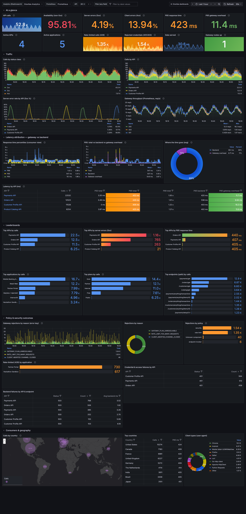
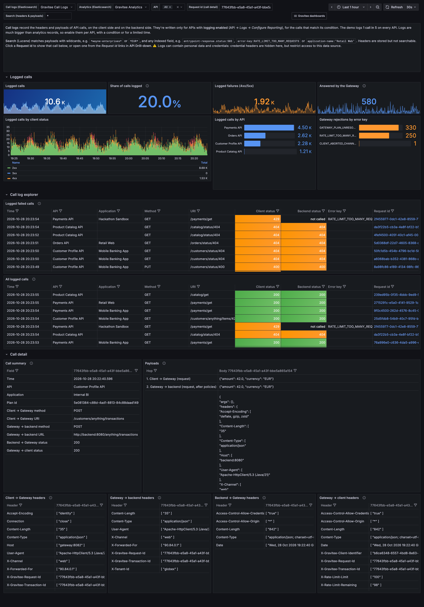

# Monitor APIM with Grafana

## Overview

The Gravitee Grafana dashboard pack gives you six linked dashboards, from the program-wide view down to the headers and payloads of a single API call. It also includes Prometheus recording rules for service level objectives (SLOs) and ready-to-route alerts.

| Dashboard | What it answers |
| --- | --- |
| **API Program Overview** | How are all my APIs doing, who calls them, from where, and what does the Gateway reject and why? |
| **API Drill-down** | What's wrong with one API: which path, which consumer, which call? |
| **Consumers, Plans & Tenants** | Which applications and plans drive traffic, with what quality of service, and who hits their limits? |
| **Gateway Fleet & Runtime** | Are the Gateway nodes healthy: JVM, garbage collection, CPU, connections, backend connection pool? |
| **SLOs & Error Budgets** | Are we meeting the availability objective, how fast is the error budget burning, and which API breaches it? |
| **Call Logs** | What exactly did one call send and receive, on the client side and on the backend side? |

[Download the latest pack](https://github.com/gravitee-io-labs/gravitee-prometheus-grafana-dashboards/releases/latest/download/gravitee-grafana-dashboards.zip) (`gravitee-grafana-dashboards.zip`). The dashboards, rules, and a Docker Compose demo stack are maintained in the [gravitee-prometheus-grafana-dashboards](https://github.com/gravitee-io-labs/gravitee-prometheus-grafana-dashboards) repository under the Apache 2.0 license. To try it on a local Docker Compose stack first, see [Monitor APIM with Prometheus and Grafana using Docker Compose](../how-to-guides/use-case-tutorials/monitor-apim-with-prometheus-and-grafana.md).

<figure><figcaption><p>The API Program Overview dashboard</p></figcaption></figure>

## Data sources

The dashboards read four sources that APIM already produces. Nothing is added to the request path.

| Source | Content | Used for |
| --- | --- | --- |
| **API analytics**: `gravitee-v4-metrics-*` index in Elasticsearch or OpenSearch | One record per API call: API, application, plan, subscription, status, total, backend and Gateway latency, backend connect time and time to first byte, payload sizes, error key, rejecting component, client country and city, user agent, URI, transaction ID | Everything per API, per consumer, and per call |
| **Gateway metrics**: Prometheus endpoint of each Gateway | Gateway-wide request rates and status codes, connections, backend HTTP client, JVM, CPU, file descriptors | Real-time throughput, Gateway health, SLO burn rates, alerts |
| **Node monitoring**: `gravitee-monitor-*` index in Elasticsearch or OpenSearch | Per-node JVM, CPU, and memory snapshots | Gateway health where Prometheus isn't deployed |
| **API logs** (optional): `gravitee-v4-log-*` index in Elasticsearch or OpenSearch | Headers and payloads of logged calls, between the client and the Gateway and between the Gateway and the backend. Written only for APIs with logging enabled. | The Call Logs dashboard |


The dashboards read v4 API analytics. v2 APIs report to the `gravitee-request-*` and `gravitee-log-*` indexes with a different structure, and aren't covered.


## Prerequisites

* APIM 4.x with the Elasticsearch or OpenSearch reporter enabled (the default)
* Grafana 10.4 or later
* Prometheus 2.40 or later, for the Gateway metrics, SLOs, and alerts

## Install the dashboards

### Enable the Gateway metrics endpoint

Enable the Prometheus metrics service and make the Gateway internal API reachable by Prometheus. For all the options, see [Expose metrics to Prometheus](logging/expose-metrics-to-prometheus.md).


```yaml
services:
  metrics:
    enabled: true
    prometheus:
      enabled: true
  core:
    http:
      host: 0.0.0.0
      port: 18082
      authentication:
        type: basic
        users:
          admin: <your-password>
```



Port `18082` serves the Gateway internal API. Restrict network access to it to your monitoring infrastructure.


### Configure Prometheus

Add a scrape job named `gravitee`: the rules and dashboards select Gateways with `job="gravitee"`. Then load the rule files from the pack's `prometheus-rules` folder.


```yaml
rule_files:
  - /etc/prometheus/rules/gravitee-slo.rules.yml
  - /etc/prometheus/rules/gravitee-alerts.rules.yml

scrape_configs:
  - job_name: gravitee
    metrics_path: /_node/metrics/prometheus
    basic_auth:
      username: admin
      password: <your-password>
    static_configs:
      - targets: ['<gateway-1>:18082', '<gateway-2>:18082']
```


On Kubernetes, use your usual service discovery and keep the job name `gravitee`.

### Add the data sources in Grafana

Create the data sources. Their names are free: each dashboard lets you select them.

| Type | Index or URL | Time field |
| --- | --- | --- |
| Elasticsearch | `gravitee-v4-metrics-*` | `@timestamp` |
| Elasticsearch | `gravitee-monitor-*` | `@timestamp` |
| Elasticsearch (optional, for Call Logs) | `gravitee-v4-log-*` | `@timestamp` |
| Prometheus | Your Prometheus URL | – |

To provision them instead, adapt the files in the pack's `grafana-provisioning/datasources` folder.

### Import the dashboards

1. In Grafana, go to **Dashboards > New > Import**.
2. Upload a JSON file from the pack's `dashboards` folder.
3. Repeat for the six files.

To provision the dashboards instead, mount the `dashboards` folder and use `grafana-provisioning/dashboards/gravitee.yml`.

### Enable API logging (optional)

The **Call Logs** dashboard shows calls only for APIs with logging enabled. To enable it, see [Configure API-level logs](logging/configure-api-level-logs.md). Choose the modes, phases, and content to log, and set a request phase condition to limit the volume.


* The condition is evaluated in the request phase. It can select on request headers, path, method, or time, for example `{#request.headers['X-Debug'] != null}`, but not on the response status.
* A logged call with headers and payloads is several times larger than its analytics record. Log only what you need, and keep a short retention on the log index.
* Logs can contain personal data and credentials. The dashboard hides API key, `Authorization`, and cookie headers, but the index stores them: restrict access to the data source.


### Verify

1. Open **Gravitee · API Program Overview**.
2. In the top bar, select your analytics and Prometheus data sources.
3. Check that **API calls** and **Gateway nodes up** show values.

## Use the dashboards

| Control | Effect |
| --- | --- |
| **Data source selectors** | Switch the analytics, node monitoring, and Prometheus data sources, for example between environments |
| **API** | Restrict all analytics panels to one or more APIs. In the API Drill-down, select the API to investigate. |
| **Filter (any field)** | Add conditions on any analytics field, applied to every panel. Useful fields: `application-name.keyword`, `plan-id`, `status`, `error-key`, `geoip.country_iso_code`, `custom.<name>` |
| **Node** | In Gateway Fleet & Runtime, restrict panels to one or more Gateway instances |
| **API name** | In tables and leaderboards, opens the API Drill-down for that API with the same time range |
| **Gravitee dashboards** menu | Moves between the six dashboards, keeping the time range and selections |
| **Request ID** | In API Drill-down, opens the call in Call Logs. In Call Logs, shows the call in the **Call detail** section. |
| **Search** | In Call Logs, a Lucene query on logged calls: payload content with wildcards, for example `*ORD-1234*`, or any field, for example `entrypoint-response.status:503` |
| **Panel ⓘ icon** | Explains what the panel measures and how to read it |
| **Inspect > Data** | Shows or exports the data behind a panel as CSV |

A typical investigation: an alert fires, **SLOs & Error Budgets** shows which API burns its budget, and you select it. **API Drill-down** then shows the affected paths and applications, whether the time is spent in the backend or the Gateway, and the failing calls. Select a request ID to see in **Call Logs** what the client sent, what the backend received, and what it returned.

## Dashboard reference

### API Program Overview

| Section | Content | How to read it |
| --- | --- | --- |
| At a glance | Calls, availability, 5xx and 4xx share, P95 response time, P95 Gateway overhead, active APIs and applications, rate-limited calls, rejected credentials, data served, Gateway nodes up | 4xx are consumer errors and don't count against availability. |
| Traffic | Calls by status class and by API, 5xx rate by API, real-time Gateway throughput | A 5xx spike on one API points to its backend. A spike on all APIs points to the platform. |
| Latency attribution | Response time percentiles, total vs backend vs Gateway overhead, share of time in each, latency per API | When total follows the backend, the slowness is upstream. When it follows the Gateway overhead, review the API's policies. |
| Leaderboards | Top APIs by calls, 5xx, and P95; top applications, plans, and paths | |
| Policy & security outcomes | Rejections by [error key](gateway-error-key-reference.md) and by policy, 429 by application, credential failures by API, backend failures by API | Separates calls the Gateway refused (rate limit, invalid credentials) from calls the backend failed. |
| Consumers & geography | Calls by country on a map, top countries with their P95, client types | |

### API Drill-down

| Section | Content |
| --- | --- |
| API health | Calls, availability, error rate, P95 total, backend, and Gateway overhead |
| Traffic & errors | Status classes and codes over time, HTTP methods, error keys, payload sizes |
| Latency deep-dive | P95 split into total, backend, backend time to first byte, backend connect, and Gateway overhead; response time heatmap; per-path table with calls, P50, P95, max, and 5xx |
| Consumers of this API | Applications with calls, P95, and errors; traffic by application, plan, country, and client type |
| Investigate | Latest failed calls and calls slower than 500 ms, with status, method, URI, error key, application, plan, timings, client IP, and request ID. The request ID opens the call in Call Logs. |


Connect time spikes point to network, DNS, or TLS issues towards the backend. A rising time to first byte with a flat connect time means the backend itself is slow.


### Consumers, Plans & Tenants

* **Application scorecard**: calls, P95, number of APIs used, bytes served, 4xx, 5xx, and rate-limited calls for each application.
* **Plans & subscriptions**: usage by API and plan, number of applications per plan, most active subscriptions.
* **Business dimensions**: traffic by tenant, channel, and plan name. These panels need custom metrics, as described in [Add business dimensions](#add-business-dimensions).
* **Where consumers are**: map, operating systems and devices, user agents.

### Gateway Fleet & Runtime

| Section | Watch for |
| --- | --- |
| Fleet at a glance | Nodes down, uneven load, heap above 75%, recent restarts |
| Inbound traffic | Request rate and status codes per node, response time, client connections, network throughput |
| Outbound traffic | Backend calls by status, backend response time, connection pool. A pool pinned at its maximum while latency rises indicates backend saturation. |
| JVM | Heap against its maximum, GC time per second (above 5% sustained affects tail latency), allocation rate, threads, off-heap buffers |
| Host & process | CPU, load against CPU count, open file descriptors |
| Node monitoring | Heap, memory, and CPU per node from the monitoring index, without Prometheus |

### SLOs & Error Budgets

The default objective is 99.5% of calls without a server error over 30 days: an error budget of 0.5%.

* **Availability SLI (30d)** and **Error budget remaining** show the position against the monthly objective.
* **Error budget burn rate** compares the error rate with the allowed pace. At `1`, the budget lasts exactly 30 days.
* **Per-API SLO compliance** lists availability, the share of the budget used, P95, P99, and slow calls for each API over the selected range. Above 100% used, the API missed its objective for the period.

### Call Logs

| Section | Content |
| --- | --- |
| Logged calls | Logged calls and their share of all calls, logged failures, calls the Gateway answered without calling the backend, and rejections by error key |
| Call log explorer | Latest logged failed calls and all logged calls, with the client status and the backend status. `not called` means the Gateway rejected the call, for example for plan security or rate limiting. |
| Call detail | One call, selected by request ID, or the latest call: a summary, the body at each hop, and the headers at each hop |

The hops are client to Gateway, Gateway to backend, backend to Gateway, and Gateway to client. Compare the first two, or the last two, to see what the API's policies changed.

<figure><figcaption><p>The Call Logs dashboard</p></figcaption></figure>

## Alerts

The `gravitee-alerts.rules.yml` file defines these alerts. Route them with Alertmanager or Grafana alerting.

| Alert | Condition | Severity |
| --- | --- | --- |
| `GraviteeGatewayDown` | A Gateway can't be scraped for 1 minute | critical |
| `GraviteeErrorBudgetFastBurn` | Burn rate above 14.4 on both the 5-minute and 1-hour windows | critical |
| `GraviteeErrorBudgetSlowBurn` | Burn rate above 6 on both the 30-minute and 6-hour windows | warning |
| `GraviteeHighLatency` | Average response time above 500 ms for 5 minutes | warning |
| `GraviteeHeapPressure` | Heap above 90% for 10 minutes | warning |
| `GraviteeGcPressure` | More than 10% of time in garbage collection for 10 minutes | warning |
| `GraviteeHighCpu` | Process CPU above 85% for 10 minutes | warning |
| `GraviteeBackendErrors` | More than 10% of backend calls return 5xx for 5 minutes | warning |

## Customize

### Add business dimensions

The [Assign Metrics](../create-and-configure-apis/apply-policies/policy-reference/assign-metrics.md) policy adds a value to the analytics record of each call, as `custom.<name>`. The **Consumers, Plans & Tenants** dashboard charts `custom.tenant`, `custom.plan`, and `custom.channel`. Use any other name in the **Filter** bar.

```json
{
  "policy": "policy-assign-metrics",
  "configuration": {
    "scope": "REQUEST",
    "metrics": [
      {
        "name": "tenant",
        "value": "{#request.headers['X-Tenant-ID'] != null ? #request.headers['X-Tenant-ID'][0] : 'unknown'}"
      }
    ]
  }
}
```


When the expression returns `null`, the metric is dropped from the record. Always provide a fallback value.


To show plan names instead of plan IDs, add the policy to each plan's flow with a fixed value, for example `"name": "plan", "value": "Gold"`.

### Change the objectives and thresholds

* **SLO objective**: replace `0.005` in `gravitee-slo.rules.yml`, for example with `0.001` for 99.9%, and in the **Error budget used** calculation of the per-API SLO table.
* **Colors**: edit a panel and change its **Thresholds**.
* **Alerts**: edit the conditions in `gravitee-alerts.rules.yml`.

## Troubleshooting

| Symptom | Check |
| --- | --- |
| Analytics panels are empty | The data source uses the `gravitee-v4-metrics-*` index and the `@timestamp` time field. The APIs are v4 APIs with analytics enabled. The time range contains traffic. |
| **Gateway nodes up** is `0` | The metrics service is enabled, the internal API listens on a reachable interface, the job is named `gravitee`, and the credentials match. Check the target in Prometheus under **Status > Target health**. |
| Throughput is higher than the API traffic | HTTP server metrics include the scrapes of the internal API. The dashboards keep `local` values ending in `:8082`. If your Gateway listens on another port, update the filter. |
| SLO panels are empty | The recording rules are loaded. The 30-day SLI fills in as history accumulates. |
| Tenant, channel, or plan name panels are empty | These panels need the Assign Metrics policy. |
| The map has no background | The basemap loads public Esri tiles. The browser needs access to `services.arcgisonline.com`. |
| Call Logs is empty | Logging is enabled on the API and its condition matches calls. The data source uses the `gravitee-v4-log-*` index. A request ID opened from API Drill-down shows nothing when that call wasn't logged. |
| A Call Logs search finds nothing | Payloads are split on spaces only: use wildcards, for example `*EUR*`. Headers are stored but not searchable. |
