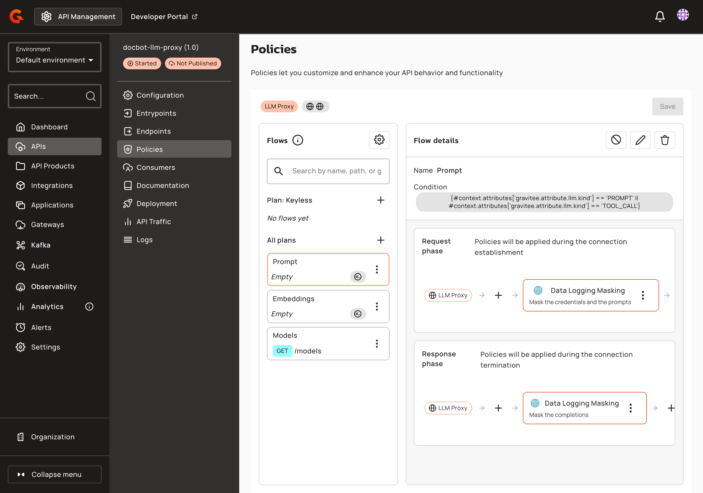
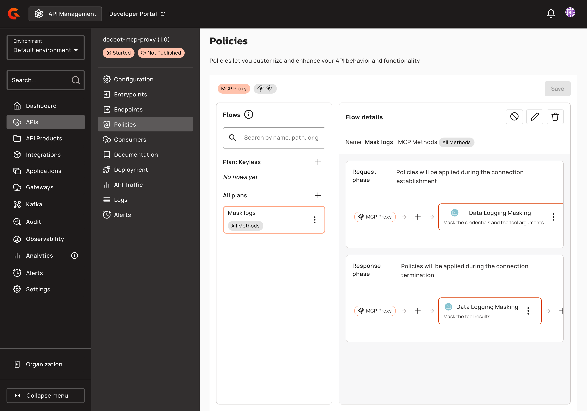

# Data Logging Masking


**This feature requires** [**Gravitee's Enterprise Edition**](../../../introduction/enterprise-edition.md)**.**


## Overview

If you enable logging on APIs, you can use the `data-logging-masking` policy to configure rules to conceal sensitive data. You can use `json-path`, `xml-path` or a regular expression to identify the information to hide.


**When using V2 APIs:** Place the `data-logging-masking` policy last in both the request and response flows. Putting it at the end ensures that content altered by any other policy is masked in the logs.

**When using V4 APIs:** Data masking is automatically operated just before the reporting phase, so manual positioning is not required.


## Examples



Sample policy configuration for a v4 proxy API:

```json
{
  "api": {
    "definitionVersion": "V4",
    "type": "PROXY",
    "name": "Data Logging Masking example API",
    "flows": [
      {
        "name": "Common Flow",
        "enabled": true,
        "selectors": [
          {
            "type": "HTTP",
            "path": "/",
            "pathOperator": "STARTS_WITH"
          }
        ],
        "request": [
          {
            "name": "Data Logging Masking",
            "enabled": true,
            "policy": "policy-data-logging-masking",
            "configuration":
              {
                  "scope": "REQUEST_CONTENT",
                  "headerRules": [
                      {
                          "path": "X-Header-To-Mask",
                          "replacer": "*"
                      }
                  ],
                  "bodyRules": [
                      {
                          "path": "$.field",
                          "replacer": "-"
                      },
                      {
                          "type": "EMAIL",
                          "replacer": "@"
                      },
                      {
                          "type": "URI",
                          "replacer": "U"
                      },
                      {
                          "type": "IP",
                          "replacer": "IP"
                      },
                      {
                          "type": "CREDIT_CARD",
                          "replacer": "$"
                      },
                      {
                          "regex": "(proto?:/.w*)(:\\d*)?\\/?(.*?)",
                          "replacer": "S"
                      }
                  ]
              }
          }
        ]
      }
    ]
  }
}
```



Sample policy configuration:

```json
{
    "name": "Data Logging Masking",
    "description": "Data Logging Masking configured for RAW or JSON",
    "enabled": true,
    "policy": "policy-data-logging-masking",
    "configuration": {
        "scope": "REQUEST_CONTENT",
        "headerRules": [
            {
                "path": "reqHeaderToHide",
                "replacer": "*"
            }
        ],
        "bodyRules": [
            {
                "path": "$.field",
                "replacer": "-"
            },
            {
                "type": "EMAIL",
                "replacer": "@"
            },
            {
                "type": "URI",
                "replacer": "U"
            },
            {
                "type": "IP",
                "replacer": "IP"
            },
            {
                "type": "CREDIT_CARD",
                "replacer": "$"
            },
            {
                "regex": "(proto?:/.w*)(:\\d*)?\\/?(.*?)",
                "replacer": "S"
            }
        ]
    }
}
```



## Configuration

When configuring the `data-logging-masking` policy, note the following:

* If you use the `path` property in a rule without regex, all the data corresponding to this path will be hidden.
* If you use a `MaskPattern` type property or a custom regular expression without a `path`, the transformation will apply to all the raw data.
* On a v4 API, when the Gateway cuts a logged JSON body at its maximum log size, a rule that sets a `path` masks the values it selects in the part that was logged.
* On a v4 API, a complete JSON body that isn't valid JSON, such as concatenated documents or fields in single quotes, is masked as a whole by the rules that set a `path`.
* A body that doesn't parse in the format that its content type announces, such as an HTML error page announced as JSON or a JSON error announced as XML, is masked as a whole by the rules that set a `path`, even when they also set a `type` or a `regex`.
* A body masked as a whole is masked with the `replacer` of the first rule that sets one, or with `*` when no rule sets one.
* We provide some patterns that you can use and adapt as required:
  * `CUSTOM`: Use to write your own regular expression
  * `CREDIT_CARD`: Use to catch and hide credit card numbers (supports Visa, Mastercard and American Express)
  * `EMAIL`: Use to pick up and hide email addresses (doesn’t support Unicode)
  * `IP`: Use to pick up and hide IP addresses (supports IPv4 and IPv6 format)
  * `Uri`: Use to catch and hide sensitive addresses (supports HTTP, HTTPS, FTP, mailto and file)

You can enable or disable the policy with policy identifier `policy-data-logging-masking`.

### Phases

The phases checked below are supported by the `data-logging-masking` policy:

<table data-full-width="false"><thead><tr><th width="202">v2 Phases</th><th width="139" data-type="checkbox">Compatible?</th><th width="198">v4 Phases</th><th data-type="checkbox">Compatible?</th></tr></thead><tbody><tr><td>onRequest</td><td>false</td><td>onRequest</td><td>true</td></tr><tr><td>onResponse</td><td>false</td><td>onResponse</td><td>true</td></tr><tr><td>onRequestContent</td><td>true</td><td>onMessageRequest</td><td>false</td></tr><tr><td>onResponseContent</td><td>true</td><td>onMessageResponse</td><td>false</td></tr></tbody></table>

On LLM Proxy and MCP Proxy APIs, the policy runs in the request and response phases.

### Options

You can configure the `data-logging-masking` policy with the following options:

<table><thead><tr><th width="153">Property</th><th data-type="checkbox">Required</th><th width="164">Description</th><th width="209">Type</th><th>Default</th></tr></thead><tbody><tr><td>scope</td><td>false</td><td>Scope where the policy is executed</td><td>Policy scope</td><td>REQUEST_CONTENT</td></tr><tr><td>headerRules</td><td>false</td><td>List of mask rules to apply on client and proxy headers</td><td>List&#x3C;MaskHeaderRule></td><td></td></tr><tr><td>bodyRules</td><td>false</td><td>List of mask rules to apply on client and proxy body</td><td>List&#x3C;MaskBodyRule></td><td></td></tr></tbody></table>

#### Mask header rule

<table><thead><tr><th width="129">Property</th><th data-type="checkbox">Required</th><th width="165">Description</th><th>Type</th><th>Default</th></tr></thead><tbody><tr><td>path</td><td>true</td><td>Header name to transform</td><td>String</td><td></td></tr><tr><td>replacer</td><td>false</td><td>Replacement character</td><td>String</td><td>*</td></tr></tbody></table>

#### Mask body rule

<table><thead><tr><th width="121">Property</th><th width="104" data-type="checkbox">Required</th><th width="261">Description</th><th width="129">Type</th><th>Default</th></tr></thead><tbody><tr><td>path</td><td>false</td><td>Context-dependent. If "Content-type" is <code>application / json</code> you must use <code>json-path</code>, if it is "application / xml" you must use <code>xml-path</code>, otherwise not used.</td><td>String</td><td></td></tr><tr><td>type</td><td>false</td><td>Value selector type</td><td>MaskPattern</td><td></td></tr><tr><td>regex</td><td>false</td><td>Custom value selector (use regular expression)</td><td>String</td><td></td></tr><tr><td>replacer</td><td>false</td><td>Replacement character</td><td>String</td><td>*</td></tr></tbody></table>

## LLM Proxy and MCP Proxy APIs

You can add the `data-logging-masking` policy to LLM Proxy and MCP Proxy APIs. The policy masks the logs only. The requests and responses that pass through the Gateway are unchanged.

<figure><figcaption><p>Data Logging Masking in the Prompt flow of an LLM Proxy API</p></figcaption></figure>

<figure><figcaption><p>Data Logging Masking in a flow of an MCP Proxy API</p></figcaption></figure>

The **Prompt** flow that an LLM Proxy API starts with runs only for prompts and tool calls. To mask the logs of the other requests, add the policy to the other flows too.

In the request phase, a rule in **Masking rules for headers** masks the header in the logged request from the consumer and in the logged request to the endpoint. In the response phase, it masks the header in the logged response from the endpoint and in the logged response to the consumer. For example, in the request phase, a rule for `Authorization` masks the consumer's credentials. A rule for the header that carries your LLM provider's API key masks that key. On an MCP Proxy API, a rule for `Mcp-Session-Id` in both phases masks the session ID.

A rule in **Masking rules for payload** that sets a `path` selects values in the JSON body of the logged requests or responses of its phase. For example:

* In the request phase, `$.messages[*].content` selects the prompts of a chat completion request in the OpenAI format.
* In the response phase, `$.choices[*].message.content` selects the completion of a chat completion response in the OpenAI format.
* In the response phase, `$.choices[*].delta.content` selects the completion in each event of a streamed chat completion in the OpenAI format.
* In the response phase, `$.result.content[*].text` selects the text that an MCP tool returns.

## Streamed requests and responses

Rules in **Masking rules for payload** treat a logged request or response with the `text/event-stream` content type, such as a streamed chat completion or MCP response, as follows:

* A rule that sets a `path` applies to the data of each event that holds a JSON object or array. It masks the value that the path selects as a whole, even when the rule also sets a `type` or a `regex`. The other lines of the event, such as `event:` and `id:`, stay as they are. The `data: [DONE]` event that ends an LLM stream is read as a JSON array, so the example paths above leave it as it is.
* A rule that sets a `path` masks as a whole the data of an event that isn't a JSON object or array, such as free text.
* A rule that sets a `path` masks as a whole a body that holds no event, such as a JSON error, even when the rule also sets a `type` or a `regex`.
* When the Gateway cuts the logged body at its maximum log size, a rule that sets a `path` masks as a whole the data of the last event, unless that data is complete JSON. When the body wasn't cut, the last event is masked like the others, even when no blank line ends it.
* A rule that sets only a `type` or a `regex` applies to the whole body. It doesn't match a value split across several events, such as an email address that an LLM streams in several parts. To mask streamed text, use a rule that sets a `path`, for example `$.choices[*].delta.content`.

A Bedrock stream, with the `application/vnd.amazon.eventstream` content type, isn't read as events. A rule that sets only a `path` masks it as a whole, and a rule that also sets a `type` or a `regex` applies it to the whole body.

## Compatibility matrix

The following is the compatibility matrix for APIM and the `data-logging-masking` policy:

<table data-full-width="false">
    <thead>
        <tr>
            <th>Plugin Version</th>
            <th>Supported APIM versions</th>
        </tr>
    </thead>
    <tbody>
        <tr>
            <td>Up to 1.x</td>
            <td>Up to 3.17.x</td>
        </tr>
        <tr>
            <td>2.0 to 2.x</td>
            <td>3.18.x to 3.20.x</td>
        </tr>
        <tr>
            <td>3.0 to 3.x</td>
            <td>4.0.x to 4.13.x</td>
        </tr>
        <tr>
            <td>4.0 to 4.x</td>
            <td>4.7.x to 4.13.x</td>
        </tr>
        <tr>
            <td>5.0+</td>
            <td>4.14+</td>
        </tr>
    </tbody>
</table>
