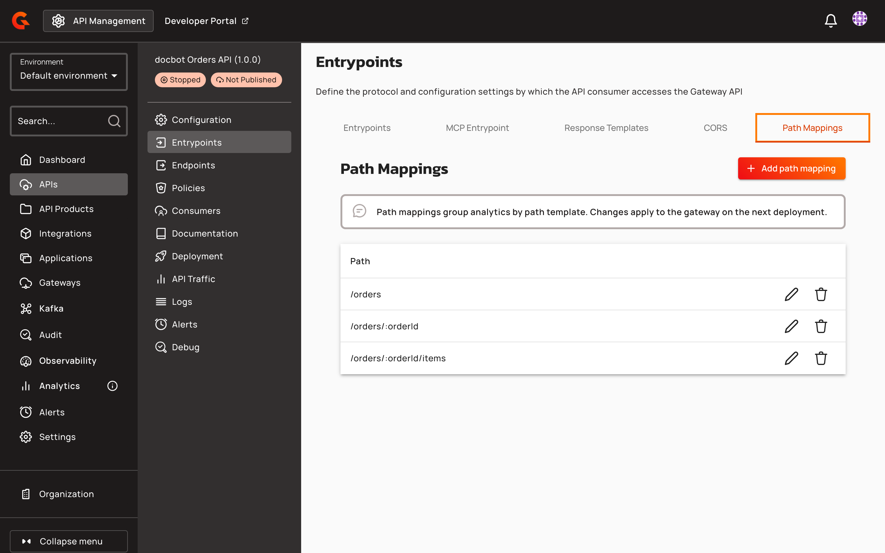
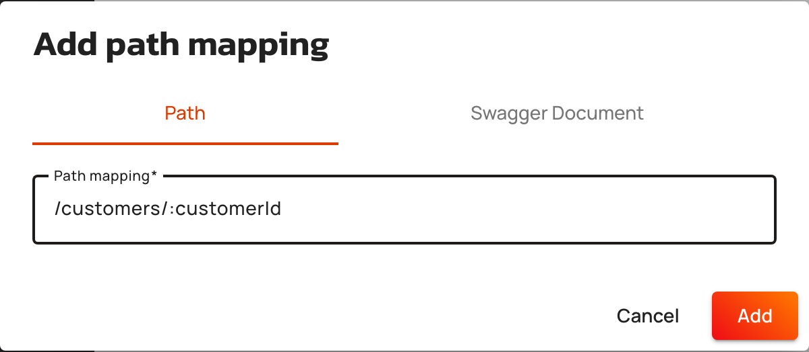
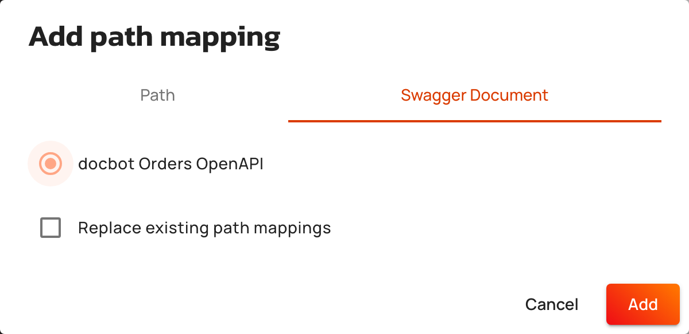
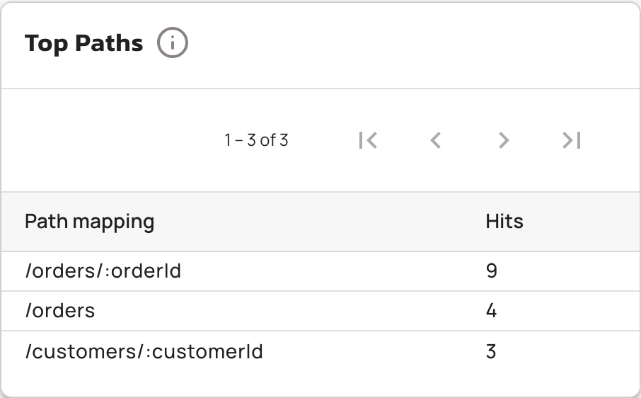

# Configure path mappings

Path mappings group the analytics of a v4 API by path template. A request whose path matches a path mapping is recorded under that path mapping in the API's analytics data. Requests to `/orders/42` and `/orders/57` are then both recorded under `/orders/:orderId`, instead of only as two different paths.

A segment that starts with `:` matches any value in that segment, including an empty one. Path mappings take effect the next time you deploy the API.

## Before you start

* The **Path Mappings** tab appears for a v4 API that clients reach over HTTP. A TCP proxy API and a native Kafka API don't have it.
* Without permission to read the API definition, the tab doesn't appear. To add, import, edit, or delete path mappings, you need permission to update it.
* Without that permission, and for an API with the **Kubernetes Origin** badge, the tab lists the path mappings without the **Add path mapping** button or the edit and delete icons. An API gets this badge when the Gravitee Kubernetes Operator, Terraform, or the Automation API creates or updates it.

## Open the Path Mappings tab

To open the tab, follow these steps:

1. Log in to your APIM Console.
2. Click **APIs**.
3. Select the API.
4. Click **Entrypoints**.
5.  Click the **Path Mappings** tab.

    <figure><figcaption>
The Path Mappings tab
</figcaption></figure>

The tab lists the path mappings under **Path**, in alphabetical order. An API without path mappings shows **No path mappings**.

## Add a path mapping

To add a path mapping, follow these steps:

1. Click **Add path mapping**.
2.  On the **Path** tab, enter the path mapping in **Path mapping**, for example `/customers/:customerId`.

    <figure><figcaption>
Add a path mapping
</figcaption></figure>
3. Click **Add**.

The Console reports **The path mapping has been successfully added!**

A path mapping starts with `/`, followed by letters, digits, and the characters `:`, `/`, `.`, `_`, and `-`. **Add** stays disabled until the value follows these rules, and the field says what's wrong:

| What you enter | What the field says |
| --- | --- |
| Nothing, or only spaces | **Path mapping is required.** |
| A path mapping the API already has | **Path mapping already exists.** |
| Any other value outside the rules, such as `/`, `/users/{userId}`, or `/users/*` | **Wrong path mapping pattern. Example: /products/:productId** |

If the API already holds a path mapping outside these rules, the **Add path mapping** button and the edit and delete icons stay available. Every save that still holds that path mapping fails with an error. Edit it to a valid value or delete it first. When the API holds several, each edit or delete still includes the others in the save, so the save fails. Replace them all with an import that has **Replace existing path mappings** selected.

## Import path mappings from an OpenAPI page

The **Swagger Document** tab adds the paths of an OpenAPI page of the API. It lists the API's OpenAPI pages in the New Developer Portal. Unpublished pages are listed too when you're an organization administrator or you can create, edit, or delete the API's documentation. When the API has no such page, the tab lists the API's Swagger pages instead, with the same rule for unpublished pages. With neither, the tab says that the API has no Swagger documentation.

To import path mappings, follow these steps:

1. Click **Add path mapping**.
2. Click the **Swagger Document** tab.
3.  Select the page to import from.

    <figure><figcaption>
Import path mappings from an OpenAPI page
</figcaption></figure>
4. Optional: Select **Replace existing path mappings** to replace the API's path mappings with the paths of the page. Otherwise, the import adds the paths of the page and keeps the existing path mappings.
5. Click **Add**.

The Console reports **The path mappings have been successfully imported!**

The import writes each path parameter, such as `{orderId}`, as `:orderId`, and adds each path once. A path that doesn't follow the rules of a path mapping, such as `/` or a path with `*`, is skipped without a message. With **Replace existing path mappings** selected, a page whose paths are all skipped leaves the API with no path mappings.

## Edit or delete a path mapping

To edit a path mapping, follow these steps:

1. In the row of the path mapping, click the **Edit path mapping** icon.
2. Change the value in **Path mapping**. The same rules apply as when you add a path mapping.
3. Click **Save**.

The Console reports **The path mapping has been successfully updated!**

To delete a path mapping, follow these steps:

1. In the row of the path mapping, click the **Delete path mapping** icon.
2. In the **Delete path mapping** dialog, click **Delete**.

## How a request matches a path mapping

Each path mapping is compared with the part of the request path that follows the API's context-path. For an API whose context-path is `/shop`, a request to `/shop/orders/42` is compared as `/orders/42`.

A path mapping matches a whole path. `/orders` matches `/orders`, and doesn't match `/orders/42`. Because a segment that starts with `:` also matches an empty value, `/orders/:orderId` matches a request to `/orders` too.

When more than one path mapping matches, the one with the fewest `:` characters is recorded. A request to `/orders/latest` matches both `/orders/latest` and `/orders/:orderId`, and is recorded under `/orders/latest`. Between two path mappings with the same number of `:` characters, the one recorded isn't fixed. A request that matches no path mapping is recorded without one.

## Set path mappings from an import or a migration

An OpenAPI import and a migration from v2 also set the path mappings of a v4 API:

* **An OpenAPI import.** When you create or update a v4 API from an OpenAPI specification, turn on **Create the path mapping for analytics** to set the API's path mappings from the paths of the specification. For more information, see [Import and Update v4 APIs from OpenAPI and Gravitee Definitions](../create-apis/import-and-update-v4-apis-from-openapi-and-gravitee-definitions.md).
* **A migration from v2.** Migrating a v2 API to v4 carries over the path mappings that follow the rules of a path mapping. For more information, see [Migrate APIs](../create-apis/migrate-apis.md).

## Verification

To verify path mappings are working as expected, follow these steps:

1. Deploy the API.
2. Send a request whose path matches a path mapping, for example `/orders/42` after the API's context-path for the path mapping `/orders/:orderId`.
3. Click **API Traffic**.
4.  In the **Top Paths** table, find `/orders/:orderId` under **Path mapping**. The request is counted in its **Hits**.

    <figure><figcaption>
Top Paths groups the hits by path mapping
</figcaption></figure>
