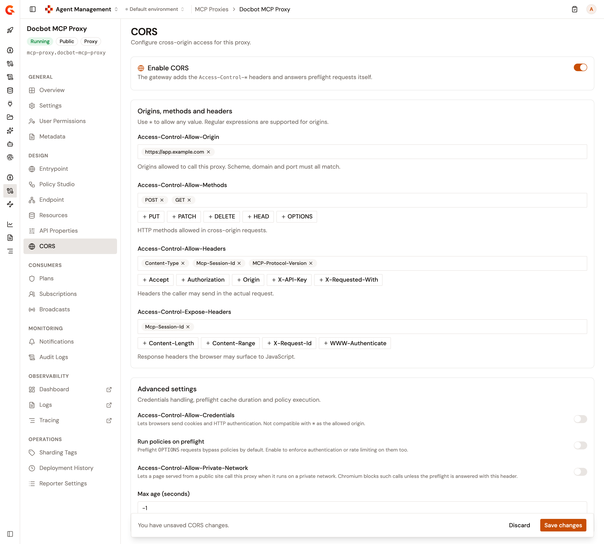

# Configure MCP Proxy CORS

The **CORS** page configures cross-origin access for an MCP Proxy or an MCP Studio. It lets an MCP client that runs in a browser call the proxy from a page on another origin. When CORS is enabled, the gateway answers browser preflight requests itself and adds the `Access-Control-*` headers to the responses of the proxy. CORS is off until you enable it.

## Prerequisites

Before you begin, confirm that you have the following:

* An MCP Proxy or an MCP Studio. For more information, see [Create an MCP proxy](create-an-mcp-proxy.md) and [Create an MCP Studio](create-an-mcp-studio.md).
* Permission to update the API definition of the proxy. Without it, the page is read-only: the **Enable CORS** switch and the other fields stay disabled, and the save bar never appears.

To open the page, follow these steps:

1. From the Gamma console sidebar, select **Agent Management**.
2. Under **Secure**, select **MCP Proxies**.
3. Select your MCP Proxy or MCP Studio.
4. Under **Design**, click **CORS**.

<figure><figcaption><p>The CORS page with unsaved changes</p></figcaption></figure>

## Enable CORS

Turn on the **Enable CORS** switch. The other settings on the page stay disabled until CORS is enabled.

## Set the origins, methods, and headers

The **Origins, methods and headers** card carries four list fields. Type a value and press Enter or a comma to add it, and click the cross on a value to remove it. The buttons under the method and header fields add a suggested value with one click. Use `*` to allow any value.

| Field                             | Description                                                                                                                                                                         |
| --------------------------------- | ----------------------------------------------------------------------------------------------------------------------------------------------------------------------------------- |
| **Access-Control-Allow-Origin**   | Origins allowed to call the proxy, such as `https://app.example.com`. An origin matches only when its scheme, domain, and port are the same. A value that contains `(`, `[`, or `*` is also evaluated as a regular expression. |
| **Access-Control-Allow-Methods**  | HTTP methods allowed in cross-origin requests.                                                                                                                                      |
| **Access-Control-Allow-Headers**  | Headers the caller may send in the actual request.                                                                                                                                  |
| **Access-Control-Expose-Headers** | Response headers the browser may surface to JavaScript.                                                                                                                             |

For an MCP client in a browser, the page suggests `Mcp-Session-Id` and `MCP-Protocol-Version` under **Access-Control-Allow-Headers**, because the client sends them with its requests. It also suggests `Mcp-Session-Id` and `WWW-Authenticate` under **Access-Control-Expose-Headers**, because the client reads them from the responses of the proxy.

Header names are saved in lowercase, so `Content-Type` reads back as `content-type` after you save. Enter methods in uppercase: the gateway compares the method of a preflight request with the saved values exactly. Add at least one method: with none, the gateway refuses every preflight request.

When you save, a value that reads neither as an origin nor as a valid regular expression is refused. The message names the value, such as **not-an-origin is not valid as an 'allow origin' value**.


Adding `*` as an allowed origin shows the **Allowing all origins** alert, because `*` exposes the proxy to any website. Make sure that authentication is enforced. While `*` is listed, the **Access-Control-Allow-Credentials** switch is disabled.


## Adjust the advanced settings

The **Advanced settings** card covers credentials, policy execution on preflight requests, private network access, and the preflight cache duration.

* **Access-Control-Allow-Credentials**. Lets browsers send cookies and HTTP authentication with cross-origin requests. When the switch is on, the gateway adds `Access-Control-Allow-Credentials: true` to the responses. The switch isn't compatible with `*` as the allowed origin.
* **Run policies on preflight**. By default, the gateway answers a preflight `OPTIONS` request as soon as the CORS checks pass, without running the flows of the proxy. Turn the switch on to also run, on preflight requests, the policies of the flows that aren't tied to a plan, such as the **Common Flows**. Plan flows don't run on preflight requests. The preflight request is still answered by the gateway and never reaches the upstream MCP server, and the security of the plans is skipped for preflight requests whether the switch is on or off.
* **Access-Control-Allow-Private-Network**. Lets a page served from a public site call the proxy when the proxy runs on a private network. When the switch is on, the gateway answers a preflight request that carries `Access-Control-Request-Private-Network: true` with `Access-Control-Allow-Private-Network: true`.
* **Max age (seconds)**. How long the browser may cache the preflight response. The default, `-1`, sends no `Access-Control-Max-Age` header. The field accepts values from `-1` to `2147483647`, and a value above `600` shows the **Long preflight cache** warning.

## Save and deploy

A change on the page shows the save bar with **You have unsaved CORS changes.** Click **Save changes** to apply, or **Discard** to revert. A successful save shows **CORS settings saved**. When the save is refused, the page shows the message returned by the API.

Saving with the **Enable CORS** switch off resets the page: the four lists read back empty, **Max age (seconds)** returns to `-1`, and the switches turn off.

Saving updates the API definition but doesn't deploy it. The **This API is out of sync** banner appears at the top of the detail view. Click **Deploy**, optionally enter a deployment label in the **Deploy your API** dialog, and click **Deploy** to push the change to the gateway.

Once CORS is enabled, the gateway decides the CORS headers of the proxy. A response to an origin that isn't allowed, or to a request without an `Origin` header, loses the `Access-Control-Allow-Origin`, `Access-Control-Allow-Credentials`, and `Access-Control-Expose-Headers` headers that the upstream MCP server set.

## Verification

To verify that the gateway applies the settings, follow these steps:

1. Enable CORS, add the origin `https://app.example.com`, add the `POST` method, and add the `Content-Type` header. Click **Save changes**, and then deploy the proxy from the **This API is out of sync** banner.
2. Send a preflight request to the URL of the proxy, as listed in the **Exposed entrypoints** card of the **Entrypoint** page:

    ```bash
    curl -i -X OPTIONS <proxy-url> \
      -H "Origin: https://app.example.com" \
      -H "Access-Control-Request-Method: POST" \
      -H "Access-Control-Request-Headers: content-type"
    ```

    The response carries `Access-Control-Allow-Origin: https://app.example.com`, `Access-Control-Allow-Methods`, and `Access-Control-Allow-Headers`.
3. Send the same request with an origin you didn't allow, such as `https://other.example.com`. The gateway refuses the preflight with status `400` and no `Access-Control-*` headers.

## Next steps

* [Configure the MCP Proxy entrypoint](configure-mcp-proxy-entrypoint.md). Change the context path that MCP clients call.
* [Manage MCP Proxy plans](configure-your-mcp/manage-mcp-proxy-plans.md). Set how consumers authenticate to the proxy.
