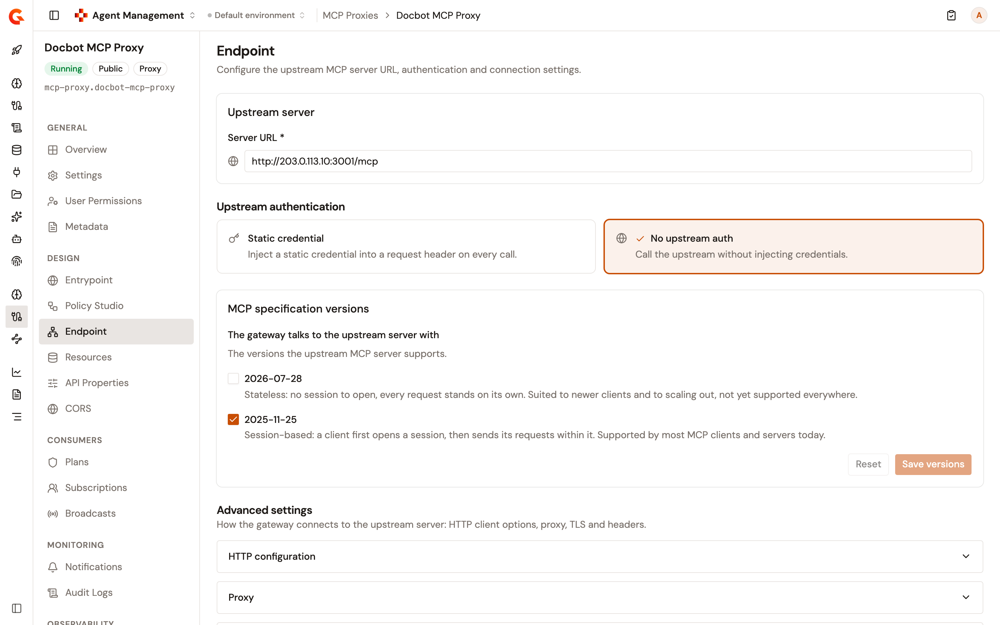
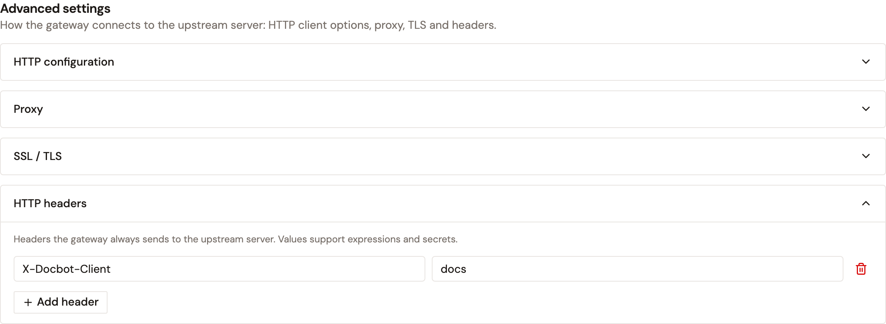

# Configure the MCP Proxy endpoint

The **Endpoint** page of an MCP Proxy sets the upstream MCP server that the proxy forwards calls to, and how the gateway connects to it. Only an MCP Proxy has this page. An MCP Studio shows **Tools** in its place, and each of its sources that comes from an MCP server in the Catalog takes its connection settings from that server. For more information, see [Change the connection settings of a registered server](../import/register-an-mcp-server.md#change-the-connection-settings-of-a-registered-server).

## Prerequisites

Before you begin, confirm that you have the following:

* An MCP Proxy. For more information, see [Create an MCP proxy](create-an-mcp-proxy.md).
* Permission to update the API definition of the proxy. Without it, the page is read-only and reads **You do not have permission to change the endpoint of this API.**

To open the page, follow these steps:

1. From the Gamma console sidebar, select **Agent Management**.
2. Under **Secure**, select **MCP Proxies**.
3. Select your MCP Proxy.
4. Under **Design**, select **Endpoint**.

<figure><figcaption>
The Endpoint page
</figcaption></figure>

## Change the upstream server

In the **Upstream server** card, enter the **Server URL** of the upstream MCP server. The URL starts with `http://` or `https://`. Otherwise, the field shows **Must be a valid http/https URL.** and **Save changes** stays disabled.

To set the credentials that the gateway injects into its calls to the upstream server, see [Configure Upstream Authentication](configure-your-mcp/README.md#configure-upstream-authentication).

## Adjust the advanced settings

The **Advanced settings** section sets how the gateway connects to the upstream MCP server. Click a section to open it:

* **HTTP configuration**. Timeouts, the connection pool, the **HTTP version**, and how the gateway handles keep-alive, pipelining, redirects, compression, and the client's `Accept-Encoding` and `Host` headers. **Propagate client Accept-Encoding header** turns on only while **Enable compression (`gzip`, `deflate`)** is off, and **Allow h2c clear-text upgrade** appears only when the **HTTP version** is **HTTP/2**.
* **Proxy**. Turn on **Enable proxy** to route the calls to the upstream server through a proxy. Either turn on **Use system proxy** to use the proxy settings of the gateway, or select a **Proxy type** of **HTTP**, **SOCKS4**, or **SOCKS5** and enter its **Host** and **Port**, plus a **Username** and **Password** when the proxy needs them. Without a host, the section shows **Proxy host is required when proxy is enabled.** Without a port, or with a port that isn't a number above zero, it shows **Proxy port is required when proxy is enabled.** **Save changes** stays disabled until you fix it.
* **SSL / TLS**. **Hostname verifier** checks that the certificate of the upstream server matches its host name, and **Trust all certificates** accepts any certificate. The page doesn't edit trust stores or key stores, and saving keeps the ones that the proxy already has.
* **HTTP headers**. The headers that the gateway sends with every call to the upstream server. Click **Add header**, and then enter a **Header name** and a **Value**. A value accepts the Gravitee Expression Language, including the attributes of the incoming request and secrets. A row without a name isn't saved. A header whose value is empty, or whose expression fails or resolves to nothing, isn't sent. The gateway waits for the values no longer than the **Read timeout (ms)**: past it, the call fails with status `504` and doesn't reach the upstream server.

<figure><figcaption>
The Advanced settings section
</figcaption></figure>

## Save and deploy

To apply your changes, follow these steps:

1. Click **Save changes**. The page confirms with **Connection settings saved.**
2. In the **This API is out of sync** banner, click **Deploy**.
3. Optional: In the **Deploy your API** dialog, enter a deployment label.
4. Click **Deploy**.

**Save changes** stays disabled until you change something and every field is valid. **Reset** brings the saved values back.

Saving updates the API definition but doesn't deploy it. The gateway keeps the previous settings until you deploy.


An MCP Proxy managed by the Kubernetes operator is read-only on this page, which reads **This API is managed by the Kubernetes operator. Its endpoint can only be changed from its source definition.**


## Verification

To verify the endpoint is working as expected, follow these steps:

1. Under **HTTP headers**, add a header, click **Save changes**, and then deploy the proxy.
2. Under **Operations**, select **Deployment History**. The newest version carries the **live** badge.
3. Send a request from an MCP client to the proxy. The upstream MCP server receives the header with the call.

## Next steps

* [Configure the MCP Proxy entrypoint](configure-mcp-proxy-entrypoint.md). Change the context path that MCP clients call.
* [Review MCP Proxy deployment history](review-mcp-proxy-deployment-history.md). Compare the deployed versions of the proxy, and roll back to an earlier one.
