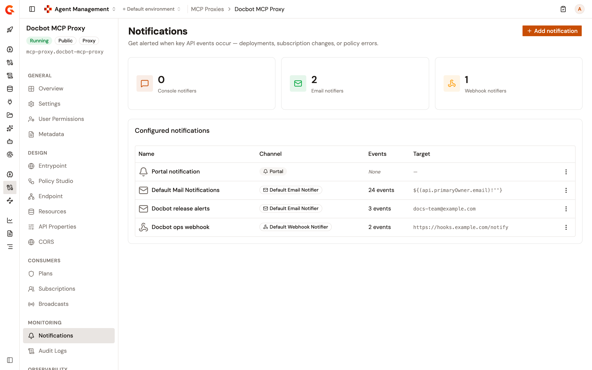

# Configure MCP Proxy notifications

The **Notifications** page controls which API events send notifications and where they are delivered. Each notification pairs a notifier with the set of events that trigger it.

To open the page, follow these steps:

1. Click **MCP Proxies** in the module sidebar.
2. Select your MCP Proxy.
3. Click **Notifications** in the MCP Proxy sidebar.

<figure><figcaption>
The Notifications page
</figcaption></figure>

The **Configured notifications** table lists each notification's **Name**, **Channel**, **Events**, and **Target** columns. An actions menu is added at the end of a row when you can edit or delete that notification.

Every MCP Proxy starts with a **Portal notification**, shown with the **Portal** channel. Other rows show the notifier they use, such as **Default Email Notifier**. The **Events** column shows how many events trigger the notification, or **None**. The **Target** column shows the email list or webhook URL of a notification, and the number of groups selected for the **Portal notification**.

If the list can't be loaded, the page shows **Could not load notifications**, followed by the reason.

The **Notifications** item appears in the sidebar only when you're allowed to read notifications. The **Add notification** button appears only when you're allowed to create notifications, and the actions menu offers only the entries your permissions allow. The **Portal notification** can be edited, but it can't be deleted.

## Add a notification

To add a notification, follow these steps:

1. Click **Add notification**.
2. Enter a **Name**.
3. Select a **Channel**. The list offers the available email and webhook notifiers, such as **Default Email Notifier**. The channel sets the target field: **Email list** for an email notifier, or **Webhook** for a webhook notifier.
4. Enter the target. Separate multiple email addresses with a space, a comma, or a semicolon.
5. For a webhook, optionally enable **Use system proxy** to route webhook calls through the configured system proxy.
6. Under **Events**, select the API events that send a notification. Events are grouped by category, such as **API KEY** and **SUBSCRIPTION**.
7. Click **Add notification**.

## Edit or delete a notification

To change a notification, open its actions menu, and then click **Edit**. You can adjust its target, its selected events, and for a webhook **Use system proxy**, and then click **Save**. For the **Portal notification**, the form offers the events only, plus the groups of the proxy when it has some, and only the primary owner changes the groups. The channel of an existing notification can't be changed. The form shows it as a read-only **Email** or **Webhook** badge.

To delete a notification, open its actions menu, and then click **Delete**. The **Delete this notification?** dialog warns that the notification stops receiving API event notifications, and that the action can't be undone. Click **Delete notification** to confirm.

## Verification

To verify a notification is working as expected, follow these steps:

1. Add a notification for an event you control, for example a subscription event.
2. Trigger the event.
3. Confirm that the notification arrives on the configured channel.
4. Return to the **Notifications** page. The new notification appears in the table with its notifier, and the **Events** count matches the events you selected.
