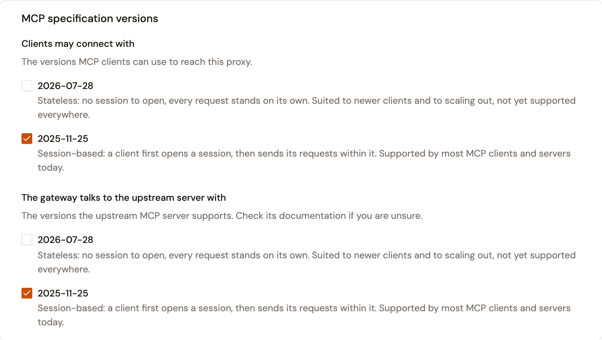
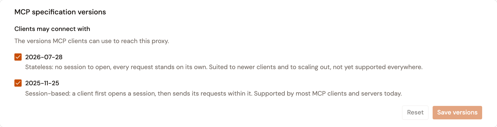
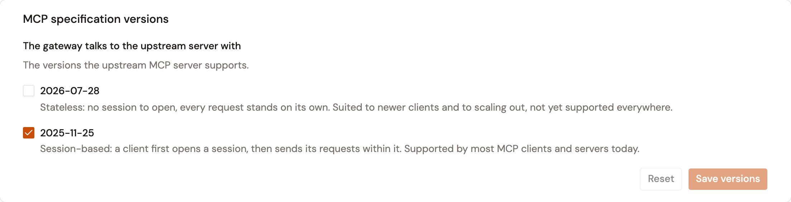
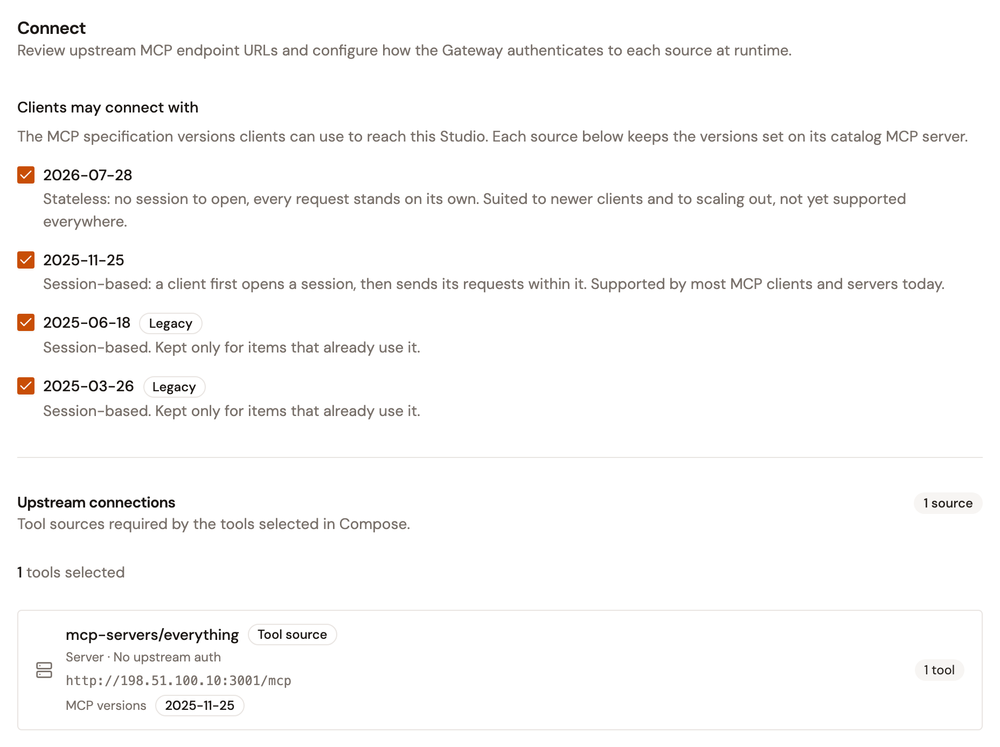
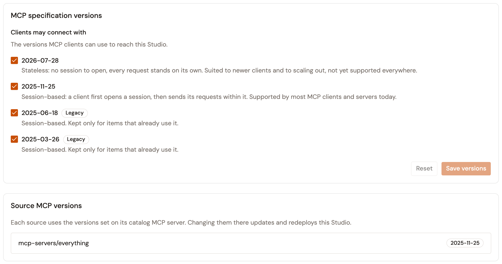
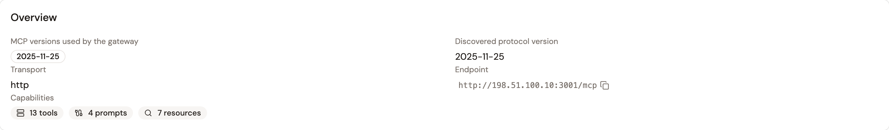
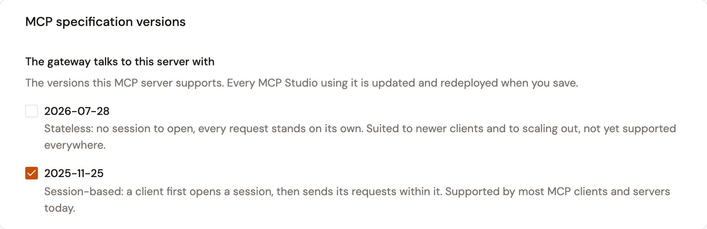

# Configure MCP specification versions

An MCP Proxy and an MCP Studio each list the MCP specification versions their clients may connect with. An MCP Proxy also lists the versions the gateway uses with its upstream MCP server. Each source of an MCP Studio uses the versions set on its catalog MCP server. You choose the versions when you create the proxy, and change them afterward from its detail pages. A change reaches the gateway when you deploy the proxy.

## The versions you can select

Every picker offers the same two versions, each with a description of how its clients connect.

| Version        | What the picker says                                                                                                                                 |
| -------------- | ---------------------------------------------------------------------------------------------------------------------------------------------------- |
| **2026-07-28** | Stateless: no session to open, every request stands on its own. Suited to newer clients and to scaling out, not yet supported everywhere.          |
| **2025-11-25** | Session-based: a client first opens a session, then sends its requests within it. Supported by most MCP clients and servers today.                 |

An item that already uses an earlier version, such as 2025-06-18, keeps showing it with a **Legacy** badge so that you can clear it. At least one version must stay selected. When none is, the picker shows **Select at least one version.** and you can't continue or save.

A new MCP Proxy starts with **2025-11-25** selected on both sides. A new MCP Studio starts with **2026-07-28**, **2025-11-25**, **2025-06-18**, and **2025-03-26** selected.

## Set the versions of an MCP Proxy

An MCP Proxy records the versions you select and doesn't negotiate the version itself. It forwards the version a client asks for to the upstream MCP server, which answers with the version it uses.

### In the creation wizard

1. Open the MCP Proxy wizard and complete the **Define** and **Secure** steps. For the whole procedure, see [Create an MCP proxy](../create-an-mcp-proxy.md).
2. In the **Connect** step, scroll to the **MCP specification versions** card.
3. Under **Clients may connect with**, select the versions MCP clients can use to reach the proxy.
4. Under **The gateway talks to the upstream server with**, select the versions the upstream MCP server supports. Check its documentation if you are unsure.
5. Complete the wizard. The **Review** step lists the versions as **Client MCP versions** and **Upstream MCP versions**.

<figure><figcaption>
The MCP specification versions card in the Connect step
</figcaption></figure>

### After creation

1. From the Gamma console sidebar, select **Agent Management**.
2. Under **Secure**, select **MCP Proxies**, and then open the MCP Proxy.
3. Under **Design**, select **Entrypoint**.
4. In the **MCP specification versions** card, select the versions under **Clients may connect with**, and then click **Save versions**.
5. To change the versions used with the upstream server, under **Design**, select **Endpoint**. In the **MCP specification versions** card, select the versions under **The gateway talks to the upstream server with**, and then click **Save versions**.
6. Click **Deploy** in the **This API is out of sync** banner.

The message **MCP versions saved. Deploy to apply them to the gateway.** confirms each save. **Reset** returns the card to the saved versions. When the proxy is managed by the Kubernetes operator, or you don't have the right to change it, the card is read-only and the page says why.

<figure><figcaption>
The Entrypoint page of an MCP Proxy that accepts both versions
</figcaption></figure>

<figure><figcaption>
The Endpoint page of an MCP Proxy
</figcaption></figure>

## Set the versions of an MCP Studio

An MCP Studio answers its clients itself. A client on a session-based version opens a session with the version it asks for, when the Studio accepts that version. Otherwise, the session opens with the newest session-based version the Studio accepts. A client on 2026-07-28 sends each request on its own, without a session. A request on a version the Studio doesn't accept is refused with the error **Unsupported protocol version**, code `-32022`, which lists the versions the Studio accepts. A client on a session-based version that sends a request without a session is refused with the error `Missing or invalid Mcp-Session-Id`. When the Studio accepts only 2026-07-28, a session-based client can't open a session. Its handshake is refused with the error **Unsupported protocol version**, which lists the versions the Studio accepts.

Each source of the Studio uses the versions set on its catalog MCP server, so on the Studio you select only the versions clients may connect with.

### In the creation wizard

1. Open the MCP Studio wizard and complete the **Define**, **Secure**, and **Compose** steps. For the whole procedure, see [Create an MCP Studio](../create-an-mcp-studio.md).
2. In the **Connect** step, under **Clients may connect with**, select the versions MCP clients can use to reach the Studio.
3. Under **Upstream connections**, read the **MCP versions** of each source. To change them, configure the source's catalog MCP server, as described in [Set the versions of a catalog MCP server](#set-the-versions-of-a-catalog-mcp-server).
4. Complete the wizard. The **Review** step lists the versions as **Client MCP versions**.

<figure><figcaption>
The Connect step of the MCP Studio wizard
</figcaption></figure>

### After creation

1. From the Gamma console sidebar, select **Agent Management**.
2. Under **Secure**, select **MCP Proxies**, and then open the MCP Studio.
3. Under **Design**, select **Entrypoint**.
4. In the **MCP specification versions** card, select the versions under **Clients may connect with**, and then click **Save versions**.
5. Click **Deploy** in the **This API is out of sync** banner.

The **Source MCP versions** card lists the versions each source uses. Change them on the catalog MCP server. As on an MCP Proxy, the card is read-only when the Studio is managed by the Kubernetes operator or you don't have the right to change it.

<figure><figcaption>
The Entrypoint page of an MCP Studio
</figcaption></figure>

## Set the versions of a catalog MCP server

A catalog MCP server starts with the version it reported when you verified its URL. When the gateway doesn't support that version, the server starts with 2025-11-25.

1. From the Gamma console sidebar, select **Agent Management**.
2. Under **Catalog**, select **MCP Servers**, and then select the server. The **Overview** card shows the versions in use as **MCP versions used by the gateway**, and the version the server reported as **Discovered protocol version**.
3. Click **Configure**.
4. In the **MCP specification versions** card, under **The gateway talks to this server with**, select the versions the server supports.
5. Click **Save**.

The versions decide how the gateway connects to the server for the MCP Studios that use it. With session-based versions only, the gateway opens a session with the server. With 2026-07-28 only, it sends each request on its own. With both, it first tries the way the newest selected version uses, and then the other.

When you save, every MCP Studio that uses the server takes the new versions. A Studio that was in sync is deployed again. A Studio with changes that aren't deployed yet is updated but not deployed, and its owners are notified. The message that confirms the save says how many Studios were redeployed, how many need a manual deploy, and how many couldn't be updated. Re-syncing the server keeps the versions you selected.

<figure><figcaption>
The Overview card of a catalog MCP server
</figcaption></figure>

<figure><figcaption>
The MCP specification versions card of the Configure page
</figcaption></figure>

## Verification

To verify the versions, follow these steps:

1. Under **Design**, select **Entrypoint**. The **MCP specification versions** card shows the versions you saved, and the **This API is out of sync** banner is gone once the deploy is done.
2. For an MCP Studio, send a request from an MCP client on a version you didn't select. The Studio answers **Unsupported protocol version** and lists the versions it accepts.

## Next steps

* [Create an MCP proxy](../create-an-mcp-proxy.md). Create an MCP Proxy that governs an upstream MCP server.
* [Create an MCP Studio](../create-an-mcp-studio.md). Compose tools, resources, and prompts from multiple sources into a governed Composite MCP Server.
* [Register an MCP server](../../import/register-an-mcp-server.md). Add an MCP server to the Catalog with its tools, resources, and prompts.
