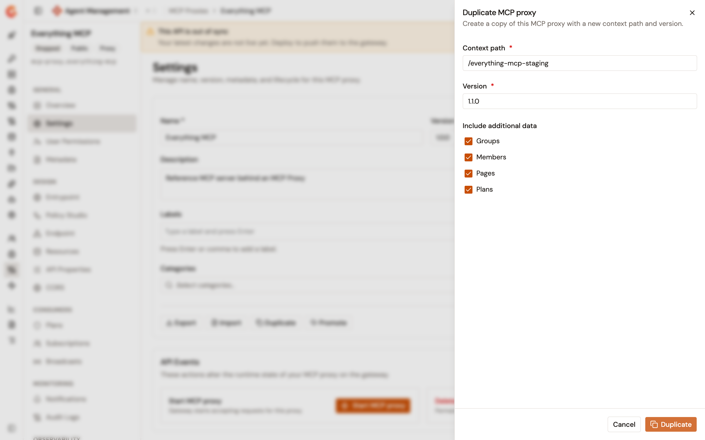

# Duplicate an MCP Proxy

## Overview

The **Duplicate** action creates a new MCP Proxy from the configuration of an existing one, in either mode. A copy of a proxy sits in front of the same upstream MCP server, and a copy of an MCP Studio composes the same tools, prompts, and resources. The panel asks you for a version and for a context path, which the copy can't share with its source.

Use **Duplicate** to copy a proxy inside one environment. To move a proxy to a different environment, export it and import the file there instead. For more information about exporting and importing an MCP Proxy, see [Export and import an MCP Proxy](export-and-import-an-mcp-proxy.md).

## Prerequisites

Before you begin, confirm that you have the following:

* An MCP Proxy or an MCP Studio created in Agent Management. For more information, see [Create an MCP proxy](create-an-mcp-proxy.md) and [Create an MCP Studio](create-an-mcp-studio.md).
* Permission to read the API definition of the proxy, and permission to create an API in the environment. The **Duplicate** action isn't shown on the **Settings** page without both.

## Duplicate the proxy

To duplicate an MCP Proxy, complete the following steps:

1. From the Gamma console sidebar, select **Agent Management**.
2. Under **Secure**, select **MCP Proxies**.
3. Select the MCP Proxy that you want to copy.
4. Under **General**, select **Settings**.
5. Select **Duplicate**.

    <figure><figcaption>
The Duplicate MCP proxy panel
</figcaption></figure>

6. In the **Duplicate MCP proxy** panel, complete the following fields:

    | Field | Required | Description |
    | --- | --- | --- |
    | **Context path** | Yes | The path prefix that clients call on the copy. It starts with `/`, is longer than three characters, uses only letters, digits, and the `/`, `.`, `-`, and `_` characters, and holds no `//`. Until you type, the field shows the source proxy's path. |
    | **Version** | Yes | The version of the copy, up to 32 characters. Until you type, the field shows the source proxy's version, but the copy takes only the value you type. |

7. Under **Include additional data**, clear any of the **Groups**, **Members**, **Pages**, and **Plans** checkboxes you want to leave out of the copy. All four are selected by default.
8. Select **Duplicate**.

The console creates the copy and opens its **Settings** page. The copy takes the source proxy's name. Give it a distinct name on its **Settings** page when you want to tell the two apart in the **MCP Proxies** list.

An MCP Proxy created outside Agent Management, such as in the APIM Console, can't be duplicated. Export it and import the file instead.

## Context path availability

The panel checks the context path against the other APIs of the environment as you type, with a short pause after your last keystroke. **Checking availability** appears while the check runs, and a path that's already in use is reported under the field.

The check runs again when you select **Duplicate**, so a path taken between your keystroke and your submission is still caught. If the check itself can't reach the platform, the panel doesn't block you, and the duplicate is refused on submission when the path is taken.

## Start the copy

The copy is created stopped and out of sync. Once its configuration is right, select **Start MCP proxy** on its **Settings** page, and deploy it from the out-of-sync banner.


When you clear the **Plans** checkbox, the copy has no plan, and clients can't subscribe to it. Add a plan to the copy before you start it. See [Manage MCP Proxy plans](configure-your-mcp/manage-mcp-proxy-plans.md).


## Verification

To verify the copy, complete the following steps:

1. Under **Secure**, select **MCP Proxies**. The list holds a second proxy with the source proxy's name.
2. Open the copy, and then under **Design**, select **Endpoint** on a proxy, or **Tools** on an MCP Studio. The copy shows the same upstream server, or the same tools, as the source.
3. Under **Consumers**, select **Plans**. The plans are present when you left the **Plans** checkbox selected, and absent when you cleared it.

## Next steps

* **Manage the copy's plans**. See [Manage MCP Proxy plans](configure-your-mcp/manage-mcp-proxy-plans.md).
* **Move the copy to another environment**. See [Export and import an MCP Proxy](export-and-import-an-mcp-proxy.md).
