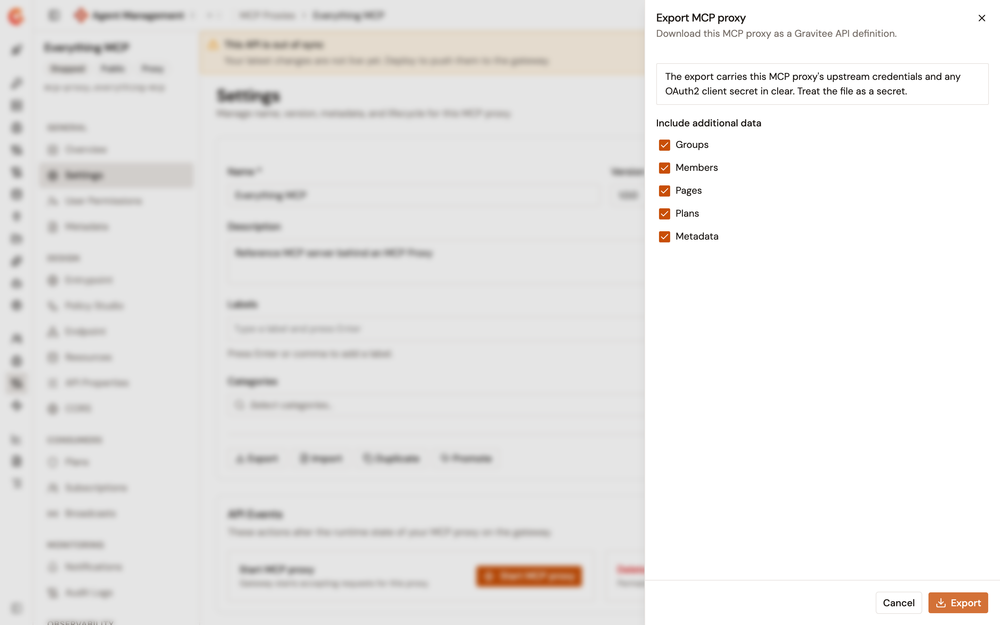
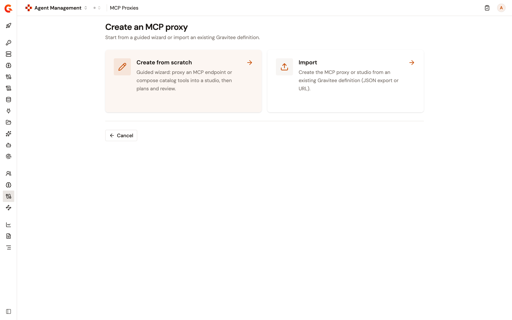
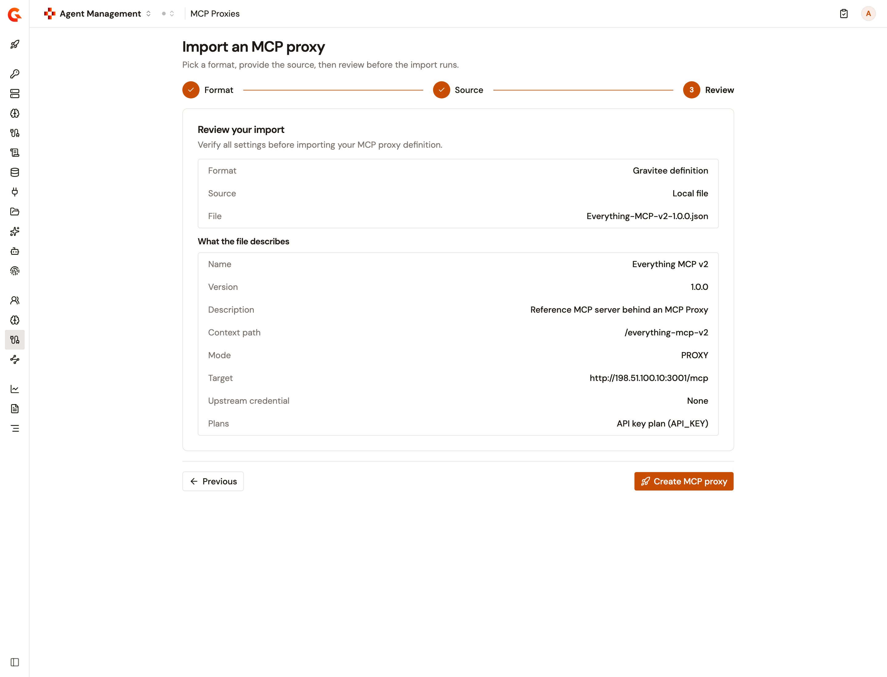
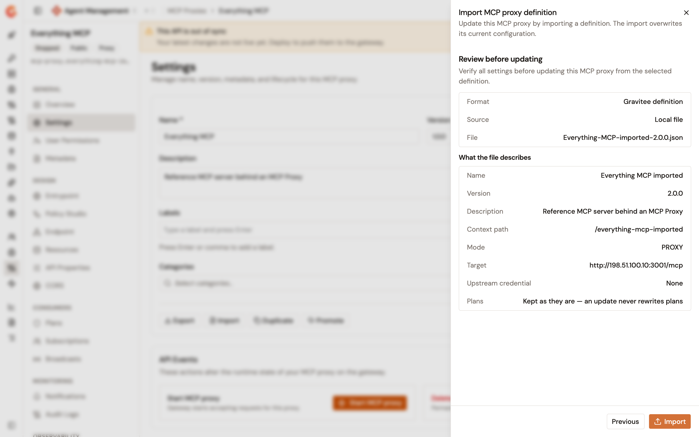

# Export and import an MCP Proxy

## Overview

An MCP Proxy exports as a Gravitee API definition, and a Gravitee API definition creates or updates an MCP Proxy. Both modes travel this way: a proxy in front of an upstream MCP server, and an MCP Studio that composes catalog tools. Together the two directions move a proxy between environments and rebuild a proxy without retyping its configuration.

The exported file is a standard Gravitee export with one extra `gamma` block that records the proxy's mode. For a proxy, the block carries the upstream MCP server. For an MCP Studio, it names each tool, prompt, and resource by its name in the catalog. The import looks for the same names in the catalog of the environment you import into. A proxy created outside Agent Management, such as in the APIM Console, exports without the block.

## Prerequisites

Before you begin, confirm that you have the following:

* An MCP Proxy or an MCP Studio. For more information, see [Create an MCP proxy](create-an-mcp-proxy.md) and [Create an MCP Studio](create-an-mcp-studio.md).
* Permission to read the API definition of the proxy. The **Export** action isn't shown on the **Settings** page without it.
* Permission to update the API definition of the proxy, to import a definition onto an existing proxy. The **Import** action isn't shown on the **Settings** page without it.
* Permission to create an API in the environment, to create a proxy by importing a definition. Without it, the import is refused on the **Review** step.

## Export an MCP Proxy

The **Export** action downloads the MCP Proxy definition. To export a proxy, complete the following steps:

1. From the console sidebar, select **Agent Management**.
2. Under **Secure**, select **MCP Proxies**.
3. Select the MCP Proxy that you want to export.
4. Under **General**, select **Settings**.
5. Select **Export**.

    <figure><figcaption>
The Export MCP proxy panel
</figcaption></figure>

6. In the **Export MCP proxy** panel, clear any of the **Include additional data** checkboxes you want to leave out of the file. **Groups**, **Members**, **Pages**, **Plans**, and **Metadata** are all selected by default, and each cleared checkbox drops that data from the export.
7. Select **Export**.

The browser downloads a JSON file named `<name>-<version>.json`. Whitespace and other non-word characters in the file name are replaced with hyphens.

An MCP Studio export is refused when one of the tools, prompts, or resources that the studio composes, or the source it comes from, is no longer in the catalog. It's also refused when the catalog can't be read.


When you clear the **Plans** checkbox, the file can update an existing MCP Proxy but can't create one. A create by import needs the plans, and refuses a file that carries none. Keep **Plans** selected when you plan to recreate the proxy elsewhere.



The panel warns that the export carries the proxy's upstream credentials and any OAuth2 client secret in clear. Treat the file as a secret.


## Create an MCP Proxy by importing a definition

The **Create an MCP proxy** page offers **Import** beside the wizard. To create a proxy or a studio from a definition, complete the following steps:

1. From the console sidebar, select **Agent Management**.
2. Under **Secure**, select **MCP Proxies**.
3. Select **+ Create MCP proxy**.
4. On the **Create an MCP proxy** page, select **Import**.

    <figure><figcaption>
The Create an MCP proxy page
</figcaption></figure>

5. On the **Format** step, keep the **Gravitee definition** card selected. This is the only format an MCP Proxy accepts, and it's selected for you.
6. Select **Next**.
7. On the **Source** step, under **Configure file source**, select **Local file** or **Remote URL**:
   * For **Local file**, drop a file on the upload area or select it to browse. The picker accepts `.json` files of up to 5 MB.
   * For **Remote URL**, enter the **Definition URL** of the file.
8. Select **Next**.
9. On the **Review** step, check the summary, and then select **Create MCP proxy**.

    <figure><figcaption>
The Review step of a create by import
</figcaption></figure>

The **Review your import** summary restates the **Format**, the **Source**, and the **File** or the **URL** you chose. Under **What the file describes**, it shows what the import is about to create: the **Name**, **Version**, **Description**, **Context path**, and **Mode**. It also shows the **Target** of a proxy or the **Catalogue** of a studio, which counts its tools, prompts, and resources. Last come whether the file includes an **Upstream credential**, and the **Plans**. A file that the import would refuse is refused on this step, with the same message, before anything is created.

The mode comes from the file: a proxy's export creates an MCP Proxy, and a studio's export creates an MCP Studio. The console creates the proxy and opens it. The proxy is created stopped and out of sync. To serve traffic, select **Start MCP proxy** on its **Settings** page, and deploy it from the out-of-sync banner.

### File shapes the import accepts

The import accepts the following two shapes:

* **A Gamma export of either mode.** A proxy is recreated in front of the same upstream MCP server, with the upstream credential the file carries. A studio's tools, prompts, and resources are linked to the catalog of the environment you're importing into, which is what lets one file create the studio in a second environment.
* **An APIM Console export of an MCP Proxy in front of an upstream server.** The upstream server and credential are read from the definition's endpoint. An APIM Console export of an MCP Studio is refused, because it doesn't record the catalog items the studio was built from. Export the studio again from the Gamma console.

The import recreates **Keyless**, **API Key**, and **OAuth2** plans. This covers OAuth2 plans made with **Gravitee as Authorization Server** or **External Authorization Server**. A file that carries a plan of any other type, such as a **JWT** or **mTLS** plan, is refused for a create. An update by import never reads the plans, so it still accepts that file.

### When an import is refused

The import validates the file before it writes anything, and reports what's wrong instead of creating a partial proxy:

| Condition | Result |
| --- | --- |
| The file carries no `api` definition | The import is refused. |
| The file describes another kind of API | The import is refused, and the message names the type the file carries. |
| The file describes an MCP Studio but carries no Gamma addition | The import is refused, and the message tells you to export the studio again from the Gamma console. |
| A proxy's definition carries no upstream server | The import is refused. |
| The file carries no plans | The create is refused, and the message tells you to export the proxy again without excluding the plans. |
| A plan has a type the import doesn't recreate | The create is refused, and the message names the plan type. |
| An OAuth2 plan names no authorization server | The create is refused. |
| An OAuth2 plan names an authorization server that the file doesn't declare, or one of a type the import doesn't recognize | The create is refused, and the message names the server. |
| The file's proxy name generates an ID that this environment already holds | The create is refused, and the message names the ID. The name in the file decides the value. |
| The file's context path is already in use in this environment | The create is refused, and the message names the path. |
| A studio names a tool, prompt, or resource that this environment's catalog doesn't hold | The import is refused, and the message names the item and its source. |
| A studio carries an upstream credential for a catalog source that this environment doesn't hold | The import is refused, and the message names the source. |
| A studio carries an upstream credential for a catalog source that matches more than one source in this environment | The import is refused as ambiguous. |
| The catalog itself can't be read | The import is refused. Retry once the catalog responds. |


To move an MCP Studio into another environment, register the same MCP servers there first. The import finds each tool, prompt, and resource by its name in the catalog, which comes from the MCP server's name and the item's own name. It refuses the file when it can't find a match, and never adds the missing item to the catalog for you.


## Update an MCP Proxy by importing a definition

The **Import** action on the **Settings** page replaces an existing proxy's configuration from a definition. To update a proxy, complete the following steps:

1. Open the MCP Proxy that you want to update.
2. Under **General**, select **Settings**.
3. Select **Import**.
4. In the **Import MCP proxy definition** panel, under **Configure file source**, select **Local file** or **Remote URL**, and then provide the file or the **Definition URL**.
5. Select **Review**.

    <figure><figcaption>
The review before an update by import
</figcaption></figure>

6. On the **Review before updating** step, check what the file describes, and then select **Import**.

The proxy keeps its ID and its plans, so its subscriptions survive the update. The following table shows what the update takes from the file, and what it keeps from the proxy:

| The update takes from the file | The update keeps from the proxy |
| --- | --- |
| The name, version, description, and context path | The proxy's own ID, even when the file carries a different one |
| For a proxy, the upstream MCP server and its credential | The plans, and therefore their subscriptions |
| For an MCP Studio, its tools, prompts, and resources, and the upstream credential of each source | The MCP protocol versions the proxy supports |

A proxy's file that carries no upstream credential removes the proxy's current one. An update by import accepts a file exported without its plans, because it never writes plans. It refuses a file of the other mode: a studio's file can't update a proxy, and a proxy's file can't update a studio. Import the file as a new proxy instead. An MCP Proxy created outside Agent Management, such as in the APIM Console, can't be updated from a file either.

The context path comes from the file. An import that applies one proxy's export to a different proxy is refused while the source still holds that path. Change the path in the file, or free it on the source, before you import.

The update doesn't deploy. The proxy is left out of sync, and you deploy it from the out-of-sync banner.

## Import from a remote URL

Gravitee fetches the definition from the URL, not your browser, under the same restrictions as the API Management import from a URL. Your installation can limit which addresses it fetches. An address it refuses is reported as forbidden, and an address it can't read is reported as a failure to fetch the definition. Either way, an update leaves the proxy as it was.

## Verification

To verify that a proxy survives the round trip, complete the following steps:

1. Export the proxy with every **Include additional data** checkbox selected.
2. Change the proxy name and the context path in the downloaded file. A create by import is refused when the name generates an ID that the environment already holds, and refused when the context path is already in use. An import into a different environment needs neither change.
3. Create a proxy by importing the edited file.
4. Under **Consumers**, select **Plans** on the copy. The plans the file carried are present.
5. Under **Design**, select **Endpoint** on a proxy, or **Tools** on an MCP Studio. The copy shows the same upstream server, or the same tools, as the source.

## Next steps

* **Copy a proxy inside one environment**. See [Duplicate an MCP Proxy](duplicate-an-mcp-proxy.md).
* **Send a proxy to another environment through Gravitee Cloud**. See [Promote your proxies to another environment](promote-your-proxies-to-another-environment.md).
* **Manage the plans of the imported proxy**. See [Manage MCP Proxy plans](configure-your-mcp/manage-mcp-proxy-plans.md).
