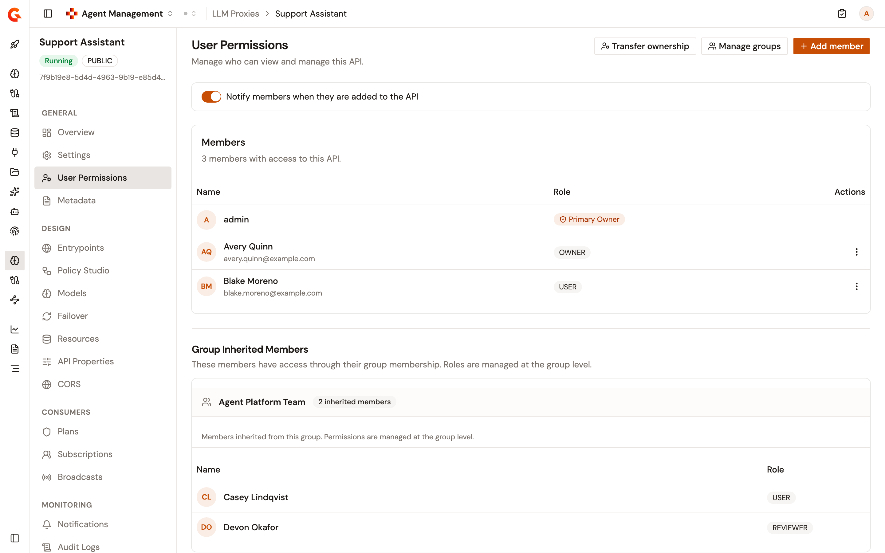
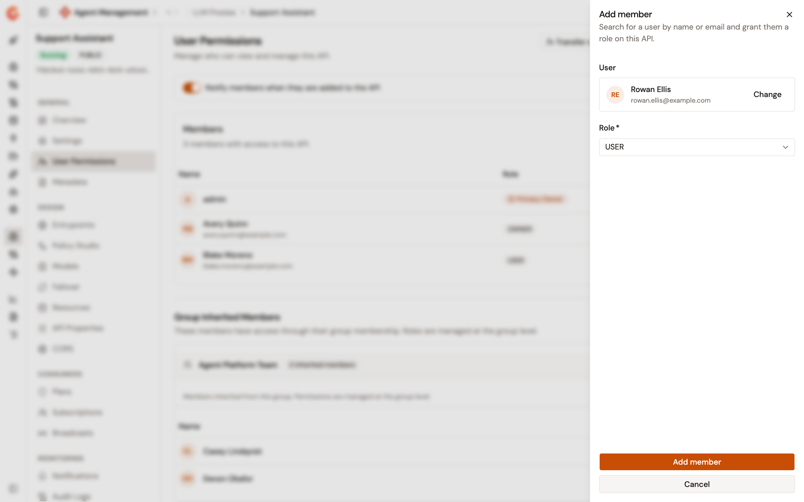
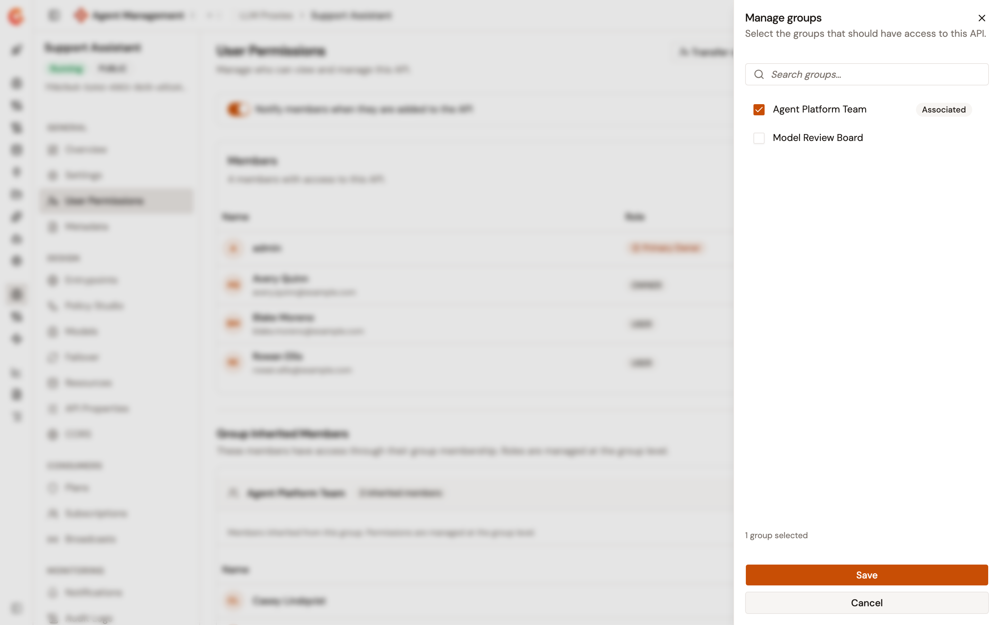
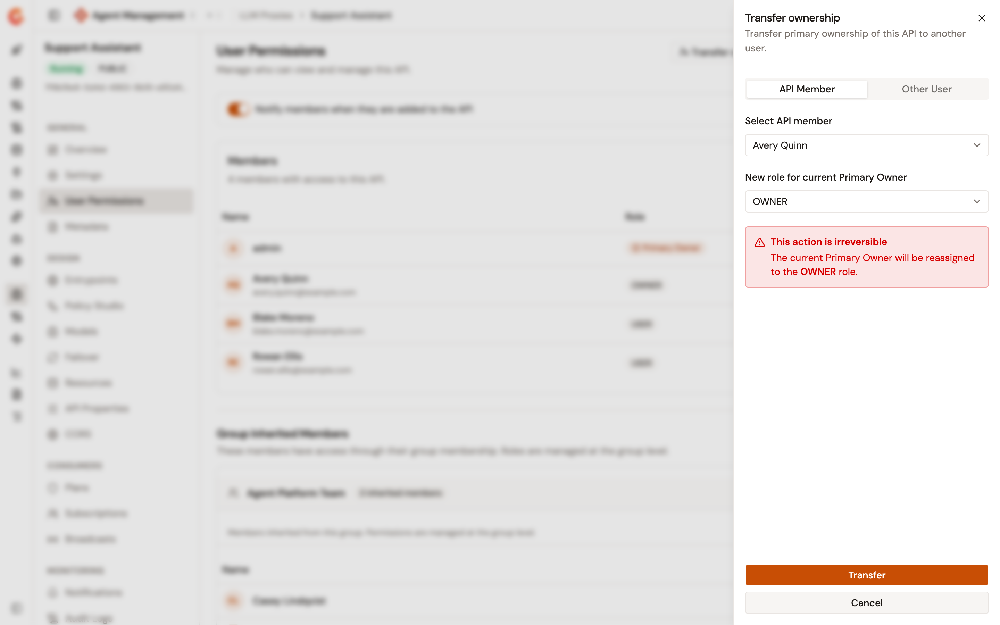
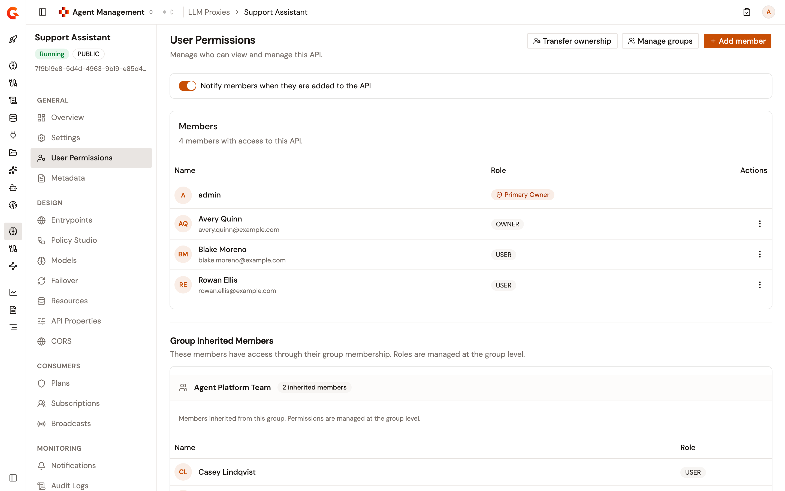

# Manage user permissions for your proxies

Each LLM Proxy, MCP Proxy, and A2A Proxy has a **User Permissions** page. It controls who holds a role on the proxy: its members, the members of its groups, and its primary owner.

A member holds the role you give them on this page. The members of an associated group hold the API role they have in that group. The roles you give are the API roles of your organization, except the primary owner role. See [Manage roles](../../platform-management/manage-roles.md) and [Manage groups](../../platform-management/manage-groups.md).

A change on this page takes effect without a deployment.

## Open the User Permissions page

To open the page, follow these steps:

1. Under **Secure** in the module sidebar, select **LLM Proxies**, **MCP Proxies**, or **A2A Proxies**.
2. Select the proxy to configure.
3. Under **General**, select **User Permissions**.

<figure><figcaption>
The User Permissions page of an LLM Proxy
</figcaption></figure>

The **Members** list holds the people with a role directly on the proxy. The person who owns the proxy carries the **Primary Owner** badge, and their row has no actions menu. When a group owns the proxy, no member carries the badge, and the group is listed under **Group Inherited Members**.

**Group Inherited Members** lists each associated group in which at least one member holds an API role, with the role of each of those members. To change an inherited role, change the member's roles in the group. See [Change a member's roles](../../platform-management/manage-groups.md#change-a-members-roles).

**Transfer ownership**, **Manage groups**, and **Add member** show to everyone who opens the page. When your role doesn't allow a change, the change fails with **Could not save changes**. When your role doesn't allow reading the members, the page reads **Could not load members**.

## Notify the people you add

**Notify members when they are added to the API** is on by default. While it's on, each person you add to the proxy receives an email that names the proxy. Turn it off to add people without an email. The change saves as soon as you turn the switch.

The email goes out only when emailing is turned on and the person has an email address. See [Configure the SMTP mail server](../../platform-management/configure-smtp.md).

## Add a member

To add a member, follow these steps:

1. Click **Add member**.
2. In the **Add member** panel, enter at least two characters of the person's name or email address in **User**, and then select the person.
3. Select a **Role**.
4. Click **Add member**.

<figure><figcaption>
The Add member panel
</figcaption></figure>

Note the following points when you add a member:

* The **Role** list starts on the first role in alphabetical order, which is **OWNER** with the default roles. Select the role you mean to give before you click **Add member**.
* The search returns at most 20 people. Refine it when the person you expect isn't listed.
* The search finds people only when your organization role lets you read the organization's users. With the default roles, only organization administrators have that access. Otherwise, every search reads **No users found.**
* A person who's already a member of the proxy isn't added again. The page reads **Could not save changes**, and the panel stays open. To give them another role, change their role instead.

## Change a member's role

To change a member's role, follow these steps:

1. Open the actions menu of the member, and then click **Edit role**.
2. Select the new role in the **Role** column.
3. Click **Save**.

## Remove a member

To remove a member, follow these steps:

1. Open the actions menu of the member, and then click **Remove member**.
2. In the **Remove this member?** dialog, click **Remove member**.

Removing a member takes away the role they hold directly on the proxy. A role they inherit from a group associated with the proxy stays.

## Manage groups

To choose the groups associated with the proxy, follow these steps:

1. Click **Manage groups**.
2. In the **Manage groups** panel, select the groups that get access to the proxy, and clear the ones that don't. **Associated** marks the groups that are associated with the proxy.
3. Click **Save**.

<figure><figcaption>
The Manage groups panel lists the groups of the environment
</figcaption></figure>

**Save** associates the groups you selected, with the following exceptions:

* With **Hybrid** or **Group** as the API primary owner mode, a group that owns the proxy stays associated, even when you clear it.
* A group in which someone holds the API primary owner role is left out without an error, unless that person owns the proxy.
* With **Group** as the API primary owner mode, saving the groups of a proxy that a person owns also associates a qualifying group: the owner's, or else one of yours. Without one, the save fails with **Could not save changes**. The same applies when you turn **Notify members when they are added to the API**. See [Configure primary owner mode](../../platform-management/configure-primary-owner-mode.md).

Members who hold an API role in an associated group appear under **Group Inherited Members** with that role.

## Transfer ownership

A transfer gives the primary owner role of the proxy to another person. When a person owns the proxy, they're reassigned to the role you choose.

To transfer ownership, follow these steps:

1. Click **Transfer ownership**.
2. In the **Transfer ownership** panel, choose the new owner in one of the following ways:
    * On the **API Member** tab, select a member of the proxy in **Select API member**.
    * On the **Other User** tab, search for the person by name or email, and then select them.
3. In **New role for current Primary Owner**, select the role the current primary owner is reassigned to.
4. Click **Transfer**.

<figure><figcaption>
The Transfer ownership panel
</figcaption></figure>

Note the following points when you transfer ownership:

* A role the new owner held as a member of the proxy is replaced by the primary owner role.
* **New role for current Primary Owner** starts on the first role in alphabetical order, like the **Role** list of the **Add member** panel.
* The search of the **Other User** tab works like the search of the **Add member** panel.
* Ownership goes to a person only. The panel offers no group.
* When a group owns the proxy, the transfer removes that group from the groups associated with the proxy. The role you select in **New role for current Primary Owner** then goes to nobody.

## Verification

To verify user permissions are working as expected, follow these steps:

1. Add a member, as described in [Add a member](#add-a-member).
2. Reload the **User Permissions** page.
3. Confirm the person is listed under **Members** with the role you selected.

<figure><figcaption>
The new member is listed with the role you selected
</figcaption></figure>
