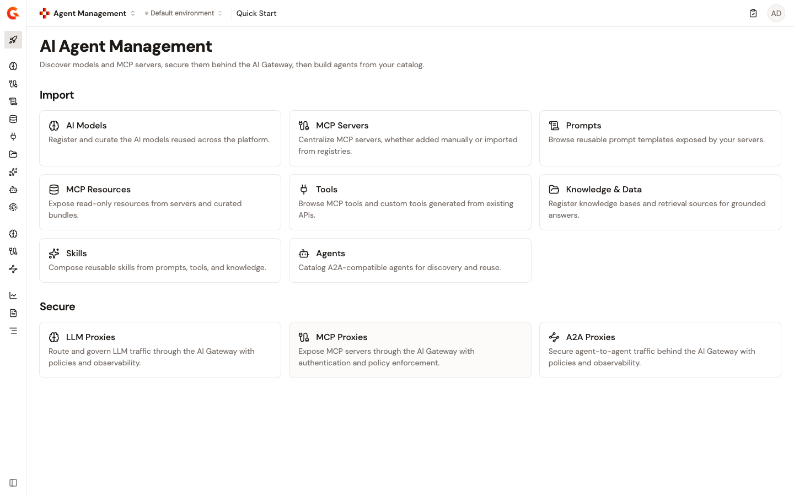

# Catalog

The **Catalog** group of the Agent Management sidebar holds the **AI Models**, **MCP Servers**, **Prompts**, **MCP Resources**, **Tools**, **Knowledge & Data**, **Skills**, **Agents**, and **Agent Identity** pages.

* [**Integrations**](integrations/README.md). Integrations bring models and agents from outside Gamma into the Catalog.
* [**Add an AI model**](add-an-ai-model.md). Add an AI model to the Catalog so authorization policies, observability, and cost attribution can reference it.
* [**Add an MCP Registry**](add-an-mcp-registry.md). Importing MCP servers in bulk from an external registry is planned for a future release.
* [**Register an MCP server**](register-an-mcp-server.md). Register an MCP server to add it to the Catalog with its tools, resources, and prompts.
* [**Import prompts**](import-prompts.md). Prompts are reusable, parameterized templates discovered from registered MCP servers and cataloged for governance.
* [**Add MCP resources**](add-mcp-resources.md). MCP resources are read-only data items agents use as context, discovered from registered MCP servers.
* [**Create API tools**](create-api-tools.md). Expose REST APIs governed in API Management as agent-accessible tools in the Catalog.
* [**Create workflow tools**](create-workflow-tools.md). Chain operations from your APIs in API Management into one MCP tool that the gateway runs.
* [**Add a knowledge source**](add-knowledge-source.md). Add a knowledge source so agents can read documentation and reference material as context.
* [**Upload skills**](upload-skills.md). Upload a skill package so agents can consume it as an MCP resource and you can govern it.
* [**Manage a registered agent**](manage-a-registered-agent.md). A registered agent's page in the Catalog is the hub for everything Gamma holds and controls for it.
* [**Give an agent an identity**](give-an-agent-an-identity.md). The Identity page of an agent creates the gateway application that acts for it and gives that application an OAuth identity from Gravitee Access Management.
* [**Route an agent through an A2A Proxy**](route-an-agent-through-an-a2a-proxy.md). Put an A2A Proxy in front of a registered agent from its Proxies page, or link an existing proxy to it.
* [**Subscribe an agent to an LLM Proxy**](subscribe-an-agent-to-an-llm-proxy.md). The Models page of an agent lists the models it calls and the LLM Proxies that route them.
* [**Subscribe an agent to an MCP Proxy**](subscribe-an-agent-to-an-mcp-proxy.md). The Tools page of an agent lists what it calls in Azure AI Foundry and whether those calls go through the gateway.
* [**Publish your agent to the Developer Portal**](../publish/publish-your-agent-to-the-developer-portal.md). List an agent exposed through a Gamma A2A Proxy in the Developer Portal catalog.
* [**Agent kill switch**](../build/agent-killswitch.md). Stop an agent in one move from its page in the Catalog, which stops the A2A Proxy in front of it, pauses its gateway subscriptions, and disables it on Azure AI Foundry, or stop a proxy on its own.
* [**Create an agent identity**](../build/create-an-agent-identity.md). Register an agent as an OAuth client in Gravitee Access Management with a persona that fits how it runs.

<figure><figcaption>
The Import section of the Agent Management dashboard. Each card links to a Catalog entity type. The full set of import operations — including integrations, API tools, and Event tools — is listed below.
</figcaption></figure>
