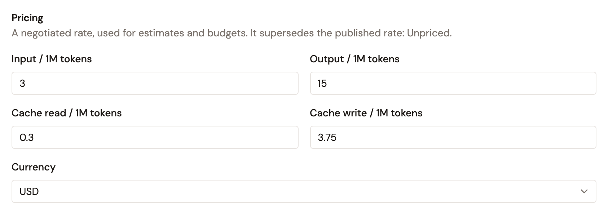

# Add an AI model

AI models are Catalog entities that represent LLMs from any provider. Cataloging a model gives it an identity that authorization policies, observability, and cost attribution can reference. You can add models by configuring a provider connection and selecting which models to activate.

## AI model catalog fields

Each AI model in the Catalog records the following metadata:

| Field                  | Description                                                                   |
| ---------------------- | ----------------------------------------------------------------------------- |
| **Provider**           | The upstream provider (derived from the model source).                        |
| **Query name**         | The technical identifier sent to the provider during invocation.              |
| **Display name**       | The human-readable name for this model (e.g., `Claude 3 Opus`).               |
| **Description**        | What this model is best used for.                                             |
| **Family**             | The model family.                                                             |
| **Context window**     | The maximum token context length supported by this model.                     |
| **Capabilities**       | Supported interaction types (e.g., `chat`, `embeddings`).                     |
| **Pricing**            | Input and output cost per 1M tokens, and optionally the cost per 1M tokens of a cache read and a cache write, used for cost attribution. |

## Import models

To add new AI models to your catalog, connect a provider and import them:

1. From the Gamma console sidebar, select **Agent Management**.
2. In the **Catalog** section of the sidebar, select **AI Models**.
3. Select **Add AI Model**.
4. **Choose source type**: Select an LLM provider or Azure AI Foundry to import deployed models.
5. **Configure connection**: Enter the required credentials (e.g., Azure Subscription ID, Resource Group, Account Name, and Bearer Token).
6. **Select models**: Select which available models from the provider to activate in the catalog.
7. **Review**: Confirm the inventory result (available models vs. active models) and the detected capabilities.
8. Select **Import**.

The selected models appear in the Catalog and become available for use in LLM Proxy configurations.

## Edit model details

You can adjust the display name and description of an imported model:

1. In the **Catalog** section of the sidebar, select **AI Models**.
2. Select the model.
3. Update the **Display name** and **Description**.
   _Note: The Provider, Query name, Family, Context window, Capabilities, and Pricing are derived from the model source and cannot be changed._
4. Select **Save**.

You can also record a price you negotiated with the provider, which replaces the suggested price wherever the price is shown and wherever cost is computed. On the model's page, select **Edit**. In **Edit model**, enter the negotiated rate in the **Input / 1M tokens** field and in the **Output / 1M tokens** field, then select **Save changes**. When the provider suggests a price, **Currency** is set to the currency of that price and can't be changed. Otherwise, select `USD`, `EUR`, or `GBP`, with `USD` selected by default. Set both prices, or clear both, and enter a price of `0` or more. Entering `0` in both fields is valid, because a free model is still a priced model.

To go back to the price suggested by the provider, select **Drop the negotiated rate** when **Edit model** shows it. Otherwise, clear every price field and select **Save changes**.

A model with a negotiated price shows a `Custom` badge next to its price, together with the suggested rate and the date and author of the last change. The negotiated price appears in the **Price / 1M** column of the AI Models list, on the model detail page, and on the models page of an LLM Proxy. Refreshing the catalog updates the provider-derived fields and keeps your display name, description, and negotiated price.

### Price the prompt cache

A model's price can also cover the part of a prompt that the provider reads from or writes into its prompt cache. Enter those prices in **Edit model**, beside the input and output prices:

* **Cache read / 1M tokens**: the price of the prompt tokens that the provider serves from its cache.
* **Cache write / 1M tokens**: the price of the prompt tokens that a request writes into the provider's cache.

Both fields are optional. A cache price is saved only with an input and an output price. When both of those are empty, the cache field shows **Set the input and output prices to price the cache**. Enter `0` when the provider doesn't charge for a cache read or a cache write. An empty field means the price is unknown, not free:

* When the provider reports cache reads for a model with no **Cache read / 1M tokens**, the LLM Proxy bills them at the input price and adds a `COST_CACHE_RATE_NOT_FOUND` warning to the request.
* When the provider reports cache writes for a model with no **Cache write / 1M tokens**, the LLM Proxy bills them at the input price and adds the same warning.

<figure><figcaption>
The Pricing section of Edit model
</figcaption></figure>

The model's page shows the cache prices that are set, either after its price or in a **Cache price** row. On the **Models** page of an LLM Proxy, the **Pricing** column shows them for the models of an inline provider and of a catalog provider. The **Price / 1M** column of the AI Models list shows the input and output prices only. A model you add manually to a provider takes the same two prices, in USD per 1M tokens. Enter them in the **Cache read price** and **Cache write price** fields of the **Add models manually** sheet.

An LLM Proxy picks up a new or changed cache price once it's republished.

## Next steps

* **Create an LLM Proxy**: Route traffic to cataloged models. See [Create an LLM Proxy](../build/create-an-llm-proxy.md).
* **Republish an LLM Proxy**: Republish any LLM Proxy that consumes a repriced model so cost tracking picks up the negotiated rate.
