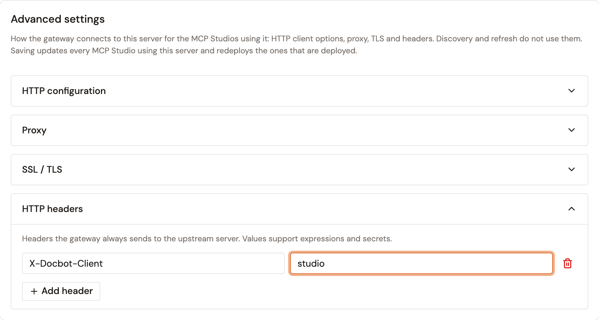
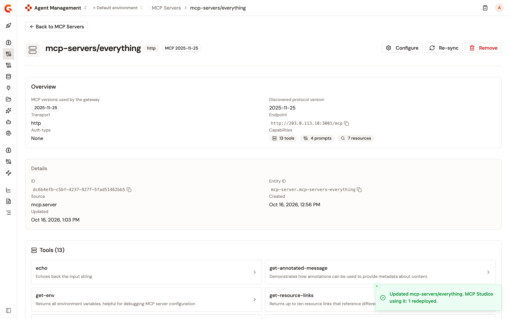

# Register an MCP server

Registering an MCP server adds it to the Catalog as a first-class entity — along with its tools, resources, and prompts. Once registered, the server's capabilities become available for use in MCP Proxies, MCP Studios, and authorization policies.

This is the most common way to bring external MCP servers into Gamma's governance layer.

## Step 1: Start the import

1. From the Gamma console sidebar, select **Agent Management**.
2. Navigate to **Catalog** → **MCP Servers**.
3. Select **Add MCP server**.
4. **Select server**: Enter the Streamable HTTP endpoint URL of your MCP server (e.g., `https://mcp.example.com/mcp`).
5. Click **Verify URL** to verify the endpoint and discover its available capabilities.

## Step 2: Configure connection

If your server requires authentication to discover its capabilities, select an authentication method:

| Auth method            | Description                                                                                                                                           |
| ---------------------- | ----------------------------------------------------------------------------------------------------------------------------------------------------- |
| **OAuth**              | Authenticate with an OAuth client ID, token URL, and optional scopes. The secret is used once to fetch a discovery token and is never stored.         |
| **Static credential**  | Provide a Bearer token, Basic auth, or API key. Sent in the headers to read the server's capabilities and never persisted.                           |
| **No upstream sign-in**| Add the server without storing or injecting upstream credentials.                                                                                       |

After choosing an authentication method, click **Test connection** again to re-run discovery.

## Step 3: Review and import

Once the server URL is verified and discovery is successful, you will see a summary of the capabilities (e.g., the number of tools discovered).

Click **Import MCP Server**.

## Note on Credential Retention

The credentials provided during import are used strictly to discover and catalog the server's capabilities. **Secrets are never stored or persisted** by the catalog. When you later create an MCP Proxy in front of this server, you will need to configure upstream authentication separately to handle runtime invocations.

## After registration

The MCP server appears in the Catalog with its metadata:

| Field                 | Description                                                                               |
| --------------------- | ----------------------------------------------------------------------------------------- |
| **Entity ID**         | Unique identifier in the Catalog.                                                         |
| **Source**            | How it was registered (guided setup by URL).                                              |
| **Type**              | **Native** (an upstream server you registered) or **Composite** (authored in MCP Studio). |
| **Transport**         | Streamable HTTP.                                                                          |
| **Connection status** | Whether Gamma can currently reach the server.                                             |
| **Tool count**        | Number of tools discovered on this server.                                                |
| **Resource count**    | Number of resources discovered on this server.                                            |
| **Last sync**         | Timestamp of the most recent catalog refresh.                                             |

## Change the connection settings of a registered server

The **Advanced settings** of a registered MCP server set how the gateway connects to it for the MCP Studios that use it. They hold the HTTP configuration, a proxy, SSL/TLS, and the HTTP headers sent with every call. The sections are the ones of the **Advanced settings** of an MCP Proxy, described in [Adjust the advanced settings](../build/configure-mcp-proxy-endpoint.md#adjust-the-advanced-settings). Discovery and refresh don't use them.

To change the settings, follow these steps:

1. From the Gamma console sidebar, select **Agent Management**.
2. Under **Catalog**, select **MCP Servers**.
3. Select the server.
4. Click **Configure**.
5. In the **Advanced settings** card, open a section and change its settings.

    <figure><figcaption>
The Advanced settings card
</figcaption></figure>
6. Click **Save**.

Saving updates every MCP Studio that uses the server. In each Studio, only the part that calls this server changes:

* A Studio that's in sync with the gateway is deployed again, with a deployment label that names the change, such as **Catalog MCP server updated: connection settings**.
* A Studio with changes that aren't deployed yet gets the new settings in its definition but isn't deployed, and the Studio sends its **API Updated** notification. Its next deploy ships both.
* A Studio that fails to update doesn't stop the others.

The confirmation counts the Studios that were redeployed, that need a manual deploy, and that couldn't be updated, for example **Updated `mcp-servers/everything`. MCP Studios using it: 1 redeployed.**

<figure><figcaption>
The confirmation after a save
</figcaption></figure>

The following also applies to the settings of a server:

* Until you save the **Advanced settings** of a server for the first time, the Studios that use it keep the connection settings they already have. After that, the settings of the server replace those of the Studios each time the URL, the MCP specification versions, or the settings of the server change.
* Once saved, the settings stay with the server. The page changes them but doesn't clear them.
* The page doesn't show the proxy **Password** again after you save it. Leave the field empty to keep the saved password while the proxy **Host**, **Port**, and **Username** stay the same. If you change any of the three, enter the password again.
* A Studio source built from an API in API Management or from a workflow tool doesn't use these settings.
* **Re-sync** keeps the settings.
* **Remove** doesn't change the MCP Studios that use the server. They keep calling its last URL.

## Next steps

* **Create an MCP Proxy** — Put a governance layer in front of this server. See [Create an MCP proxy](../build/create-an-mcp-proxy.md).
* **Add policies** — Apply fine-grained authorization at the tool level. See [Add policies to your MCP server](../build/configure-your-mcp/add-policies-to-mcp-server.md).
* **Compose into a Studio** — Include this server's tools in a Composite MCP Server. See [Create an MCP Studio](../build/create-an-mcp-studio.md).
