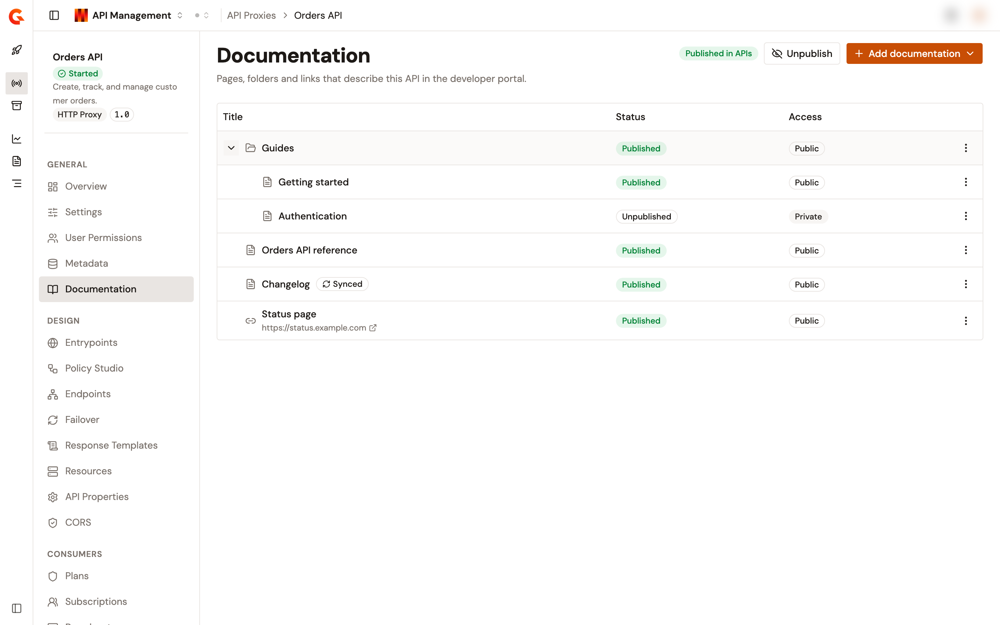
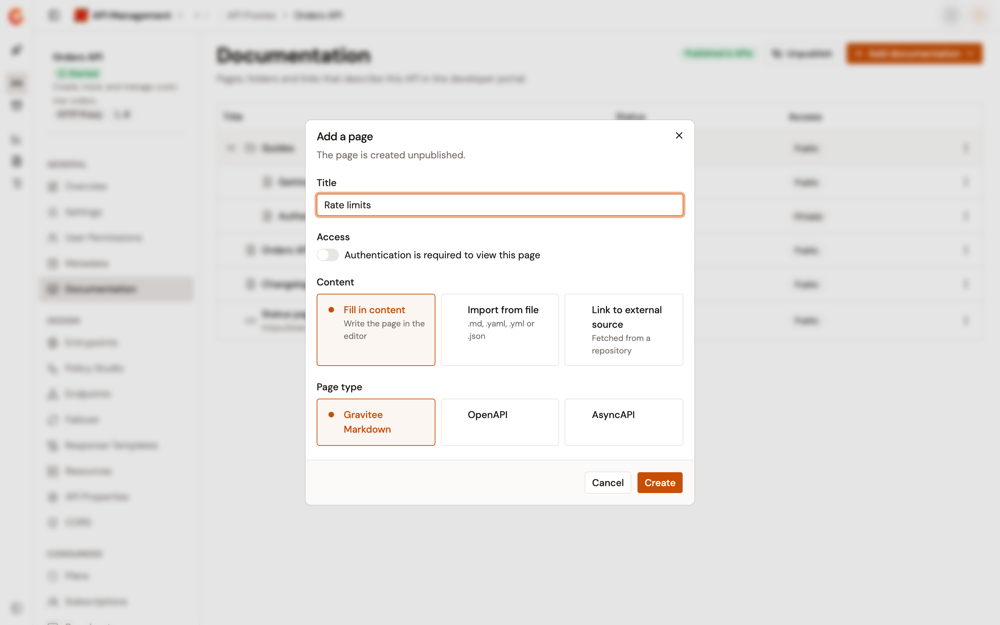
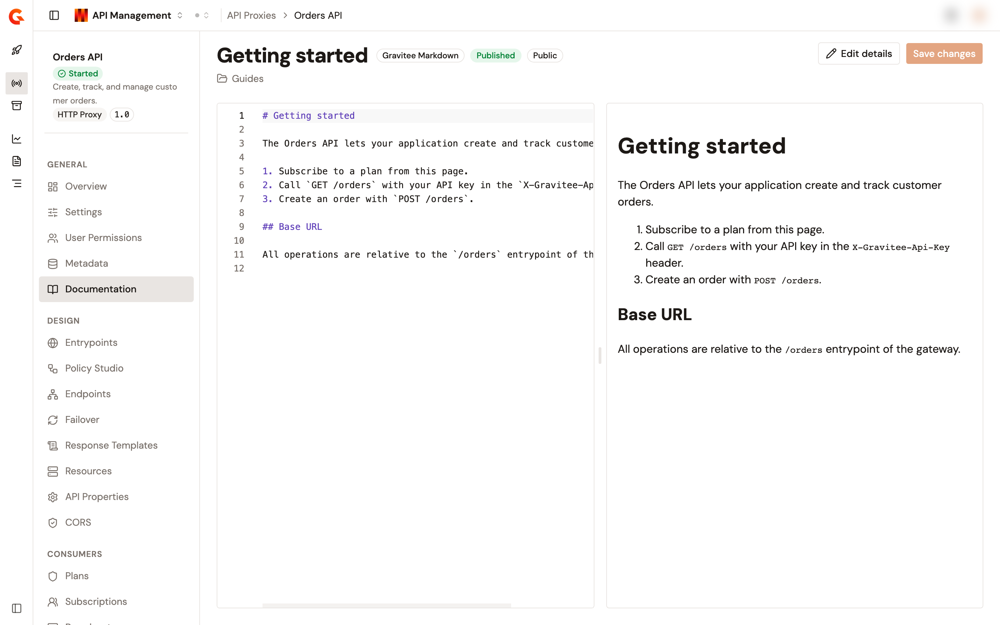
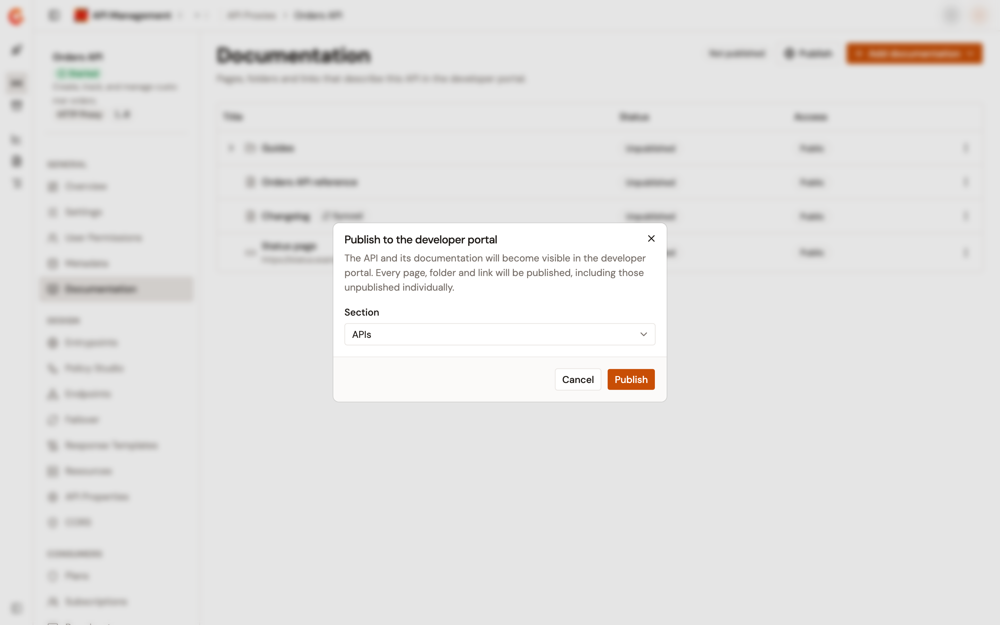
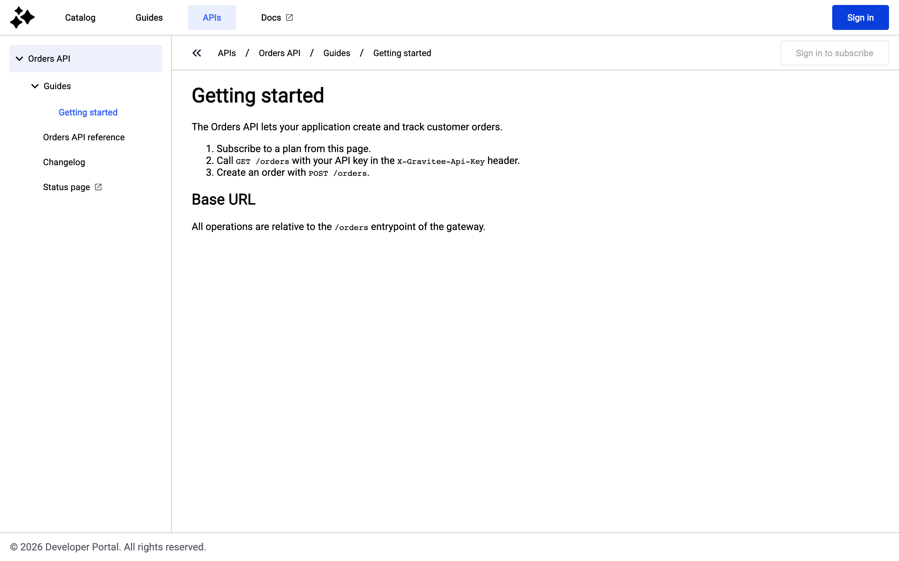

# Manage API documentation

The **Documentation** page of an API proxy holds the pages, folders, and links that describe the API in the developer portal. They belong to the API. They appear under the API in every portal that lists it, and they stay with the API when you take it out of the portal. You write them here, and you publish the API when they're ready.

The New Developer Portal shows these items. The same items appear under the API's entry on the **Navigation** page of the Portal Settings, where a portal designer places the API in the portal. See [Manage Portal Navigation and APIs](https://documentation.gravitee.io/apim/developer-portal/new-developer-portal/customize-the-navigation).

To open the page, follow these steps:

1. Click **API Proxies** in the module sidebar.
2. Select your API proxy.
3. Under **General** in the API proxy sidebar, click **Documentation**.

The item doesn't appear when your role doesn't grant read access to the API's documentation. The page then reads **You don't have permission to view this API's documentation.** A TCP Proxy API has no **Documentation** item. A federated API keeps it.

<figure><figcaption>
The Documentation page lists the pages, folders, and links of the API and shows where the API is published.
</figcaption></figure>

Each item carries a **Status** badge that reads **Published** or **Unpublished**, and an **Access** badge that reads **Public** or **Private**. A **Private** item is shown to signed-in portal users only. A **Synced** badge marks an item whose content is fetched from an external source. The badge at the top of the page reads **Published in** followed by the section of the portal's top navigation that lists the API, or **Not published**. An entry that a portal designer added to the navigation but kept hidden counts as not published.

**Add documentation** appears when your role lets you create and update the API's documentation. The row menu offers the actions your role grants, and a right-click on a row opens the same menu.

## Add a page

To add a page, follow these steps:

1. Click **Add documentation**, and then click **Page**. To add the page inside a folder, open the folder's row menu and click **Add page** instead.
2. Enter a **Title**.
3. Under **Access**, turn on **Authentication is required to view this page** to show the page to signed-in users only. Inside a private folder, the switch is locked on, and the dialog says why.
4. Under **Content**, choose where the content comes from:
   * **Fill in content**. You write the page in the editor.
   * **Import from file**. Choose a `.md`, `.yaml`, `.yml`, or `.json` file of up to 10 MB. A `.md` file is imported as Gravitee Markdown. A YAML or JSON file is imported as OpenAPI when its root has an `openapi` or `swagger` property, and as AsyncAPI when its root has an `asyncapi` property. A file with neither is refused. The file name becomes the title until you change it.
   * **Link to external source**. The content is fetched from a repository or a URL, and it stays read only here. See [Fetch content from an external source](manage-api-documentation.md#fetch-content-from-an-external-source).
5. Under **Page type**, choose **Gravitee Markdown**, **OpenAPI**, or **AsyncAPI**. The choice isn't offered for an imported file, whose type is detected.
6. Click **Create**.

The page is created unpublished and opens in the editor.

<figure><figcaption>
The Add a page dialog takes a title, the access, the content source, and the page type.
</figcaption></figure>

## Edit a page

Click the title of a page to open it. The editor shows the content on the left and a preview on the right, and the preview follows what you type. An OpenAPI page previews in Swagger UI, or in Redoc when the page is configured for it. Click **Save changes** to save the content. Closing or reloading the browser tab with unsaved changes asks you to confirm first. Moving to another page of the console doesn't.

<figure><figcaption>
The editor shows the content and its preview side by side.
</figcaption></figure>

Click **Edit details** to change the title or the access. The change applies in every portal that lists the API. A page synced from an external source keeps its title while it keeps the source, and a page inside a synced folder can't be edited at all.

### Configure the OpenAPI viewer

On an OpenAPI page, click **Configure** to choose how the portal renders the page. Under **OpenAPI Documentation Viewer**, choose **SwaggerUI** or **Redoc**. Set a **Base URL** that starts with `http://` or `https://`, or leave it empty. With **SwaggerUI**, turn on the options you need, such as **Use API entrypoints as server URLs** or **Enable "Try It!" mode**. Click **Save**. The configuration is saved on its own, apart from the content, and the preview follows it. For what each option does, see [Creating OpenAPI Documentation Pages](https://documentation.gravitee.io/apim/developer-portal/new-developer-portal/customize-the-navigation/creating-openapi-documentation-pages). **Configure** isn't offered on a page inside a synced folder.

## Add a folder

To add a folder, follow these steps:

1. Click **Add documentation**, and then click **Folder**. To nest it, open the parent folder's row menu and click **Add folder** instead.
2. Under **Contents**, keep **Empty folder**, or choose **Import from a repository** to fill the folder with pages fetched from a folder of a repository. The pages stay read only. A `.gravitee.json` manifest in the repository decides the hierarchy, and without one the folder tree is mirrored. Only source types that can list a folder are offered.
3. Enter a **Title**, and turn on **Authentication is required to view this folder** to show the folder to signed-in users only.
4. Click **Create**, or **Import** for a repository import.

The folder is created unpublished. Click **Edit details** in its row menu to change its title or access. Making a folder private makes every item inside it private too, and an item inside a private folder can't be made public.

## Add a link

To add a link, click **Add documentation**, and then click **Link**. Enter a **Title** and the **URL**, choose the access, and click **Create**. The URL has to be a valid address, such as `https://status.example.com`. A link has no content to open, so clicking its title in the list opens its details instead.

## Fetch content from an external source

A page or a folder linked to an external source takes its content from a repository or a URL. The source types are the fetcher plugins installed with the Management API, and APIM bundles the GitHub, GitLab, Git, Bitbucket, and HTTP fetchers. Only the ones that can list a folder are offered for a folder import.

When you link a source, choose a **Source type**, fill in its settings, and turn on **Fetch automatically** to fetch the content on a schedule. **Schedule (cron)** takes a six-field cron expression, and **Quick select** offers presets from **Every 5 minutes** to **Every day at midnight**. **Edit as JSON** shows the settings as JSON instead of a form. The content is fetched when the page is created. When that first fetch fails, the page is still created, and its editor shows the error.

A synced page is read only. In its editor, a bar names the source type, says when the content was last fetched, and shows the schedule. Click **Fetch now** to fetch the content again. The row menu offers **Fetch now** on a synced page, on an imported folder, and on a folder that holds synced pages.

To change the source of a page, click **Edit details**, and change its settings or its schedule. Saving fetches the content again. A saved secret, such as a token, is kept unless you enter a new one, and changing the address clears the saved secrets. To write the page by hand again, turn off **Fetch this page from an external source**, and click **Save**. The source is removed, and the page keeps its current content. A folder imported from a repository changes or removes its source the same way, with **Fetch this folder from an external source**.

The pages inside an imported folder can't be edited or deleted one by one. The folder manages them, and deleting the folder deletes them with it.

## Publish the API to the developer portal

Until the API is published, its documentation stays out of the portal, and no item can be published on its own. To publish the API, follow these steps:

1. Click **Publish**.
2. If the API has no page yet, the dialog reads **Add a page before publishing**, because an API needs at least one page to be shown in the developer portal. Click **Create Overview page** to create an unpublished **Overview** page built from the API's details. The page opens in the editor. Review it, go back to the **Documentation** page, and click **Publish** again. Folders and links don't count as a page. Without permission to create documentation, the dialog says to ask someone who can add documentation to this API.
3. In the **Publish to the developer portal** dialog, select the **Section** of the portal's top navigation to list the API in. The list holds the published top-level folders of the portal's main navigation. The dialog preselects the section where a hidden entry of the API already sits, otherwise the section named **APIs**, and otherwise the first one. Every environment has an **APIs** section by default, which is offered here unless it was renamed, unpublished, or deleted. When no section is available, the field reads **No sections available**, and the dialog says to ask a portal administrator to add one.
4. Click **Publish**.

<figure><figcaption>
The Publish to the developer portal dialog lists the API in the section you choose.
</figcaption></figure>

The API appears in the section, and every page, folder, and link is published, including the ones that were unpublished one by one. When a portal designer had already added the API to the navigation and kept it hidden, publishing reuses that entry and moves it to the section you chose. The badge then reads **Published in** and the section, and the button reads **Unpublish**.

### Unpublish the API

To take the API out of the portal, click **Unpublish**, and then click **Unpublish** in the confirmation. The API and its documentation become invisible in the developer portal. Nothing is deleted. The entry stays in the navigation, hidden, and publishing the API again shows it and its documentation.

## Show or hide one item

Once the API is published, open an item's row menu, click **Publish** or **Unpublish**, and then confirm.

* Unpublishing a folder hides the items inside it too.
* When you publish a folder, the dialog offers to publish the items inside it too. The checkbox is selected by default, and clearing it publishes the folder alone.
* An item inside an unpublished folder can't be published, and the menu says so.
* Publishing the API again publishes every item, including the ones you hid here.

## Delete an item

Open the item's row menu, click **Delete**, and then click **Delete** in the confirmation. A folder is deleted with everything inside it, and the dialog gives the count. The item disappears from every portal that lists the API. An item inside an imported folder can't be deleted on its own. Deleting the API deletes its documentation.

## Verification

To verify the documentation is in the developer portal, follow these steps:

1. Open the developer portal, and click the section you published the API in, such as **APIs**, in its top navigation.
2. Click the API. Its published pages, folders, and links are listed, and a **Private** item appears only after you sign in.

<figure><figcaption>
The API and its documentation in the developer portal.
</figcaption></figure>

## Next steps

* [Manage Portal Navigation and APIs](https://documentation.gravitee.io/apim/developer-portal/new-developer-portal/customize-the-navigation). Place the API in the portal navigation and manage the same documentation from the Portal Settings.
* [Import content from external sources](https://documentation.gravitee.io/apim/developer-portal/new-developer-portal/customize-the-navigation/import-content-from-external-sources). The settings of each source type.
