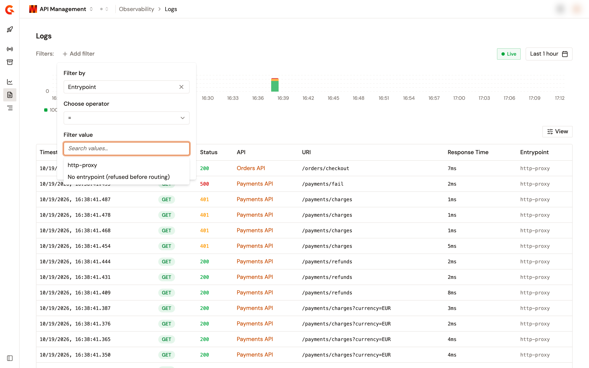
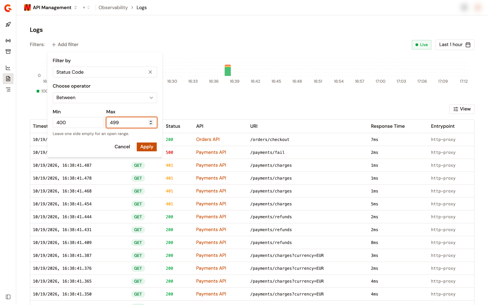
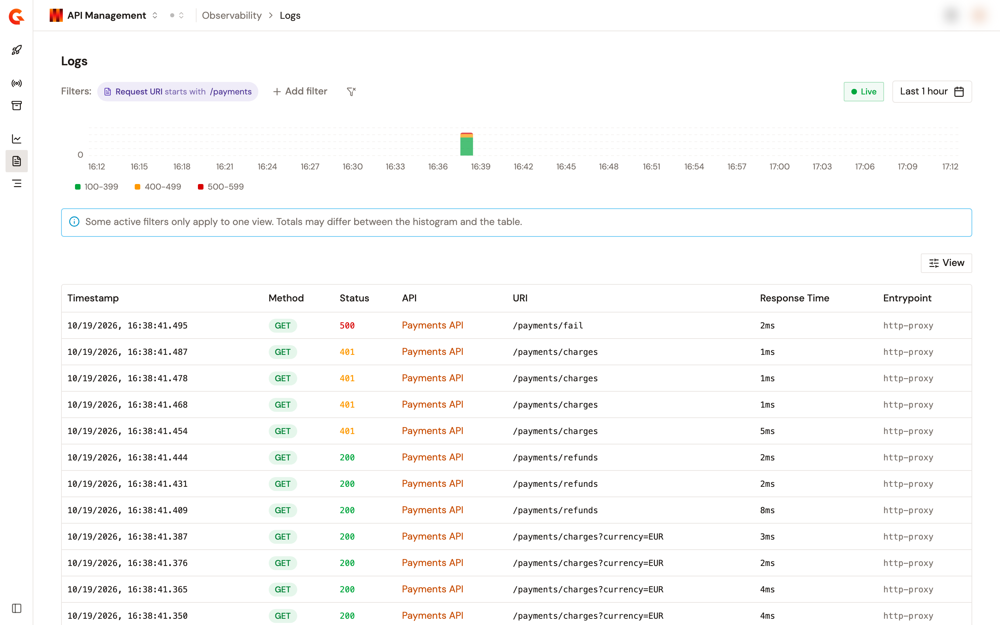

# View API logs
API logs provide a detailed record of every request processed by the API Gateway for a specific API proxy. Gamma exposes native log viewing and a **Trace Explorer** under the Observability section, giving you full request traces and span data to help you debug and analyze your API traffic.


The Trace Explorer only shows data once the platform-side OpenTelemetry pipeline is wired. The Gateway has to export traces, a Collector has to write them to Elasticsearch, and the Management API has to read from the same indices. All three are off by default. For the settings, see [Configure OpenTelemetry tracing and logs](../../platform-management/configure-opentelemetry-tracing-and-logs.md).


## Access logs and traces

1. Click the name at the left of the top bar, such as **Home**.
2. Select **API Management**.
3. Navigate to the API detail page for your API proxy.
4. Click **Logs** under **Observability** in the API proxy sidebar. The logs open in a new tab, filtered on your API proxy.
5. To view traces, click **Tracing** under **Observability** in the module sidebar.
6. In **API**, select your API proxy.

TCP Proxy APIs don't have an **Observability** group in the API proxy sidebar.

## Log entry fields

Each trace log entry provides a comprehensive view of the request lifecycle, including:

| Field             | Description                                                      |
| ----------------- | ---------------------------------------------------------------- |
| **Timestamp**     | When the request was received (derived from root span start time). |
| **Method**        | HTTP method (GET, POST, PUT, DELETE, etc.).                      |
| **Path**          | The request path.                                                |
| **Status**        | HTTP response code. Trace-level status rolls up: if any span reports an error, the trace is marked as `error`. Otherwise, it falls back to the root span's status (`ok` or `unset`). |
| **Response time** | Time in nanoseconds/milliseconds from request receipt to response delivery. |
| **Span Count**    | The total number of spans involved in the trace.                 |
| **Plan**          | The security plan that authenticated the request.                |
| **Application**   | The application that made the request (if identified by a plan). |
| **Payloads**      | Full request and response body inspection (when configured).       |

## Filter the logs

The **Filters** bar of the **Logs** page narrows the table and the histogram above it. Each filter you apply shows in the bar.

1. Click **Add filter**.
2. Under **Filter by**, select the property.
3. Under **Choose operator**, select the operator.
4. Under **Filter value**, pick or type the value.
5. Click **Apply**.

Click a filter in the bar to change it, or hover it and click the cross to remove it.

### Filters that apply to one view

A property narrows both the table and the histogram, unless it applies to one of them only. Properties such as **Request URI**, **Error Key**, and **Request ID** narrow the table only. Properties such as **HTTP Path**, **Host**, and **Latency** narrow the histogram only. Such a property carries an icon in the **Filter by** list and in the bar, and hovering the icon in the bar reads **Logs only** or **Analytics only**. While one of them is active, the page shows **Some active filters only apply to one view. Totals may differ between the histogram and the table.**

### Match the start of a request URI

**Request URI** matches the start of the URI the client called, query string included, with the **starts with** operator. A value without a leading `/` gets one. In the value:

* `*` matches any sequence of characters, so `/orders/*/42` matches `/orders/items/42`.
* `?` matches any single character, so `/orders/a?b` matches `/orders/a-b` as well as `/orders/a?b`.
* `\` makes the next character literal, so `/orders/a\?b` matches `/orders/a?b` only.

**HTTP Path** reads the path after the API's context path, without the query string, and matches it exactly. On the **Logs** page it narrows the histogram only.

**Request URI** and **HTTP Path** are case-sensitive.

### Filter on the entrypoint

**Entrypoint** lists, by their ID such as `http-proxy`, the entrypoints that recorded requests went through, whatever the time range of the page. The list ends with **No entrypoint (refused before routing)**, which picks the requests recorded without an entrypoint, such as a request that none of the API's entrypoints accepts.

An **Entrypoint** filter keeps only the entrypoints you pick. Without one, the logs also include the requests recorded without an entrypoint. Typing under **Filter value** matches a whole ID only, so pick the value from the list.

<figure><figcaption>
The values of the Entrypoint filter
</figcaption></figure>

### Filter on a range of values

Numeric properties, such as **Status Code** and **Gateway Response Time**, offer **=**, **≥**, **≤**, and **Between**.

1. Click **Add filter**.
2. Under **Filter by**, select the property.
3. Under **Choose operator**, select **Between**.
4. Enter the **Min**.
5. Enter the **Max**.
6. Click **Apply**.

Leave **Min** or **Max** empty for an open range. The range shows as one filter, such as **Status Code 400 – 499**.

<figure><figcaption>
A range on the Status Code filter
</figcaption></figure>

## Verification

To verify the filters are working as expected, follow these steps:

1. Click the name at the left of the top bar, such as **Home**.
2. Select **API Management**.
3. Under **Observability**, click **Logs**.
4. If your requests are older than 5 minutes, widen the time range, which opens on **Last 5 minutes**.
5. Click **Add filter**.
6. Under **Filter by**, select **Request URI**.
7. Under **Filter value**, enter the context path of one of your APIs, such as `/payments`.
8. Click **Apply**.

The table lists only the requests whose URI starts with that path, and the page shows **Some active filters only apply to one view. Totals may differ between the histogram and the table.**

<figure><figcaption>
A Request URI filter, which narrows the table only
</figcaption></figure>

## Next steps

* [Monitor API usage](monitor-api-usage.md) — View aggregate metrics and dashboards for your API.
