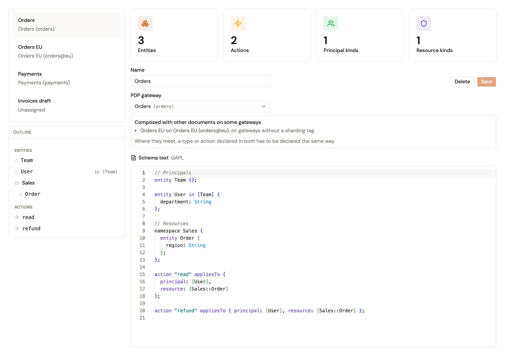

# Create and edit schema documents

A schema document declares entity types, relationships, and actions for the PDP gateway it's assigned to. For what a document declares and which gateways receive it, see [Schema documents](schema-generation.md).

## Prerequisites

Before you create a document, make sure of the following:

* The PDP gateway you assign the document to is registered under **PDP Gateways**. For the steps, see [Configure the Gravitee Gateway as a runtime](../../evaluate/configure-gravitee-gateway-as-runtime.md). The **Bootstrap PDP** is always offered, with no registration. A PDP gateway registered with neither a **Target PDP ID** nor a sharding tag runs the built-in engine, so **PDP gateway** lists it as the **Bootstrap PDP**.
* Your role in the environment has the permissions listed in the following table.

| Action | Required permission |
|--------|-------------------|
| See **Schemas** and read documents | `ENVIRONMENT_AUTHZ_SCHEMA[READ]` |
| Create a document with **New document** | `ENVIRONMENT_AUTHZ_SCHEMA[CREATE]` |
| Edit and save a document | `ENVIRONMENT_AUTHZ_SCHEMA[UPDATE]` |
| Delete a document | `ENVIRONMENT_AUTHZ_SCHEMA[DELETE]` |
| List PDP gateways in **PDP gateway** | `ENVIRONMENT_AUTHORIZATION[READ]` |

Without `ENVIRONMENT_AUTHORIZATION[READ]`, **PDP gateway** offers only **Unassigned** and the **Bootstrap PDP**.

## Create a schema document

To create a schema document, complete the following steps:

1. In the Authorization Management sidebar, select **Schemas** in the **Policy Structure** group.
2. Click **New document**.
3. In **Name**, enter a name for the document, and then click **Continue**.
4. In **PDP gateway**, select the PDP gateway that receives the document. A PDP gateway that already holds a document shows the name of that document, and it's unavailable.

    To store the document without sending it to any gateway, keep **Unassigned**.
5. In **Schema text**, write the entity types, relationships, and actions of the document. To start from an example, click **Guide**, and then copy the **Starter template**.

    The editor checks the text as you type. For the errors it reports, see [Validate schema changes](validate-schema-changes.md).
6. Click **Create**.

## Edit a schema document

To edit a schema document, complete the following steps:

1. On the **Schema** page, select the document in the list.
2. Change its **Name**, its **PDP gateway**, or its **Schema text**.
3. Click **Save**.

## What the page shows for a document

Four tiles count what the selected document declares: **Entities**, **Actions**, **Principal kinds**, and **Resource kinds**. The **Outline** lists its entity types, grouped by namespace, and its actions. Click a name to jump to its declaration in **Schema text**.

The tiles and the **Outline** describe the saved version of the document. While **Schema text** has unsaved changes, the **Outline** says **Showing the saved version. Save to refresh.**

## Delete a schema document

To delete a schema document, complete the following steps:

1. On the **Schema** page, select the document in the list.
2. Click **Delete**.
3. Click **Delete document**.

The gateways that held the document stop using it. The deletion is permanent.

## Verification

To verify that a schema document is saved and assigned, follow these steps:

1. On the **Schema** page, find the document in the list. Under its name, the list shows its PDP gateway, or **Unassigned**.
2. Select the document. Under **PDP gateway**, a note says that the document is the whole schema of that PDP, or lists the documents it's composed with and the gateways where they meet.

<figure><figcaption>
The Orders document, assigned to the Orders PDP gateway and composed with Orders EU on gateways without a sharding tag.
</figcaption></figure>
