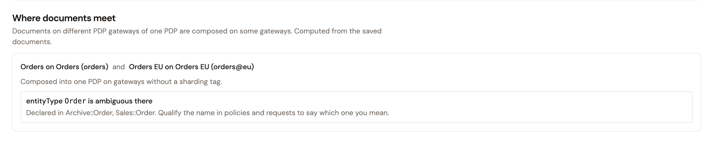

# Schema documents

A schema declares the entity types, their relationships, and the actions that a PDP reasons about. It's the contract your policies are written against. Authorization Management keeps the schema as documents, and each document is assigned to one PDP gateway, or to none.

## What a document declares

A schema document is written in GAPL and declares the following:

* **Entity types**, each with typed attributes between braces, such as `department: String`. An attribute whose name ends with `?` is optional.
* **Relationships**. `in [...]` lists the parent types of an entity, such as `entity User in [Team]`.
* **Actions**. `appliesTo` lists the principal types and the resource types that each action connects, plus an optional `context` record of request-time data.
* **Namespaces**, which group declarations. A type from another namespace is written with `::`, such as `Sales::Order`.

Attribute types include `String`, `Long`, `Bool`, `decimal`, `datetime`, `duration`, `ipaddr`, `Set<T>`, inline records, and entity types, such as `team: Team`.

The following document declares a `User` that belongs to a `Team`, an `Order` in the `Sales` namespace, and two actions that a `User` performs on an `Order`:

```text
// Principals
entity Team {};

entity User in [Team] {
  department: String
};

// Resources
namespace Sales {
  entity Order {
    region: String
  };
};

action "read" appliesTo {
  principal: [User],
  resource: [Sales::Order]
};

action "refund" appliesTo { principal: [User], resource: [Sales::Order] };
```

For more examples, with snippets to copy, click **Guide** on the **Schema** page.

## Which gateways receive a document

The **PDP gateway** of a document decides which gateways receive it. A gateway here is a Gravitee Gateway running the PDP plugin:

* A document assigned to a PDP gateway goes to the gateways that host that PDP gateway, each time you save it.
* The **Bootstrap PDP** is the built-in engine that every gateway runs. A document assigned to it goes to every gateway that serves your environment.
* A document set to **Unassigned** is stored, and no gateway receives it.

A PDP gateway holds one document. When you delete a PDP gateway, the document assigned to it becomes **Unassigned**. When you delete a document, the gateways that held it stop using it.

## Where documents meet

Two documents meet when they end up in the same engine on some gateways, where they're composed into one schema. Documents meet in the following cases:

* Their PDP gateways belong to the same environment, share a **Target PDP ID**, and differ by sharding tag. On a gateway that hosts both, such as a gateway without a sharding tag, those PDP gateways run in one engine.
* They belong to the same environment, one is assigned to the **Bootstrap PDP**, and the other to a PDP gateway registered without a **Target PDP ID** and with a sharding tag. Both use the built-in engine, so they meet on gateways with that tag and on gateways without a sharding tag.
* They belong to different environments, and both use the built-in engine: the **Bootstrap PDP**, or a PDP gateway registered without a **Target PDP ID**. The built-in engine is the only one that environments share. The **Schema** page names the other environment's document as a document of another environment.

Where two documents meet, a save is refused if it makes them declare a shared type or action differently. The **Where documents meet** section of the **Schema** page lists each pair of saved documents that meet, and the gateways where they're composed.

<figure><figcaption><p>Two documents whose PDP gateways share the Target PDP ID <code>orders</code> meet on gateways without a sharding tag.</p></figcaption></figure>

For the errors and warnings that a save reports, see [Validate schema changes](validate-schema-changes.md).

## Schemas from earlier versions

An environment that had a schema before 4.13 finds it as a document named **Default schema**, set to **Unassigned**. To send it to the gateways, assign it to a PDP gateway. For the steps, see [Create and edit schema documents](edit-your-schema.md).
