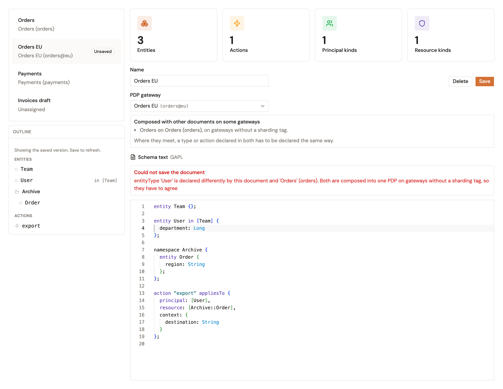

# Validate schema changes

The **Schema** page checks a schema document as you type, and again when you save it. A save also checks the document against every document it meets on some gateway.

## Errors while you type

While you type in **Schema text**, the editor lists what's wrong under **Schema could not be fully parsed**. **Create** and **Save** stay unavailable until the list is empty. The following table lists common errors:

| What the document contains | What the editor reports | How to fix it |
| --- | --- | --- |
| A declaration without a closing `;` | The line and column, for example `line 2:0 mismatched input 'entity' expecting {';', 'tags', 'enum'}` | Add the `;` |
| A type that the document doesn't declare, in `appliesTo` or in `in [...]` | `undeclared entity type(s) referenced in schema: Document` | Declare the type in the document |
| An attribute type that GAPL doesn't have, such as `Int` or `Boolean` | `undeclared entity type(s) referenced in schema: Int` | Use `Long` in place of `Int`, and `Bool` in place of `Boolean` |
| A type from another namespace, written without its namespace | `undeclared entity type(s) referenced in schema: Billing::User` | Write the namespace before the type, such as `App::User` |
| The same action declared twice | `duplicate action declaration in schema: Action::"read"` | Keep one declaration |

When the validator doesn't answer, the editor shows **Validation unavailable** and lets you save. The save then checks the document, and refuses it if it has errors.

## Errors when you save

When a save is refused, the editor shows **Could not save the document** with the reason. Besides the errors that the editor lists, a save is refused when the document declares a type or action differently from a document it meets. The reason then names the type or action, the other document, and the gateways where the two meet.

To fix it, change one of the two documents so that both declare the type or action the same way. Alternatively, assign one of them to a PDP gateway with another **Target PDP ID**, or set it to **Unassigned**.

<figure><figcaption>
A save refused because <code>User</code> is declared differently in two documents that meet.
</figcaption></figure>

## Warnings when you save

A save goes through with a warning when a name is ambiguous where two documents meet, for example when one declares `Sales::Order` and the other `Archive::Order`. An alert above the document lists the warnings, and the pair shows the same warning under **Where documents meet**. In the policies and requests that reach those gateways, write the namespace before the name to say which one you mean.

## Documents that don't parse

A document marked **Does not parse** in the list was saved in a form that the current version no longer reads. Select it, fix the errors that the editor lists, and save it.

## Verification

To verify that a schema document passes every check, follow these steps:

1. On the **Schema** page, select the document. The editor shows no **Schema could not be fully parsed** list.
2. Under **Where documents meet**, check that no pair with the document carries a **Conflict** badge.

<figure><figcaption>
A pair without a <strong>Conflict</strong> badge. The notice about <code>Order</code> is a warning, and the save went through.
</figcaption></figure>
