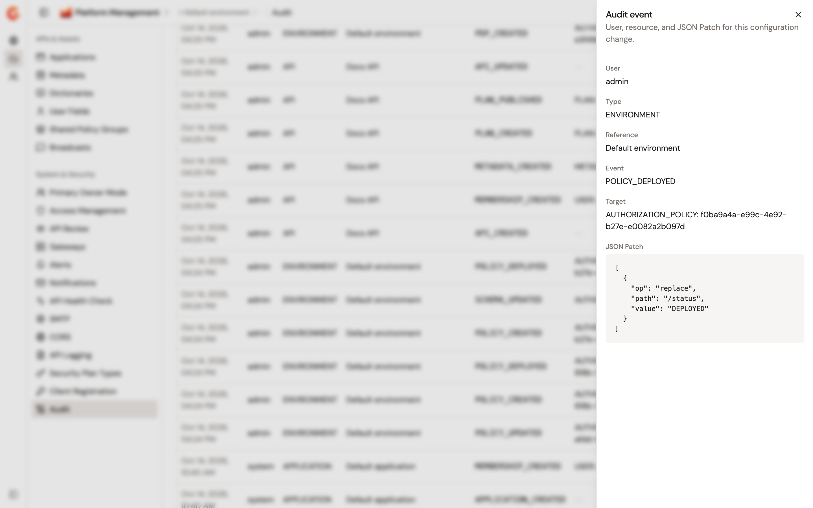

# Audit authorization changes

Gravitee records the changes you make in Authorization Management in the audit trail of the environment, together with the account that made each change. An event of Authorization Management has the type **ENVIRONMENT**, and its **Target** names what changed, such as `AUTHORIZATION_POLICY` followed by the ID of the policy.

To read the audit trail, see [Review organization and environment audit logs](../../platform-management/review-audit-logs.md). The **Event** and **Type** filters of the **Audit** page don't offer the events of Authorization Management, so narrow the trail with the date range instead.

## Events

The following table lists the events that Authorization Management records:

| Change | Event | Target |
| --- | --- | --- |
| Create, update, or delete a policy | `POLICY_CREATED`, `POLICY_UPDATED`, or `POLICY_DELETED` | `AUTHORIZATION_POLICY` |
| Deploy a policy, with **Deploy to PDP** | `POLICY_DEPLOYED` | `AUTHORIZATION_POLICY` |
| Undeploy a policy | `POLICY_DISABLED` | `AUTHORIZATION_POLICY` |
| Create, update, or delete an entity | `ENTITY_CREATED`, `ENTITY_UPDATED`, or `ENTITY_DELETED` | `AUTHORIZATION_ENTITY` |
| Register or delete a PDP gateway | `PDP_CREATED` or `PDP_DELETED` | `AUTHORIZATION_PDP` |
| Create, save, or delete a schema document | `SCHEMA_CREATED`, `SCHEMA_UPDATED`, or `SCHEMA_DELETED` | `AUTHORIZATION_SCHEMA` |

Deleting a PDP gateway records `PDP_DELETED` only. The policies, entities, and schema documents that the deletion removes the PDP gateway from get no event of their own.

For the events of SCIM directories and their syncs, see [Audit trail](../directories/sync-principals-from-a-scim-directory.md#audit-trail).

## Inspect a change

The **JSON Patch** of an event shows what changed. A policy event carries the policy before and after the change, including its text and its target PDP gateways, so the patch shows the statements and the targets that changed. The patch of `POLICY_DEPLOYED` shows the status of the policy moving to `DEPLOYED`.

<figure><figcaption>
The deployment of a policy in the audit trail.
</figcaption></figure>

## Verification

To verify that your changes are recorded, follow these steps:

1. Deploy a policy. For the steps, see [Create, update, and delete policies](../configure/create-update-delete-policies.md).
2. From the Gamma console sidebar, select **Platform Management**, open the **Environment** section, and navigate to **Audit**.

    The trail lists `POLICY_DEPLOYED` with your account and the ID of the policy.

## Next steps

* [Review organization and environment audit logs](../../platform-management/review-audit-logs.md). Filter the trail, inspect a change, and export it.
