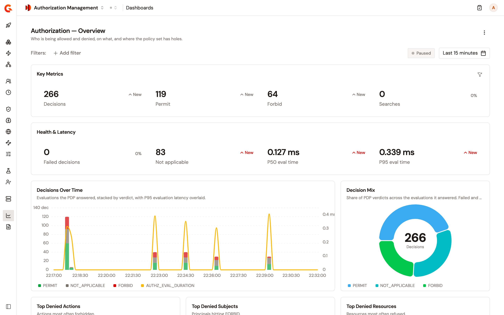

# Monitor authorization decisions

The **Authorization — Overview** dashboard summarizes the decisions your PDP gateways took over a time range. It shows how many there were, what was forbidden and to whom, where no deployed policy applied, and how long evaluation took. For what a decision record holds, and what has to be in place for the dashboard to show data, see [Analytics sent to the control plane](../evaluate/analytics-sent-to-control-plane.md).

## Open the dashboard

To open the dashboard, complete the following steps:

1. In the Authorization Management sidebar, select **Dashboards** in the **Observability** group.
2. Select **Authorization — Overview**.

    <figure><figcaption>
The Authorization — Overview dashboard.
</figcaption></figure>

The dashboard opens on **Last 7 days**. To narrow every widget at once, select **Add filter**. The filters are **API**, **Decision**, **Subject**, **Action**, **Resource**, **Caller kind**, **Outcome status**, and **PDP Gateway**. Searches carry no decision, caller kind, outcome status, or PDP gateway, so a filter on one of those sets **Searches** to 0.

## Read the dashboard

The **Key Metrics** row counts the decisions of the time range, and the permits and forbids among them. **Searches** counts the search requests your AuthZEN endpoints and the AuthZEN policy received. A search records no decision.

The **Health & Latency** row counts the evaluations that failed and the evaluations no deployed policy matched. It also shows the median and the 95th percentile of the evaluation time, over the evaluations that succeeded.

The following widgets need a word of explanation:

| Widget | What it shows |
| ------ | ------------- |
| **Decisions Over Time** | The decisions per time bucket, stacked by decision, with the 95th percentile of the evaluation time as a line. |
| **Decision Mix** | The share of each decision among the evaluations the PDP answered. Failed and not-ready evaluations aren't part of the mix. They're counted under **Failed decisions**. |
| **Coverage Gaps** | The five actions evaluated most often with no matching deployed policy. The PDP answered **Not applicable**, and the caller applied its own default. |
| **Top Reasons** | The five most frequent reasons. A decision can carry several reasons, so the counts can add up to more than the number of decisions. |
| **Caller Mix** | The share of decisions per kind of caller. |

The other widgets list the five actions, subjects, and resources with the most **Forbid** decisions, and the five PDP gateways and the five APIs with the most decisions. The API is the one the decision was requested on. The chart legends show the recorded values, such as `PERMIT`, or `gateway` for an AuthZEN endpoint, rather than the labels the **Decisions** page shows.

To see the decisions behind a figure, open **Decisions** for the same time range. For more information, see [Review authorization decisions](review-authorization-decisions.md).

## Build your own dashboard

The **Authorization — Overview** dashboard is a template, so you can't edit it in place. To change it, select the **⋮** menu at the top right of the dashboard, and then select **Duplicate as custom dashboard**. The copy opens for editing. The widget editor doesn't list the decision metrics, such as `AUTHZ_DECISIONS` or `AUTHZ_FORBIDS`, so to change what a widget counts, select **JSON** and change the `metric` of the widget. To start from an empty dashboard, select **New dashboard** on the **Dashboards** page, and add decision widgets in the **JSON** view too. Both actions need the right to create dashboards in the environment. Without it, the action fails and an error message appears.

## Verification

To verify that the dashboard reports your decisions, follow these steps:

1. Send an evaluation request to an AuthZEN endpoint of a PDP gateway, or call an API that the PEP policy protects.
2. Open the **Authorization — Overview** dashboard.
3. Select the time range at the top right. The dashboard counts the decisions up to the start of the current minute, so a request from the current minute appears once the next minute starts.
4. Under **Last**, select **15 minutes**.

    The **Decisions** count of the **Key Metrics** row includes the request, and **Decisions by PDP** lists the PDP gateway that evaluated it.

    <figure><figcaption>
The dashboard on the last 15 minutes, right after a burst of evaluation requests.
</figcaption></figure>

## Next steps

* [Review authorization decisions](review-authorization-decisions.md). List the decisions one by one, and open one to see the policies and reasons behind it.
