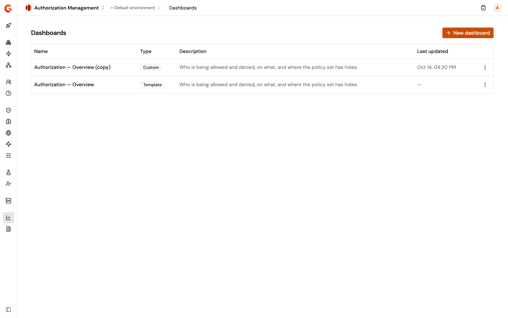
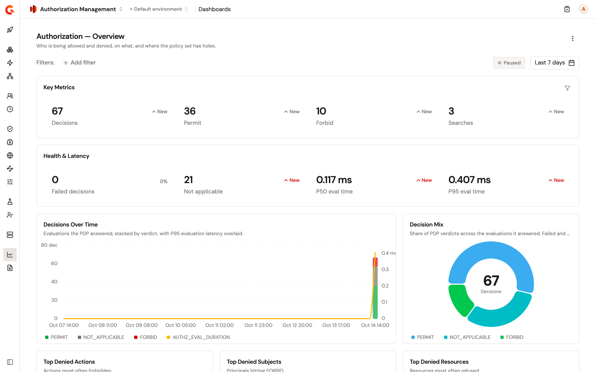

# Monitor authorization with dashboards

Authorization Management ships one dashboard template, **Authorization — Overview**. It follows the decisions of your gateways over time: who is permitted and forbidden, on what, and which requests no policy matches. The **Dashboards** page lists the template next to the custom dashboards saved in the environment.

## Prerequisites

Before you open a dashboard, make sure of the following:

* Your gateways report decisions to Elasticsearch. For the details, see [Decision reporting](decision-reporting.md).
* Your role has the permissions listed in [Permissions](#permissions).

## Open the overview dashboard

To open the overview dashboard, complete the following steps:

1. In the Authorization Management sidebar, select **Dashboards** in the **Observability** group.
2. Click **Authorization — Overview**.

<figure><figcaption>
The Dashboards page lists the template and the custom dashboards of the environment.
</figcaption></figure>

The dashboard opens on the last 7 days, and counts only the decisions made for the APIs your role can read.

<figure><figcaption>
The overview dashboard.
</figcaption></figure>

## Read the overview dashboard

Each widget describes what it counts. The following numbers need some context:

* **Failed decisions** includes the evaluations that weren't ready.
* **Coverage Gaps** ranks the actions that no deployed policy matched. The caller denied these requests.
* A decision can give several reasons, so the counts of **Top Reasons** can add up to more than the number of decisions.
* **Searches** counts the subject, resource, and action searches sent to an AuthZEN endpoint or an AuthZEN policy. A search isn't a decision, so **Decisions** doesn't count it. A dashboard filter that searches don't carry, such as **Caller kind**, makes **Searches** read 0.

To find the requests behind a number, open **Decisions** and apply the same filters. For more information, see [Review authorization decisions](review-authorization-decisions.md).

## Build your own dashboard

The template is read-only. The widget editor lists gateway and LLM metrics only, so to build a dashboard on decision metrics, start from a copy of the template.

To create a custom dashboard from the template, complete the following steps:

1. On the **Dashboards** page, open the actions menu of the **Authorization — Overview** row.
2. Select **Duplicate as custom dashboard**.

    The copy is saved under the original title followed by `(copy)`, and the editor opens on it.
3. Edit the title, remove the widgets you don't need, and arrange the others on the grid.
4. To change what a widget counts, click **JSON**, and change the `metric` of the widget. Then click **Apply changes**, and click **Builder**.
5. Click **Save**.

For example, to rank the actions that no policy matches instead of the actions forbidden most often, change the `metric` of the **Top Denied Actions** widget from `AUTHZ_FORBIDS` to `AUTHZ_NOT_APPLICABLE`.

The following metrics count decisions and AuthZEN traffic:

| Metric | What it counts |
| --- | --- |
| `AUTHZ_DECISIONS` | Every decision. |
| `AUTHZ_PERMITS`, `AUTHZ_FORBIDS`, `AUTHZ_NOT_APPLICABLE` | **Permit**, **Forbid**, and **Not applicable** decisions. |
| `AUTHZ_FAILURES` | Failed decisions. |
| `AUTHZ_EVAL_DURATION` | The evaluation time, in milliseconds. |
| `AUTHZ_OPERATIONS` | The requests sent to AuthZEN endpoints and AuthZEN policies. |
| `AUTHZ_SEARCHES` | The AuthZEN searches. |

The widgets of the template show the `measure` and `by` values that go with each metric. To read them, open the actions menu of the template row and select **Copy JSON**.

For everything else the editor does, including dashboard filters and the default time range, see [Build a custom dashboard](../../agent-management/observe/dashboards/build-a-custom-dashboard.md).

## Permissions

The following table lists the permission each action requires:

| Action | Required permission |
| --- | --- |
| Open **Dashboards** and a dashboard | `ENVIRONMENT_DASHBOARD[READ]` |
| **New dashboard**, **Duplicate as custom dashboard**, or **Duplicate** | `ENVIRONMENT_DASHBOARD[CREATE]` |
| Edit a custom dashboard | `ENVIRONMENT_DASHBOARD[UPDATE]` |
| Delete a custom dashboard | `ENVIRONMENT_DASHBOARD[DELETE]` |

## Verification

To verify that the overview dashboard shows your decisions, follow these steps:

1. Send a request to an API whose flow carries the Authorization PEP policy.
2. Open **Authorization — Overview**.
3. Confirm that **Decisions** in **Key Metrics** counts the request.

## Next steps

* [Review authorization decisions](review-authorization-decisions.md). Open the decisions behind a number, and see why each one was made.
* [Save observability dashboards with the Gamma API](../../platform-management/save-observability-dashboards.md). Create and maintain custom dashboards from a script or a pipeline.
