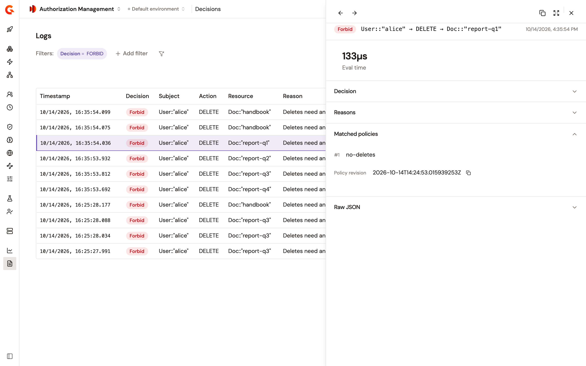

# Review authorization decisions

Each time a gateway asks a PDP whether a request is allowed, the component that asked records the decision: the Authorization PEP policy on an API or MCP flow, the AuthZEN endpoint of a PDP gateway, or the AuthZEN policy. The **Decisions** page lists these records, newest first.

## Prerequisites

Before you review decisions, make sure of the following:

* Your gateways report decisions to Elasticsearch. For the details, see [Decision reporting](decision-reporting.md).
* Your role has the permissions listed in [Permissions](#permissions).

## Open the Decisions page

To open the decisions of the environment, complete the following steps:

1. In the Authorization Management sidebar, select **Decisions** in the **Observability** group. The page opens under the heading **Logs**, on the last 5 minutes.
2. Optional: Click the time range control, and select another range.

<figure><figcaption><p>Decisions of the last hour, from the PEP policy and the AuthZEN endpoint.</p></figcaption></figure>

## Read a decision

The **Decision** column reads one of the following values:

| Decision | What it means |
| --- | --- |
| **Permit** | A policy permits the request, and no policy forbids it. |
| **Forbid** | A policy forbids the request. A `forbid` statement wins over every `permit` statement. |
| **Not applicable** | No policy matched the request, so the caller denied it. |
| **Error** | The evaluation failed, and the PDP gave no decision. |
| **Not ready** | The PDP hadn't loaded its policies yet, so it didn't evaluate the request. |

AuthZEN searches don't appear on this page. The overview dashboard counts them under **Searches**.

To open a decision, click its row. The panel lists its fields, the reasons the PDP gave, and the policies that matched.

<figure><figcaption><p>The details of a decision made by the PEP policy.</p></figcaption></figure>

The following fields of a decision need some explanation:

| Field | What it means |
| --- | --- |
| **Verdict** | The answer of the PDP: **Permit**, **Forbid**, or **Not applicable**. |
| **Outcome** | What the decision concluded: **Allow**, **Deny**, or **Indeterminate** when there's no permit or forbid. |
| **Enforced** | What the caller did with the request: **Allow** or **Deny**. |
| **Indeterminate cause** | Why the outcome is **Indeterminate**: **Not applicable**, **Timeout**, **Error**, or **Not ready**. |
| **Error type** | Why the evaluation failed: **Evaluation timeout**, **PDP unavailable**, **Evaluation failed**, or **Agent unresolved**. |
| **Engine generation** | The version of the policy set on that gateway. It increases each time the PDP loads a change, and it differs from one gateway to another. |
| **Policy revision** | Under **Matched policies**, the deployed version of each policy that matched. |
| **Batch** | For an AuthZEN batch request, the position of the decision in the batch. The decisions of one batch share the same request ID. |

**Enforced**, **Matched policies**, and **Batch** are hidden from the list when the page opens. To show them, click **View**.

A request that no policy matches has the verdict **Not applicable** and the outcome **Indeterminate**, and the caller enforces **Deny**. A failed evaluation is denied too. Only an Authorization PEP policy whose **Cold-start behaviour** lets requests through records **Allow** for a request the PDP wasn't ready to evaluate. For more information, see [Failed and not-ready decisions](decision-reporting.md#failed-and-not-ready-decisions).

## Filter decisions

To narrow the list, complete the following steps:

1. Click **Add filter**.
2. Under **Filter by**, select the property.
3. Under **Choose operator**, select the operator.
4. Under **Filter value**, select the values, or type them separated by commas.
5. Click **Apply**.

A few filters work differently from the field they filter:

* **Decision** offers **Permit**, **Forbid**, and **Not applicable**. To find failed decisions, filter on **Outcome status** set to **Error**, or on **Error type**.
* **Subject** and **Resource** take the ID alone, such as `alice`, or with its type, such as `User::"alice"`.
* **Matched policy** takes a policy name, and matches every statement of the policy.
* **Reason** matches the decisions whose reason contains the text you type.

## Give a decision its reason

By default, a decision names the policy statement that decided it, and the reason says which one. For example, a request that the first statement of the `alice-reads` policy permits has the reason `Permitted by policy 'alice-reads#0'`, and the matched policy `alice-reads#0`. A request that no policy matches has the reason `No applicable policy`.

To give the readers of the **Decisions** page a reason they understand, annotate the statement in the policy text:

* `@id` names the statement. The **Matched policies** column and the **Matched policy** filter use this name.
* `@reason` sets the reason that the decision reports.

The following policy forbids every `DELETE` action, and says why:

```text
@id("no-deletes")
@reason("Deletes need an approval ticket")
forbid (principal, action == Action::"DELETE", resource);
```

A request that this statement forbids has the reason `Deletes need an approval ticket` and the matched policy `no-deletes`. For the steps to write and deploy a policy, see [Create, update, and delete policies](../configure/create-update-delete-policies.md).

<figure><figcaption><p>A decision matched by the statement named <code>no-deletes</code>.</p></figcaption></figure>

## Permissions

The following table lists the permission each action requires:

| Action | Required permission |
| --- | --- |
| Open **Decisions** and filter the list | `ENVIRONMENT_DASHBOARD[READ]` or `ENVIRONMENT_API[READ]` |
| Open the details of a decision | `API_LOG[READ]` on the API the decision was made for |

The list shows only the decisions made for the APIs your role can read. Without `API_LOG[READ]` on the API of a decision, its panel reads **Log not found**.

## Verification

To verify that decisions are recorded, follow these steps:

1. Send a request to an API whose flow carries the Authorization PEP policy.
2. In the Authorization Management sidebar, select **Decisions** in the **Observability** group.

    The request is listed first, with the caller kind **PEP policy** and the decision the PDP gave.

## Next steps

* [Monitor authorization with dashboards](monitor-authorization-with-dashboards.md). Follow decisions over time, and see where the policy set has gaps.
* [Decision reporting](decision-reporting.md). Learn which component reports each decision, and what the gateways need for this page to show data.
