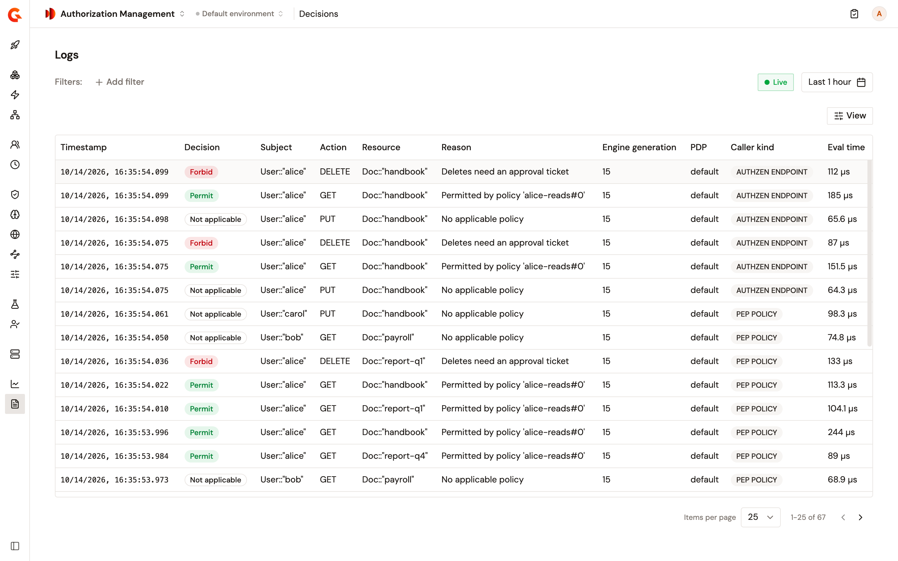
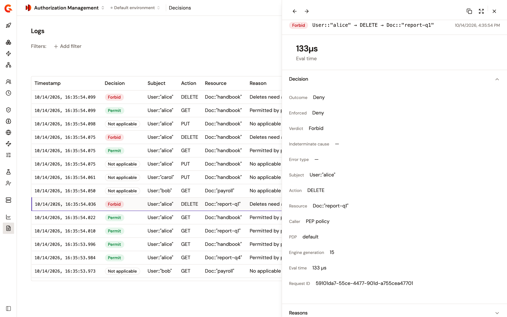
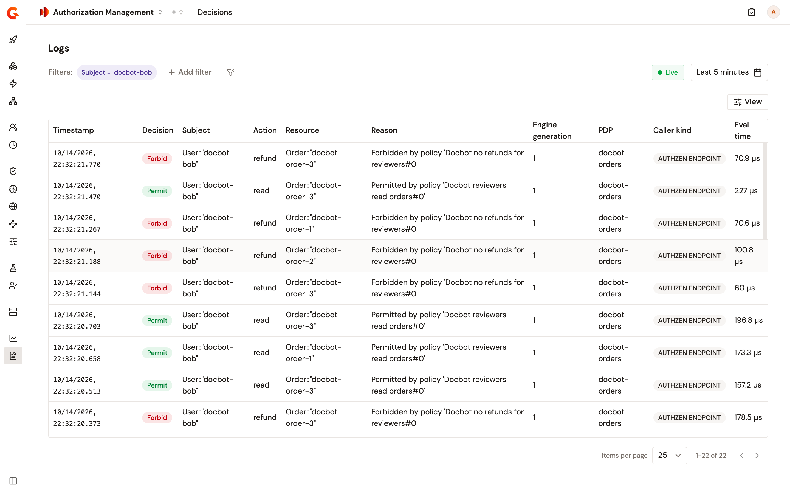

# Review authorization decisions

The **Decisions** page lists the authorization decisions your PDP gateways took, one row per decision. Use it to find out why a request was permitted or forbidden, which policies matched, and which PDP gateway answered. For what a decision record holds, see [Analytics sent to the control plane](../evaluate/analytics-sent-to-control-plane.md).

## Open the Decisions page

To open the page, complete the following steps:

1. In the Authorization Management sidebar, select **Decisions** in the **Observability** group. The page opens with the heading **Logs**.

    <figure><figcaption>
The Decisions page.
</figcaption></figure>

The page opens on **Last 5 minutes** with **Live** on, so the list refreshes every minute. Select the time range at the top right to see older decisions.

## Read a row

A few columns need a word of explanation:

* **Decision** reads **Permit**, **Forbid**, or **Not applicable**. It reads **Not ready** when the PDP gateway hadn't loaded its policies yet, and **Error** when the evaluation failed for another reason.
* **Reason** is cut after 60 characters. Hover over the cell to read the reasons in full. When a failed decision carries no reason, the cell shows the error type instead. By default, a reason names the policy and the statement that decided, counted from `#0`, such as `Permitted by policy 'Orders read#0'`. To report your own text, annotate the statement in the policy with `@reason("…")`. To rename the statement under **Matched policies**, annotate it with `@id("…")`.
* **Engine generation** is the generation of the policy set the PDP gateway evaluated. **default** under **PDP** is the default engine of the gateway. A decision that failed or wasn't evaluated also shows **default** under **PDP**, with `0` under **Engine generation**.
* `Eval time` reads **—** for a decision the PDP never evaluated.

Three columns are hidden by default. Select **View**, and then select the columns to show:

* **Enforced**: what the caller applied, such as **Allow** or **Deny**.
* **Matched policies**: the policies that matched. Hover over a policy to see its revision.
* **Batch**: the position of the decision in a batch request, for example `2/3`.

## Filter the decisions

To filter the decisions, complete the following steps:

1. Select **Add filter**.
2. Under **Filter by**, select the property.
3. Under **Choose operator**, keep or change the operator.
4. Under **Filter value**, select one or more values, or type them separated by commas. **Reason** takes one piece of text.
5. Select **Apply**.

Besides **API** and **Request ID**, the following filters apply to decisions:

| Filter | Narrows to |
| ------ | ---------- |
| **Decision** | **Permit**, **Forbid**, or **Not applicable**. |
| **Subject** | One or more principals. |
| **Action** | One or more actions. |
| **Resource** | One or more resources. |
| **Caller kind** | **PEP policy**, **AuthZEN endpoint**, **AuthZEN policy**, or **Unknown**. |
| **Outcome status** | **Success** or **Error**. |
| **Indeterminate cause** | **Not applicable**, **Timeout**, **Error**, or **Not ready**. |
| **Error type** | **Evaluation timeout**, **PDP unavailable**, **Evaluation failed**, or **Agent unresolved**. |
| **PDP Gateway** | One or more PDP gateways. |
| **Matched policy** | One or more policies. |
| **Engine generation** | One or more generations of the policy set. |
| **Reason** | Decisions whose reason contains the text you enter. |

## Open a decision

Select a row to open the decision in a side panel. The panel holds the following sections, one open at a time, starting with **Decision**:

* **Decision**: the **Outcome**, **Enforced**, **Verdict**, **Indeterminate cause**, **Error type**, **Subject**, **Action**, **Resource**, **Caller**, **PDP**, **Engine generation**, `Eval time`, and **Request ID** of the decision. A decision from a batch request also shows **Batch**, for example `2 of 3 (shared request)`.
* **Reasons**: every reason the PDP gave, numbered. The section is shown only when the decision carries a reason.
* **Matched policies**: each policy that matched, with its **Policy revision**. When no policy matched, the section says why, for example **No policy matched (Not applicable)**.
* **Raw JSON**: the full decision record.

<figure><figcaption>
A decision open in the side panel.
</figcaption></figure>

## Verification

To verify that decisions are recorded, follow these steps:

1. Send an evaluation request to an AuthZEN endpoint of a PDP gateway, or call an API that the PEP policy protects.
2. Open **Decisions**. With **Live** on, the decision is listed first.
3. Select **Add filter**.
4. Under **Filter by**, select **Subject**.
5. Under **Filter value**, enter the principal of your request.
6. Select **Apply**. The list keeps only that principal's decisions.

    <figure><figcaption>
The Decisions page filtered on one subject.
</figcaption></figure>

## Next steps

* [Monitor authorization decisions](monitor-authorization-decisions.md). Read the **Authorization — Overview** dashboard.
