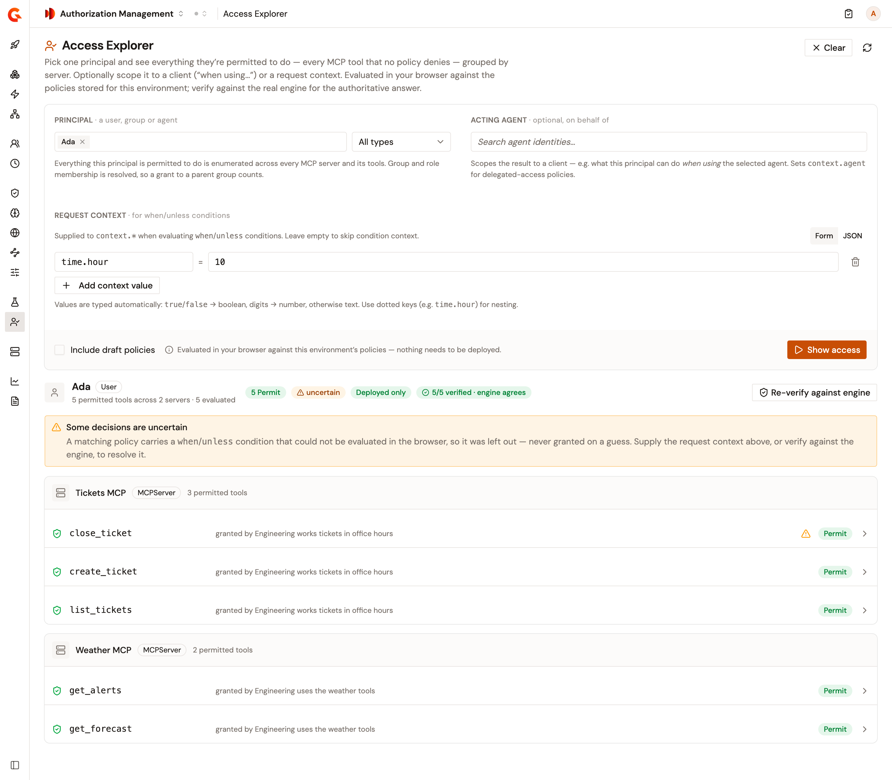

# Explore a principal's access

The **Access Explorer** lists the MCP tools that one principal is permitted to call, across the MCP servers of the environment. Deactivated principals, MCP servers, and tools aren't included. It decides each tool the same way as the Policy Simulator, from the policies as they're stored, so nothing needs to be deployed. **Verify against engine** checks the decisions with the authorization engine, whose decision is authoritative.

## Prerequisites

Before you begin, confirm that you have the following:

* MCP servers and their tools among your resources, and the principal you want to explore. For more information, see [Import resources from Catalog](../manage/resources/import-resources-from-catalog.md) and [Create a local principal](../manage/principals/create-a-local-principal.md).
* At least one MCP policy. For more information, see [Create, update, and delete policies](../configure/create-update-delete-policies.md).
* Read access to the environment's policies and entities. Without read access to policies, the **Testing** group isn't in the sidebar. Without read access to entities, the page shows **Could not load evaluation data**.

## Show a principal's access

To show what a principal can access, complete the following steps:

1. In the Authorization Management sidebar, select **Access Explorer** in the **Testing** group.
2. In **Principal**, select a user, group, role, service account, or agent identity. A policy for a group the principal belongs to counts.
3. Optional: In **Acting agent**, select an agent identity to see what the principal can do when using that agent. The agent becomes `context.agent` in the request.
4. Optional: In **Request context**, add the values that the conditions of your policies read. For more information, see [Add a request context](simulate-policy-decisions.md#add-a-request-context).
5. Optional: Select **Include draft policies** to count draft policies alongside deployed ones.
6. Click **Show access**.

A change to any of these clears the results. To see the results again, click **Show access**.

## Read the results

The results list the permitted tools under the name of their MCP server, each with the policy that grants it. A server with no permitted tool isn't listed. When no tool is permitted, the page shows **Nothing permitted**.

The line under the name of the principal counts the permitted tools and their servers, and how many tools were evaluated.

<figure><figcaption>
The tools one user can call, verified against the engine.
</figcaption></figure>

When the browser can't evaluate the condition of a matching policy, the page shows **Some decisions are uncertain** and marks the listed tools concerned with a warning icon. Leaving out a forbid policy this way can list a tool as permitted, and the engine can agree. To settle it, add the missing value, for example by selecting the acting agent, and click **Show access** again. In the figure, `close_ticket` is marked because a forbid policy reads `context.agent`, and no acting agent is selected. For more information, see [Uncertain decisions](simulate-policy-decisions.md#uncertain-decisions).

To see why a tool is permitted, click it. The decision opens in the same panel as in the Policy Simulator. For more information, see [Open a decision](simulate-policy-decisions.md#open-a-decision).

## Verify against the engine

To check the decisions, click **Verify against engine**. The engine decides every tool of the environment for the principal, not only the permitted ones, and the bar counts the tools it verified.

When the engine disagrees, a warning says on how many tools. A permitted tool that the engine forbids is outlined in red and names the engine's decision. A tool that the engine permits but the browser forbids isn't in the list, so open the Policy Simulator to compare every tool.

## Next steps

* **Compare several principals across chosen tools**. See [Simulate policy decisions](simulate-policy-decisions.md).
* **Change what a principal can access**. See [Create, update, and delete policies](../configure/create-update-delete-policies.md).
