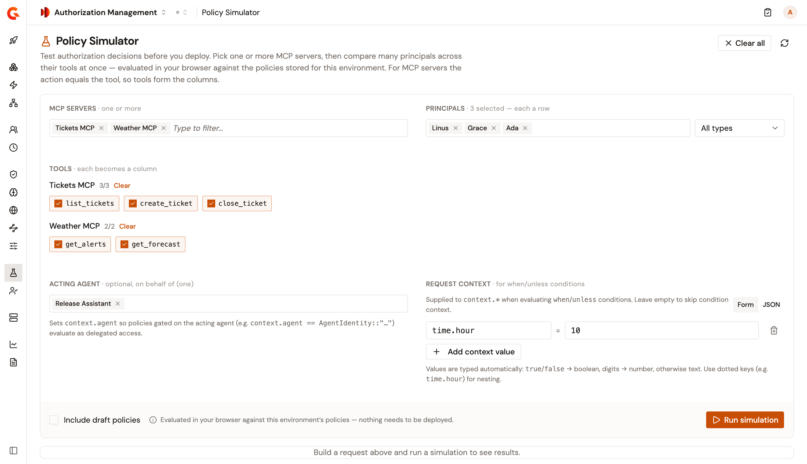
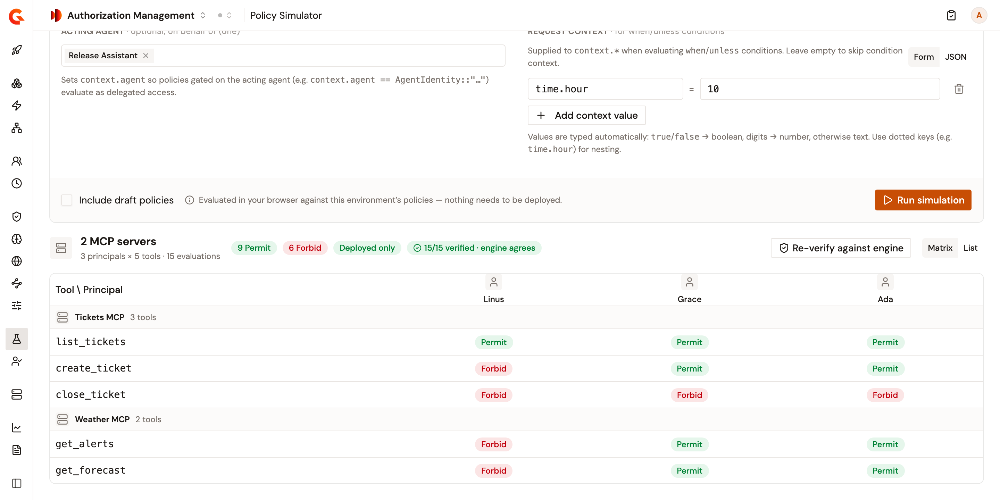
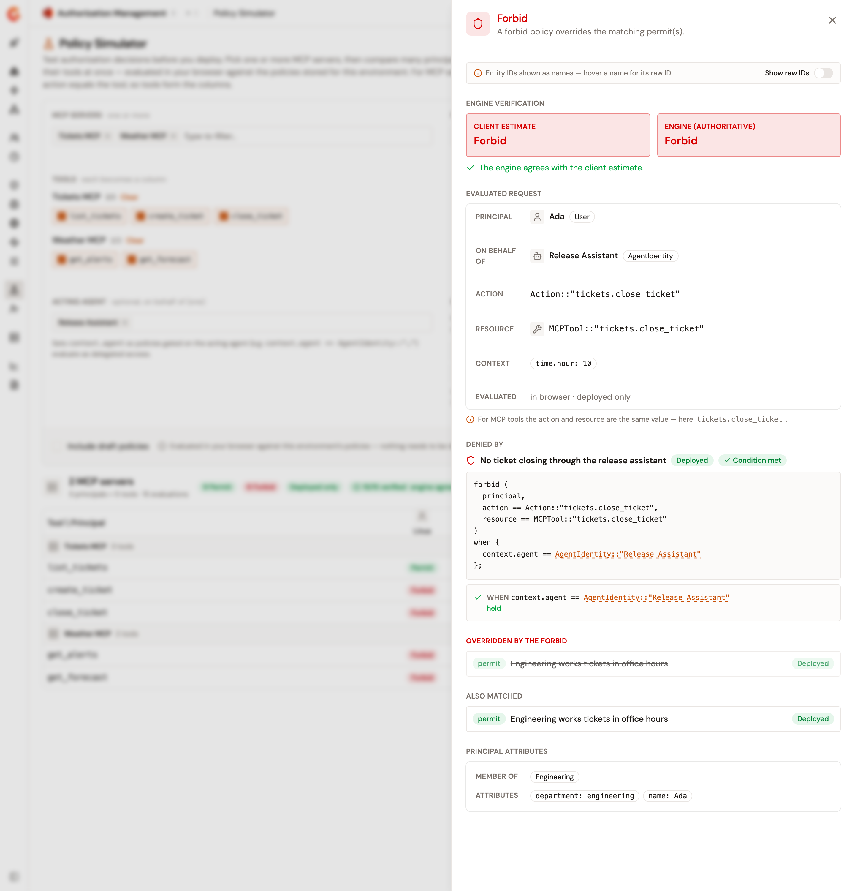

# Simulate policy decisions

The **Policy Simulator** decides, for each principal and each MCP tool you pick, whether the environment's MCP policies permit the call. It reads the policies as they're stored, so you can test a policy before you deploy it. Nothing is deployed, and no gateway is involved.

Your browser makes these decisions. **Verify against engine** then checks each one with the authorization engine, using the policies and entities stored for the environment. A gateway can still decide differently. For more information, see [What a simulation doesn't cover](#what-a-simulation-doesnt-cover).

## Prerequisites

Before you begin, confirm that you have the following:

* MCP servers and their tools among your resources, and the principals you want to test. For more information, see [Import resources from Catalog](../manage/resources/import-resources-from-catalog.md), [Create a local resource](../manage/resources/create-a-local-resource.md), and [Create a local principal](../manage/principals/create-a-local-principal.md).
* At least one MCP policy. For more information, see [Create, update, and delete policies](../configure/create-update-delete-policies.md).
* Read access to the environment's policies and entities. Without read access to policies, the **Testing** group isn't in the sidebar. Without read access to entities, the page shows **Could not load simulation data**.

## Run a simulation

To run a simulation, complete the following steps:

1. In the Authorization Management sidebar, select **Policy Simulator** in the **Testing** group.
2. In **MCP servers**, add one or more MCP servers. **Tools** lists the tools of each server, all selected.
3. Optional: Clear the tools you don't want to test. With more than one server, **Select all** beside the name of a server selects all its tools, and **Clear** clears them once they're all selected.
4. In **Principals**, add the users, groups, roles, service accounts, or agent identities you want to test. When the principals are of more than one type, the **All types** list beside the field filters them by type.
5. Optional: In **Acting agent**, select the agent identity that acts on behalf of each principal. The agent becomes `context.agent` in the request, so a policy whose condition names the agent applies.
6. Optional: In **Request context**, add the values that the conditions of your policies read. For more information, see [Add a request context](#add-a-request-context).
7. Optional: Select **Include draft policies** to test draft policies alongside deployed ones.
8. Click **Run simulation**.

    <figure><figcaption>
A request for three users on two MCP servers.
</figcaption></figure>

**Run simulation** is available once at least one MCP server, one tool, and one principal are selected. A disabled policy is never part of a simulation, and neither is a deactivated principal, MCP server, or tool.

The results show the request as it was when you ran it. After you change the request, click **Run simulation** again.

## Add a request context

The request context holds the values that a `when` or `unless` condition reads under `context`. To add one, click **Add context value**, and then enter a key and a value:

* A key with dots builds nested values. For example, the key `time.hour` is read as `context.time.hour`.
* A value of `true` or `false` is a boolean, a value such as `9` is a number, and a word such as `admin` is text. To keep a value as text, wrap it in double quotes, such as `"007"`.
* The engine reads a decimal number, such as `1.5`, as text. A condition that compares it can decide differently after you verify against the engine.

To edit the same context as a JSON object instead, click **JSON**.

## Read the results

Above the results, a bar counts the **Permit** and **Forbid** decisions, and the uncertain ones. **Deployed only** or **Drafts included** says which policies the run used.

* **Matrix** shows one row per tool, under the name of its MCP server, and one column per principal. With more than 12 principals, the matrix gets wide, and **List** is easier to read.
* **List** shows one card per principal, with each tool and the name of the policy that decided it.

<figure><figcaption>
The results of a run, verified against the engine.
</figcaption></figure>

Each decision follows these rules:

* A call is permitted when a permit policy matches it and no forbid policy applies. A forbid policy that applies wins over every permit policy.
* A call that no permit policy matches is forbidden.
* A policy for a group applies to every member of the group, including the members of the groups nested in it. Nesting stops at a deactivated group. A policy that names an MCP server applies to each of its tools.
* A policy whose `when` or `unless` condition doesn't hold for the request is left out.

### Uncertain decisions

When the browser can't evaluate a condition, it leaves the policy out of the decision and marks the cell with a warning icon. This happens when the condition compares a value that the request doesn't hold, such as `context.agent` with no acting agent, or uses an expression the browser doesn't evaluate.

Leaving out a forbid policy this way can turn the cell to **Permit**. The engine can agree, because a permit policy still decides the call when the forbid policy can't be evaluated. To settle an uncertain decision, add the missing value, for example by selecting the acting agent, and run the simulation again.

## Open a decision

To see why a call is permitted or forbidden, click its cell in the matrix or its row in the list. The panel opens with the decision and the reason for it, followed by these sections:

* **Evaluated request**: the principal, the agent acting on its behalf under **On behalf of**, the action and the resource, the request context, and whether draft policies were included.
* **Granted by** or **Denied by**: the policy that decided, with its GAPL and the result of each condition. When no permit or forbid policy applies, the section reads **Decision** and explains that the call is forbidden by default.
* **Overridden by the forbid**: the permit policies that a forbid policy overrode.
* **Also matched**: the permit policies that matched besides the one under **Granted by**. When a forbid policy decides, it lists the same permit policies as **Overridden by the forbid**.
* **Condition could not be evaluated**: the policies left out because the browser couldn't evaluate their condition.
* **Excluded by their condition**: the policies left out because their condition didn't hold.
* **Principal attributes**: the groups the principal is a member of, and its attributes.

The panel shows the names of principals in place of their IDs. To see the IDs, turn on **Show raw IDs**.

<figure><figcaption>
A forbid policy that overrides a permit policy.
</figcaption></figure>

## Verify against the engine

To check the decisions of a run, click **Verify against engine**. The authorization engine decides every cell of the run with the policies stored for the environment, with the same choice of draft policies as the run. The engine weighs all the environment's policies, while the browser weighs only its MCP policies.

When the engine has answered, the bar reads, for example, **15/15 verified · engine agrees**, or counts the cells where the engine disagrees. In the matrix, a cell where the engine disagrees is outlined in red and carries a red dot. In the list, its row names the engine's decision. In the panel of a decision, **Engine verification** shows the **Client estimate** beside the **Engine (authoritative)** decision.

When a policy can't be evaluated and no other policy decides the call, the engine gives no decision. The panel then shows the engine's decision as **Not evaluated**, with the reason under **Engine errors**. For example, a condition that reads a context value you didn't add can't be evaluated.

If the check fails, the page shows **Engine unavailable, showing the client estimate only** and keeps the results of the browser. After a new run, click **Verify against engine** again.

## What a simulation doesn't cover

A simulation has the following limits:

* It tests calls to MCP tools only.
* It doesn't take the **Target gateways** of a policy into account. Every policy the run uses counts, whichever gateways it targets.

## Next steps

* **List everything one principal can call**. See [Explore a principal's access](explore-a-principals-access.md).
* **Deploy the policies you tested**. See [Create, update, and delete policies](../configure/create-update-delete-policies.md).
