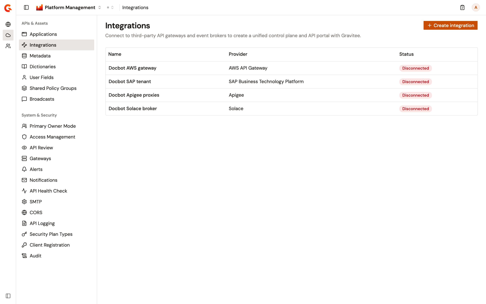
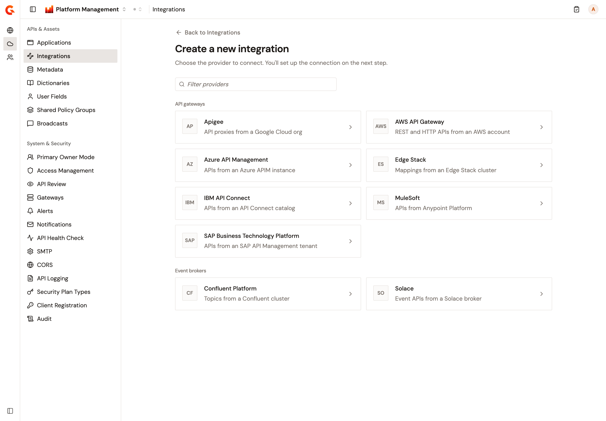
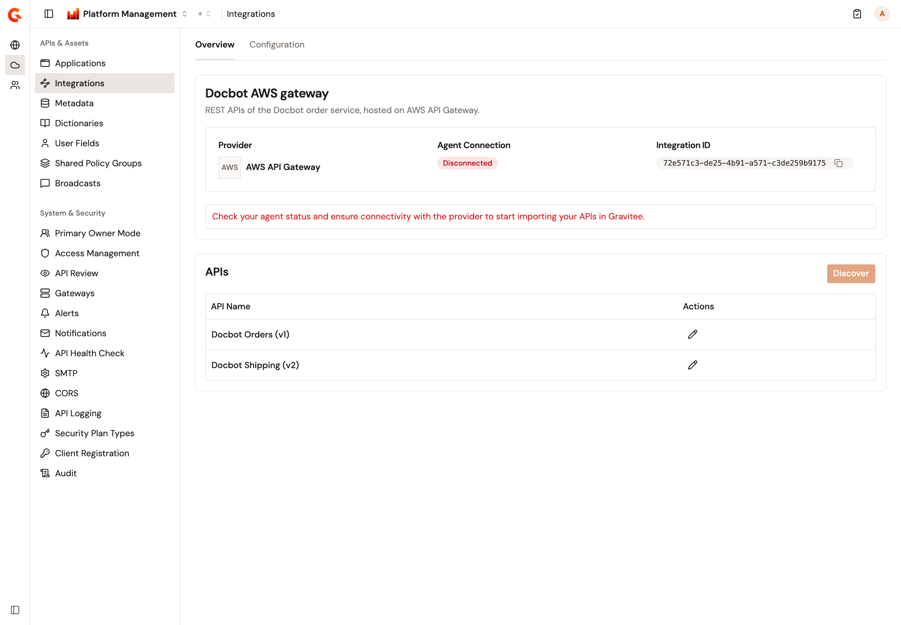
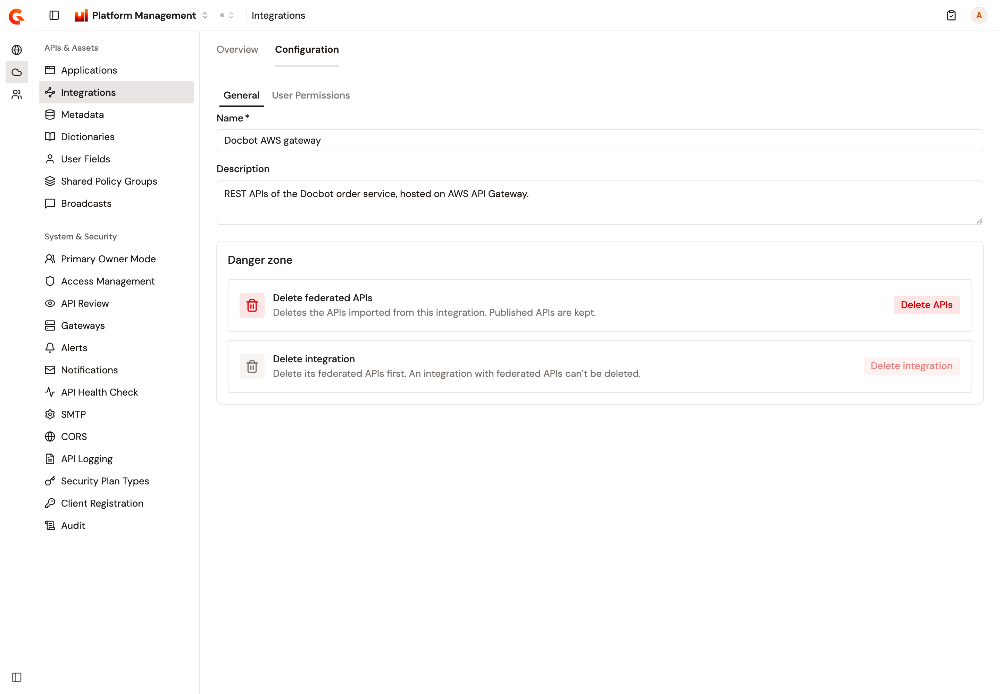
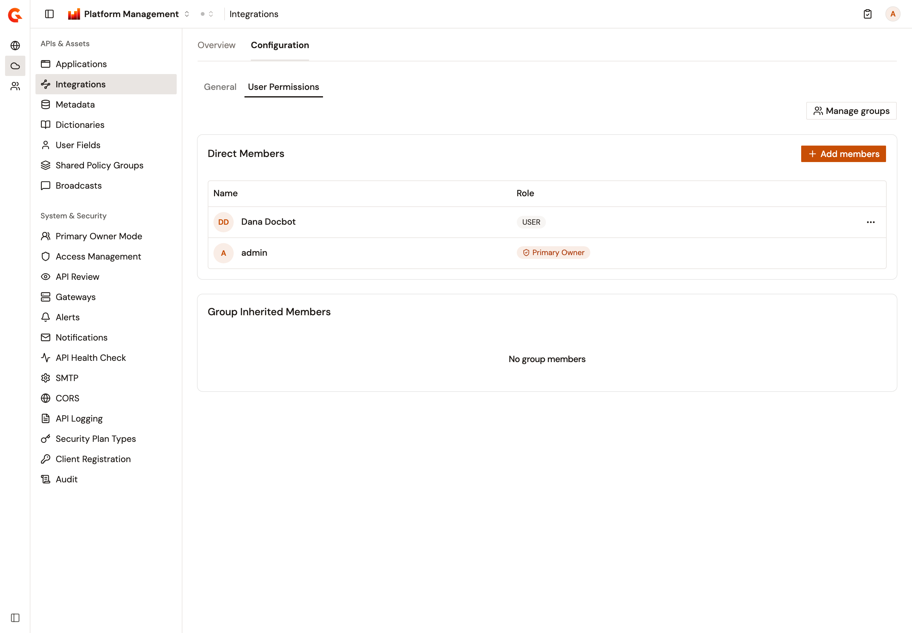
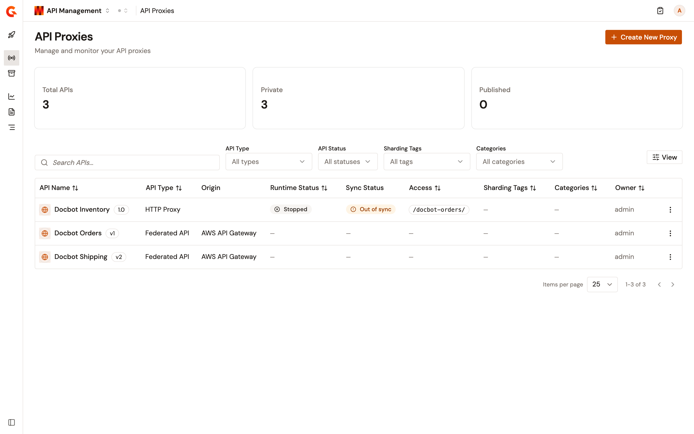

# Manage integrations

An integration connects Gravitee to a third-party API gateway or event broker, so that the APIs it hosts appear in Gravitee next to your own. Each integration pairs with a federation agent that runs next to the provider. Once the agent is connected, you discover the provider's APIs from the integration's **Overview** and ingest them as federated APIs. The federated APIs then appear in the **API Proxies** list of API Management.

The **Integrations** page of the **Environment** section lists the integrations of the environment, and is where you create one. Running the agent and giving it the provider's credentials happens outside the Gamma console. For more information, see [Integrations](https://documentation.gravitee.io/apim/govern-apis/federation/integrations) and [3rd-Party Providers](https://documentation.gravitee.io/apim/govern-apis/federation/3rd-party-providers) in the API Management documentation.

## Prerequisites

* Federation turned on for your installation, and a license that includes it and hasn't expired. Until both are in place, the **Integrations** item doesn't appear in the sidebar, and its pages send you to the **Applications** page, or to the first page of the sidebar when you can't open **Applications**. For more information, see [Federation](https://documentation.gravitee.io/apim/govern-apis/federation) in the API Management documentation.
* A role that can read the environment's integrations. Without it, the **Integrations** item doesn't appear either.

Which integrations you see depends on your role. An administrator sees every integration of the environment. Anyone else sees the integrations they're a member of, directly or through a group.

## Open Integrations

To open **Integrations**, complete the following steps:

1. At the top of the page, click **Home**, or the name of the product you're working in.
2. Select **Platform Management**.
3. Open the **Environment** section. The section names show when you hover over the icons on the left.
4. Under **APIs & Assets**, click **Integrations**.

    <figure><figcaption>
The Integrations page lists the integrations of the environment with their provider and the status of their agent.
</figcaption></figure>

Each row shows the integration's provider and whether its agent is **Connected** or **Disconnected**. The A2A integrations of the environment are listed too, with **A2A Protocol** as their provider and no status, but you can't open or create them from this page. Until the environment has an integration, the page reads **No integrations yet**.

## Create an integration

To create an integration, complete the following steps:

1. On the **Integrations** page, click **Create integration**. The button appears when your role can create integrations in the environment.
2. On the **Create a new integration** page, select the provider. The providers are grouped under **API gateways** and **Event brokers**, and **Filter providers** narrows the list as you type.

    <figure><figcaption>
The provider step of the Create a new integration page.
</figcaption></figure>

3. Enter a **Name** of up to 50 characters and, optionally, a **Description** of up to 250 characters. To pick another provider, click **Change**.
4. Click **Create integration**.

The integration's **Overview** opens, and the message **Integration \<name> created successfully** confirms the creation. If the creation fails, the message **Failed to create integration.** appears. The form keeps your values.

Under **API gateways**, the providers are **Apigee**, **AWS API Gateway**, **Azure API Management**, **Edge Stack**, **IBM API Connect**, **MuleSoft**, and **SAP Business Technology Platform**. Under **Event brokers**, they're **Confluent Platform** and **Solace**.

A new integration shows **Disconnected** until its federation agent connects. The agent needs the **Integration ID** shown on the **Overview**, and the credentials of the provider. For more information, see [The federation agent](https://documentation.gravitee.io/apim/govern-apis/federation/integrations#the-federation-agent) in the API Management documentation.

## Review an integration

Click an integration's name to open its **Overview**. The page shows the integration's **Provider**, its **Agent Connection**, and its **Integration ID**, which you can copy for the agent's configuration. While the agent is disconnected, the page reads **Check your agent status and ensure connectivity with the provider to start importing your APIs in Gravitee.**

The **APIs** card lists the federated APIs ingested from the integration, with their version. Click one to open its **Settings** page in API Management. Until the first ingestion, the card reads **No APIs created**.

<figure><figcaption>
The Overview of an integration whose agent is disconnected, with two ingested APIs.
</figcaption></figure>

The **Configuration** tab appears when your role can update or delete the integration, or read its members.

## Discover and ingest APIs

Discovery asks the agent for the APIs the provider hosts, and ingestion creates a federated API in Gravitee for each one you keep. Running it again later refreshes the APIs that already exist.

**Discover** appears in the **APIs** card when your role can create integrations in the environment, and is available once the agent is **Connected** and no ingestion is running. The discovery itself also needs the right to create on the integration. Without it, the page reads **Discovery preview could not be loaded. Please try again from the overview.**

To discover and ingest APIs, complete the following steps:

1. On the integration's **Overview**, click **Discover**. The **Discover** page lists the APIs found at the provider, each marked **New** or **Update**. An API is an **Update** when an earlier ingestion already created it.
2. Under **APIs to ingest**, keep or clear **New** and **Update**. Each one shows how many APIs it holds, and one that holds none is unavailable. The list follows your choice.
3. Click **Ingest**. The **Overview** reopens, and the message **API ingestion is in progress. Come back shortly to see discovered APIs.** confirms the start.

Ingestion runs in the background. While it runs, the **APIs** card reads that APIs are being ingested and refreshes on its own, and **Discover** is unavailable. If the ingestion can't start, the message **Ingestion failed. Please check your settings and try again.** appears instead.

When the provider returns only part of its APIs, the **Discover** page warns **Only a partial list of APIs was returned by the provider. Proceeding will ingest all discoverable APIs.** In that case, **Ingest** ingests every API the provider can discover, whatever you selected.

An **Update** overwrites the name, description, and version of the federated API, and what it imported from the provider. It refreshes the API's plans and the documentation pages that came from the provider. A plan the provider no longer offers is deleted, and its subscriptions are closed first. Pages written in Gravitee, and the API's groups, categories, labels, visibility, and lifecycle state keep their values.

## Open a federated API

Federated APIs appear in the **API Proxies** list of API Management, with **Federated API** in the **API Type** column and the provider in the **Origin** column. The **API Type** filter gains a **Federated API** option. A federated API doesn't run on the gateway, so its **Runtime Status** and **Sync Status** show a dash, and its row menu has no **View Analytics** action.

Opening a federated API lands on its **Settings** page, where **From integration** in the **Details** panel links back to the integration's **Overview**. For what you can change on a federated API, see [Manage general settings](../api-management/build/configure-your-api-proxy/manage-general-settings.md#federated-apis).

## Edit an integration

To change the name or description of an integration, complete the following steps:

1. Open the integration, and click **Configuration**.
2. On the **General** tab, edit **Name** or **Description**. The form shows **You have unsaved changes.** once something changed and the values are valid.
3. Click **Save**. The message **Integration successfully updated!** confirms the change.

The form appears when your role can update the integration. A save doesn't change the groups attached to the integration.

<figure><figcaption>
The General tab of an integration's Configuration page.
</figcaption></figure>

## Delete the federated APIs or the integration

The **Danger zone** of the **General** tab holds both deletions, and appears when your role can delete the integration.

**Delete federated APIs** deletes the APIs ingested from the integration, with their plans, subscriptions, documentation, and metadata. The tile appears when your role can also delete APIs in the environment, and **Delete APIs** is available while the integration has federated APIs. A published API is kept. After you confirm, the message **Federated APIs have been deleted.** reports how many APIs were deleted, how many weren't, and how many failed.

**Delete integration** is available once the integration has no federated APIs left. The dialog asks you to type the integration's name, and **Delete permanently** removes the integration with its members. The message **Integration successfully deleted!** confirms it, and the **Integrations** page reopens.

## Manage members and groups

The **User Permissions** tab of **Configuration** lists who can work with the integration. It appears when your role can read the integration's members.

* **Direct Members** lists each member with their integration role. The **Primary Owner** is the person who created the integration, and can't be edited or removed here.
* **Group Inherited Members** lists, for each group attached to the integration, the members of the group with their integration role. When you can't view a group's members, the group reads **You do not have the appropriate permissions to view members of this group.**

Each of the following actions appears when your role allows it:

* To add members, click **Add members**, search for users by name or email, and choose the role they get. Any integration role except **Primary Owner** can be chosen.
* To change a member's role, open the menu at the end of the row, and click **Edit role**. Pick the role, and click **Save**.
* To remove a member, click **Remove member** in the same menu, and confirm.

To change the groups attached to the integration, click **Manage groups**, select the groups that should have access to the integration, and save. The button is available when your role can update the integration.

<figure><figcaption>
The User Permissions tab of an integration's Configuration page.
</figcaption></figure>

## Verification

To verify that an integration is working as expected, follow these steps:

1. Open the integration's **Overview**, and check that **Agent Connection** reads **Connected**.
2. Click **Discover**, keep **New** selected, and click **Ingest**.
3. When the **APIs** card lists the ingested APIs, open **API Proxies** in API Management, and set the **API Type** filter to **Federated API**.

    The ingested APIs are listed with the integration's provider in the **Origin** column.

    <figure><figcaption>
Two federated APIs in the API Proxies list.
</figcaption></figure>

## Next steps

* [Manage general settings](../api-management/build/configure-your-api-proxy/manage-general-settings.md#federated-apis). What the **Settings** page of a federated API offers.
* [Manage groups](manage-groups.md). Create the groups you attach to an integration.
* [Federated APIs](https://documentation.gravitee.io/apim/govern-apis/federation/federated-apis). How the plans and subscriptions of a federated API relate to the provider.
