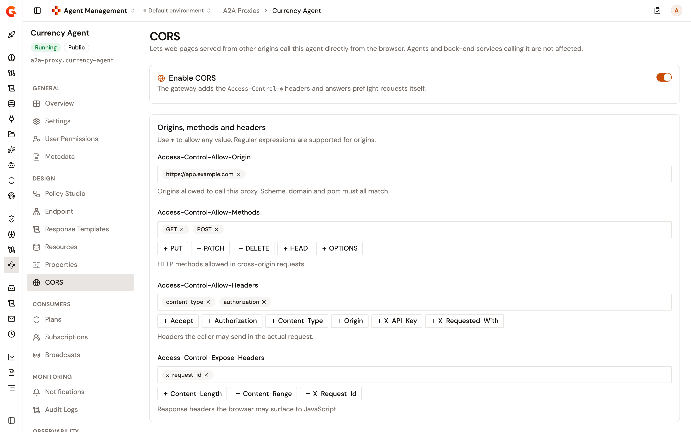
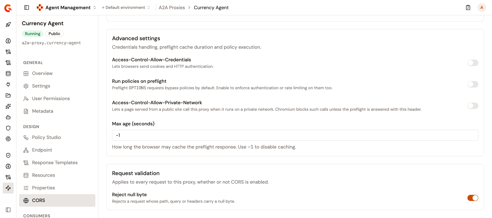

# Configure A2A Proxy CORS

The **CORS** page of an A2A Proxy lets web pages served from other origins call the agent directly from the browser. Agents and back-end services that call the proxy aren't affected. When CORS is enabled, the gateway answers browser preflight requests itself and adds the `Access-Control-*` headers to the responses of the proxy, including the agent card and streamed responses. CORS is off until you enable it. While it's off, the gateway passes preflight requests on to the agent.

## Prerequisites

Before you begin, confirm that you have the following:

* An A2A Proxy. For more information, see [Expose your agent with the A2A Proxy](expose-agent-with-a2a-proxy.md).
* Permission to update the definition of the proxy. Without it, the page is read-only: the switches and the fields stay disabled, and the save bar never appears.
* An A2A Proxy entrypoint that supports CORS. The entrypoint delivered with 4.14.0 does. With an entrypoint that doesn't, the page shows **The entrypoint of this proxy does not support CORS** and locks the CORS settings: CORS stays off, and a proxy that already has CORS on only lets you turn it off. The **Reject null byte** switch stays available.

To open the page, follow these steps:

1. In the Gamma console, open **Agent Management**.
2. Under **Secure**, select **A2A Proxies**.
3. Select your A2A Proxy.
4. Under **Design**, select **CORS**.

<figure><figcaption><p>The CORS page of an A2A Proxy</p></figcaption></figure>

## Enable CORS

Turn on the **Enable CORS** switch. The settings of the **Origins, methods and headers** and **Advanced settings** cards stay disabled until CORS is enabled.

## Set the origins, methods, and headers

The **Origins, methods and headers** card carries four list fields. Type a value and press Enter or a comma to add it, and click the cross on a value to remove it. The buttons under the method and header fields add a common value with one click. Use `*` to allow any value.

| Field                             | Description                                                                                                                                                                                                                                  |
| --------------------------------- | -------------------------------------------------------------------------------------------------------------------------------------------------------------------------------------------------------------------------------------------- |
| **Access-Control-Allow-Origin**   | Origins allowed to call the proxy, such as `https://app.example.com`. An origin matches only when its scheme, domain, and port are the same. A value other than `*` that contains `(`, `[`, or `*` is a regular expression, matched against the whole origin. |
| **Access-Control-Allow-Methods**  | HTTP methods allowed in cross-origin requests. The buttons offer `GET`, `POST`, `PUT`, `PATCH`, `DELETE`, `HEAD`, and `OPTIONS`.                                                                                                            |
| **Access-Control-Allow-Headers**  | Headers that the caller sends in the actual request. The buttons offer `Accept`, `Authorization`, `Content-Type`, `Origin`, `X-API-Key`, and `X-Requested-With`.                                                                             |
| **Access-Control-Expose-Headers** | Response headers that the browser lets JavaScript read. The buttons offer `Content-Length`, `Content-Range`, and `X-Request-Id`.                                                                                                             |

The page checks an origin when you add it. A value that's neither `*`, `null`, an origin without a path such as `https://app.example.com`, nor a valid regular expression stays in the field, with **Enter an origin such as https://app.example.com, without a path, or a regular expression.** or **Not a valid regular expression.** underneath.

Header names are saved in lowercase, so `Content-Type` reads back as `content-type` after you save.

When CORS is enabled, a save that changes the CORS settings needs at least one allowed origin and at least one allowed method. Each method is an HTTP method name in uppercase, such as `POST`, or `*`. Otherwise the save is refused, and the page shows the reason, such as **At least one allowed origin is required when CORS is enabled.**


Adding `*` as an allowed origin shows the **Allowing all origins** alert, because `*` exposes the proxy to any website. Make sure that authentication is enforced. While `*` is listed, a save with **Access-Control-Allow-Credentials** on is refused.


## Adjust the advanced settings

The **Advanced settings** card covers credentials, policy execution on preflight requests, private network access, and the preflight cache duration.

* **Access-Control-Allow-Credentials**. Lets browsers send cookies and HTTP authentication with cross-origin requests. When the switch is on, the gateway adds `Access-Control-Allow-Credentials: true` to the responses it sends to allowed origins.
* **Run policies on preflight**. By default, the gateway answers a preflight `OPTIONS` request as soon as the CORS checks pass, without running the flows of the proxy. Turn the switch on to also run, on preflight requests, the policies of the flows that aren't tied to a plan. Plan flows don't run on preflight requests. Whether the switch is on or off, a preflight request never reaches the agent, and the security of the plans is skipped for it.
* **Access-Control-Allow-Private-Network**. Lets a page served from a public site call the proxy when the proxy runs on a private network. When the switch is on, the gateway answers a preflight request that carries `Access-Control-Request-Private-Network: true` with `Access-Control-Allow-Private-Network: true`.
* **Max age (seconds)**. How long the browser caches the preflight response. The default, `-1`, sends no `Access-Control-Max-Age` header. The field accepts values from `-1` to `2147483647`, and a value above `600` shows the **Long preflight cache** warning.

<figure><figcaption><p>The Advanced settings and Request validation cards</p></figcaption></figure>

## Reject requests that carry a null byte

The **Request validation** card applies to every request to the proxy, whether or not CORS is enabled. While **Reject null byte** is on, the gateway refuses a request whose path, query, or headers carry a null byte. By default, the refusal has status `400` and the message `The request contains invalid characters.` A new A2A Proxy starts with the switch on.

## Save and deploy

A change on the page shows the save bar with **You have unsaved CORS changes.** Click **Save changes** to apply, or **Discard** to revert. A successful save shows **CORS settings saved**. When the save is refused, the page shows the reason.

Saving with the **Enable CORS** switch off resets the CORS settings: the four lists read back empty, **Max age (seconds)** returns to `-1`, and the switches of the **Advanced settings** card turn off. **Reject null byte** keeps its value.

Saving updates the definition of the proxy but doesn't deploy it. The **This A2A proxy is out of sync** banner appears at the top of the page. Click **Deploy**, optionally enter a deployment label in the **Deploy your A2A proxy** dialog, and click **Deploy** to push the change to the gateway.

Once CORS is enabled, the gateway decides the CORS headers of the proxy. A response to an origin that isn't allowed, or to a request without an `Origin` header, loses the `Access-Control-Allow-Origin`, `Access-Control-Allow-Credentials`, and `Access-Control-Expose-Headers` headers that the agent set.

## Verification

To verify that the gateway applies the settings, follow these steps:

1. Enable CORS, add the origin `https://app.example.com`, add the `POST` method, and add the `Content-Type` header. Click **Save changes**, and then deploy the proxy from the **This A2A proxy is out of sync** banner.
2. Send a preflight request to the **Gateway URL** of the proxy, as shown in the **Connection** card of its **Overview** page:

    ```bash
    curl -i -X OPTIONS <gateway-url> \
      -H "Origin: https://app.example.com" \
      -H "Access-Control-Request-Method: POST" \
      -H "Access-Control-Request-Headers: content-type"
    ```

    The response has status `200` and carries `Access-Control-Allow-Origin: https://app.example.com`, `Access-Control-Allow-Methods`, and `Access-Control-Allow-Headers`.
3. Send the same request with an origin you didn't allow, such as `https://other.example.com`. The gateway refuses the preflight with status `400` and no `Access-Control-*` headers.

An actual cross-origin request from an allowed origin gets `Access-Control-Allow-Origin` in its response and, when you set exposed headers, `Access-Control-Expose-Headers`. From an origin that isn't allowed, the agent still answers the request, but the response carries no `Access-Control-Allow-Origin` header, so the browser keeps it from the page.

## Next steps

* [Add policies to your A2A Proxy](configure-your-a2a-proxy/add-policies-to-a2a-proxy.md). Add policies in the Policy Studio to secure agent-to-agent traffic and control its behavior.
* [Manage A2A Proxy plans](configure-your-a2a-proxy/manage-a2a-proxy-plans.md). Create, edit, publish, deprecate, and close the plans that control how consumers authenticate to the proxy.
