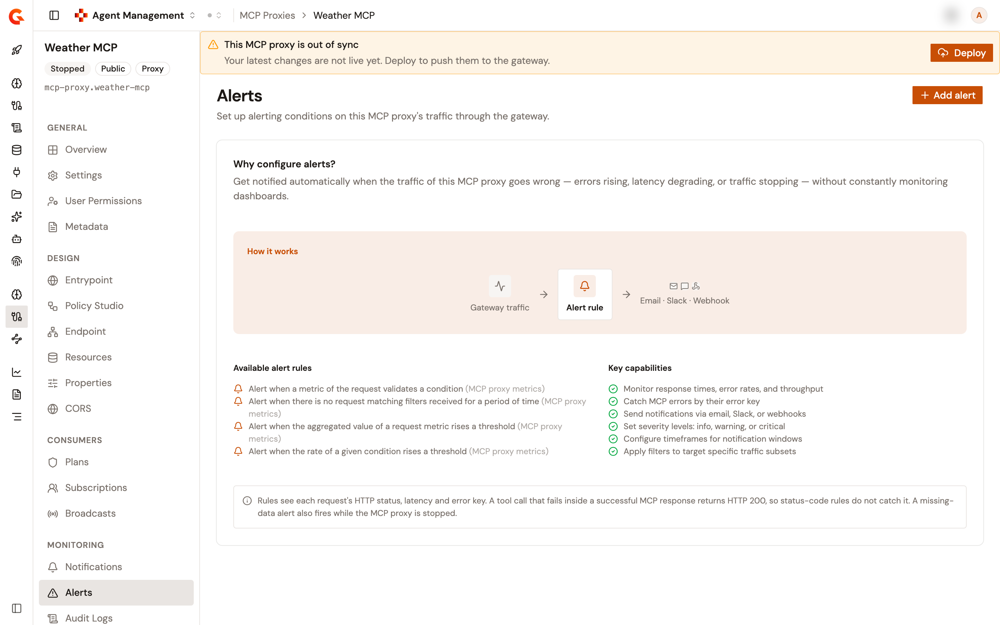
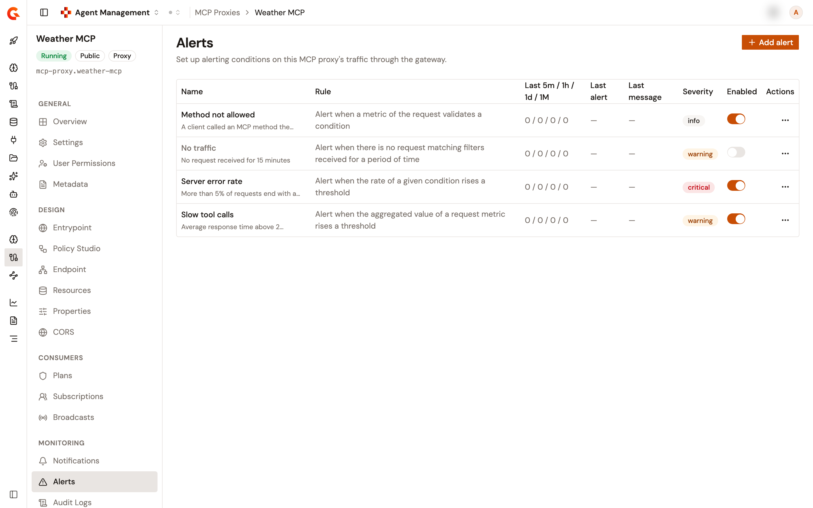
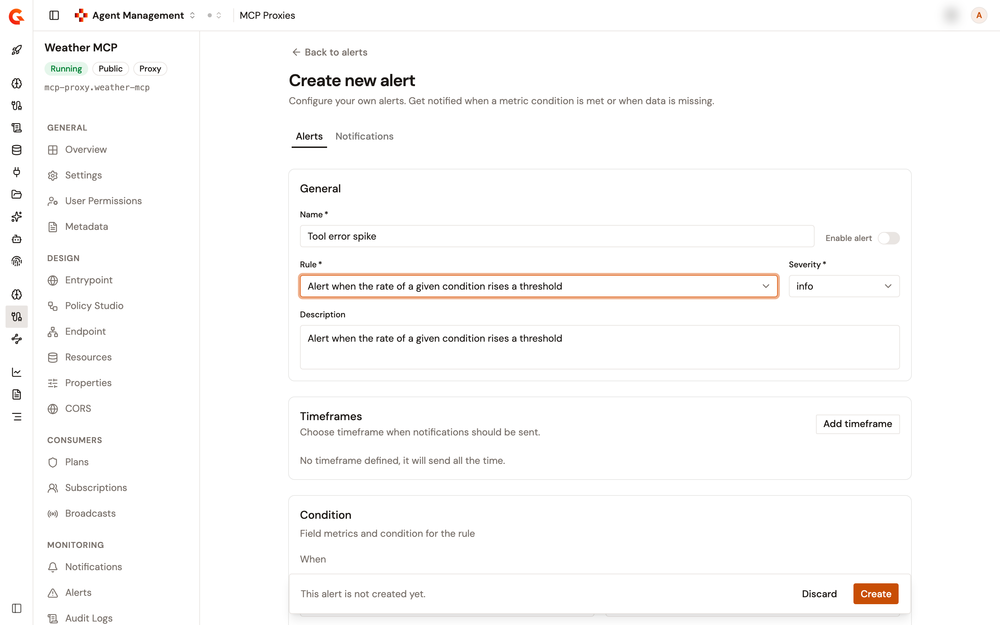
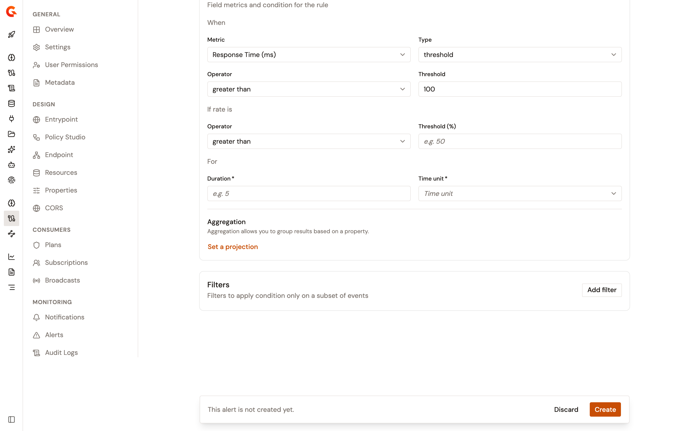
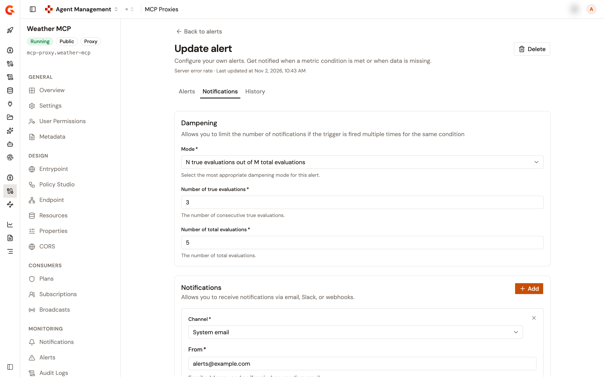

# Configure MCP Proxy alerts

An alert watches the requests that an MCP Proxy handles, and notifies you when its rule matches, for example when errors rise, responses slow down, or traffic stops. The **Alerts** page of an MCP Proxy lists its alerts, creates and edits them, and counts how often each one fired.

Alerts require Alert Engine. Your license must include it, alerting must be turned on for your organization, and at least one alert plugin must be installed. When one of them is missing, the **Alerts** page shows **Alerts require Alert Engine**, **Alerting is turned off**, or **No alert plugin is installed**. You then can't add an alert, turn one on or off, or save changes to one. Without the license, the page doesn't list the alerts either.

## Open the Alerts page

The **Alerts** page sits in the **Monitoring** group of an MCP Proxy, between **Notifications** and **Audit Logs**.

To open the page, follow these steps:

1. In the Gamma console, open **Agent Management**.
2. Under **Secure**, select **MCP Proxies**.
3. Select your MCP Proxy.
4. Under **Monitoring**, select **Alerts**.

The **Alerts** item appears only when you're allowed to read alerts.

Until the proxy has an alert, the page shows a card that explains alerts in place of the table, and lists the rules available for new alerts.

<figure><figcaption>
The Alerts page before the first alert
</figcaption></figure>

## Read the alert list

The table lists one row per alert, sorted by name, with the following columns:

| Column                     | Description                                                                                                                                   |
| -------------------------- | --------------------------------------------------------------------------------------------------------------------------------------------- |
| **Name**                   | The name of the alert, with its description below it. The name of a disabled alert is dimmed.                                                 |
| **Rule**                   | The rule that the alert evaluates.                                                                                                            |
| **Last 5m / 1h / 1d / 1M** | How many times the alert fired in the last 5 minutes, the last hour, the last day, and the last 30 days. Hover over the counts to see each period spelled out. |
| **Last alert**             | How long ago the alert last fired, or a dash when it hasn't fired. Hover over it to see the date and time.                               |
| **Last message**           | The message of the last alert.                                                                    |
| **Severity**               | **info**, **warning**, or **critical**.                                                                                                       |
| **Enabled**                | A switch that enables or disables the alert.                                                                                                  |
| **Actions**                | A menu with **Edit**, or **View** when you can't edit alerts, and **Delete** when you're allowed to delete alerts.                            |

Click a row to open its alert. Turning the **Enabled** switch on or off saves the alert at once, and **Alert saved with success** confirms it.

The **Add alert** button appears only when you're allowed to create alerts.

<figure><figcaption>
The alerts of an MCP Proxy
</figcaption></figure>

## Create an alert

To create an alert, follow these steps:

1. Click **Add alert**. The **Create new alert** page opens on the **Alerts** tab.
2. Under **General**, enter a **Name** of 3 to 50 characters, and select a **Rule**. See [Rules](#rules).
3. Select a **Severity**: **info**, **warning**, or **critical**. It's **info** by default.
4. Optionally, enter a **Description** of up to 256 characters.
5. To enable the alert when it's created, turn on **Enable alert**. A new alert stays disabled until you enable it.
6. Under **Timeframes**, optionally click **Add timeframe** to restrict when notifications are sent. See [Restrict notifications to a timeframe](#restrict-notifications-to-a-timeframe).
7. Under **Condition**, set the condition of the rule. See [Set the condition](#set-the-condition).
8. Under **Filters**, optionally click **Add filter** to apply the condition to a subset of events. See [Filter the events](#filter-the-events).
9. To be notified, open the **Notifications** tab, and add the notification channels. You can also change the dampening there. See [Configure dampening and notifications](#configure-dampening-and-notifications).
10. Click **Create**.

Selecting a rule replaces the description with the wording of the rule, resets the condition and the dampening to their defaults, and clears the filters. The rule can't be changed after the alert is created.

Problems show once you click **Create**. Each one appears under its field or at the top of its card, and the page switches to a tab with a problem. Once the alert is created, **Alert has been saved successfully** confirms it, and the alert opens on its **Update alert** page. **Discard** clears what you entered, or returns to the list when you haven't entered anything.

<figure><figcaption>
The Create new alert page with a rate rule selected
</figcaption></figure>

### Rules

The **Rule** list offers four rules under **MCP PROXY METRICS**. Each rule takes its own condition:

| Rule                                                                              | Condition                                                                                                                                         |
| --------------------------------------------------------------------------------- | ------------------------------------------------------------------------------------------------------------------------------------------------- |
| **Alert when a metric of the request validates a condition**                      | **When** a **Metric** meets a **Type** of condition.                                                                                              |
| **Alert when there is no request matching filters received for a period of time** | **No event for** a **Duration** and a **Time unit**.                                                                                              |
| **Alert when the aggregated value of a request metric rises a threshold**         | **Calculate** a **Function** on a **Metric**, then **If result is** an **Operator** and a **Threshold**, **For** a **Duration** and a **Time unit**. |
| **Alert when the rate of a given condition rises a threshold**                    | **When** a **Metric** meets a **Type** of condition, then **If rate is** an **Operator** and a **Threshold (%)**, **For** a **Duration** and a **Time unit**. |

### Set the condition

The **Condition** card shows the fields of the rule. A **Metric** takes a **Type** that depends on the metric, and each type takes its own fields:

* **threshold**: an **Operator** and a **Threshold**.
* **threshold range**: a **Low threshold** and a **High threshold**.
* **compare**: an **Operator**, a **Multiplier**, and the **Property** to compare with.
* **string**: an **Operator** and a **Value** or a **Pattern**.

The numeric operators are **less than**, **less than or equals to**, **greater than or equals to**, and **greater than**. The string operators are **equals to**, **not equals to**, **starts with**, **ends with**, **contains**, and **matches**. The functions are **count**, **average**, **min**, **max**, **50th percentile**, **90th percentile**, **95th percentile**, and **99th percentile**. The time units are **Seconds**, **Minutes**, and **Hours**.

Thresholds, multipliers, and durations take values of 1 or more, and durations take whole numbers. A high threshold must be greater than or equal to the low one, and the **Threshold (%)** of a rate takes a value from 1 to 99.

The metrics offered depend on the rule:

| Rule                                                                                                                         | Metrics                                                                                                                                                                       |
| ---------------------------------------------------------------------------------------------------------------------------- | ----------------------------------------------------------------------------------------------------------------------------------------------------------------------------- |
| **Alert when a metric of the request validates a condition** and **Alert when the rate of a given condition rises a threshold** | **Response Time (ms)**, **Upstream Response Time (ms)**, **Status Code**, **Request Content-Length**, **Response Content-Length**, **Error Key**, **Tenant**, **Application**, **Plan** |
| **Alert when the aggregated value of a request metric rises a threshold**                                                    | **Response Time (ms)**, **Upstream Response Time (ms)**, **Request Content-Length**, **Response Content-Length**                                                              |

**Response Time (ms)**, **Upstream Response Time (ms)**, **Request Content-Length**, and **Response Content-Length** offer the threshold, threshold range, and compare types. **Status Code** offers threshold and threshold range. **Error Key**, **Tenant**, **Application**, and **Plan** take the string type.

With the **equals to** or **not equals to** operator, these four metrics offer a **Value** list in place of a **Pattern**:

* **Error Key** lists error keys, including the keys of the MCP Proxy, such as `MCP_PROXY_METHOD_NOT_ALLOWED`.
* **Tenant** lists the tenants.
* **Application** lists the applications that have a subscription to the proxy, whatever its status.
* **Plan** lists the published plans of the proxy.

When a list can't be loaded, for example when you can't see the plans or the subscriptions of the proxy, the field takes a **Pattern** instead.

For the aggregation and rate rules, the card ends with an **Aggregation** section. **Set a projection** groups the results by a **Property**: **Status Code**, **Error Key**, **Tenant**, **Application**, or **Plan**. **Remove** clears the projection.

<figure><figcaption>
The Condition card of a rate rule
</figcaption></figure>

### Filter the events

**Add filter** adds a numbered **Filter** card that narrows the events the condition applies to. Each filter takes a **Metric**, a **Type**, and the fields of that type, as described in [Set the condition](#set-the-condition), and offers every metric of the request. Remove a filter with its trash icon.

### Restrict notifications to a timeframe

Without a timeframe, the **Timeframes** card reads **No timeframe defined, it will send all the time.** **Add timeframe** adds a **Configure timeframe** card:

* Select at least one day of the week.
* Optionally, set a start and an end time under **Time range**. Set both or neither, and set the end after the start.
* The **Office hours** switch sets the range from 9:00 AM to 6:00 PM, and the **Business day** switch selects every day except the weekend.

A timeframe is evaluated in the time zone of the browser that added it, and the card names that zone. Remove a timeframe with its X.

### Configure dampening and notifications

The **Notifications** tab holds the **Dampening** and **Notifications** cards.

**Dampening** limits the number of notifications when the alert fires several times for the same condition. Select a **Mode**:

| Mode                                              | Fields                                                                                             |
| ------------------------------------------------- | -------------------------------------------------------------------------------------------------- |
| **N consecutive true evaluations**                | **Number of true evaluations**                                                                     |
| **N true evaluations out of M total evaluations** | **Number of true evaluations** and **Number of total evaluations**, which must be at least as high |
| **N true evaluations in T time**                  | **Number of true evaluations**, **Duration**, and **Time unit**                                    |
| **Only true evaluations for at least T time**     | **Duration** and **Time unit**                                                                     |

A new alert starts with **N consecutive true evaluations** and one evaluation. The counts and durations take whole numbers from 1 to 100, and changing the mode clears them.

**Notifications** sends the alert through the channels you add. Click **Add**, select a **Channel**, and fill in the fields of the channel. The channels are **System email**, which is always offered, and the notifiers installed on the platform, such as **Email**, **Slack**, and **Webhook**. Each channel shows its own fields. Changing the channel clears its fields. Remove a channel with its X.

When you open a saved alert, the secrets of its channels are masked. Secrets include passwords and tokens, the part of a webhook URL after its host, and the webhook headers that carry credentials. Leave a masked value as it is to keep the saved secret. If you change where a channel sends, such as the mail server or the webhook URL, enter its secrets again. Otherwise, the save fails and names the field to enter again.

<figure><figcaption>
The Notifications tab of an alert
</figcaption></figure>

## Edit an alert

To edit an alert, follow these steps:

1. Click the row of the alert, or click **Edit** in its actions menu. The **Update alert** page opens with the **Alerts**, **Notifications**, and **History** tabs.
2. Change the fields. The **Rule** can't be changed.
3. Click **Save**.

**Save** and **Discard** appear once you change a field, and **Alert has been saved successfully** confirms the save. **Back to alerts** returns to the list.

When the condition of the alert has a **Duration**, saving opens the **Update scheduled alert** dialog, which warns that saving resets the evaluation schedule. Click **Update** to save.

When you can't edit alerts, the actions menu offers **View**, and the page opens read-only.

## Delete an alert

To delete an alert, follow these steps:

1. In the actions menu of the row, click **Delete**. On the **Update alert** page, click **Delete** instead.
2. In the **Delete this alert?** dialog, click **Delete alert**.

Deleting an alert deletes its history too. `Alert '<name>' has been deleted` confirms a deletion from the list. **Alert deleted with success** confirms a deletion from the **Update alert** page, which then returns to the list.

**Delete** appears only when you're allowed to delete alerts.

## Review the history of an alert

The **History** tab of the **Update alert** page lists the events of the alert, newest first, with their **Date** and **Message**. The date shows how long ago the event happened, and hovering over it shows the date and time. **Refresh** reloads the list. The table shows 10 events per page by default, and offers 25, 50, 75, and 100. Without an event, the tab reads **No data to display.**

## Next steps

* [Configure MCP Proxy notifications](configure-mcp-proxy-notifications.md). Send notifications for the API events of an MCP Proxy.
