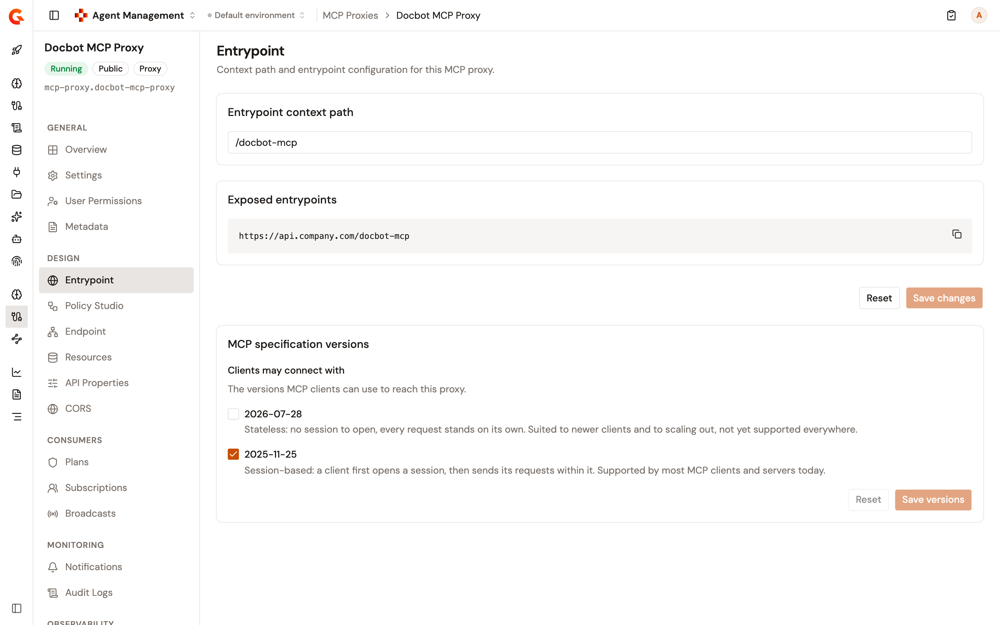

# Configure the MCP Proxy entrypoint

The **Entrypoint** page of an MCP Proxy or an MCP Studio sets the context path that MCP clients call, and shows the URL that path gives. An MCP Proxy has one context path.

## Prerequisites

Before you begin, confirm that you have the following:

* An MCP Proxy or an MCP Studio. For more information, see [Create an MCP proxy](create-an-mcp-proxy.md) and [Create an MCP Studio](create-an-mcp-studio.md).
* Permission to update the API definition of the proxy. Without it, the page is read-only and reads **You do not have permission to change the entrypoints of this API.**

To open the page, follow these steps:

1. From the Gamma console sidebar, select **Agent Management**.
2. Under **Secure**, select **MCP Proxies**.
3. Select your MCP Proxy or MCP Studio.
4. Under **Design**, select **Entrypoint**.

<figure><figcaption>
The Entrypoint page
</figcaption></figure>

The **Exposed entrypoints** card shows the URL that MCP clients call: the **Default HTTP entrypoint** of your environment followed by the context path. To change the default entrypoint, see [Manage entrypoints and sharding tags](https://documentation.gravitee.io/platform-management/organization/assets/manage-entrypoints-and-sharding-tags).

## Change the context path

To change the context path, follow these steps:

1. In the **Entrypoint context path** card, enter the new path.
2. Click **Save changes**. The page confirms with **Entrypoint saved.**
3. In the **This API is out of sync** banner, click **Deploy**.
4. Optional: In the **Deploy your API** dialog, enter a deployment label.
5. Click **Deploy**.

**Save changes** stays disabled until the path differs from the saved one and passes its checks. **Reset** brings the saved path back.

The page checks the path as you type. A path that breaks a rule shows one of the following messages under the field.

| Message                                                                         | Cause                                                                                                                  |
| ------------------------------------------------------------------------------- | ---------------------------------------------------------------------------------------------------------------------- |
| **Context path is required.**                                                   | The path is empty.                                                                                                     |
| **Context path is not valid.**                                                  | The path doesn't start with `/`, contains `//`, or uses a character other than letters, digits, `/`, `.`, `-`, and `_`. |
| **Context path has to be more than 3 characters long.**                         | The path is three characters or shorter.                                                                              |
| A message that names a path, for example **Path \[/docbot-studio/] already exists** | Another API of the environment uses the path, a path inside it, or a path that contains it. The message names that API's path. |

## What saving changes

Saving changes the context path in the API definition but doesn't deploy it:

* The **This API is out of sync** banner appears, and the gateway keeps answering on the previous path until you deploy.
* The **Exposed entrypoints** card shows the URL with the new path as soon as you save.

When the MCP Proxy or MCP Studio was created with **Gravitee as Authorization Server**, saving also updates Gravitee Access Management. The MCP server it holds for the proxy moves to the new path. Access Management takes the new path when you save, and the gateway takes it when you deploy, so deploy right after you save. If the save is refused, Gravitee tries to point Access Management back at the previous path.


An MCP Proxy managed by the Kubernetes operator is read-only on this page, which reads **This API is managed by the Kubernetes operator. Its entrypoints can only be changed from its source definition.**


## Verification

To verify the context path is working as expected, follow these steps:

1. Change the context path, click **Save changes**, and then deploy the proxy.
2. Under **Design**, select **Entrypoint**. The **Exposed entrypoints** card shows the URL with the new path, and the **This API is out of sync** banner is gone.
3. Connect an MCP client to that URL. The proxy answers on the new path.

## Next steps

* [Configure the MCP Proxy endpoint](configure-mcp-proxy-endpoint.md). Change the upstream MCP server and how the gateway connects to it.
* [Configure MCP Proxy CORS](configure-mcp-proxy-cors.md). Let browser-based MCP clients call the proxy from another origin.
