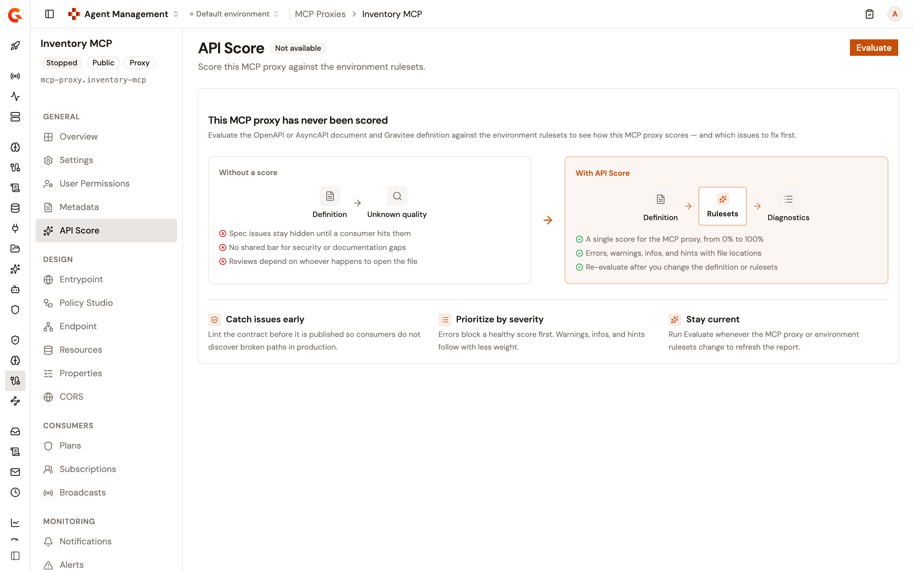
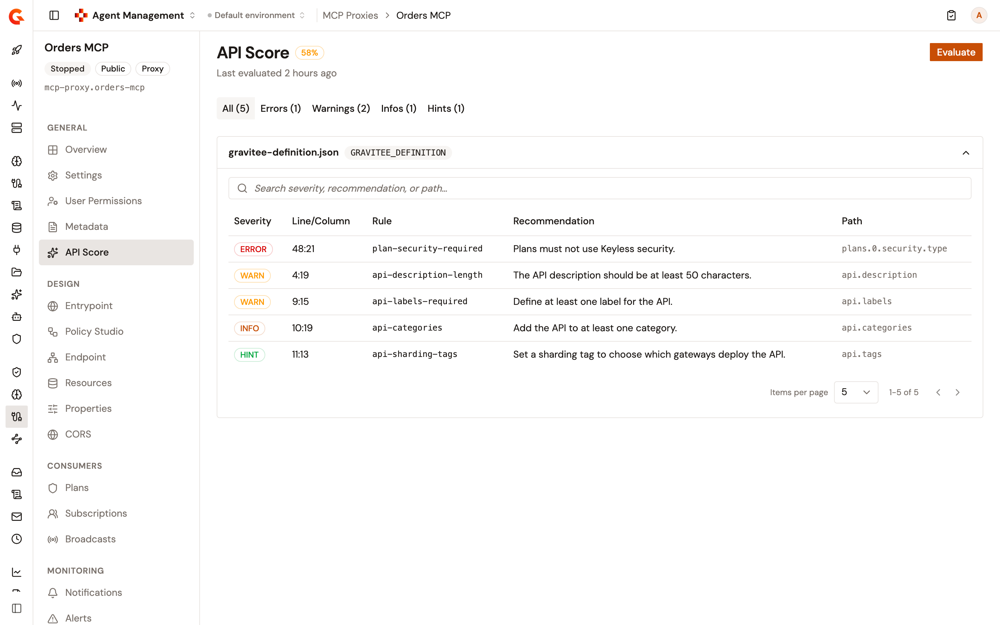

# Review the MCP Proxy API Score

API Score rates an MCP Proxy against the [rulesets of its environment](../../platform-management/manage-api-score.md) and lists what to fix. An evaluation checks the Gravitee definition of the MCP Proxy, plus each OpenAPI or AsyncAPI document the MCP Proxy has. It returns one score for the MCP Proxy, as a percentage, and the findings of each asset. You run an evaluation on demand, and the page shows the result of the latest one that succeeded. The score doesn't update on its own: it changes only when an evaluation of the MCP Proxy succeeds, and a failed evaluation keeps the previous score. Editing the MCP Proxy or the rulesets of the environment doesn't change the score until the MCP Proxy is evaluated again.

## Prerequisites

Before you begin, confirm that you have the following:

* API Score turned on for the environment, with **Enable API Score** on the **API Review** page of Platform Management. Until then, the **API Score** item doesn't appear in the MCP Proxy sidebar. See [Configure API Review](../../platform-management/configure-api-review.md).
* Permission to read the API definition of the MCP Proxy. Without it, the **API Score** item doesn't appear in the MCP Proxy sidebar.
* Permission to update the API definition of the MCP Proxy, to run an evaluation. Without it, the page shows the latest result with no **Evaluate** button.
* An installation connected to Gravitee Cloud. Without that connection, an evaluation fails. For a self-hosted installation, see [Register installations](https://documentation.gravitee.io/gravitee-cloud/self-hosted/register-installations).

## Open API Score

To open the page, complete the following steps:

1. In the Gamma console, open **Agent Management**.
2. Under **Secure**, select **MCP Proxies**.
3. Select your MCP Proxy.
4. Under **General**, select **API Score**.

The **API Score** page of Platform Management opens this page too, when you click the name of an MCP Proxy. See [Manage API Score](../../platform-management/manage-api-score.md).

Until the MCP Proxy is evaluated for the first time, the header shows **Not available** in place of a score, and the page explains how scoring works under **This MCP proxy has never been scored**.

<figure><figcaption>
The API Score page of an MCP Proxy that hasn't been evaluated yet
</figcaption></figure>

When API Score is turned off for the environment, the sidebar hides **API Score**, and the page, opened from a saved link, reads **API Score is disabled** and shows no score.

## Evaluate the MCP Proxy

To evaluate the MCP Proxy, click **Evaluate**.

While the evaluation runs, the button reads **Evaluating…** and stays disabled. The page shows **A request is currently processing, updated result will appear below once completed.** The previous result stays on the page until the new one arrives. You can leave the page: an evaluation you started keeps running, and the page shows it again when you come back. When the evaluation succeeds, the new result replaces the previous one. The time limit of an evaluation depends on how many assets and rulesets it checks, and never exceeds 15 minutes.

## Read the results

The header shows the score and when the MCP Proxy was last evaluated. The score is green from 80%, amber from 40%, and red below 40%.

Each finding has a severity of `ERROR`, `WARN`, `INFO`, or `HINT`. The severity filters above the assets count the findings, and selecting one narrows every asset to that severity. A filter with no findings is disabled.

Each asset has its own collapsible section, titled with the asset's name and type, with a table of its findings. The Gravitee definition of the MCP Proxy is listed as `gravitee-definition.json`. In the table, **Line/Column** is where the finding starts in the asset, and **Path** is the element it concerns. The search field of a section matches the severity, the rule, the recommendation, and the path, and filters that section only.

When the evaluation finds nothing to fix, the page reads **All clear**. When the evaluation returns no score and no asset had errors, the page says that the assets of the MCP Proxy didn't match any rulesets.

## Troubleshoot an evaluation

The page shows the following messages when an evaluation can't start, fails, or can't score an asset, or when the page can't load:

| Message | Meaning |
| ------- | ------- |
| **Failed to evaluate API Score.** | The evaluation couldn't start, for example because the installation isn't connected to Gravitee Cloud. The reason shows below the message. |
| **The last evaluation failed at** | The evaluation failed. The message gives the time of the evaluation, followed by the cause. Click **Evaluate** to retry. |
| **Evaluation timed out at** | The evaluation didn't finish within its time limit. Click **Evaluate** to retry later. |
| **Errors occurred while scoring this MCP proxy:** | One or more assets couldn't be scored. The message lists each asset with the code and path of each error, and the header shows **Evaluation errors**. |
| **Failed to load API Score** | The page couldn't read the result, for example because your role can't read the API definition of the MCP Proxy. The reason shows below the message. |

**The last evaluation failed at** and **Evaluation timed out at** concern an evaluation you started, and show each time you open the page: the first until an hour after the evaluation failed, the second until an hour after the evaluation started.

## Verification

To verify API Score is working as expected, follow these steps:

1. Open **API Score** for your MCP Proxy.
2. Click **Evaluate**.
3. Wait for **Evaluate** to become available again.

The header shows the score, and **Last evaluated** says when the new result arrived. Each asset lists its findings, or the page reads **All clear**.

<figure><figcaption>
The API Score page of an MCP Proxy after an evaluation, with the findings of its definition
</figcaption></figure>
