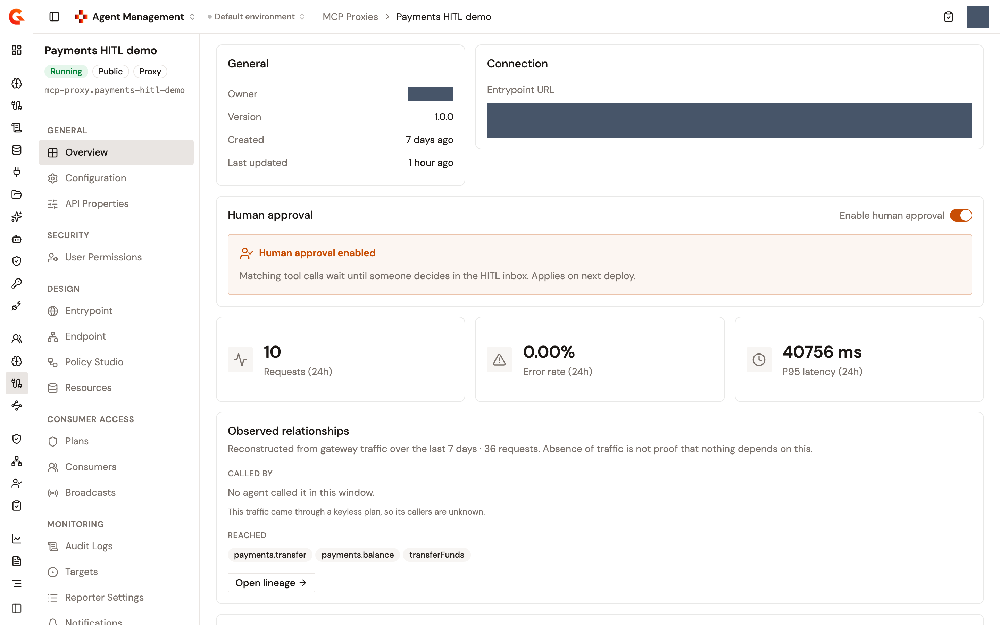

# Require human approval for MCP tool calls

Human In the Lead makes human oversight a property of the tool call rather than a feature of the agent. You declare approval rules against MCP tools and turn human approval on for an MCP Proxy. The AI Gateway then holds every matching tool call until one of the rule's approvers approves or rejects it. A call that nobody decides before its time to decide runs out is denied.

Four pages make up the feature. They sit in the **Human In the Lead** group of the Agent Management sidebar: **Inbox**, **Rules**, **Notifications**, and **History**. The switch that puts a proxy under approval lives on the proxy's **Overview** page.

## Before you start

* Confirm that your license includes Human In the Lead. Without it, the pages of the group ask you to request an enterprise license, and human approval can't be switched on for a proxy.
* Optional: Tune the following two housekeeping properties of the Management API configuration:
    * `modules.aim.approval.sweep.enabled` turns the periodic sweep on or off, and it's on by default. The sweep is the only thing that sends a rule to the gateways again when publishing it failed. A rule the gateways never received holds no call. `modules.aim.approval.sweep.delay` and `modules.aim.approval.sweep.unit` set how often it runs. The unit defaults to `MINUTES`, and a value that isn't positive uses an interval of 1 minute.
    * `modules.aim.approval.arguments.retention.delay` and `modules.aim.approval.arguments.retention.unit` set how long the arguments of a settled approval are kept for the approver's history. The unit defaults to `DAYS`. By default the arguments are removed when the approval settles.

## Turn on human approval for an MCP Proxy

Rules don't hold anything on their own. A proxy holds its tool calls only once human approval is turned on for it.

1. In the Gamma console, open **Agent Management**.
2. Under **Secure**, select **MCP Proxies**.
3. Select the proxy.
4. On the **Overview** page, in the **Human approval** card, turn on **Enable human approval**.

    <figure><figcaption>
The Human approval card on an MCP Proxy's Overview page
</figcaption></figure>

5. In the **Switch human approval on?** dialog, read the effect, and click **Switch on**.

When you switch human approval on, the setting is saved and the API is deployed. When the API has other changes that aren't deployed yet, they're deployed too. The card then reads **Human approval enabled**. When the API is managed by Kubernetes or automation, the change is saved and applies on its next apply. When the deployment fails, the card reads **Saved, but the deployment failed. The gateway still runs the previous deployment.** and offers **Deploy again**.

The human approval step runs in the API's internal flow, which the Policy Studio doesn't show. When you turn the switch off in the **Switch human approval off?** dialog, tool calls run without waiting for an approver, even when an approval rule matches them.

## Create an approval rule

A rule names the tool calls that wait for a person, who decides them, and how long they wait. The first enabled rule that matches the tool and its arguments holds the call. You only see the rules you have access to.

1. In the **Human In the Lead** group of the sidebar, select **Rules**.
2. Click **Add rule**. The **Add rule** button appears only when you can create rules.
3. Fill in the fields of the rule form.
4. Click **Create rule**. A **Rule created** notification appears.

The rule form has the following fields:

<table>
    <thead>
        <tr>
            <th width="220">Field</th>
            <th>What it sets</th>
        </tr>
    </thead>
    <tbody>
        <tr>
            <td><strong>Name</strong></td>
            <td>Required. At most 255 characters.</td>
        </tr>
        <tr>
            <td><strong>Description</strong></td>
            <td>Optional. Why the rule exists. At most 2000 characters.</td>
        </tr>
        <tr>
            <td><strong>Tools</strong></td>
            <td>The tools the rule holds. Choose <strong>Catalog tools</strong> to pick up to 50 tools from the catalog, or <strong>Name pattern</strong> to type an exact tool name, a glob where <code>*</code> matches anything, or <code>|</code> between alternatives. Only an administrator can use <code>*</code> or <code>|</code> to match several tools.</td>
        </tr>
        <tr>
            <td><strong>Argument conditions</strong></td>
            <td>Optional. Click <strong>Add condition</strong> to name an argument, an operator, and a value. A call needs approval only when its arguments match every condition, and a rule can carry up to 20. Operators: <strong>equals</strong>, <strong>does not equal</strong>, <strong>greater than</strong>, <strong>at least</strong>, <strong>less than</strong>, <strong>at most</strong>, <strong>contains</strong>, and <strong>matches</strong>. With no condition, the rule holds every call to its tools.</td>
        </tr>
        <tr>
            <td><strong>Rule access</strong></td>
            <td>The users and groups who see this rule and can edit, enable, or delete it. A group includes every member.</td>
        </tr>
        <tr>
            <td><strong>Approval ownership</strong></td>
            <td>The users and groups who see the request and can approve or reject it. A group includes every member.</td>
        </tr>
        <tr>
            <td><strong>Notifications</strong></td>
            <td>Who is told about the rule's requests. See <a href="#send-notifications">Send notifications</a>.</td>
        </tr>
        <tr>
            <td><strong>Time to decide (seconds)</strong></td>
            <td>How long approvers have to decide before the request expires. New rules start at 900 seconds. The minimum is 30.</td>
        </tr>
        <tr>
            <td><strong>Priority</strong></td>
            <td>Rules with a lower number are checked first. New rules start at 100, and only an administrator can save a rule below 100. The field appears only when you can manage broad rules.</td>
        </tr>
        <tr>
            <td><strong>Enabled</strong></td>
            <td>A disabled rule is kept but guards nothing.</td>
        </tr>
    </tbody>
</table>

The conditions compare as follows. An argument the call didn't send satisfies only **does not equal**. When both the argument and the value read as numbers, the comparison is numeric, and otherwise it's a text comparison. **contains** looks for the value inside the argument, and **matches** tests the argument against a regular expression, which is checked when you save the rule.

The **Rules** page lists each rule with its **Name**, **Tools**, **Conditions**, **Rule access**, **Approvers**, **Time to decide**, **Reminder**, and **Enabled** switch. A rule with no conditions reads **every call** under **Conditions**. A rule the gateways don't hold yet carries a **Not published yet** badge, and until they hold it they keep holding calls by the version they have. Only an administrator can change a rule that matches several tools or is evaluated before the default priority of 100. A call no rule matches runs without waiting for anyone.

To delete a rule, click the delete button on its row, and confirm in the **Delete this rule?** dialog.

## Send notifications

A held call waits for a limited time, and the agent behind it waits too. A notification reaches the people who need to know, by email or webhook.

1. In the **Human In the Lead** group of the sidebar, select **Notifications**.
2. Click **Add notification**.
3. Under **Notifier**, select **Default Email Notifier** or **Default Webhook Notifier**.
4. Enter the target. For email, enter the address list, separated by a space, a comma, or a semicolon, with at most 20 addresses. For a webhook, enter the URL that Gravitee POSTs data to, which must be an http or https URL.
5. Optional: For a webhook, turn on **Use system proxy**.
6. Choose at least one event.
7. Keep **Enabled** on, and click **Add notification**. A **Notification created** notification appears.

The saved notifications are listed with their **Notifier**, **Events**, **Target**, and **Enabled** switch. When email isn't configured for the environment, email notifications aren't sent, and each notice is recorded as refused instead.

A notification can receive the following events:

<table>
    <thead>
        <tr>
            <th width="220">Event</th>
            <th>When it's sent</th>
        </tr>
    </thead>
    <tbody>
        <tr>
            <td><strong>Approval required</strong></td>
            <td>A tool call matched a rule and is waiting for a decision.</td>
        </tr>
        <tr>
            <td><strong>Reminder</strong></td>
            <td>The request is still waiting and the reminder interval has elapsed.</td>
        </tr>
        <tr>
            <td><strong>Approved</strong></td>
            <td>An approver approved the request.</td>
        </tr>
        <tr>
            <td><strong>Rejected</strong></td>
            <td>An approver rejected the request.</td>
        </tr>
        <tr>
            <td><strong>Expired</strong></td>
            <td>The time to decide ended with no decision.</td>
        </tr>
    </tbody>
</table>

A rule picks its notifications in the **Notifications** field of the rule form, in one of the following three modes:

* **Use a saved notification** sends the rule's events to the saved notifications you select, up to 20.
* **Create one on this rule** sends the rule's notices to destinations of its own, up to 10. It needs the permission to update notifications.
* **Disable notifications** holds the call without sending a notice.

Unless notifications are disabled, choose how often to notify. **Notify once** sends one notice when the request is created. **Remind until someone decides** repeats the notice every number of minutes you enter, until a decision or the end of the window. The reminder must be at least 1 minute and shorter than the time to decide. A reminder only goes to a destination that has the **Reminder** event selected.

Notifications decide who is told. They don't change who can approve.

## Decide on a held call

In the **Human In the Lead** group of the sidebar, select **Inbox**. The inbox lists only the requests you're allowed to decide, which are those whose rule names you, or a group you belong to, under **Approval ownership**. Requests that expire within 10 minutes are listed first, under **Expiring within 10 minutes**, and the others under **Later**. When nothing is waiting, the inbox reads **Nothing waiting for you**.

1. Select a request. The panel shows the reason the call was held, a **Request** section with the call's arguments, and its **Tool**, **Rule**, and **Approvers**.
2. In the decision bar, read the countdown, and choose what an approval covers. **This call only** is the default. **Later calls too** also approves the same tool, with the same arguments, from the same caller, for the minutes you enter, from 1 to 1440. The presets are 15, 30, 60, and 240 minutes.
3. Click the approve button, which reads **Approve this call**, or **Approve for** followed by the duration when you chose **Later calls too**. To reject the call instead, click **Reject**.
4. When you reject, enter a **Reason** in the **Reject this call?** dialog and click **Reject**. The reason is required, and it's returned to the agent.

To stop a time-based approval before it ends, find it under **Approvals still covering later calls** in the inbox, click its end button, and confirm **End now** in the **End this approval now?** dialog. Later identical calls need a new approval, and the action can't be undone. The end button appears only when you can update decisions.

Deciding takes the permission to update decisions, in addition to being an approver. When you can see a request but can't decide it, the page reads **You cannot decide this call**, with the reason: you aren't one of the rule's approvers, or your role lets you see approvals but not decide them. When the rule was deleted, the request reads **Nobody can decide this call**, and the call is denied when its time to decide runs out. When two people decide the same call, the second one reads **Someone else decided this call, or its time to decide ran out.**

When nobody decides in time, the request expires and the call is denied. An expired request reads **Expired, denied automatically**.

## Review decisions

In the **Human In the Lead** group of the sidebar, select **History**. The **Decisions** page lists every request with its **Decision**, **Tool**, **Proxy**, **Rule**, **Grant**, **Decided by**, **Decided** time, and **Tool result**. Filter by tool, proxy, agent, or rule, by proxy with **All proxies**, and by status with **All decisions**, **Approved**, **Rejected**, **Expired**, or **Pending**. Select a tool to open its approval.

The **Grant** column reads **None** for a request that wasn't approved, **Once** for an approval of one call, or the duration of a time-based approval. The **Tool result** column reads **Waiting**, **Running**, **Time-based**, **Ran**, **Not run**, **Tool error**, or **Unknown**. It reports what became of the call as a status only, and never shows the tool's result.

## Next steps

* [Configure your MCP proxy](../build/configure-your-mcp/README.md). Find the proxy pages the human approval step applies to.
