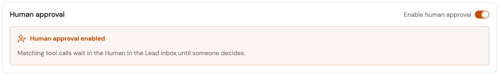
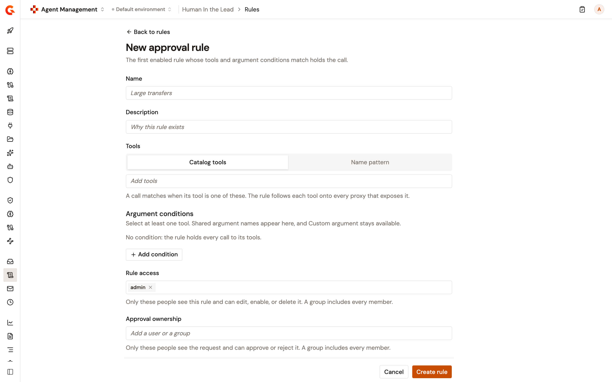
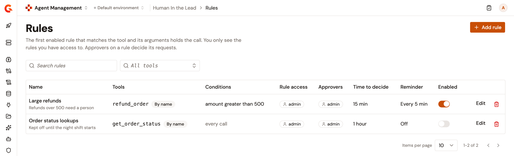

# Require human approval for MCP tool calls

Human In the Lead holds a tool call until a person approves or rejects it. Two settings work together. Human approval is turned on for the MCP Proxy or MCP Studio that receives the call, and an enabled approval rule matches the tool and its arguments. A call that no enabled rule matches isn't held.

A held call doesn't run until an approver approves it. Until then, the agent waits for the decision, as described in [How it works](#how-it-works). After an approval, the next identical call runs if the agent sends it within the time to run of the rule. After a rejection, the next call answers that an approver rejected it, with the reason. After the request expires, or once the time to run has passed, the next call answers that the approval request expired.

Some calls don't run at all. A call that a rule holds doesn't run when its arguments are larger than 256 KiB. A call to a tool that a rule covers doesn't run when its arguments aren't a JSON object. While the environment has approval rules, the proxy also refuses tool calls sent together in one batch, so send each tool call on its own.

## How it works

What the agent sees while a call waits, and what runs once it's approved, depends on its MCP client and on the approval.

### While the call waits

* **MCP clients on protocol version 2026-07-28 or later** ask again by themselves. Each attempt waits up to 20 seconds for a decision. After 8 attempts with no decision, the agent is told to call the tool again with the same arguments.
* **Older MCP clients** are told that the call needs human approval and hasn't run, and to call the tool again with the same arguments. Each repeat waits up to 20 seconds for a decision.

### Once the call is approved

* **This call only** runs the call once, with the arguments and the credentials that the agent sent. An approver can't change the arguments, and a call with other arguments opens a new request. After the call has run, an older client that sends it again opens a new approval request, and a newer client that asks for it again is told that it already ran.
* **Later calls too** runs every call with the same tool and arguments, from the same application and end user, without waiting, until the approval ends or the rule changes. An API Key plan identifies the application but not the end user, so on an API Key plan the approval covers every end user of the application.

### When a gateway can't read a rule

A gateway that can't read one of the approval rules of an environment runs none of the tool calls of the MCP Proxies and MCP Studios that have human approval on in that environment. The agent is told that the gateway doesn't receive the approval rules and that the call didn't run.

## Prerequisites

Before you begin, confirm that you have the following:

* A license that includes Human In the Lead.
* Gateways with Gamma enabled. A gateway that doesn't receive the approval rules runs none of the tool calls of an MCP Proxy that has human approval on. For more information, see [Self-hosted installation guides](https://documentation.gravitee.io/platform-management/install/self-hosted-installation-guides) and [Hybrid installation guides](https://documentation.gravitee.io/platform-management/install/hybrid-installation-guides).
* A plan on the MCP Proxy that identifies the calling application. A call that a rule holds through a plan that doesn't identify the calling application doesn't run.

## Turn on human approval for an MCP Proxy

The **Human approval** card on the **Overview** page of an MCP Proxy or MCP Studio turns human approval on and off.

To turn on human approval, follow these steps:

1. In the Gamma console, open **Agent Management**.
2. Under **Secure**, select **MCP Proxies**.
3. Select your MCP Proxy or MCP Studio.
4. Under **General**, select **Overview**.
5. In the **Human approval** card, turn on **Enable human approval**.
6. In the **Switch human approval on?** dialog, click **Switch on**.

The change is saved and the proxy is deployed, along with any other change that wasn't deployed yet. The card then reads **Human approval enabled**. When the proxy is managed by Kubernetes or automation, the change is saved and applies on its next apply.

<figure><figcaption>
The Human approval card of an MCP Proxy
</figcaption></figure>

To stop holding calls, turn off **Enable human approval**, and then click **Switch off**. The tool calls of the proxy then run without waiting, even when a rule matches them.

If the deployment fails, the card reads **Saved, but the deployment failed. The gateway still runs the previous deployment.** Click **Deploy again** to retry.

Without a license that includes Human In the Lead, human approval can't be turned on. A proxy that already has it on can still turn it off.

## Create an approval rule

A rule names the tool calls that wait for a person, who decides them, and how long they wait. When no rule is listed for you, the **Rules** page shows **Why add approval rules?** in place of the list.

To create a rule, follow these steps:

1. In the Gamma console, open **Agent Management**.
2. Under **Human In the Lead**, select **Rules**.
3. Click **Add rule**.
4. Complete the **New approval rule** form. The fields are described in the following table.
5. Click **Create rule**.

**Rule created** confirms the save, and the rule appears on the **Rules** page.

<figure><figcaption>
The New approval rule form
</figcaption></figure>

<table>
    <thead>
        <tr>
            <th width="230">Field</th>
            <th>Description</th>
        </tr>
    </thead>
    <tbody>
        <tr>
            <td><strong>Name</strong></td>
            <td>Required. Up to 255 characters.</td>
        </tr>
        <tr>
            <td><strong>Description</strong></td>
            <td>Optional. Why the rule exists.</td>
        </tr>
        <tr>
            <td><strong>Tools</strong></td>
            <td>The tools whose calls the rule holds. A new rule starts on <strong>Catalog tools</strong>, where you pick the MCP tools of the Catalog, up to 50. The rule follows each tool onto every MCP Proxy and MCP Studio that exposes it. Choose <strong>Name pattern</strong> to type an exact tool name, a pattern where <code>*</code> matches anything, or names separated by <code>|</code>.</td>
        </tr>
        <tr>
            <td><strong>Argument conditions</strong></td>
            <td>Optional. Click <strong>Add condition</strong>, then pick an argument, an operator, and a value. With catalog tools, pick the argument from the list, or choose <strong>Custom argument</strong> and type its name. With a name pattern, type the argument name. A call needs approval only when its arguments meet every condition. Without a condition, the rule holds every call to its tools. Up to 20 conditions.</td>
        </tr>
        <tr>
            <td><strong>Rule access</strong></td>
            <td>Required. The users and groups who see the rule and can edit, enable, or delete it. A group includes every member. A new rule starts with you. Up to 100.</td>
        </tr>
        <tr>
            <td><strong>Approval ownership</strong></td>
            <td>Required. The users and groups who see the requests of the rule and can approve or reject them. A group includes every member. Up to 100.</td>
        </tr>
        <tr>
            <td><strong>Notifications</strong></td>
            <td>Where the notices of the rule go, and whether reminders are sent while a call waits. See <a href="../human-in-the-lead/set-up-approval-notifications.md">Set up approval notifications</a>.</td>
        </tr>
        <tr>
            <td><strong>Time to decide (seconds)</strong></td>
            <td>How long a request waits for a decision before it expires. An expired request is denied. A new rule starts at 900 seconds. From 30 seconds to 7 days.</td>
        </tr>
        <tr>
            <td><strong>Time to run after approval (seconds)</strong></td>
            <td>How long the agent has to run the call once it's approved, counted from the approval. A new rule starts at 3,600 seconds. From 60 seconds to 7 days.</td>
        </tr>
        <tr>
            <td><strong>Priority</strong></td>
            <td>Shown to administrators only. Rules with a lower number are checked first. A new rule starts at 100, and only an administrator can save a rule below 100.</td>
        </tr>
        <tr>
            <td><strong>Enabled</strong></td>
            <td>On by default. A disabled rule is kept but guards nothing.</td>
        </tr>
    </tbody>
</table>

The operators of a condition are **equals**, **does not equal**, **greater than**, **at least**, **less than**, **at most**, **contains**, and **matches**:

* **equals** and **does not equal** compare numbers when the argument and the value are both numbers, and text otherwise.
* **greater than**, **at least**, **less than**, and **at most** compare numbers, so their value is a number. An argument that isn't a number meets the condition.
* **contains** looks for the value in the argument.
* **matches** takes a regular expression that the whole argument matches, which is checked when you save the rule. An argument longer than 4,096 characters, or one that takes more than 5 milliseconds to check, meets the condition.

An argument that the call doesn't send meets only a **does not equal** condition. A dot in the argument name points to a nested argument, for example `order.amount`.

### Which rule holds a call

Enabled rules are checked from the lowest **Priority** to the highest, and the oldest first among rules with the same priority. The first rule that matches the tool and its arguments holds the call, and the users and groups in its **Approval ownership** decide it.

### Rules only an administrator can change

Only an administrator can create, change, or delete a rule that covers several tools, or one with a priority below 100. A rule covers several tools when its name pattern holds `*` or `|`, when it has more than one catalog tool, or when it has both a name pattern and a catalog tool. Other users see such a rule read-only, with **Only an administrator can change this rule**.

## Manage approval rules

The **Rules** page lists the rules you have access to through **Rule access**. Administrators see every rule. To find a rule, type in **Search rules**, or narrow the list to the rules that hold one tool by picking it in place of **All tools**.

<figure><figcaption>
The Rules page
</figcaption></figure>

The table has the following columns:

| Column             | Description                                                                                                                                                                         |
| ------------------ | ----------------------------------------------------------------------------------------------------------------------------------------------------------------------------------- |
| **Name**           | The name and description of the rule. **Not published yet**, or **Not published since** and a date, means the gateways don't hold the latest version of the rule yet. Until they do, they keep holding calls by the version they have. |
| **Tools**          | The catalog tools and the name pattern of the rule. **By name** marks a rule without catalog tools.                                                                                  |
| **Conditions**     | The argument conditions of the rule, or **every call** for a rule without one.                                                                                                       |
| **Rule access**    | The users and groups who manage the rule.                                                                                                                                            |
| `Approvers`        | The users and groups who decide the requests of the rule.                                                                                                                            |
| **Time to decide** | How long they have to decide.                                                                                                                                                         |
| **Reminder**       | **Off**, **Once**, or how often a reminder is sent, for example **Every 10 min**.                                                                                                     |
| **Enabled**        | A switch that enables or disables the rule. On a rule only an administrator can change, other users see **Admin only** beside it.                                                    |

Click **Edit** on a rule to change it, or **View** when you can't change it. A user in the **Approval ownership** of a rule who isn't in its **Rule access** can open the rule from a request but not edit it. The page then reads **You cannot edit this rule. It is managed by**, followed by the users and groups in its **Rule access**.

To delete a rule, click its delete icon, and then click **Delete rule** in the **Delete this rule?** dialog. The rule stops requiring approval, and the approvals it already opened are kept. Nobody can decide a waiting request whose rule was deleted, and the request expires when its time to decide runs out. Once the gateways have the deletion, the call isn't held anymore, unless another rule holds it.

## Verification

To verify that a rule holds calls, follow these steps:

1. Call a tool that the rule names through the MCP Proxy, with arguments that meet its conditions.
2. In the Gamma console, open **Agent Management**.
3. Under **Human In the Lead**, select **Inbox**. As one of the users or groups in the **Approval ownership** of the rule, you see the request, held by the rule.

## Next steps

* [Decide on held tool calls](../human-in-the-lead/decide-on-held-tool-calls.md). Approve or reject the calls your rules hold.
* [Set up approval notifications](../human-in-the-lead/set-up-approval-notifications.md). Tell the people who decide that a call is waiting.
* [Review the decision history](../human-in-the-lead/review-the-decision-history.md). Find past decisions and what became of each call.
