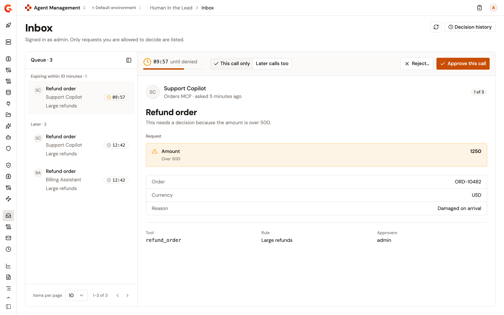

# Decide on held tool calls

When a tool call matches an approval rule, the call waits for a decision. The request appears in the **Inbox** of the users and groups that the rule names in **Approval ownership**. A call that nobody decides before its time to decide runs out is denied.

## Open the Inbox

To open the Inbox, follow these steps:

1. In the Gamma console, open **Agent Management**.
2. Under **Human In the Lead**, select **Inbox**.

The Inbox lists only the requests you're allowed to decide, the one with the least time left first. The queue groups them under **Expiring within 10 minutes** and **Later**, with the tool, the agent, the rule, and the time left of each request. The first request opens beside the queue.

<figure><figcaption>
The Inbox with the queue and a selected request
</figcaption></figure>

If your role lets you see approvals but not decide them, the Inbox reads **You can view decisions but not decide**.

## Read a request

A selected request shows the following information:

* The agent that made the call, the proxy that the call went through, and how long ago the agent asked.
* The tool, and why the rule held the call, for example **This needs a decision because the amount is over 500.**
* Under **Request**, the arguments of the call. The arguments that the rule's conditions checked come first.
* The **Tool**, the **Rule** that held the call, and, under `Approvers`, the users and groups who can decide it.

When the rule changed after the call was held, the request says so, and the reason shows the rule's current conditions.

## Approve or reject a call

To approve a call, follow these steps:

1. In the queue, select the request.
2. Choose what the approval covers:
    * **This call only** approves this call alone.
    * **Later calls too** also approves, for the time you choose, the later calls to the same tool with the same arguments, made by the same agent for the same user, through the same proxy, that the same rule holds.
3. If you chose **Later calls too**, choose **15 min**, **30 min**, **1 hour**, or **4 hours**, or choose **Custom** and enter a number of minutes from 1 to 1440.
4. Click **Approve this call**, or the **Approve for** button that names the time you chose.

To reject a call, follow these steps:

1. In the queue, select the request.
2. Click **Reject…**.
3. In the **Reject this call?** dialog, enter a **Reason**. The reason is required and can be up to 1000 characters. The agent receives up to its first 500 characters.
4. Click **Reject**.

**Approved**, **Approved for** and the time, or **Rejected** confirms the decision, and the next request opens. When someone else decided the call first, or its time ran out, the decision is refused with **Someone else decided this call, or its time to decide ran out.**

A time-based approval stops letting calls through when its time ends, when someone ends it, or when its rule changes. Any change to the arguments needs a new approval.

## End a time-based approval early

When no request waits for you, the Inbox reads **Nothing waiting for you**. It lists the requests **Decided today**, and the time-based approvals that still let calls through, under **Approvals still covering later calls**.

To end a time-based approval before its time is over, follow these steps:

1. Under **Approvals still covering later calls**, click **End now** on the approval.
2. In the **End this approval now?** dialog, click **End now**.

**Later calls need approval again** confirms it. The next identical call needs a new approval, and an ended approval can't be restored.

## Verification

To verify that a decision was recorded, follow these steps:

1. In the Inbox, click **Decision history**.
2. Find the call by its tool. The **Decision** column reads **Approved** or **Rejected**, and **Decided by** shows your name.

## Next steps

* [Require human approval for MCP tool calls](../govern/require-human-approval-for-mcp-tool-calls.md). Turn on human approval for a proxy, and create the rules that hold its calls.
* [Review the decision history](review-the-decision-history.md). Find past decisions and what became of each call.
