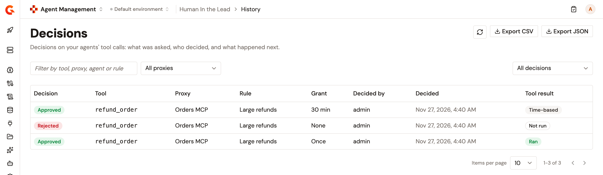

# Review the decision history

The **History** page lists the approvals that were decided or that expired, newest first, with who decided and what became of each call. You see the approvals of the rules that name you in **Approval ownership**. Administrators see every approval of the environment.

## Open the decision history

To open the history, follow these steps:

1. In the Gamma console, open **Agent Management**.
2. Under **Human In the Lead**, select **History**.

The page title reads **Decisions**. In the Inbox, **Decision history** opens the same page.

<figure><figcaption>
The History page
</figcaption></figure>

The table has the following columns:

| Column          | Description                                                                                                                                                                                                |
| --------------- | ---------------------------------------------------------------------------------------------------------------------------------------------------------------------------------------------------------- |
| **Decision**    | **Approved**, **Rejected**, **Expired**, or **Pending** for a call that still waits. An approved call stays **Approved** while it runs and after it ran.                                                   |
| **Tool**        | The tool that the agent called. Click it to open the approval.                                                                                                                                              |
| **Proxy**       | The MCP Proxy or MCP Studio that the call went through.                                                                                                                                                     |
| **Rule**        | The rule that held the call.                                                                                                                                                                                |
| **Grant**       | What the approval lets through: **Once**, a duration for a time-based approval, or **None** when the call wasn't approved.                                                                                 |
| **Decided by**  | Who decided.                                                                                                                                                                                                |
| **Decided**     | When the call was decided, or when it expired.                                                                                                                                                              |
| **Tool result** | What became of the call: **Waiting** when it's approved and not run yet, **Running**, **Ran**, **Tool error**, or **Not run**. **Time-based** marks a time-based approval, which reports no single call. **Unknown** means that no outcome was reported for the approved call. |

To narrow the list, type a tool, proxy, agent, or rule name in **Filter by tool, proxy, agent or rule**, pick a proxy in place of **All proxies**, or pick a decision in place of **All decisions**. Without a decision filter, the list shows the decided and expired approvals. **Pending** lists the calls that still wait.

## Open an approval

Click the tool of a row to open its approval. The page shows the status of the approval, the call and why the rule held it, and the arguments of the call. The **Decision** card shows the **Verdict**, **Decided by**, **Reason**, **Covers**, and **Tool outcome**. The **About this request** card shows the **Tool**, the **Proxy**, the `Approvers`, and the **Rule**.

A pending approval shows the time left before the call is denied. If you can decide it, the **Your decision** card offers **This call only** and **Later calls too**, with **Approve this call** and **Reject…**. Otherwise, the page reads **You cannot decide this call**, or **Nobody can decide this call** when its rule was deleted.

By default, the arguments of an approval are removed when the approval concludes, and the page then reads **The arguments were removed when this approval concluded.** **Back to history** returns to the list as you left it.

## Export decisions

Click **Export CSV** or **Export JSON** to download the approvals that the list shows, with its filters applied, as `decisions.csv` or `decisions.json`. A file holds at most the 10,000 newest approvals. When more approvals match, the page reads **The file is partial**, and a narrower decision filter exports the rest.

## Verification

To verify that the list shows a decision, follow these steps:

1. In the Gamma console, open **Agent Management**.
2. Under **Human In the Lead**, select **History**.
3. Pick **Approved** in place of **All decisions**. The list shows the approved calls only.

## Next steps

* [Decide on held tool calls](decide-on-held-tool-calls.md). Approve or reject the calls that wait for you.
* [Require human approval for MCP tool calls](../govern/require-human-approval-for-mcp-tool-calls.md). Change the rules that hold the calls.
