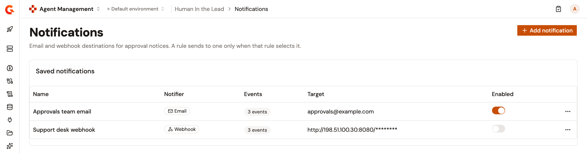

# Set up approval notifications

A held call waits for a limited time, and the agent behind it waits too. Approval notices tell people by email or webhook that a call is waiting, is still waiting, was approved or rejected, or expired. The **Notifications** page holds the destinations saved in the environment, and each rule chooses where its notices go.

## Save a notification

To save a notification, follow these steps:

1. In the Gamma console, open **Agent Management**.
2. Under **Human In the Lead**, select **Notifications**.
3. Click **Add notification**.
4. Complete the fields described in the following table.
5. Click **Add notification**.

**Notification created** confirms the save, and the notification appears under **Saved notifications**. Until the environment has a saved notification, the page shows **Why add notifications?** in place of the list.

| Field                | Description                                                                                                                  |
| -------------------- | ---------------------------------------------------------------------------------------------------------------------------- |
| **Name**             | Required.                                                                                                                    |
| **Notifier**         | **Default Email Notifier** or **Default Webhook Notifier**.                                                                  |
| **Email list**       | With the email notifier, up to 20 addresses, separated by a space, a comma, or a semicolon.                                 |
| **Webhook**          | With the webhook notifier, the URL that Gravitee posts the data to, starting with `http` or `https`. A new or changed URL must resolve to a public address, unless your installation allows private endpoints. |
| **Use system proxy** | With the webhook notifier, sends the request through the HTTP proxy that your installation uses.                            |
| **Events**           | The events that send a notice. Choose at least one.                                                                          |
| **Enabled**          | On by default. A notification that's switched off keeps its settings and is sent nothing, not even the notices it missed. |

The following events send a notice:

| Event                 | Sent when                                                             |
| --------------------- | --------------------------------------------------------------------- |
| **Approval required** | A tool call matched a rule and is waiting for a decision.             |
| **Reminder**          | The request is still waiting and the reminder interval has elapsed.   |
| **Approved**          | An approver approved the request.                                     |
| **Rejected**          | An approver rejected the request.                                     |
| **Expired**           | The time to decide ended with no decision.                            |

Each email destination receives one message per notice, with its addresses blind-copied. No email is sent while email is switched off for the environment.

A rule sends to a saved notification only when the rule selects it. To change a saved notification, open its actions menu and select **Edit** or **Delete**. When you delete one, the rules that selected it stop sending to that destination.

<figure><figcaption>
The Notifications page
</figcaption></figure>

## Choose where a rule sends its notices

The **Notifications** section of a rule sets where its notices go. It doesn't change who can approve.

To set it, follow these steps:

1. In the Gamma console, open **Agent Management**.
2. Under **Human In the Lead**, select **Rules**.
3. Click **Edit** on the rule.
4. Under **Notifications**, choose one of the following options:
    * **Use a saved notification**: select up to 20 saved notifications. A new rule starts with this option when the environment has a saved notification.
    * **Create one on this rule**: click **Add**, and complete the same fields as for a saved notification. A new destination starts with the **Approval required** event. These destinations belong to the rule alone, up to 10.
    * **Disable notifications**: hold the call without sending a notice. A new rule starts with this option when the environment has no saved notification.
5. Under **Schedule**, choose **Notify once** to send one notice when the request is created, or **Remind until someone decides** to repeat it until a decision or the end of the time to decide.
6. If you chose reminders, enter the number of minutes in **Every**. It starts at 10, and it's at least 1 and shorter than the time to decide.
7. Click **Save changes**.

The same destinations receive the first notice and any reminder. A request receives at most 10 reminders, and only the destinations that have the **Reminder** event receive them.

The emails use the templates of the **Human in the lead** category, which you can reword on the **Templates** page of Platform Management.

## Verification

To verify that a notification is sent, follow these steps:

1. Call a tool that the rule holds, through the MCP Proxy.
2. Check the mailbox or the webhook receiver of the destination. It receives a notice for the **Approval required** event.

## Next steps

* [Decide on held tool calls](decide-on-held-tool-calls.md). Approve or reject the calls that the notices announce.
* [Require human approval for MCP tool calls](../govern/require-human-approval-for-mcp-tool-calls.md). Create the rules that send the notices.
