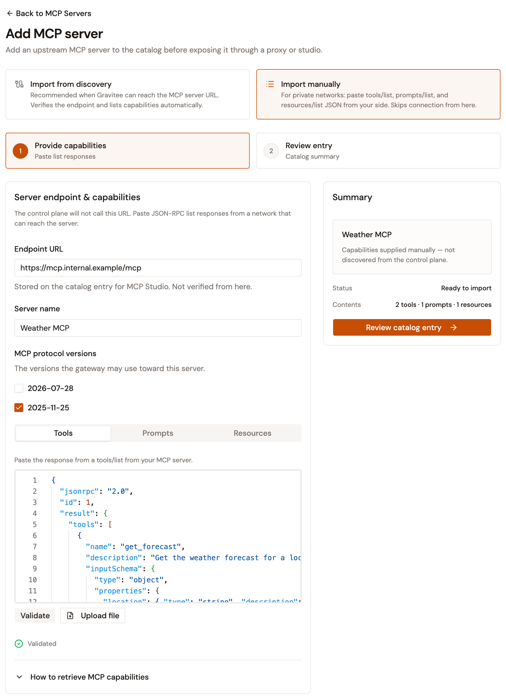
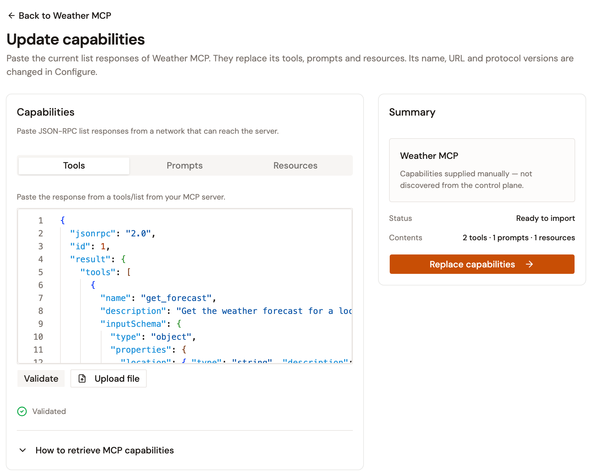
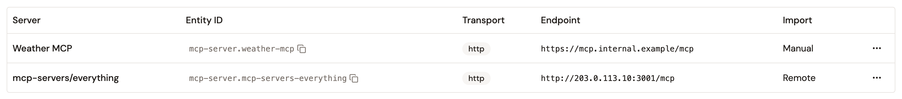

# Import an MCP server manually

Import an MCP server manually when it runs in a private network that the control plane can't reach. You collect the server's list responses from a host that reaches it, and supply them to the **Add MCP server** wizard. The control plane doesn't connect to the server, the import stores no credentials for it, and nothing keeps the Catalog in sync with it afterward.

To add a server that the control plane reaches, see [Register an MCP server](register-an-mcp-server.md).

## Collect the list responses

From a host that reaches the MCP server, call `tools/list`, `prompts/list`, and `resources/list` over Streamable HTTP, and keep each JSON-RPC response. The tools are required. The prompts and the resources are optional.

The wizard reads each response as you captured it, including the following forms:

* The JSON-RPC response as the server returned it, or only its `result`.
* A response captured as an event stream.
* The pages of a list that the server split into several pages, up to 50, one after the other, in the order the server returned them.

Each list holds up to 5 MB.

The following example is a `tools/list` response with one tool:

```json
{
  "jsonrpc": "2.0",
  "id": 1,
  "result": {
    "tools": [
      {
        "name": "get_forecast",
        "description": "Get the weather forecast for a location.",
        "inputSchema": {
          "type": "object",
          "properties": {
            "location": { "type": "string" }
          },
          "required": ["location"]
        }
      }
    ]
  }
}
```

## Add the server to the Catalog

To add the server, follow these steps:

1. In the Gamma console, open **Agent Management**.
2. Under **Catalog**, select **MCP Servers**.
3. Click **Add MCP server**.
4. Select **Import manually**.
5. In **Endpoint URL**, enter the URL of the MCP server. The wizard stores the URL for the MCP Studios that use the server, and doesn't call it.
6. In **Server name**, enter a name. Until you type one, the wizard proposes the host name of the URL.
7. Under **MCP protocol versions**, select the versions the gateway uses with the server. The wizard opens with **2025-11-25** selected.
8. On the **Tools** tab, paste the `tools/list` response, or click **Upload file** to load it from a file.
9. Optional: On the **Prompts** and **Resources** tabs, paste or upload the `prompts/list` and `resources/list` responses.
10. Click **Validate**. When the lists pass, the wizard shows **Validated**, and the **Summary** card counts the tools, prompts, and resources.

    <figure><figcaption><p>A manual import with validated lists</p></figcaption></figure>
11. Click **Review catalog entry**.
12. Click **Save catalog entry**.

**Validate** checks the three lists together and reports every problem it finds:

* An error appears under the list it belongs to, with a count on the tab. An error about one item names it, such as a tool that appears more than once. An error about the whole response says what to change, such as a response pasted on the wrong tab. **Review catalog entry** stays unavailable until the lists pass.
* A warning doesn't block the import. For example, the wizard warns when the last page of a list says that the server has more items, and when a response carries fields the Catalog doesn't keep.
* A change to a field or to a list after the validation clears it. Click **Validate** again.

The name sets the **Entity ID** of the server. If a manual import already has that **Entity ID**, **Save catalog entry** replaces it. If a server imported from discovery has it, the save is refused with a message that names the ID.

## Update the capabilities of a manual import

A manual import has no **Re-sync** action. When the tools, prompts, or resources of the server change, supply its current list responses again. They replace the lists in the Catalog.

To update the capabilities, follow these steps:

1. In the Gamma console, open **Agent Management**.
2. Under **Catalog**, select **MCP Servers**.
3. Select the server.
4. Click **Update capabilities**.
5. On the **Tools**, **Prompts**, and **Resources** tabs, paste or upload the current responses. The tabs open empty. If you leave the **Prompts** or the **Resources** tab empty, the server loses its prompts or its resources.
6. Click **Validate**.

    <figure><figcaption><p>The Update capabilities page with validated lists</p></figcaption></figure>
7. Click **Replace capabilities**.

The following applies to an update:

* A tool or a prompt that keeps its name, and a resource that keeps its URI, stays the same item in the Catalog with the same **Entity ID**. An item that's missing from the new lists is removed.
* The name, the URL, the MCP specification versions, and the **Advanced settings** of the server stay as they are. To change them, click **Configure**. For a manual import, the **Server details** card holds the **Endpoint URL** and the **Server name**.
* Only a manual import has **Update capabilities**. A server imported from discovery has **Re-sync** in its place.

## Import and export MCP servers over the API

The module's REST API validates list responses, imports a catalog entry, and exports one. Use it to script a manual import, or to copy an MCP server from one environment to another. The console has no export action.

| Request | Result |
| --- | --- |
| `POST /gamma/organizations/{orgId}/environments/{envId}/modules/aim/catalog/mcp-servers/_parse` | Validates list responses and returns the catalog entry they produce, with its warnings. Nothing is saved. |
| `POST /gamma/organizations/{orgId}/environments/{envId}/modules/aim/catalog/mcp-servers/_import` | Imports a catalog entry as a manual import. The body is the entry that `_parse` returned, or an exported entry. |
| `GET /gamma/organizations/{orgId}/environments/{envId}/modules/aim/catalog/mcp-servers/{id}/_export` | Exports the catalog entry of a server, including its **Entity ID**, name, URL, MCP specification versions, tools, prompts, and resources. |

The paths start at the root of the Management API's host, beside `/management`, and the calls take the same authentication as the Management API. In the export path, `{id}` is the **ID** in the **Details** card of the server's page.

The body of `_parse` requires the `name` and the `endpoint` of the server, and its `tools` response. The optional fields include `protocolVersions`, `prompts`, and `resources`. Each response goes in as JSON or as the text you captured. A server without `protocolVersions` gets 2025-11-25.

The following example validates a `tools/list` response:

```json
{
  "name": "Weather MCP",
  "endpoint": "https://mcp.internal.example/mcp",
  "protocolVersions": ["2025-11-25"],
  "tools": {
    "jsonrpc": "2.0",
    "id": 1,
    "result": {
      "tools": [
        {
          "name": "get_forecast",
          "inputSchema": { "type": "object" }
        }
      ]
    }
  }
}
```

The following applies to these requests:

* An export reads a manual import and a server imported from discovery alike. It carries no credentials, authentication settings, or connection settings.
* An import matches the entry to a server by its **Entity ID**, which comes from the entry or, when the entry has none, from the name of the server. With no match, the import creates the server. When the match is a server imported from discovery, the import is refused.
* When the match is a manual import, the import replaces it with the entry, including its name, URL, MCP specification versions, tools, prompts, and resources. The server keeps its **ID**, its **Entity ID**, and its **Advanced settings**. A changed URL or a changed set of versions updates the MCP Studios that use the server, as a save on the **Configure** page does.
* An imported entry is a manual import in the environment that receives it, whatever the server it was exported from.
* An import that doesn't pass validation saves nothing, and the answer lists the problems found.

To take an MCP Studio to another environment, export each catalog MCP server that it uses, import the entries into the target environment, and then import the Studio there. See [Export and import an MCP Proxy](../build/export-and-import-an-mcp-proxy.md).

## Verification

To verify that the server is in the Catalog, follow these steps:

1. In the Gamma console, open **Agent Management**.
2. Under **Catalog**, select **MCP Servers**.
3. Find the server in the list. The **Import** column shows **Manual** for a manual import, and **Remote** for a server imported from discovery.

    <figure><figcaption><p>The Import column of the MCP Servers list</p></figcaption></figure>
4. Select the server. Its page lists the tools, prompts, and resources that you supplied, up to 200 of each.

## Next steps

* **Use the server in an MCP Studio**. See [Create an MCP Studio](../build/create-an-mcp-studio.md).
* **Set the versions the gateway uses with the server**. See [Configure MCP specification versions](../build/configure-your-mcp/configure-mcp-specification-versions.md).
* **Add a server that the control plane reaches**. See [Register an MCP server](register-an-mcp-server.md).
