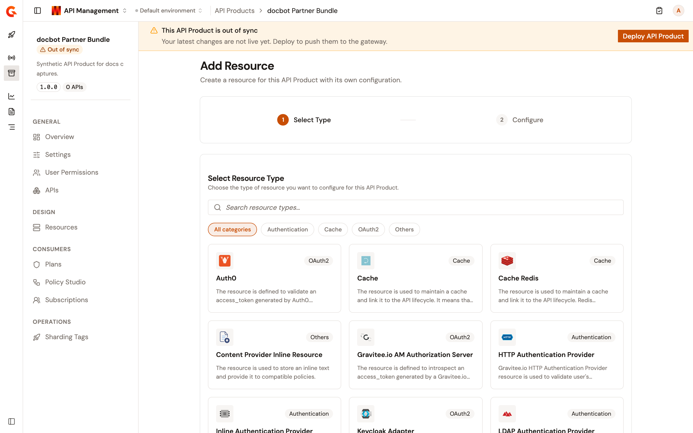
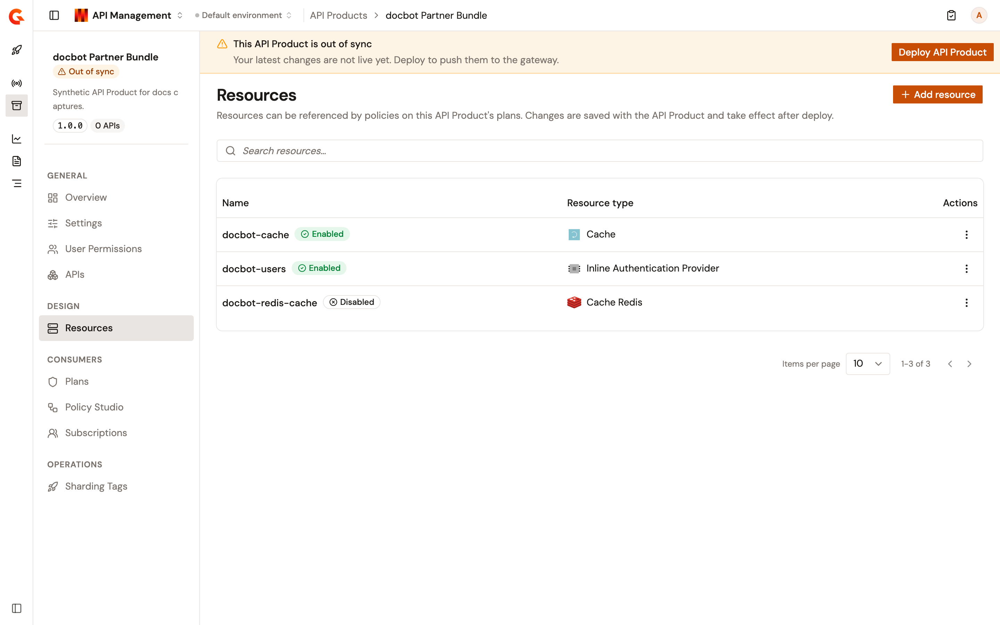
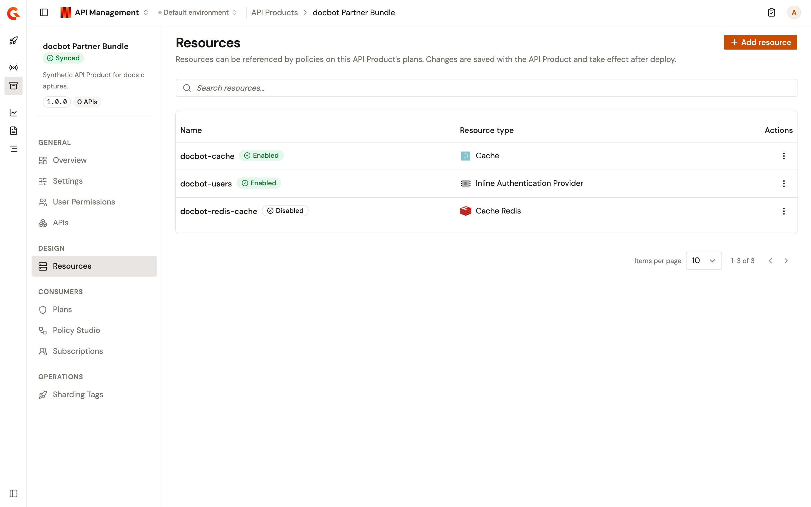

# Configure API Product resources

The **Resources** page of an API Product holds the resources that the policies of the product use, such as caches, OAuth2 providers, and authentication providers. A policy that you add in the **Policy Studio** of the API Product reaches a resource through its name.

The resources of an API Product are separate from the resources of its APIs. A policy in the **Policy Studio** of the API Product uses the product's resources on every API in the product, and the policies of each API keep using that API's resources.

## Open the Resources page

To open the page, follow these steps:

1. Click **API Products** in the module sidebar.
2. Select your API Product.
3. Click **Resources** in the API Product sidebar.

Until the product has a resource, the page shows **No resources yet**. Once resources exist, the page lists each resource's **Name**, with an **Enabled** or **Disabled** badge, and its **Resource type**. A search field filters the list.

The **Resources** item shows when you can view the API Product's definition. If you can view it but can't update it, the page lists the resources without **Add resource** or the actions menu.

## Add a resource

To add a resource, follow these steps:

1. Click **Add resource**.
2. Under **Select Resource Type**, select a resource type. The list holds the installed resource types that an API Product supports:

    * **Cache** and **Cache Redis**
    * **OAuth2 / OpenID Connect Provider**, **Gravitee.io AM Authorization Server**, **Auth0**, **Microsoft Entra ID**, and **Keycloak Adapter**
    * **HTTP Authentication Provider**, **Inline Authentication Provider**, and **LDAP Authentication Provider**
    * **Content Provider Inline Resource**

    <figure><figcaption>
The resource types that an API Product supports
</figcaption></figure>
3. Click **Next**.
4. Enter a **Resource name**. Policies use this name to reach the resource, so keep it once a policy uses it. Two resources of the same API Product can't share a name.
5. Complete the **Configuration** form. The fields depend on the selected resource type.
6. Click **Create resource**.

The new resource is enabled.

## Manage existing resources

The actions menu of each resource row offers the following actions:

* **Edit**. Opens **Edit Resource**, where you change the **Resource name** and the **Configuration**. Click **Save changes** to save them.
* **Disable** or **Enable**. A disabled resource doesn't run, so a policy that uses it behaves as if the resource didn't exist.
* **Remove**. Opens the **Remove resource** dialog, which warns that the policies that reference the resource fail until they're updated. Click **Remove** to confirm.

## Deploy the changes

Changes to the resources of an API Product take effect after you deploy the product. After a change, the API Product shows **This API Product is out of sync**.

To deploy the API Product, follow these steps:

1. Click **Deploy API Product**.

    <figure><figcaption>
An API Product with resource changes to deploy
</figcaption></figure>
2. In the **Deploy your API Product** dialog, click **Deploy**.

## Verification

To verify the API Product is deployed with its resources, follow these steps:

1. Open the **Resources** page of the API Product.
2. Confirm that each resource the policies of the product use shows the **Enabled** badge.
3. Confirm that the API Product shows **Synced** under its name. When it shows **Out of sync**, deploy the API Product.

<figure><figcaption>
The Resources page of a deployed API Product
</figcaption></figure>

## Next steps

* [Manage API Products with the Management API](manage-api-products-with-the-management-api.md#add-resources-to-the-product). Save the resources of an API Product through the Management API.
* [Configure API resources](../configure-your-api-proxy/configure-api-resources.md). Add resources to an API proxy.
