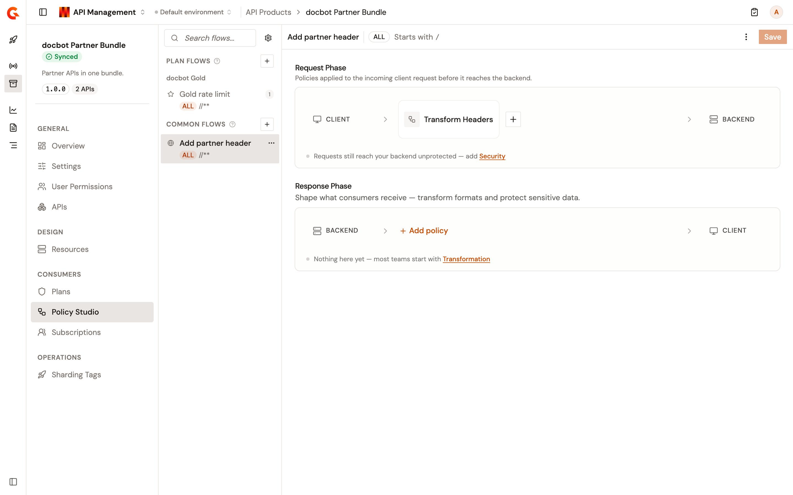

# Design API Product flows

The Policy Studio of an API Product holds flows that run on every API of the product. A flow selects part of the traffic, by path, HTTP method, or condition, and applies policies to it in the **Request Phase** and the **Response Phase**. Use it to apply a policy once for the whole product instead of repeating it on each API.

API Product flows run only on the requests that come through one of the product's plans. A request that uses one of the API's own plans runs none of them.

## How API Product flows run

On a request that comes through one of the product's plans, the Gateway runs the flows in the following order, in the request phase and again in the response phase:

1. The flows of the product's plan.
2. The product's common flows.
3. The API's common flows.

The flows of the API's own plans don't run, because the request comes through the product's plan. When an API belongs to more than one API Product, only the flows of the product whose plan the request comes through run.

A policy in an API Product flow that uses a resource, such as a cache, finds it among the resources of the API Product, not those of the API.

By default, a rate limit or quota policy in an API Product flow counts the requests of a subscription to every API of the product together. For example, a limit of 100 requests a minute on a product of three APIs lets a subscription make 100 requests a minute in total, not 100 to each API.

The path of an API Product flow is matched against the request path of each API, after the API's context path. A path parameter in the flow's path, such as `:id` in `/orders/:id`, is available to the flow's policies on every API, even when the API's own flows don't declare it. When the API declares a parameter with the same name, the API's value is used.

## Open the Policy Studio

1. From the Gamma console sidebar, select **API Management**.
2. From the module navigation, select **API Products**.
3. Click the name of the API Product.
4. In the **Consumers** group of the API Product sidebar, click **Policy Studio**.

<figure><figcaption>
The Policy Studio of an API Product
</figcaption></figure>

Without permission to read the API Product's definition, the sidebar has no **Policy Studio** item, and opening the page by its URL shows **You do not have permission to view the Policy Studio of this API Product.**

## Choose where a flow applies

The flows list on the left has two sections:

* **Plan Flows**. The flows attached to one of the product's plans, listed under the name of their plan. A plan flow applies to the requests that come through that plan only. A plan appears here once it holds a flow.
* **Common Flows**. The product's own flows, which apply to the requests that come through any of the product's plans.

Only the published and deprecated plans of the API Product take flows here, so **Plan Flows** accepts new flows only once the product has one. Closed plans and plans that aren't published yet don't appear, so their flows can't be changed here. Plan flows appear only for users who can see the product's plans.

## Add a flow

1. Click the add icon next to **Plan Flows** or **Common Flows**. While no plan holds a flow, **Add plan flow** under **Plan Flows** opens the same panel.
2. Complete the fields of the **Create a new plan flow** or **Create a new common flow** panel:

<table>
    <thead>
        <tr>
            <th width="170">Field</th>
            <th>Description</th>
        </tr>
    </thead>
    <tbody>
        <tr>
            <td><strong>Flow name</strong></td>
            <td>Optional. Left blank, the name is built from the path and the methods.</td>
        </tr>
        <tr>
            <td><strong>Associated plan</strong></td>
            <td>Plan flows only. The plan whose requests the flow applies to.</td>
        </tr>
        <tr>
            <td><strong>Operator</strong></td>
            <td>How the path is matched: <strong>Equals</strong> or <strong>Starts With</strong>.</td>
        </tr>
        <tr>
            <td><strong>Path</strong></td>
            <td>The path that the flow applies to, relative to the context path of each API. A leading <code>/</code> is added on save.</td>
        </tr>
        <tr>
            <td><strong>HTTP methods</strong></td>
            <td>Optional. The methods that the flow applies to. Left empty, the flow matches every method.</td>
        </tr>
        <tr>
            <td><strong>Condition</strong></td>
            <td>Optional. A condition, in Gravitee Expression Language, that decides whether the flow runs.</td>
        </tr>
    </tbody>
</table>

3. Click **Create**.

To change a flow later, select it, open its actions menu, and click `Edit flow...`. The same menu turns the flow off with **Disable flow** and removes it with **Delete flow**.

## Add policies to the phases

1. Select the flow in the flows list.
2. On the **Request Phase** or the **Response Phase**, click **Add policy**. When the phase already holds a policy, click its add icon instead.
3. In the **Add Policy** panel, search for the policy, then select it.
4. Complete the policy's configuration.

The **Add Policy** panel lists the policies that support the phase for HTTP proxy APIs. It also lists the shared policy groups of the environment that were built for HTTP proxy APIs and for that phase, under **Shared Policy Group**.

## Set the flow execution mode

The flow execution settings decide how the Gateway picks the product's flows to run. They apply to all the flows of the API Product, its plan flows included, and each API keeps its own settings for its own flows.

1. Click the **Flow execution settings** icon next to the flows search box.
2. In **Mode**, select **Default** or **Best match**.
3. Optional: Turn on **Match required** to respond with an error when no flow matches.

With **Match required** on, a request that comes through one of the product's plans and matches neither a plan flow nor a common flow of the product gets a `404` response, before the API's own flows run. A common flow of the product that matches a request also counts as a match for the API's own **Match required** setting.

An API Product that never saved these settings uses **Default**, with **Match required** off.

## Save the flows

1. Click **Save**.

Saving writes the flows to the API Product but doesn't deploy them. The API Product then shows **Out of sync**, and the Gateway applies the new flows at the next deployment. See [Deploy an API Product](configure-product-deployment.md#deploy-an-api-product).

If the save fails, the **Save** button turns red, and its tooltip starts with **Save failed:** followed by the reason.

When one save changes plan flows and also the product's common flows or flow execution settings, the common flows and settings are saved first. If the plan flows then fail to save, a notification says **The API Product flows were saved, but the plan flows were not:** followed by the reason. The Policy Studio then reloads the saved flows. Make the plan flow changes again, then click **Save**.

When you can change the product's plans but not the product itself, or the reverse, a message at the top of the Policy Studio says which flows you can edit. A save that changes the other flows is refused. Without permission to change either, the Policy Studio is read-only.

## Verification

To verify that the flows are in place, follow these steps:

1. Reload the **Policy Studio** page, and check that your flows and their policies are listed.
2. Deploy the API Product, and check that the header of the API Product sidebar shows **Synced**.
3. Send a request to one of the product's APIs through a subscription to one of the product's plans, and check that the response shows the effect of the product's policies.

## Next steps

* [Configure product deployment](configure-product-deployment.md). Deploy the API Product and choose which Gateways load it.
* [Control how policy flows are matched to requests](../configure-your-api-proxy/configure-flow-execution.md). Set the flow execution mode of an API proxy.
* [Reuse policies with shared policy groups](../shared-policy-groups.md). Configure a set of policies once and reuse it across flows.
