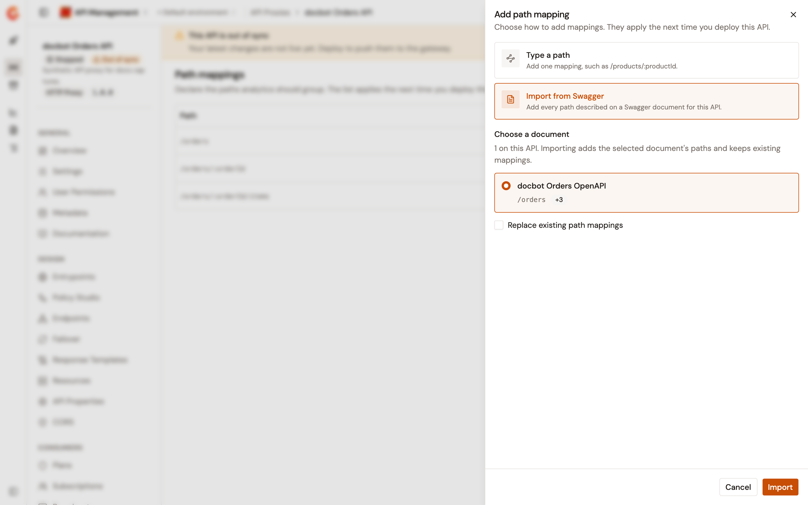
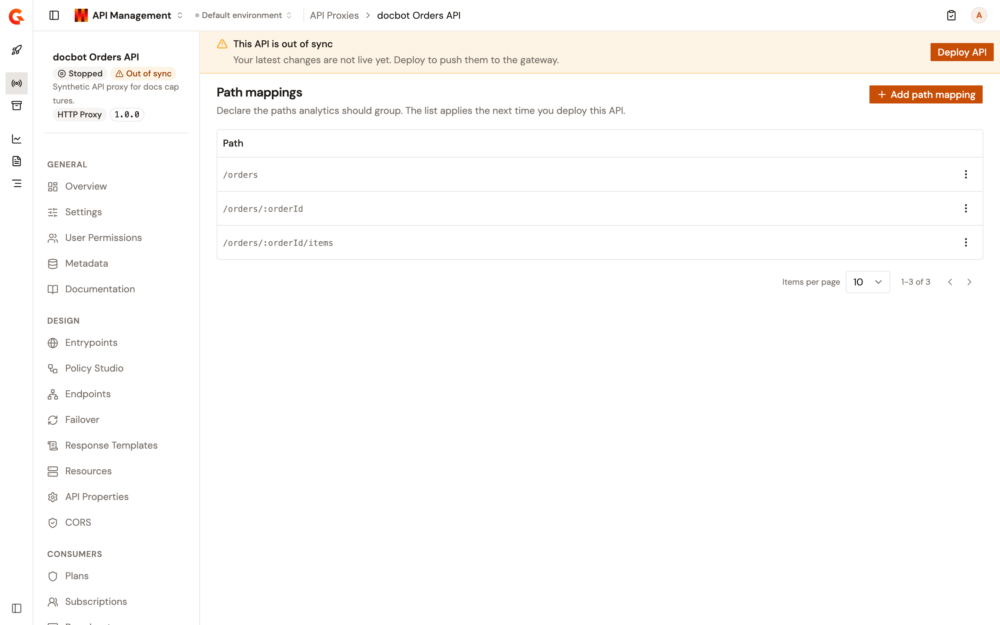

# Configure path mappings

Path mappings group the analytics of an API proxy by path. A path mapping such as `/orders/:orderId` groups every request that matches it, such as `/orders/42`, instead of listing each URL. A segment that starts with `:` matches any value in that segment.

The list applies the next time you deploy the API proxy. The **Path Mappings** item shows for an API proxy with an HTTP listener, and not for a TCP proxy.

## Open the Path mappings page

To open the page, follow these steps:

1. Click **API Proxies** in the module sidebar.
2. Select your API proxy.
3. Click **Path Mappings** in the **Monitoring** group of the API proxy sidebar.

The page lists each path mapping under **Path**. Until the API proxy has a path mapping, the page shows a **Why add a path mapping?** card with an **Add path mapping** button.

The page is read-only when the API proxy is managed by the Gravitee Kubernetes Operator, or when you can't update the API proxy.

## Add a path mapping

To add a path mapping, follow these steps:

1. Click **Add path mapping**.
2. Select **Type a path**.
3. In **Path mapping**, enter a path, such as `/orders/:orderId`.
4. Click **Add**.

A path mapping starts with `/` and holds only letters, digits, and the characters `:`, `/`, `.`, `_`, and `-`. Two path mappings of an API proxy can't be the same.

## Import path mappings from an OpenAPI page

**Import from Swagger** adds the paths of an OpenAPI page of the API proxy's documentation in the next-gen Developer Portal. To add one, see [Manage API documentation](manage-api-documentation.md). Unpublished pages are listed when you can manage the API proxy's documentation.

To import path mappings, follow these steps:

1. Click **Add path mapping**.
2. Select **Import from Swagger**.
3. Under **Choose a document**, select a page. The page's first path shows under its name, with the number of other paths.

    <figure><figcaption>
Import path mappings from an OpenAPI page
</figcaption></figure>
4. Optional: Select **Replace existing path mappings** to replace the list with the page's paths. Otherwise, the import adds the page's paths and keeps the existing path mappings.
5. Click **Import**.

The import writes each path parameter, such as `{orderId}`, as `:orderId`, adds each path once, and skips a path that isn't a valid path mapping.

## Edit or delete a path mapping

To edit a path mapping, follow these steps:

1. In the row of the path mapping, click the actions menu, then click **Edit**.
2. Change the **Path mapping**.
3. Click **Save**.

To delete a path mapping, follow these steps:

1. In the row of the path mapping, click the actions menu, then click **Delete**.
2. In the **Delete path mapping** dialog, click **Delete**.

## Deploy the changes

A change to the path mappings takes effect after you deploy the API proxy. After a change, the API proxy shows **This API is out of sync**. To deploy it, click **Deploy API**.

## Verification

To verify the path mappings are in place, follow these steps:

1. Open the **Path mappings** page of the API proxy.
2. Confirm that each path mapping shows under **Path**.

    <figure><figcaption>
The Path mappings page of an API proxy
</figcaption></figure>
3. When the page shows **This API is out of sync**, click **Deploy API**.

## Next steps

* [Import an API proxy](../import-an-api-proxy.md#import-options). Create the path mappings of an API proxy from an OpenAPI specification when you import it.
* [Manage API documentation](manage-api-documentation.md). Add the OpenAPI pages that **Import from Swagger** lists.
