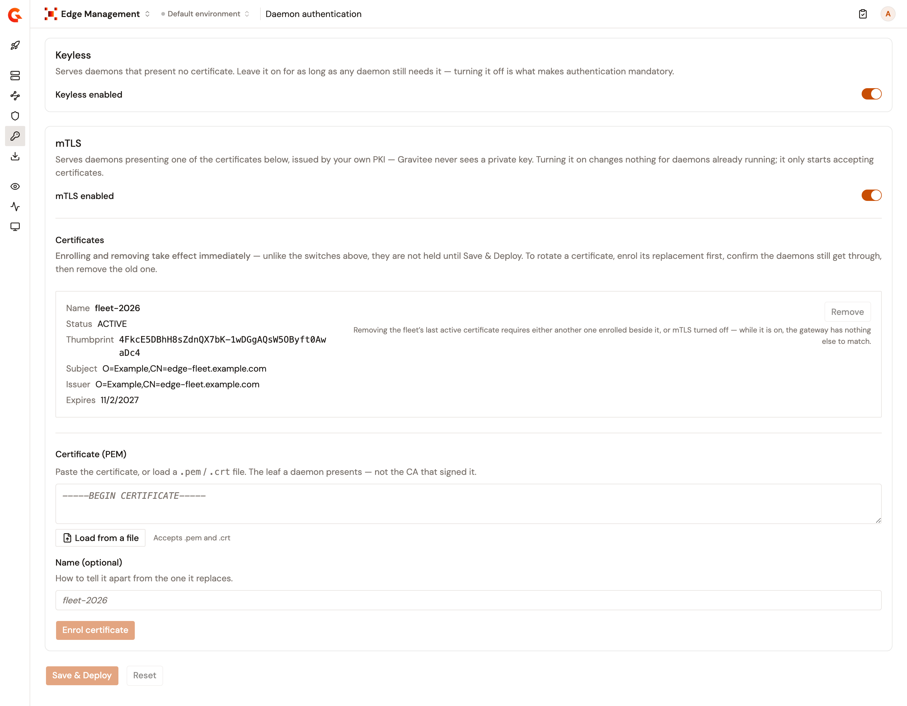

# Configure daemon authentication

## Overview

The **Daemon authentication** page decides how the Edge Daemons of an environment identify themselves to the Edge Reactor. A daemon calls the Edge Reactor to fetch its configuration, send its heartbeat, and report its metrics and its shadow AI detections. Two authentication methods answer these calls, each with its own switch:

* **Keyless** serves daemons that present no certificate, and every daemon while mTLS is off. It's on by default.
* **mTLS** serves daemons that present one of the active certificates enrolled on the page. It's off by default.

Both methods can be on at the same time, and at least one always stays on. The certificates come from your own PKI, and Gravitee never sees a private key. Turning keyless off is what makes authentication mandatory.

Daemon authentication covers the calls that a daemon makes to the Edge Reactor. The traffic that a daemon intercepts goes to the target API of its route, which applies its own plans. See [Secure a route with an OAuth2 plan](configure-edge-management.md#secure-a-route-with-an-oauth2-plan).

<figure><figcaption>
The Daemon authentication page.
</figcaption></figure>

## Before you start

* A configuration exists for the environment. See [Set up Edge Management](set-up-edge-management.md).
* Permission to edit the Edge configuration of the environment. Without it, the page is read-only.
* A leaf certificate for your fleet, issued by your PKI, in PEM format. Enrol the certificate that the daemons present, not the certificate authority that signed it.
* The certificates of the daemons reach the Edge Reactor. By default, the Edge Reactor listener asks for none, so mTLS authenticates no daemon. See [Secure the Edge Reactor listener](secure-the-edge-reactor-listener.md).

To configure daemon authentication, complete the following steps:

1. [Enrol a certificate](#enrol-a-certificate)
2. [Turn on mTLS](#turn-on-mtls)
3. [Turn off keyless](#turn-off-keyless)

## Enrol a certificate

1. Open **Edge Management**.
2. Click **Daemon authentication**.
3. In the **mTLS** card, paste the certificate in **Certificate (PEM)**, or click **Load from a file** and select a `.pem` or `.crt` file.
4. Optional: In **Name (optional)**, enter a name that tells the certificate apart from the one it replaces.
5. Click **Enrol certificate**.

Enrolling a certificate takes effect immediately. Unlike the switches, it isn't held until **Save & Deploy**.

A certificate authority, a file that holds no PEM certificate, and a certificate already enrolled in the environment are refused. When the PEM holds several certificates, only the first one is enrolled, so put the certificate that the daemons present first.

Each enrolled certificate is listed under **Certificates**, and its **Status** says whether the certificate is valid today:

* `ACTIVE`: The certificate is valid today.
* `ACTIVE_WITH_END`: The certificate is valid today and has an end date. The enrol form sets no end date, so this status only shows for a certificate enrolled with one through the Management API.
* `SCHEDULED`: The validity of the certificate starts on a later date. It becomes active on its own on that date.
* `ENDED`: The validity of the certificate is over. It stays in the list until you remove it.

While no enrolled certificate is active, mTLS accepts no daemon, and keyless can't be turned off.

## Turn on mTLS

1. In the **mTLS** card, turn on **mTLS enabled**.
2. Click **Save & Deploy**.

The switches are held until **Save & Deploy**, which deploys the Edge API of the environment again. **Reset** discards them. While no enrolled certificate is active, you can't save **mTLS enabled** turned on: **Save & Deploy** stays unavailable, and the hint next to it says why.

Turning on mTLS changes nothing for the daemons that present no certificate while keyless is on. From then on, a daemon that presents a certificate is served only when that certificate is enrolled on the page and active.

The daemons present the certificate from your PKI, and Gravitee never sees its private key. Getting the certificate and its key onto your devices happens outside Gravitee, for example with your MDM.

Install each daemon with the following flags of its installation script:

* `--client-cert`: The certificate that the daemon presents, the one you enrolled.
* `--client-key`: The private key of that certificate.
* `--reactor-ca`: The certificate authority that signed the certificate of the Edge Reactor listener, so that the daemon trusts the listener. Pass it only when a private certificate authority signs that certificate. For a self-signed certificate, pass the certificate itself.

Once mTLS is on, the Kandji script of the **Daemon deployment** page passes `--client-cert` and `--client-key`, with `--reactor-ca` commented out on its last line. See [Configure Kandji to deploy the Edge Daemon](configure-kandji-daemon.md#create-the-kandji-custom-app).

## Turn off keyless

Turning keyless off refuses every daemon that presents no certificate. Leave it on for as long as any daemon still needs it.

1. In the **Keyless** card, turn off **Keyless enabled**.
2. Click **Save & Deploy**.

The switch stays unavailable until **mTLS enabled** is turned on and an enrolled certificate is active, and its hint names what's missing. You can turn on mTLS and turn off keyless in the same save.

At least one method always stays on. While keyless is off, **mTLS enabled** can't be turned off.

To serve daemons without a certificate again, turn **Keyless enabled** back on, and click **Save & Deploy**.

## Rotate a certificate

To rotate a certificate, enrol its replacement first, and remove the old one once the daemons get through with the new one:

1. Enrol the new certificate. See [Enrol a certificate](#enrol-a-certificate).
2. Check that your daemons still get through with the new certificate.
3. Click **Remove** on the old certificate.

Removing a certificate takes effect immediately. While mTLS is on, the last active certificate can't be removed. Enrol its replacement first, or turn off mTLS.

If every enrolled certificate ends while mTLS is on, mTLS accepts no daemon until a certificate is active again. Enrol the replacement before the **Expires** date of the last active certificate.

## Environments configured before daemon authentication

An environment configured before daemon authentication existed opens the page with keyless on, mTLS off, and no certificate. Until its Edge API is deployed again from Edge Management, the Edge Reactor refuses every call from its daemons. Any change that you save in Edge Management for the environment deploys it, for example enrolling a certificate. The redeployed Edge API has keyless on, as by default.

## Verification

To verify that daemon authentication is working as expected, follow these steps:

1. Open **Edge Management**.
2. Click **Daemon authentication**.
3. Under **Certificates**, check that the **Status** of your certificate reads `ACTIVE` or `ACTIVE_WITH_END`.
4. Click **Devices**, and check that your devices report as **Active**.

## Next steps

* **Secure the listener.** See [Secure the Edge Reactor listener](secure-the-edge-reactor-listener.md).
* **Identify the developers behind intercepted traffic.** See [Secure a route with an OAuth2 plan](configure-edge-management.md#secure-a-route-with-an-oauth2-plan).
