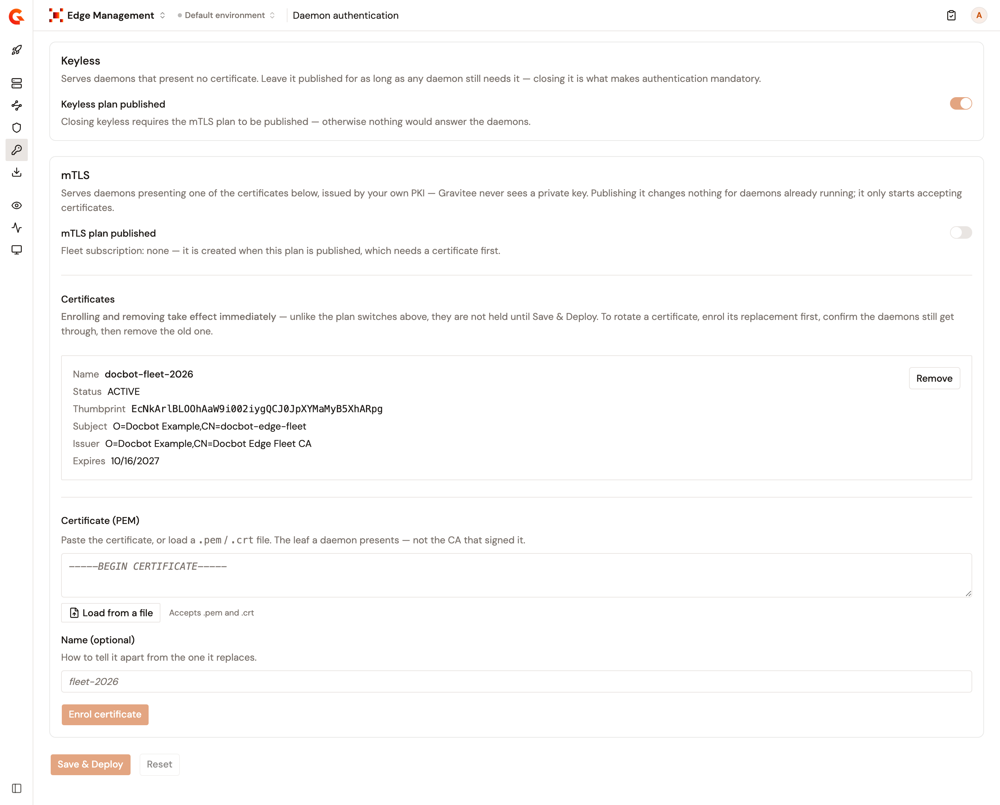
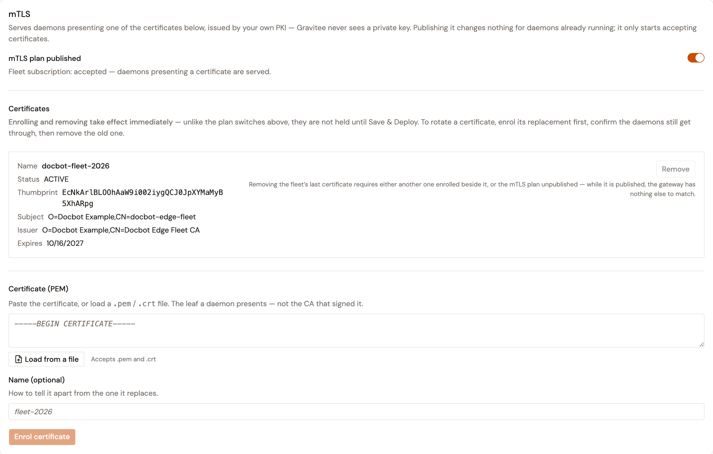

# Configure daemon authentication

## Overview

The **Daemon authentication** page decides how the Edge Daemons of an environment identify themselves to the Edge Reactor. A daemon calls the Edge Reactor to fetch its configuration, send its heartbeat, and report its metrics and its shadow AI detections. Two plans answer these calls:

* **Keyless** serves daemons that present no certificate. It's published when the configuration is created.
* **mTLS** serves daemons that present one of the certificates enrolled on the page. It's created unpublished.

The certificates come from your own PKI, and Gravitee never sees a private key. Closing the keyless plan is what makes authentication mandatory.

Daemon authentication covers the calls that a daemon makes to the Edge Reactor. The traffic that a daemon intercepts goes to the target API of its route, which applies its own plans. See [Secure a route with an OAuth2 plan](configure-edge-management.md#secure-a-route-with-an-oauth2-plan).

<figure><figcaption>
The Daemon authentication page.
</figcaption></figure>

## Before you start

* A configuration exists for the environment. See [Set up Edge Management](set-up-edge-management.md).
* Permission to edit the Edge configuration of the environment. Without it, the page is read-only.
* A leaf certificate for your fleet, issued by your PKI, in PEM format. Enrol the certificate that the daemons present, not the certificate authority that signed it.
* The certificates of the daemons reach the Edge Reactor. By default, the Edge Reactor listener asks for none, and the mTLS plan matches no daemon. See [Secure the Edge Reactor listener](secure-the-edge-reactor-listener.md).

To configure daemon authentication, complete the following steps:

1. [Enrol a certificate](#enrol-a-certificate)
2. [Publish the mTLS plan](#publish-the-mtls-plan)
3. [Close the keyless plan](#close-the-keyless-plan)

## Enrol a certificate

1. Open **Edge Management**.
2. Click **Daemon authentication**.
3. In the **mTLS** card, paste the certificate in **Certificate (PEM)**, or click **Load from a file** and select a `.pem` or `.crt` file.
4. Optional: In **Name (optional)**, enter a name that tells the certificate apart from the one it replaces.
5. Click **Enrol certificate**.

Enrolling a certificate takes effect immediately. Unlike the plan switches, it isn't held until **Save & Deploy**.

A certificate whose validity starts on a later date is enrolled, but the mTLS plan matches it only from that date. While no enrolled certificate is active, the keyless plan can't be closed.

A certificate that's already enrolled on an application of the environment, the daemon fleet's included, is refused.

## Publish the mTLS plan

1. In the **mTLS** card, turn on **mTLS plan published**.
2. Click **Save & Deploy**.

The plan switches are held until **Save & Deploy**, which deploys the Edge API of the environment again. **Reset** discards them. While no enrolled certificate is active, **Save & Deploy** stays unavailable with the mTLS plan turned on.

Publishing the plan subscribes the daemon fleet to it, and **Fleet subscription** then reads **accepted**. It changes nothing for the daemons already running. It only starts accepting certificates.

The daemons present the certificate from your PKI, and Gravitee never sees its private key. Getting the certificate and its key onto your devices happens outside Gravitee, for example with your MDM.

## Close the keyless plan

Closing the keyless plan refuses every daemon that presents no certificate. Leave it published for as long as any daemon still needs it.

1. In the **Keyless** card, turn off **Keyless plan published**.
2. Click **Save & Deploy**.

The switch stays unavailable until the following conditions are met, and its hint names the one that's missing:

* The mTLS plan is published.
* A certificate is active.
* The fleet subscription to the mTLS plan is accepted.

The fleet subscription only exists once the mTLS plan is published, so publish the mTLS plan and close the keyless plan in two separate saves.

One plan always stays published. While the keyless plan is closed, **mTLS plan published** can't be turned off.

To serve daemons without a certificate again, turn **Keyless plan published** back on, and click **Save & Deploy**.

## Rotate a certificate

To rotate a certificate, enrol its replacement first, and remove the old one once the daemons get through with the new one:

1. Enrol the new certificate. See [Enrol a certificate](#enrol-a-certificate).
2. Check that your daemons still get through with the new certificate.
3. Click **Remove** on the old certificate.

Removing a certificate takes effect immediately. While the mTLS plan is published, the last active certificate can't be removed. Enrol its replacement first, or unpublish the mTLS plan.

## Environments configured before daemon authentication

An environment whose configuration predates daemon authentication has no fleet application, so the page has nowhere to enrol a certificate and says so. The next **Save & Deploy** from any configuration page of Edge Management creates the fleet application, along with the **Keyless** and **mTLS** plans if either is missing. Publishing the mTLS plan isn't the way in, because it can't be saved without a certificate.

## Verification

To verify that daemon authentication is working as expected, follow these steps:

1. Open **Edge Management**.
2. Click **Daemon authentication**.
3. In the **mTLS** card, check that **Fleet subscription** reads **accepted**.
4. Click **Devices**, and check that your devices report as **Active**.

<figure><figcaption>
The mTLS card with an accepted fleet subscription.
</figcaption></figure>

## Next steps

* **Secure the listener.** See [Secure the Edge Reactor listener](secure-the-edge-reactor-listener.md).
* **Identify the developers behind intercepted traffic.** See [Secure a route with an OAuth2 plan](configure-edge-management.md#secure-a-route-with-an-oauth2-plan).
