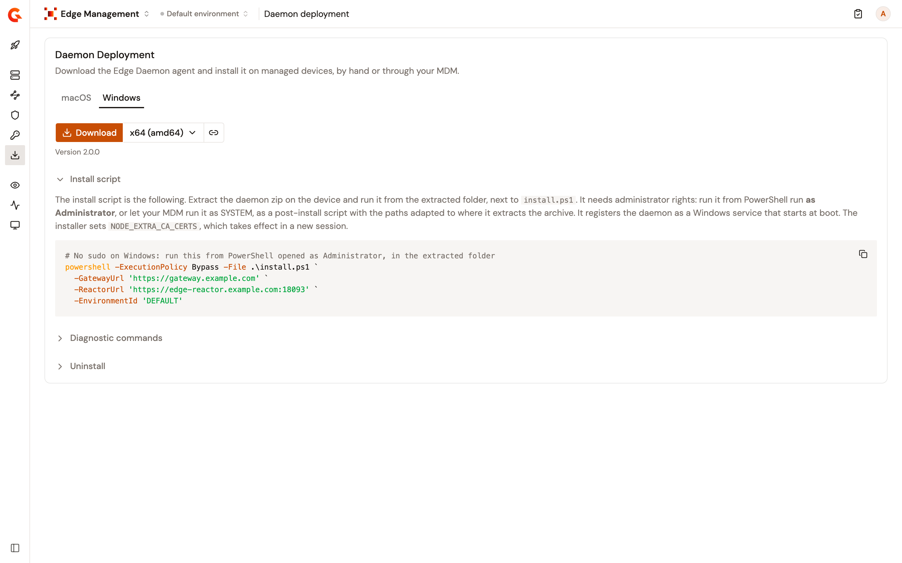

# Install the Edge Daemon on Windows

Install the Edge Daemon on the Windows devices of your fleet, by hand or through your MDM. The **Windows** tab of the **Daemon deployment** page generates the download link of the daemon and its install command for you, with the gateway addresses and the ID of the environment filled in.

For an overview of the Edge Daemon, see the [Edge Management overview](../get-started/edge-management-overview.md). To create the configuration of the environment first, see [Set up Edge Management](set-up-edge-management.md). For macOS devices, see [Configure Iru to deploy the Edge Daemon](configure-kandji-daemon.md).

## Prerequisites

Ensure the following are in place before continuing:

* Access to a running Gamma console with Edge Management enabled.
* An Edge Management configuration already created for the environment. See [Set up Edge Management](set-up-edge-management.md).
* Devices that run Windows, on x64 or Arm.
* Administrator rights on the devices, or an MDM that runs a post-install script as SYSTEM.
* The gateway-side endpoints reachable from your devices. See [Gateway-side requirements](../get-started/edge-management-overview.md#gateway-side-requirements).

To install the Edge Daemon on Windows, complete the following steps:

1. [Open the Daemon deployment page](#open-the-daemon-deployment-page)
2. [Download the daemon](#download-the-daemon)
3. [Run the install command](#run-the-install-command)
4. [Verify the installation](#verification)

## Open the Daemon deployment page

1. In the Gamma console, open **Edge Management**.
2. Click **Daemon deployment**.
3. Click the **Windows** tab.

<figure><figcaption><p>The Windows tab generates the download link and the install command.</p></figcaption></figure>

## Download the daemon

1. In the menu next to **Download**, select the architecture that matches your devices: **x64 (amd64)** or **Arm (arm64)**.
2. Click **Download** to fetch the daemon package, or click the link button next to the menu to copy its URL. The version of the daemon shows under the button.

Here is an example of the link for x64:

```text
https://download.gravitee.io/graviteeio-ai/gravitee-gamma-edge-daemon/gravitee-gamma-edge-daemon-2.0.0-windows-amd64.zip
```

## Run the install command

Under **Install script**, the page generates the install command with the Gateway URL, the Reactor URL, and the ID of the environment filled in. Once mTLS is on, on the **Daemon authentication** page, the command also passes the certificate of your fleet and its private key, as files next to `install.ps1`. The command runs from the folder where the daemon package is extracted, and looks like the following example:

```powershell
# No sudo on Windows: run this from PowerShell opened as Administrator, in the extracted folder
powershell -ExecutionPolicy Bypass -File .\install.ps1 `
  -GatewayUrl 'https://gateway.example.com' `
  -ReactorUrl 'https://edge-reactor.example.com:18093' `
  -EnvironmentId 'DEFAULT' `
  -ClientCert '.\client.crt' `
  -ClientKey '.\client.key' `
  # -ReactorCa '.\reactor-ca.crt'   # only if the reactor certificate is signed by a private CA
```

To install the daemon by hand, complete the following steps on each device:

1. Extract the daemon package.
2. If mTLS is on, put the certificate of your fleet and its private key in the extracted folder, next to `install.ps1`, as `client.crt` and `client.key`. If the Edge Reactor uses a private certificate authority, add that certificate as `reactor-ca.crt` too, and uncomment the last line of the command. See [Configure daemon authentication](configure-daemon-authentication.md#turn-on-mtls).
3. Open PowerShell as Administrator, and go to the extracted folder.
4. Run the command that you copied from the page.

To install the daemon through your MDM, have it run the command as SYSTEM, as a post-install script, with the paths adapted to where it extracts the package.

The installer registers the daemon as a Windows service that starts at boot. If the daemon is already installed on the device, the installer keeps its existing configuration. To apply new gateway addresses, another environment, or mTLS to an installed daemon, remove it with the uninstall command, then install it again.


**Tell your users to open a new terminal, or to sign in again.** The installer sets `NODE_EXTRA_CA_CERTS` for every account of the device. After an install from PowerShell, Claude Code started from a new terminal picks it up. After an install that your MDM runs as SYSTEM, your users get it at their next sign-in.

If the device already sets another `NODE_EXTRA_CA_CERTS` for every account, the installer replaces it, and the uninstall command puts it back.


For example, the page shows one of the following alerts instead of the command:

* **This environment cannot be installed from a script**: the ID of the environment holds a character other than letters, digits, hyphens, and underscores, which the installer doesn't accept.
* **This URL cannot be passed to the Windows installer**: the Gateway URL or the Reactor URL holds a space or a double quote. Correct the address on the **Gateway** page. See [Change the gateway addresses](set-up-edge-management.md#change-the-gateway-addresses).

## Check or remove the daemon

The collapsible **Diagnostic commands** section lists the commands to check that the daemon service runs, to stop and start the service, and to list the DNS rules that the daemon installed. Run them from PowerShell as Administrator. The daemon writes its log to `%ProgramData%\Gravitee\EdgeDaemon\logs\daemon.log`.

The collapsible **Uninstall** section gives the command that removes the daemon from a device. Run it from PowerShell as Administrator, in the extracted daemon folder:

```powershell
powershell -ExecutionPolicy Bypass -File .\install.ps1 -Uninstall
```

## Known limitation

On a device that receives NRPT rules through Group Policy, Windows may ignore the DNS rules that the daemon installs. The intercepted domains are then not redirected to the daemon, and the AI traffic of the device bypasses the gateway. When the daemon finds such rules on the device, its log shows the following line:

```text
Group Policy defines NRPT rules: Windows may ignore the daemon's local rules, and intercepted domains may not be redirected
```

## Verification

To verify the Edge Daemon is working as expected, follow these steps:

1. In the Gamma console, open **Edge Management**.
2. Click **Devices**.
3. Confirm that your devices report as **Active**. See [Monitor your devices](../observe/monitor-devices.md).

## Next steps

* **Connect AI tools.** Check what, if anything, you have to do on a device. See [Connect Claude Code to the Edge Daemon](../connect-claude-code-to-daemon.md).
* **Watch the traffic.** See [Monitor proxied traffic](../observe/monitor-proxied-traffic.md).
